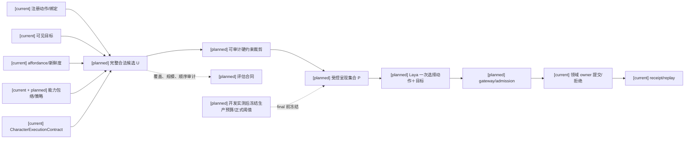
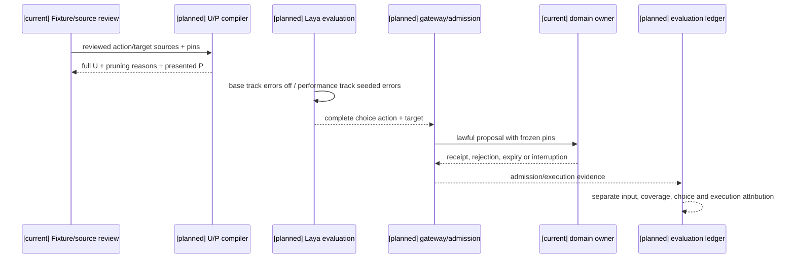
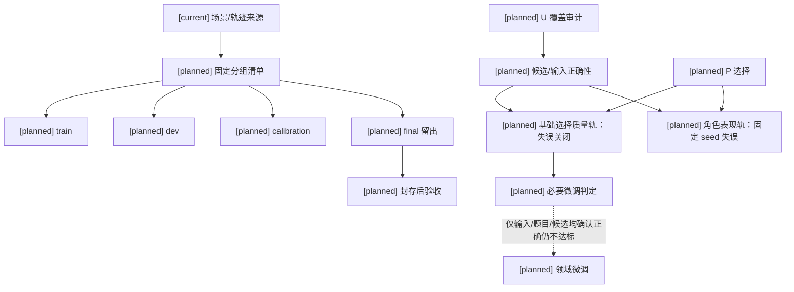

# 第二项实施准入包与静态映射

状态：`analysis/planned/non-authorizing`；登记日期：2026-10-10。

本文件是候选覆盖、选择质量、评估划分与必要微调（第二项）开始计划任务前的静态准入包。它把十月原设计、收敛决策 D03–D05/D09–D10/D13/D16、现有实现和后续验证合同放在同一张可审查的地图上；不创建 runtime `CandidateCompiler`、provider adapter、schema、registry revision API 或新的 owner，也不宣称 Laya 已通过质量门。

## 1. 准入结论与边界

完成本文件后，可以开始：

- 读取现有注册动作、绑定、可见目标、affordance、能力包络和执行合同，建立来源审核清单；
- 准备离线评估 fixture、结构化可接受动作集合和场景/轨迹隔离清单；
- 设计并测试离线 `U/P` 编译合同、覆盖审计和评估分母；
- 复用第一项已收敛的 Laya/provider/gateway/admission 边界，准备后续真实请求入口。

本文件的静态完成不代表以下门已通过；用户已明确允许在执行对应 plan 时逐项取得证据并解锁（2026-10-11），不把这些结果共同作为开工前置：

- 固定生产 checkpoint、候选预算、正式质量/延迟/校准阈值；
- 真实 provider 经 gateway/admission 的完整调用、取消、迟到结果拒绝和执行 receipt；
- 训练或必要微调的资源可行性、收益和最终权重；
- A/B/C 真实场景验收，以及角色表现轨的最终通过。

基础选择质量轨关闭原设计的受控概率性失误；角色表现轨使用固定 seed 另行开启失误并独立归因。慢模型回退不能计入 Laya 基础选择正确率，教师或旧 L3 选择也不自动成为 gold。

## 2. 原设计、收敛决策与现有实现映射

本包直接继承十月原设计中的以下边界：角色13 §5–§9/§12/§22 的能力包络、固定角色夹具和候选上限；角色02 §2–§7 的 Laya 快循环与升级/回退；角色05 §3–§6 的模式和信息需求；角色10 的主动感知与记忆边界；角色11 §3–§7 的动作承诺、中断和回退。对应原文入口：[角色13](../角色/13-角色能力图谱、认知包络与动态算力设计.md)、[角色02](../角色/02-Laya快循环与快慢思考战斗设计.md)、[角色05](../角色/05-玩法思考模式适配与L1信息获取设计.md)、[角色10](../角色/10-主动感知与记忆边界设计.md)、[角色11](../角色/11-跨玩法动作承诺协议设计.md)。原文示例不等于现有 runtime 动作；每个正式候选仍须通过下表所列代码和合同映射。

| 设计要求/证据 | 现有实现事实 | 本准入包的处理 | 未实现或不能推断的部分 |
|---|---|---|---|
| 角色能力图谱与认知包络规格 §4.2.1：候选须来自注册动作、目标、affordance、能力与执行合同 | `backend/app/character_agent/skills/models.py` 有 `ActionDefinition`、`SkillActionBinding`、`SkillAffordanceSummary`、`CompositeActionProposal`；`skills/service.py` 有 `build_affordance_summary`、`evaluate_action` | 逐项登记动作/绑定、目标和必需条件来源；把 `CompositeActionProposal` 当现有提议模型读取 | 这些类型尚未构成统一的完整 `action_id + target_refs` 选择 wire；不能把名称直接当生产合同 |
| 规格 §4.2.1：能力和动态可执行性必须经过 affordance、资源、身体和空间条件 | `backend/app/gameplay/ability_runtime.py` 的 `AbilityAffordanceResolver` 覆盖 grant/restriction/body/resource 与 source revision vector；`backend/app/models/embodied_interaction.py` 有 `SceneAffordanceRecord`；`scene_affordance_registry.py` 检查 entity/scene/binding/catalog/space/occupancy freshness | 将这些来源作为候选生成输入，并保留 freshness、blocked、unknown 诊断 | family available 不等于每个目标可执行；ability runtime 也不覆盖全部角色动作 |
| 规格 §4.2.1：可见目标和 affordance 是题目输入的一部分 | `SceneAffordanceRecord` 提供 anchors、affordances、visibility 等；`mind/affordances.py` 生成四类 summary card | fixture 保存可见证据引用与来源版本；不从不可见目标或隐藏世界真值补候选 | summary card 不能单独证明来源 revision 新鲜，也不能替代 authority |
| 规格 §4.2.2：一次选择完整“动作＋目标”，参数/承诺/停止/回退来自注册合同 | `backend/app/character_agent/models/character_execution.py` 的 `CharacterExecutionContract` 已有 `semantic_intent_id`、`semantic_action_id`、`target_refs`、revision/privacy/authority pins | 评估 gold 使用结构化 `action_id + target_refs` 集合，并把合同引用作为审计字段 | `planning/l3_planner.py` 现有候选主要是字符串；`l4_executor.py` 仍可能从 `attention_target` 或 snapshot 重建目标，不能当作冻结 choice 已完整保留 |
| 规格 §4.2.2：先保留完整全集 U，再形成受控集合 P | `skills/registry.py` 有 skills/actions/bindings 访问，但无统一 `registry_revision` API | 离线 compiler 输入使用实际内容 digest、binding/source pins；U 超过呈现上限时只做覆盖审计，再审计裁剪形成 P | 不能声称 registry 当前内存状态就是 revision；不能提前填 20 项或其他预算 |
| 规格 §4.2.3：输入/候选/选择/执行分开归因 | `gateway/output_validator.py` 校验生成式 `candidate_intents`、`selected_intent`、`recommended_intents`；L3 结果优先使用模型提供的 selected/recommended | 评估记录分别保存输入正确性、候选覆盖、模型选择、准入/执行和 receipt | validator 当前不承载完整 frozen choice；schema 通过不等于选择质量通过 |
| D16：两轨选择评估 | 原设计中已写入受控失误类型与 seed 规则 | fixture 记录 `track`、seed components、错误注入与独立分母 | 表现轨错误不能回写基础选择质量；尚无正式运行轨迹 |

禁止从以上映射推断：`family available = all targets executable`、proposal = authority receipt、字符串候选 = 完整 choice wire contract、registry 内存状态 = revision、Godot 表现 = authority receipt、teacher/旧 L3 = gold、未准入 owner 的 unknown = safe 或 executable。

## 3. 离线评估 fixture 合同

fixture 是离线资料和评估输入，不是生产 wire schema，也不授权写入世界状态。每条题目至少应能追溯以下字段：

| 字段 | 用途 |
|---|---|
| `scenario_id`、`trajectory_group` | 按场景轨迹隔离 train/dev/calibration/final，防止相邻时间片或同一 authority 轨迹泄漏 |
| `profile_revision`、`dossier_revision` | 绑定角色 authored profile/dossier 来源；不创建 Actor、roster 或 active-control |
| `input_revision`、`candidate_source_revision` | 固定题面、来源动作/目标、affordance 和内容 digest |
| `envelope_pin`、`policy_pin` | 记录能力包络和思考策略约束，不能以高预算突破能力上限 |
| `risk_band` | 区分低风险、需确认和高风险题型，供门禁/回退分层 |
| `visible_evidence_refs`、`candidate_sources` | 证明模型仅使用授权可见资料，并能追溯 U 中每个候选的来源 |
| `acceptable_actions`、`prohibited_actions` | 结构化可接受 `action_id + target_refs` 集合及明确禁止项；允许多个合理答案 |
| `review_record` | 记录审核人/来源/理由/版本；没有审核记录的题目不得进入 calibration 或 final |

fixture 可另外保存原始模型响应、选择概率、候选顺序映射、延迟分段和 receipt 引用，但这些都是评估证据，不自动成为 runtime 合同。

## 4. U/P compiler 的静态边界

U 的来源只能是已注册动作/绑定、当前可见目标、当前 affordance、能力/资源/身体/空间条件、能力包络和执行合同。硬约束裁剪必须保留未入选项和理由；不能用本地“唯一最优”评分替模型提前决定合法候选。必需条件 unknown 或 blocked 的候选不得作为可执行项送模，但要留下诊断。

当 U 超过模型呈现上限时，本阶段只做离线覆盖审计并记录“全集未送模”；不分页、不引入第二 planner、不把动作族选择变成新的执行层，也不提高角色能力上限。生产 P 的预算只有在包络内覆盖、顺序敏感性、质量和延迟实测后才可冻结。

## 5. 评估划分、归因与微调触发

- 训练、开发、校准和最终留出按场景轨迹隔离；相邻时间片、候选重排、同一 authority 轨迹不得跨组泄漏。
- 输入错误先归输入/题目缺陷；完整 U 漏掉关键合法策略先归候选缺陷；输入和候选正确仍选错归模型选择；被拒绝、过期、打断或无反馈归准入/执行失败。receipt 与 Godot 可见表现单独统计。
- 正式质量、延迟、校准、候选预算和微调触发阈值在 final 之前冻结；本文件不填猜测数字。
- 只有输入、题目和候选已确认正确，但基础选择质量仍不达标，才进入必要领域微调。微调前先 dry-run 数据转换，再实测本机资源、导出/复载和校准 recipe；final 标签不得用于调参。

## 6. 启动分界

对应规格/计划进入执行后，计划01 Task1A/1B负责真实 gateway/admission、取消和迟到结果证据，Task1C负责开发实测、阈值冻结、按需微调与 final；计划02完整包络接入后回验。允许这些任务在实施/验收阶段解除各自的门；执行任务或勾选复选框本身不解除门。微调仅在输入/题目/候选正确且基础质量仍不达标时触发，final前冻结阈值，final只验收。缺证据只限制对应能力，角色基础与离线合同工作可先推进。本次确认不授权立即开始运行时代码。

| 时点 | 可做/必须产生 | 不能宣称 |
|---|---|---|
| 实施前必须确认 | 来源审核、现有类型映射、fixture 字段、U/P 评分分母、轨迹隔离方法、第一项 gateway/admission 责任边界 | 生产预算、正式阈值、Laya 质量通过 |
| 实施中产生 | 实际 fixture、离线 compiler、覆盖/顺序/延迟实验、候选 policy revision、校准与微调资源证据、真实 admission 请求和 receipt | 用 unit test、配置文件、慢模型回退或单题 warm latency 代替最终质量 |
| 验收时验证 | 封存 checkpoint/policy/input/candidate 下的 final 两轨结果、真实延迟/超时、校准、取消/执行 receipt、A 回验及后续 B/C | 未完成的门不能被“候选生成完成”或 Godot 表现绕过 |

## 7. 依据与后续入口

- [规格05 §4.2.1–4.2.3](../规格/05-角色能力图谱、认知包络与动态算力规格.md#421-现有实现映射与完整受控实验边界)
- [角色心智运行时基础实施计划](../计划/01-角色心智运行时基础实施计划.md)
- [角色能力学习与动作实施计划](../计划/02-角色能力学习与动作实施计划.md)
- [实施待决收敛与验证闸门](03-实施待决收敛与验证闸门.md)
- [设计回写登记](../回写/README.md)，登记号 RW-17

本准入包完成后，第二项可启动的最小阶段是：静态实现映射 → 来源审核 fixture → 离线 U/P compiler 合同与覆盖审计 → 评估隔离测试。真实 Laya 质量、生产 P、必要微调和 final 验收仍是后续实施/验收证据。
