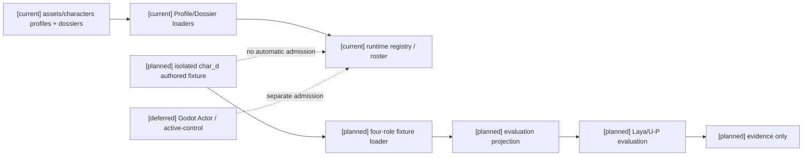
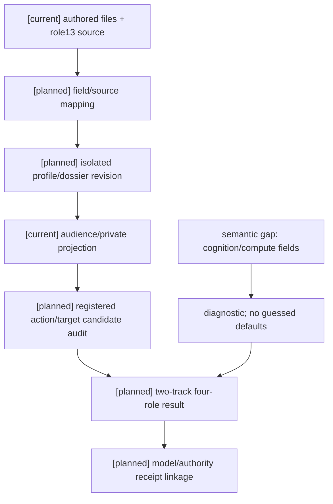

# 第三项：阿博 `char_d` 评估档案与四角色夹具

状态：`analysis/planned/non-authorizing`

本文件是第三项的静态审查与实施准入包。它把角色13 §5、§6、§8、§12、§22、§24.3 的阿博定义映射到当前 `CharacterProfile`/`CharacterDossier`，并规定隔离四角色评估夹具。它不创建运行时角色、不新增 schema、不改变 registry 或 roster。

## 1. 结论与范围

`char_d` 是阿博的 authored profile/dossier 评估输入，不是新增场景人物需求。当前正式资料只有 `assets/characters/profiles/char_a.yaml`、`char_b.yaml`、`char_c.yaml` 和 `assets/characters/dossiers/char_a.yaml`、`char_b.yaml`；不存在正式 `char_d` 文件。`backend/assets` 不是角色资料目录。

`CharacterProfileRegistry.from_directory()` 会加载目录下所有 `*.yaml`，loader 默认指向 `assets/characters/profiles`；`CharacterDossierLoader` 默认指向 `assets/characters/dossiers`，并可将 legacy profile 包装成 dossier。因此评估用 `char_d` 不能直接放入这两个正式目录，否则会被自动发现。首版只在隔离 fixture 根目录保存 authored 资料和来源索引，运行时 registry 不读取它。

边界固定如下：

- 不加入 `backend/assets/population/default_roster.json`，当前 roster 保持 `char_a`、`char_b`、`char_c` 与 resident 条目。
- 不自动创建 Godot Actor、资产包、SkeletonProfile、动作库登记或 backend identity binding。
- 不替换已有 actor，不取得 active-control；任何后续 admission 必须另有 owner、合同和真实证据。
- 不把缺失的认知字段填成产品默认值，不把人格字段当智力分数，不把评估通过写成运行时能力。

## 2. 原设计事实与可用证据

| 原设计事实 | 来源 | 本批可记录的语义 | 证据状态 |
|---|---|---|---|
| 工作记忆、因果推理、元认知较低；固定流程可靠 | 角色13 §12、§22 | 评估约束与可观察预期 | `[planned]`，不是现有 schema 字段 |
| 低开放、高尽责、低外向 | 角色13 §12 | 只有有来源的人格字段可复用 | `[planned]`，数值未授权 |
| 执行清单、停用入口、通知主管；不展开复杂推理 | 角色13 §12、§22 | 结构化可接受动作集合的预期成员 | `[planned]`，必须先映射已注册动作和目标 |
| 默认 `fast`，最高 `balanced`；增加预算不能突破能力上限 | 角色13 §6、§12、§22 | 夹具中的 policy expectation / cap assertion | `[planned]`，当前没有对应 runtime owner |
| 认知字段示例和能力包络示例 | 角色13 §5.1、§5.4 | 仅作字段调查清单 | `[planned]`，示例数值不是阿博正式数值 |

## 3. 逐字段映射

### 3.1 `CharacterProfile`

| 原设计语义 | 当前字段 | 处理 | 缺口/限制 |
|---|---|---|---|
| 身份、机器标识、姓名、职业 | `identity_core.character_id`, `canonical_name`, `aliases`, `occupation_role` | 复用 | 仅填写有来源事实；职业不能从评估动作反推 |
| 出身与当前场景功能 | `origin_seed` | 复用 | 没有原文依据的 homeland/context/function 保持空或缺失，不补人设 |
| 长期记忆骨架 | `life_memory_backbone` | 复用 | 只保存来源明确的 defining/unresolved 内容；评估事件记在 fixture，不写长期记忆 |
| 价值、红线、禁止行为 | `virtue_value_layer` | 复用 | 只作为候选/表达约束；不授予 authority |
| 低开放、高尽责、低外向 | `personality_layer.big_five` 与 facets | 可复用语义，待来源审定 | 原文没有正式数值；不得复制角色13示例或猜填数值 |
| 工作记忆、证据辨识、因果推理、抽象、社会/空间/数理推理、元认知 | 无对应字段 | 登记语义缺口 | 不得塞入 `personality_layer`、`rationality` 或 `capability_constraint_layer` |
| hard limits：上下文、假设、推理跳数、候选数、并发目标、规划跨度、置信度上限 | 无对应字段 | 仅作为隔离 fixture 的 expected cap | 正式 `CapabilityEnvelope`/`CognitionPolicy` 尚未实现；不能写入 runtime profile |
| fast/balanced/deep 与 L2/L3/dialogue 预算 | 无对应字段 | 仅作为评估期 policy assertion | `runtime_defaults` 只有 control mode，不能扩展成 compute owner |
| 技能/知识域/身体/心理/社会约束 | `capability_constraint_layer` | 复用已被来源支持的约束 | `skills` 是字符串列表，不能代替 `CapabilitySeedProfile` 或稳定技能快照 |
| 说话和表达约束 | `style_expression_bias_layer`, `conversation_personality_layer`, `temperament_response_layer` | 复用 | 不能从固定流程预期反推完整人设 |

### 3.2 `CharacterDossier`

| 原设计语义 | 当前字段 | 处理 | 缺口/限制 |
|---|---|---|---|
| dossier/actor/schema/revision 元数据 | `dossier_id`, `actor_id`, `schema_version`, `dossier_metadata.layer_versions` | 必须提供 | revision 需由隔离夹具 manifest 保存；当前 dossier loader 不提供独立评估 registry |
| 身份、角色、社会身份 | `identity_profile` | 复用 | 与嵌套 `CharacterProfile.identity_core.character_id` 一致 |
| 身体、感知、运动、声音 | `embodiment_profile` | 仅填写有来源项 | 不为评估虚构身体能力或资产绑定 |
| 出身、生命史、价值、人格、需要、表达 | 对应 `*_profile: dict[str, object]` + `character_profile` | 仅作原文映射容器 | 这些 dict 不是新 wire contract；具体字段仍须落到已有 profile schema |
| 关系种子 | `relationship_seed_profile` | 仅 candidate-only 评估输入 | projection 已标记 `candidate_only`，不能直接写关系事实 |
| 能力种子、技能、领域、约束 | `capability_seed_profile` | 复用有来源的注册 skill/knowledge | 不把低认知语义伪装成 skill proficiency/confidence |
| 责任、允许/禁止动作、升级对象 | `authority_profile` | 只记录已确认的 authored 约束 | 不创建 owner；动作必须经实际 admission |
| 私有事实 | `private_truth_profile` | 遵守现有 audience projection | 评估输入只能使用角色可见私有投影；未知不是安全结论 |

`CharacterDossier` 的 actor consistency validator 要求顶层 `actor_id`、`identity_profile.actor_id`（如存在）和嵌套 `CharacterProfile.identity_core.character_id` 一致。`dossier_projection.py` 已提供 author/self/player/l2/l3/l4 投影、private truth 过滤、candidate-only 能力/关系种子和 layer source refs，可作为夹具输入边界；它不解决认知字段缺口。

## 4. 最低可评估资料与隔离夹具

本批最低资料不是完整人物传记，而是可以审查、重放和归因的评估输入：

1. `char_d` authored profile/dossier：只填有来源的身份、人格语义、能力约束、表达约束和必要的 authority/privacy 投影；每层带 `source_ref`、revision 和 authoring status。
2. `fixture_manifest`：`fixture_id`、`profile_revision`、`dossier_revision`、原文章节引用、`checkpoint_revision`、`policy_revision`、`scenario_id`、`trajectory_group`、随机 seed 和隔离目录。
3. 每题输入：可见证据、私有投影摘要、动态状态、注册动作/目标引用、候选 revision、能力包络预期和适用条件。
4. 每题真值：结构化可接受集合，至少包含 `action_id + target_refs`、理由、来源和禁止项；允许多个合理动作。教师或旧 L3 选择不自动成为 gold。
5. 阿博限制断言：`preferred_effort=fast`、`maximum_effort=balanced`、固定流程路径和一跳/少候选预期作为待验证断言；不存在时记 diagnostic，不用默认数值补齐。
6. 轨迹分组：训练、开发、校准、最终留出按场景轨迹隔离；同一事件的改写、重排和四角色版本不得跨组泄漏。

建议目录（不创建运行时文件）：

```text
tests/fixtures/character_evaluation/
  char_d_authored/
    profile.yaml                 # planned fixture, not assets/characters/profiles
    dossier.yaml                 # planned fixture, not assets/characters/dossiers
    sources.yaml
  four_role_lock_event/
    manifest.yaml
    acceptable_actions.yaml
    splits.yaml
```

正式实现前，fixture loader 必须显式接收此根目录，不能复用默认 profile/dossier loader 的正式目录扫描；若未来需要代码 loader，先登记责任和测试，不扩展现有 registry API。

## 5. 四角色夹具与评估边界

四角色夹具使用现有 `char_a`、`char_b`、`char_c` 正式资料，加上隔离的 `char_d` authored 输入。同一门锁事件及其可见证据分别投影给四个角色；模型选择、角色上限、表达变化和执行结果分开记录。基础选择质量轨关闭受控失误，角色表现轨再按固定 seed 开启角色失误；两轨均保留能力上限。

阿博预期只表述为可检验约束：固定清单路径、停用入口、通知主管；默认 fast、最高 balanced；提高预算不能产生超过其 authored/fixture 上限的多跳复杂推理。只有当动作、目标、权限和执行合同都能从现有 registry/affordance/L4 映射时，才可进入 live 题；否则保留为 unavailable/diagnostic 或离线审查题。

## 6. 图示



```mermaid
sequenceDiagram
  participant H as Harness
  participant F as Isolated fixture
  participant P as Profile/Dossier projection
  participant L as Laya evaluation
  participant O as Existing action/authority owner
  H->>F: load char_a/b/c + isolated char_d and pinned revisions
  F->>P: build audience/private/candidate-only projection
  P->>L: frozen visible evidence + legal candidate set
  L-->>H: structured action+target choice and diagnostics
  H->>O: only if existing admission contract is mapped
  O-->>H: receipt/rejection; never inferred from model text
```



## 7. 阶段门

| 阶段 | 必须确认/产生 | 缺失时限制 |
|---|---|---|
| 实施前必须确认 | 原文字段来源、现有 schema 映射、隔离根目录、revision/source refs、四角色事件和分组规则 | 不能生成 `char_d` 正式 runtime 文件，不能报告四角色差异 |
| 实施中产生 | authored fixture、字段审核记录、可接受动作集合、候选/包络映射、四角色两轨输入和开发结果 | 只限制四角色评估与生产质量门；不阻断角色基础合同映射 |
| 验收时验证 | 同一事件输入、独立留出、能力上限、fast/balanced cap、结构化选择、真实 authority receipt（若动作已准入） | 不得声称阿博或四角色已接入 runtime；模型文本和动作底座通过不能替代 |

### 7.1 本轮冻结状态（2026-10-12）

四角色评估夹具已落在 `backend/tests/fixtures/character_evaluation/`。`char_a`、`char_b`、`char_c` 继续引用正式来源；`char_d` 仅为隔离 authored profile/dossier/source fixture，loader、default roster、Godot Actor 和 active-control 均明确关闭。manifest 固定 `profile_revision`、`dossier_revision`、`checkpoint_revision`、`policy_revision`、seed 和 train/dev/calibration/final split；acceptable action set 为结构化多动作集合，仍处于 `pending_source_review`，不构成正式质量真值。

每道题必须同时保存 source ref、frozen MindFrame、visible evidence、完整 U、受控 P、acceptable action set、target/visibility、scenario split 和 provider/checkpoint pins。教师答案、旧 L3 输出和慢模型输出不自动提升为真值；基础选择质量轨关闭受控失误，角色表现轨固定 seed 独立记录，且无合法 target 的题目排除动作选择质量分母。当前状态为 evaluation-fixture-only，未冻结正式四角色评估或 runtime capability。

### 7.2 第二阶段剩余验收结果（2026-10-12）

本轮已补齐四角色 source pin 回归，包括隔离 `char_d` 三个 authored 文件；计分回归确保 `legal_target` 非布尔 `true`、slow-model、fallback、timeout 不会制造 Laya 正确率。相关 focused evaluation/fixture tests 为 `14 passed`，CandidateCompiler/L3/L4 及相邻合同测试为 `87 passed`。审计 CLI 正确以 `evaluation_blocked` 退出，不调用 provider，也不读取 final labels。

另行落成隔离评估准备包 `backend/tests/fixtures/character_evaluation/four_role_preparation/`。准备脚本固定 development/calibration 的 8 条 trajectory group，并为 char_a、char_b、char_c 和隔离 char_d 生成 32 条输入；每条包含冻结 MindFrame、公开可见证据、完整 U、CandidateCompiler 独立对照的 P、候选 digest、provider revision 和 target provenance。准备包只生成诊断输入，`runtime_legality=unverified`，不注册 runtime actor，不继承 char_d 的运行时人格数值。合同测试现为 `9 passed`；final/independent holdout 仍保留 sealed，threshold/calibration 仍为 proposal/pending。

最新工作树完整 pytest 已重新运行并通过：`7862 passed, 2 skipped, 106 warnings`。该结果包含准备包修复和新增合同测试；它只确认工程回归 clean，不把 diagnostic preparation 提升为正式质量评估。

正式 calibration、final 和 independent holdout 仍为空；policy、题目、候选、阈值、校准方法以及 frozen MindFrame/U/P/acceptable action/合法 target 未冻结。故本文件不报告四角色差异、校准、延迟质量或微调结论，质量门保持 blocked。

## 8. 关联与非目标

- 原设计：[角色13](../角色/13-角色能力图谱、认知包络与动态算力设计.md) §5、§6、§8、§12、§22、§24.3。
- 收敛规格：[规格05](../规格/05-角色能力图谱、认知包络与动态算力规格.md) §2.1、§4、§7–9。
- 执行计划：[计划01](../计划/01-角色心智运行时基础实施计划.md) Task1C；[计划02](../计划/02-角色能力学习与动作实施计划.md) Task1–3、Task6。
- 已有代码：`backend/app/character_agent/profile/models.py`、`dossier_models.py`、`loader.py`、`dossier_loader.py`、`registry.py`、`dossier_projection.py`；正式资料在 `assets/characters/profiles/` 和 `assets/characters/dossiers/`。
- 本项不调查编辑器/AD、自走棋、完整 Soul owner、B/C 场景或新动作资格链；这些按 D14/D15 和 1–6 各自门禁处理。

### 7.3 正式评估执行结果（2026-10-12）

本轮正式评估入口执行了 fail-closed preflight，但没有进入 development、calibration、final 或 independent holdout。policy/questions/candidates/thresholds/calibration method、acceptable action review、合法 target、char_d schema 和 sealed split 均缺少正式证据；provider 在本轮开始前已停止且端口已释放，不能把既有恢复档案作为本轮启动证据。故不读取 final 标签、不拟合 calibration、不计算选择正确率或四角色差异，也不触发自动微调。char_d 继续不进入 loader、roster、Actor 或 active-control。

### 7.4 前置合同解锁结果（2026-10-13）

准备脚本现输出三态 preflight：`development_ready=true`、`calibration_ready=false`、`final_ready=false`。development-ready 不要求最终阈值 revision；阈值标记 `not_frozen`，由 development 产生候选值。calibration 仍缺 development 结果、冻结 candidate policy/分母/候选阈值和非空 calibration split；final 仍缺冻结 calibration 参数和非空 independent holdout，且 final labels 未读取。

`char_d` manifest 仅登记有来源字段与 schema 映射。身份和 authored 状态来自隔离 profile/dossier；人格数值、认知 facets、hard limits、compute defaults、capability seed schema values、authority owner binding、embodiment asset binding 均保持 `unknown/unavailable`，没有默认人格、能力或算力值。每个字段带 source、schema path、revision、privacy/visibility、required/present 标记。四角色每道题均保存独立 acceptable action set：来源回到角色原文、CandidateCompiler、visibility/affordance 和 execution/diagnostic contract；教师答案、旧 L3 和慢模型不是真值。

当前 8 道题均有 authored-visible fixture target，但没有 runtime legal target；动作＋目标选择分母为 0，单独进入诊断/安全统计。U/P 与 candidate order 已冻结到 preparation package，P 的裁剪记录为空；无合法 target 时只允许 observe、ask_probe、defer 或合法诊断/空集合，不加入近战动作。package 位于仓库外，由 `scripts/verification/prepare_character_evaluation.py --output-dir <external-dir>` 生成；provider calls 为 0，final labels 未读。

### 7.5 Development 输入缺陷与修订候选（2026-10-13）

新鲜全量 pytest 为 `7862 passed, 2 skipped`，固定 Laya 本轮取得 CUDA `/health=200` 与真实 `/v1/systemone=200`，但探针没有使用评估题目。development 原包 4 个 trajectory group × 4 角色共 16 条；同一场景的四个 wire `laya_state` 相同，角色定性投影没有送达 Laya，四角色差异指标不可解释。当前切片已停止，development 逐题调用与结果均为 0；不能报告 diagnostic/safety 通过、provider failure handling 或阈值建议。`action_target_quality_denominator=0`，动作＋目标正确率不计算。

新的 development-only 修订包为 `D:\Temp\paralls-preparation-20261013-v2-development\development-preparation.json`（SHA-256 `a70e30a53c8c53de2e7f6f7384c637f36b67a551440c03cb2fa455cf56b31b0a`）。仅将有来源的角色定性/隔离约束送入 state，未更改冻结候选或 acceptable set；`char_d` 人格和运行时能力缺口仍为 unknown/unavailable。修订尚待独立来源审查，`development_ready=false`。旧 calibration acceptable pairs 在检查源 YAML 时进入工具输出，原 calibration split 已失去盲性，后续须独立重建；final/holdout 标签未读。`calibration_ready=false`、`final_ready=false`、`threshold=not_frozen`，A-Cognition-diagnostic 与 A-Embodied 均未解锁。


### 7.6 A-Cognition 有效输入真实 development（2026-10-13，RW-26）

本轮根因同时位于准备器与正式 provider serializer：角色投影原来停留在旁路记录，运行时已有上下文也未进入 Laya state。修复后准备器复用 `CharacterMindFrameBuilder`、gateway 冻结 prepared request，冻结和真实调用共用 `build_wire_request`；state 包含获准角色 profile summary 与注册 envelope/policy 输入，criteria、choice labels 及 U/P 映射按完整 wire 对照。没有追加原始 dossier、完整私有档案、acceptable actions、gold 或 reviewer rationale；没有更改 Laya wire schema。

新的 v3 包由仓库修正入口生成，canonical digest 为 `b579d06613831eaf97ae0faab3e280e67bf4d8b041abe34c5a02ddcb0e09d1a8`。来源及冻结输入审查后，本轮已完成 **16 个有效输入、16 次真实 development 调用、16 次成功映射**；本轮未再以准备包作为完成结果。逐题输入/完整请求 digest、source/frame/policy/provider/candidate revisions、U/P/裁剪/label 映射、原始响应/映射/拒绝理由/延迟和仅离线使用的 development 真值来源，保存在 `D:/Temp/paralls-acognition-development-20261013-inputfix/development-live-v3/results.jsonl`；同目录 `frozen-development-package.json` 为冻结输入、`summary.json` 为汇总。

固定官方 source commit `68804629e8ccd9d616d48a40e87de9fabbeae069`、checkpoint revision `1720e3e3357cfe1e281542e223f8273b0890ca34`、`model.safetensors` SHA-256 `9d628fd971b700382ac6f65920a86f149777b2e748e0c955fb3b19695aa8f204`；复核使用 `D:/laya-probe-cache/laya-multilingual`。本轮 `/health`、multilingual、CUDA/RTX 4070、CPU fallback 0 及真实 `/v1/systemone` 已取得证据，参见证据根目录 `service-probe.json`、`service-identity-and-cleanup.log`。服务关闭后的 connection refused 不解释为权重丢失。

诊断/安全题的 authored 暂定可评分分母为 16，按该 development acceptable set 计 7/16；该集合尚不是独立审查 gold，**独立审查评分分母为 0**，因此不报告正式正确率或安全验收通过。四道场景只测试共同诊断/安全行为，角色相关来源条件确实送达 wire，但**角色条件敏感评估分母为 0**，不能证明角色差异。完整动作＋目标质量分母继续为 **0**，observe/ask_probe/defer 不升级成完整动作＋目标通过。

char_a/b/c 的 cognitive facets、hard limits、compute defaults 保持 unavailable；char_d 另缺人格数值，并继续是隔离 authored metadata，不能评估完整人格、认知上限、动态算力或真实动作能力，不进入正式 loader、roster、Actor 或 active-control。provider errors、mapping rejections、输入截断均为 0；16 次延迟 min 26.925 ms、p50 30.497 ms、p95/max 447.196 ms，仅解释为本轮诊断输入延迟分布。

相关输入投影、隐私/标签隔离、冻结请求与 provider 映射回归为 **97 passed**。本轮全量 pytest 尚在执行，最终值在下条验证记录补齐，不用历史 7862 passed 替代。Harness all 已实际执行：docs、boundaries、drift、backend-contract、godot-project 五项通过；character-agent-execution 因 Godot runtime 环境 blocked，后续未执行，cleanup passed，不声称 all 通过。

旧 calibration 版本已永久失去正式盲校准资格，保留泄漏事实和历史证据，必须以独立新题和来源重建，不能靠重命名、洗牌或复用相同题目恢复；final/holdout 标签继续封存。本轮未运行 calibration/final、微调、具身动作或 owner 改造，未据16题冻结阈值或 policy。development 已获得真实诊断结果，但 A-Cognition 正式质量、完整 A 与 A-Embodied 仍需各自验收证据；B/C、玩法包、编辑器、自走棋、AD/Blender 保持关闭。


### RW-26 本轮最终工程验证（2026-10-13）

本轮全量 `python -m pytest -v` 已新鲜完成：**7871 passed、2 skipped、106 warnings，1483.60s，exit 0**。原始输出为 `D:/Temp/paralls-acognition-development-20261013-inputfix/pytest-full.log`；相关回归仍为97 passed。本次结果替代本节先前“全量pytest等待”的执行状态，不替换历史记录。

同一证据根目录 `post-call-audit.json` 证明全部16条完整 wire/input digest 与冻结 P/label mapping 一致且无截断；`repeatability.json` 证明重新生成取得相同 package canonical digest；`source-pin-migration.json` 保留来源 hash 迁移历史。Harness all 的范围仍为五项通过、Godot runtime 环境 blocked、后续未执行、cleanup passed，不能将 pytest clean 或 docs 检查解释为 Harness all、完整 A 或 A-Embodied 通过。calibration 独立重建与 final/holdout 封存保持原记录。

### 7.7 Development 真值审查与有限对照（2026-10-13，RW-27）

盲审因误见角色级 acceptable paths，未设置 `independent_review_approved`。四个场景的共同真值为 archive=observe door、guard=ask guard、upset=ask aide、unavailable-key=defer chest；相同合理条件允许四角色相同。所有候选仅 fixture legal，runtime legal/action-target 与 owner receipt 分母为 0，`char_d` 缺失维度不补值。criteria 合同允许描述值；保持 wire schema、候选 mapping 和冻结顺序，不靠删除候选提分。

v2 矩阵为 baseline 16、descriptions 16、anonymous-summary 16、reversed-order 4，全部成功响应。描述变体改变选择，匿名摘要不变，顺序样本不足；这些是 development 诊断证据，不是正式阈值或 calibration/final/holdout 证据。role-sensitive 新题尚待盲审，gold 和正式分母为 0；旧 calibration 污染记录保留并退休。

**批准前历史快照（当前状态由下方RW-28替代）：** 2026-10-13 更新：候选语义描述由 `CandidateCompiler` 生成并进入冻结 mapping；description 只表达 action family、target、可观察范围和已知前置条件，unknown/unavailable 不被补成事实。旧 blind-review 因暴露 `development-policy.roles.acceptable_paths` 标记 retired/non-independent；新的 8 题 reviewer 输入包只含事实、角色来源条件、候选描述、可见性字段和 rubric，尚未设置 independent approval。autonomous_decision 与 explicit_instruction_diagnostic 分轨分母均为 0。


### Development v4 当前回写（2026-10-13，RW-28）

[current] 候选语义合同 `candidate-semantics:v4:1` 由 CandidateCompiler 生成并可复现，label/候选/target/description/顺序/mapping/digest一起冻结。旧盲审SHA `db910db888e0b4a5c88100b0db29dbcd9378dccb586e67b90499d423f7dccc20` 永久retired/non-independent。全新r2隔离审查只读净化包，实际3次read命令与accidental_exposure=[]核验后批准 `independent_review_approved=true`，调用前冻结48行真值。

48次真实调用完成：原16条明确指令诊断独立正式分母16、命中4；新增8题×4角色中autonomous16/explicit16分轨，正式分母均0，因为没有来源要求必然角色差异、三个候选都可接受。不得把相同选择判为失败。动作＋目标分母仍0；A/B/C缺认知、hard limits、compute、authority；D另缺人格，均不补默认值。provider error/mapping rejection=0，CPU p50=793.945ms、p95=910.455ms。原v3→v4选择变化6/16，历史description→v4变化11/16，有输入与设备混杂，不能写成质量提升；旧7/16不是正式正确率。

48条完整追溯与wire一致；state无截断，18种label+description中3种被48token上限截去末尾句号，语义完整。候选合同和新审查已通过，但role-sensitive题仍不能区分质量，calibration blocked，不触发微调。A-Cognition仅development证据；A-Embodied未运行/blocked；Godot本批禁止且历史环境blocked；Harness all未运行且不能称通过。backend-contract/change-lifecycle通过并cleanup passed；全量pytest最终重跑结果见后续工程验证记录。

完整来源、逐题覆盖、三张边界图与证据索引见 [审查11](../审查/11-development-v4真值审查与候选语义冻结.md)。本批偏离原设计的部分为先冻结认知fixture语义、分轨审查，不把fixture别名升级为动作注册/owner执行；新增题的来源条件仍不足以要求不同答案。[planned] 先改善有来源可区分development题，满足门禁后才独立新calibration；[deferred] 无新增延期能力。


### RW-28 最终工程验证与清理（2026-10-13）

新鲜全量 `python -m pytest -v`：**7920 passed、2 skipped、1 failed、106 warnings，1464.29s，exit1**。唯一失败为 `test_main_cold_start.py::test_independent_population_fixture_and_verification_cold_entry[seed]`，population offline dialogue fixture 查找 activation_active 事件时 StopIteration。独立复跑 **1 passed、22.09s、exit0**，根因未证实，不能用复跑覆盖全量失败；pytest full gate **not clean**。该模块本批未修改，未扩展到population/owner/B-C修复。

相关focused76项与v4 runner20项通过；backend-contract、change-lifecycle、docs Harness均exit0、cleanup passed。Harness all本批未运行（用户禁止Godot且历史环境blocked），不称通过。本轮自有临时目录已在导出退休preparation及SHA后删除；未创建自有provider/helper，已有用户Laya服务与系统wslrelay保留，git status --short -- .harness无本批改动，已有资料保留。

日志与机器可读状态见外部证据根 `D:/Users/User/Documents/paralls-evidence/october-development-v4-20261013/` 的 pytest-full-final.log、pytest-cold-start-rerun.log、verification-summary.json、repeatability.json和cleanup.json。本记录替代此前“最终pytest正在执行”的状态，不替换历史证据。calibration仍blocked，A-Cognition未正式接受、A-Embodied/Godot未验收。


### 7.9 独立校准输入重建与批准分轨（2026-10-13，RW-29）

本节替代RW-28中“r2独立批准”的结论，保留原件与历史结果。`reviewer-truth-r2.json` 的reviewer未批准，`approved-independent-truth.json` 是lead日志复核批准；历史纠正字段为 `reviewer_independent_approval=false`、`lead_audit_approval=true`、`formal_truth_usable=false`。旧reviewer误见acceptable_paths的污染记录永久保留。历史16条诊断4命中不作为角色质量；v4新32条角色质量正式分母0；48次CPU请求事实和冻结v4 digest保留，不混入历史CUDA对照。

[current] v2新输入为24条/6个新trajectory/三条独立轨道；全新reviewer在未读v1结论、旧答案和模型结果时亲自批准，fixture选择正式可计算分母为autonomous 8/8、explicit diagnostic 6/8、role-sensitive 8/8，共22；explicit两条因目标convenor不可用且无fallback排除。v1仅6条diagnostic的部分审查原件保留。role-sensitive依据是各参与者authored当前/过时可见证据，不能解释成人格能力验证；char_d原profile缺口保持unknown。新v2实际verifier通过，reviewer_independent_approval=true、lead_audit_approval=true、formal_truth_usable=true，严格仅适用于这22条fixture选择；原truth与lead审计truth分别保留。全部24题实际option token门通过，max46 <48；历史v4 48条input/wire/mapping digest精确重建。runtime完整动作＋目标、legality、owner、话语及执行receipt分母均0。

[current] 实际MindFrame/U/P/wire追溯和24题token审计已取得；tokenizer SHA `609d8f4c067cd3950f88594c5a802616cea245823836ef5848ee4fc40aab5b6f`，中性C1 label与可逆T1 target catalog保留映射。CPU health已核验，source/checkpoint是声明pin，artifact SHA `9d628fd971b700382ac6f65920a86f149777b2e748e0c955fb3b19695aa8f204`；live revisions.multilingual=null，仍缺live checkpoint attestation。checkpoint temperature=[1,1,1]、argmax eval，seed不是sampling字段，不编造配置。docs/backend-contract/change-lifecycle Harness分别exit0、cleanup passed。

[planned] 尚需live checkpoint证明、阈值预登记与新鲜full pytest最终结果；lead audit/verifier一致性已通过。第一次全量执行在14%为明确label-mapping verifier修正中止，不能作为完整结果；最终冻结代码后重新全量。单项复跑不能覆盖历史full exit1，冷启动根因仍未证实。全部前置门满足后，才允许下一轮正式calibration。本轮provider新调用0，calibration仍blocked；A-Cognition正式质量、A-Embodied、Godot与Harness all分别保留独立状态。

[deferred] 无新增延期能力；本轮禁止事项不改写既有规划。来源、三个边界图、分轨分母、批准语义、验证与待决详情见[审查12](../审查/12-calibration前置收口与独立题集门禁.md)；变更登记见[RW-29](../回写/README.md)。外部证据根为 `D:/Users/User/Documents/paralls-evidence/october-calibration-preclosure-20261013/`。

[current 2026-10-14] 本地snapshot路径不会赋值官方Agent.revision；使用固定Hub repo ID、`HF_HUB_OFFLINE=1`与官方缓存时，snapshot_download local_files_only解析固定revision，health revisions.multilingual与checkpoint revision一致，CPU、loaded及真实systemone 200均在同一实例核验。正式calibration已完成22条逐题封存与评分，Policy A未通过；详见审查12与RW-30。

### 2026-10-14 封存后核对与归因限制

本轮正式calibration实例为PID 6110，启动时间 `Wed Oct 14 15:46:02 2026`、端口18765；前序身份探针PID 5802与正式实例分开记录，两者均已回收。正式实例的前后health记录loaded仅multilingual、固定checkpoint revision、实际checkpoint device CPU。身份attestation与准入记录分别位于仓库外 `D:/laya-probe-cache/checkpoint-live-attestation-20261014.json`、`D:/laya-probe-cache/october-admission.json`，逐题archive/score位于 `D:/laya-probe-cache/october-calibration-run-20261014/`。

封存响应的usage显示21/22条 `truncated=true`，同21条含 `truncated_questions=[choice]`；state丢弃55–1067 token。冻结评分仍为autonomous 0/8、explicit diagnostic 0/6、role-sensitive 1/8，有效样本字段仍为8/6/8，分母、标签、阈值与逐题记录不改。候选option token审计不能证明完整state进入模型；现有输入截断限制将失败全部归因于模型选择能力，必要领域微调触发条件尚未成立。本轮不训练，不修改同批输入后重测，不以慢模型替代质量结论。外部 `post-archive-token-audit.json` 保留逐题usage。

封存完整性复核：score以去除自身digest字段后的canonical JSON（UTF-8、sort_keys、ensure_ascii=false、紧凑分隔符）重算，与登记 `sha256:2113662a7d64ec26dcc3ab78c5abddd78e2e4a97f04fe2dab1a4a66d8a2cd109` 一致。archive采用同口径重算为 `sha256:a9169483075a17220ccd75ea845d507d94327c88fec75cd5e1444e87c639dbb8`，与登记 `sha256:28156259028341ea03b67de11f5b8a97f3daa624808de497b3427edab2caf5b1` 不一致；原封存前image/生成口径尚未恢复，不能称archive digest完整性已验证，也不据此推断篡改。保留原文件及登记值，此证据缺口需关闭后才能接受正式证据链。

A-Cognition保留本轮失败，仍缺完整输入/token门及archive完整性收口、后续独立final/holdout和runtime完整动作＋目标/legality/owner/receipt验收；22条fixture不能证明完整人格、认知上限、算力或具身质量。final/holdout未读取、未运行，A-Embodied独立blocked；Godot及其他关闭范围不启动。


### 2026-10-14 本批规格与计划回写：RW-31 calibration 只读取证

[current] 本轮原证据未重写；新只读诊断与三图见 [仓库外取证报告](D:/laya-probe-cache/calibration-audit-20261014-root/report.md)，逐题/清单/验证见同目录 per-question.json、inventory-expanded.json、verification.json。此项修正前文“archive原口径未恢复”的现状：历史发送命令明确 archive=canonical(records数组)，UTF-8、对象键排序、数组原序、ensure_ascii=false、compact、无末尾换行，185143字节，重算281562…一致。旧审计错误套用全对象去自身digest口径；score211366…与22题request/response digest也一致。records封存不覆盖顶层health/process，原HTTP抓包及服务端token IDs未保存，均unknown，不声称全链verified。

[current] 冻结prepared context state、wire与发送record逐题相同；正式发送直接取冻结wire，绕过runtime backend/provider.complete。固定tokenizer与Laya纯sequence代码离线复现全部22题usage：max_len1024/head_max_len256，题头195/152加SEP后state room828/871；21条在common.build_sequence取state_ids[:room]丢尾55–1067，唯一muted_bell participant04无截断。不是仅审计记录截断。原评分0/8、0/6、1/8及valid_samples8/6/8保持，不删除题、不缩小正式22分母；总观察命中1/22，不称0/22。历史评分漏检usage.truncated，与冻结invalid_handling.truncated合同冲突；calibration完整输入验收blocked，微调触发条件不可评估。另发现发送脚本封存前已加载含标签truth以筛正式ID，“封存后才读取标签”不能证明完整隔离；是否泄漏到模型unknown，不能擅自断言。已暴露calibration不是盲集或holdout。

[planned] 仅提出完整state+head预算门与足够max_len传输方案、truncated评分拒绝、无truth的ID-only准入及明确archive范围测试要求，均未实施；保留fixture/source/truth/U/P/阈值。扩大预算也会使模型看到原未见尾部，必须重新冻结transport/model-input digest、保留原digest，并由fresh独立reviewer复核合同及暴露边界；任何语义/候选/来源改变另冻结对应输入，不能覆盖原证据。细节与对应测试要求见外部报告，不授权下一轮调用。

[deferred] final/independent holdout继续封存未读未跑；A-Cognition质量未验收，A-Embodied/Godot/B/C/玩法包/编辑器/自走棋/AD/Blender保持关闭。阈值 manifest digest 重算一致且锁定 `sha256:a4bb6f41bc165ed1a645550ee54a7e1830ff5f5dbd8843bb73ecfbf6b6517ba1`。本轮provider/训练调用0，无运行时代码变更，不跑全量pytest；本条为取证回写，不是修复或运行时验收。
[2026-10-14 RW-32] 修复后同轮官方CPU诊断已封存22/22，预算usage完整且未截断；固定分母仍8/6/8。独立 gate 无法从现有文件确认 v3 truth 批准，未执行评分，不据模型结果重标答案或调阈值。见[RW-32](../回写/calibration-repair-20261014.md)。
