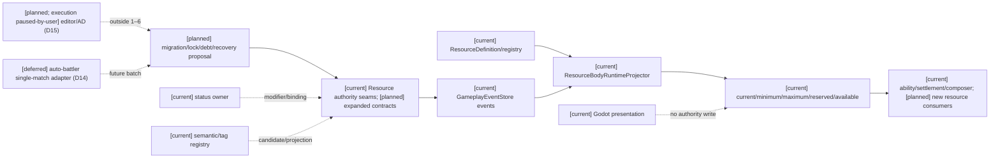
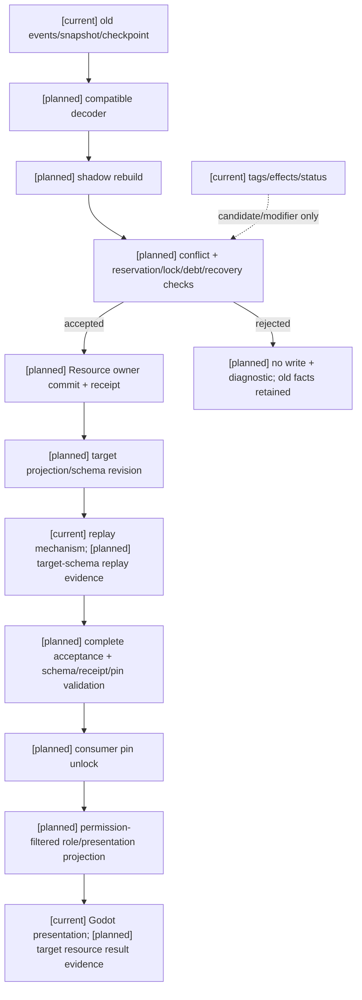

# 第四项：通用资源集中迁移与兼容边界

状态：`analysis/planned/non-authorizing`；审查/决策回写日期：2026-10-11。本文件是对 D06/D17、RW-07/RW-18 的代码、测试和原设计核对，不创建资源 owner、迁移 schema 或运行时字段，也不授权计划04直接修改代码。

## 1. 结论与范围

第四项已经收敛为一次**集中切换**。资源事实仍由已存在的资源/身体运行时写入口负责；迁移必须先由该 owner 审定字段语义、目标 schema revision、旧数据兼容解码、冲突处理、receipt 与 replay，再统一开放新 consumer pins。不能逐资源散落升级，也不能把当前窄的 bounds clamp 入口描述为完整迁移。

集中切换不表示跨 owner 全局原子事务。资源 owner 的提交、status owner 的生命周期、effect/tag 的语义绑定、ability/equipment/inventory 的各自事实仍保持分离；一个 owner 已提交而另一个 owner 冲突或超时，保留已提交事实和 receipt，走查询、后继计划或 owner 批准的补偿。

## 2. 原设计、当前代码和证据映射

| 语义/能力 | 十月原设计依据 | 当前实现与调用方 | owner/证据状态 |
|---|---|---|---|
| 资源定义与边界 | [战斗02 §1.2、§2](../战斗系统与角色技能，状态和资源/02-角色战斗资源与资源转换计划.md) | `ResourceDefinition(resource_id, definition_version, minimum, maximum)`；`ResourceDefinitionRegistry` 按版本保留定义 | `[current]` ResourceBody runtime 仅证明 minimum/maximum；不能推导 capacity |
| 当前量和预留 | [战斗02 §1.2–1.3](../战斗系统与角色技能，状态和资源/02-角色战斗资源与资源转换计划.md) | `ResourceEntry.current/reserved`；`ResourceReservationAuthorityService` 追加 reservation_created/consumed/released | `[current]` 资源 owner 写入；`available` 实现为 `current - reserved` |
| 身体/动作资源结算 | [战斗02 §1.3、§5](../战斗系统与角色技能，状态和资源/02-角色战斗资源与资源转换计划.md) | `ResourceBodyActionSettlementService`、`patch_rule_settlement.py` 使用 owner projection 和 atomic batch | `[current]` 仅覆盖已注册动作/身体合同，不等于通用所有转换 |
| bounds 迁移 | [战斗02 §1.2、规格10 §3](../战斗系统与角色技能，状态和资源/02-角色战斗资源与资源转换计划.md) | `ResourceBoundsMigrationAuthorityService` 只允许降低 maximum、无 reservation 时 clamp current；`patch_lifecycle_authority.py` 做 manifest/schema/digest/shadow replay 校验 | `[current; narrow]` 不是 capacity/locked/debt/recovery 完整迁移；rollback 为 forward-fix-only，回滚请求被拒绝 |
| projection 与角色读取 | [战斗04、规格10 §7–9](../战斗系统与角色技能，状态和资源/04-战斗状态、CombatPrefill与高频读取计划.md) | `phase3_state_composer.py` 输出 `core.resources` 的 current/minimum/maximum/reserved/available；`phase3_mirror_source.py` 复用同一 projector | `[current]` 可供私有投影；Stable/Hot/Delta 分类及新字段仍 `[planned]` |
| 事件、receipt、幂等 | 角色16时序/回执约束；规格09 §4–7 | `GameplayEventStore.append_batch`、`AppendBatchResult`、idempotency、stream revision、outbox、projection checkpoint、snapshot/replay | `[current]` 资源事件可审计；集中迁移需新增证据而不是替换旧事件 |
| 状态生命周期 | [战斗05、规格10 §4](../战斗系统与角色技能，状态和资源/05-效果通道、环境场与生命精神灵魂规则设计.md) | `status_tags.py` 的 status authority/projector 负责 attach/stack/expire/remove 等生命周期 | `[current/planned]` 状态 owner 分离；不得由资源迁移直接写状态 |
| effect/semantic binding | [战斗05、07、08](../战斗系统与角色技能，状态和资源/07-战斗影响源、标签与跨维度效果设计.md) | `semantic_effects.py` 解析/计划；`semantic_registry.py` 注册 binding；不直接写资源或世界事实 | `[current/planned]` binding 只产候选/投影，事实仍回到 owner |
| ability/equipment/inventory | [战斗06、08、11](../战斗系统与角色技能，状态和资源/11-通用装备系统设计.md) | `ability_runtime.py` 读 resource/body/ability；`equipment_runtime.py` 读身体投影并管实例/槽位；`inventory_runtime.py` 管库存与独立 reservation | `[current]` 能力读取资源、装备/库存各有事实 owner；不能被集中迁移合并 |

## 3. 字段语义冻结边界

原设计字段与当前字段必须分开记录：

| 当前实现字段 | 当前可证明语义 | 目标语义 | 处理规则 |
|---|---|---|---|
| `minimum` | 资源当前允许的下界 | 仍保留为下界 | 兼容解码和新 schema 都不得静默改名 |
| `maximum` | 当前 `ResourceDefinition`/entry 的上界 | 不能直接称为 `capacity` | 只有 owner 提供有来源的映射和 revision 后才迁移 |
| `current` | 当前总量 | `current` | 迁移前后必须保留来源事件和 clamp/损失说明 |
| `reserved` | 已创建但未 consume/release 的 reservation 总量 | 仍是预留 | 不能默认等于 `locked`；锁定可能来自状态、动作或 authority policy |
| `available` | `current - reserved`，当前实现不 clamp 到零 | 原设计建议为 `max(0,current-reserved-locked)` | 在 `locked` owner/schema 证据前维持当前公式，不能只改 projection 文案 |
| `capacity` / `base_capacity` | 当前不存在 | 原设计的当前上限/基础上限 | `[planned]` 需要来源、修正来源和迁移规则，不能由 `maximum` 猜测 |
| `locked` | 当前不存在 | 暂时不可用量 | `[planned]` 需要锁定 owner、生命周期、释放条件和 receipt |
| `debt` / overdraft | 当前不存在 | 透支量、上限和反噬策略 | `[planned]` 需要世界/profile policy、边界和回放证据 |
| `recovery` | 当前不存在 | 速率、延迟、条件和恢复状态 | `[planned]` 需要时间 owner、来源账和恢复事件；角色不自行累计 |

因此，`maximum == capacity`、`reserved == locked`、`available == current-reserved-locked` 都不是当前代码事实。实施前没有 owner 审定时，任何消费者只能读取当前投影或收到不可用诊断。

### 3.1 目标语义的来源和迁移审定要求

以下是原设计要求的映射资料，不是已经注册的新字段或接口：

| 目标语义 | 原设计具体来源 | 资源 owner 必须审定的映射 | 禁止的默认推导 |
|---|---|---|---|
| capacity/base_capacity | 战斗02 §1.2 的基础值、职业/装备/永久状态加法、互斥与倍率顺序；§1.4 来源账 | 旧 definition 上界是否可作为某个资源的新上限输入；基础值来源与 modifier/binding revision；current 超上限的明确损失/保留政策 | 将所有 maximum 复制为 base_capacity/capacity，或用余额倒推基础上限 |
| locked | 战斗02 §1.2、§1.5、§2 的暂时不可用与恢复抑制；战斗05/07 的状态与来源 | 每次锁定的资源/来源/量、所属 policy、作用期与释放条件；状态 owner 给来源证据，资源 owner 提交可用量变化；与 reservation 重叠的规则须注册 | 把已有 reserved 改名为 locked，或迁移直接创建/清除状态 |
| debt/overdraft | 战斗02 §1.3 的 overdraft/refund、§1.5 的先还债、§3 转换与反噬 | 透支资格、债务单位/上限/偿还次序及反噬 owner；旧历史是否有可证明债务来源；无来源不得补造债务或额度 | minimum 小于零即已有透支政策；余额不足自动借贷；反噬直接写入其他 owner |
| recovery | 战斗02 §1.2 的速率/延迟/条件、§1.4 来源和去重、§1.5 状态机 | 复用规格09的时间/窗口合同，注册 tick、来源、恢复条件/延迟、锁/抑制、满值与偿债顺序；恢复写入有事件/receipt | 从旧 adjusted 正向 delta 猜成完整回蓝状态；角色/Godot自行累计；另建 clock/scheduler |
| revision/source accounting | 战斗02 §1.2/§1.4/§1.5、战斗07 来源生命周期 | ResourceEntry 当前只有 definition_version/source_event_id；运行状态版本来自 ResourceStateProjection 的 source_revision_vector/projection_revision。新来源账须保留原因、binding/owner revision与因果链，不把现有单个 source_event_id 称为完整账本 | 为未知来源补默认 owner 或伪造 modifier；把全部来源压成无法回放的合计 |

旧资源不存在这些事实时，只能根据注册定义/政策显式初始化或拒绝该映射，初始化理由也须随迁移可审查；不得以猜测数值补齐。目标字段单位和数值类型由注册定义审定，当前整数账本不自动证明小数恢复已经支持。

### 3.2 存储、receipt 和已有测试定位

资源 read model 由 `ResourceBodyRuntimeProjector` 从 `GameplayEventStore` 的 `gameplay.resource.materialized/adjusted/bounds_migrated/reservation_created/reservation_consumed/reservation_released` 重建。现有 bounds planner 没有 store 写口；`patch_lifecycle_authority.py` 校验 manifest、schema/code/migration digest，绑定资源迁移事件与状态组/Patch-set 转换到 authority batch。它不是任意资源迁移中心。

`event_store.py` 有内存 `GameplayEventStore` 及持久 `SqliteGameplayEventStore`；append result、transaction/idempotency、stream revision、snapshot 与 projection checkpoint 属已有主干。具体运行 session 使用的存储实例和待迁移数据位置仍须执行时盘点，本文件不声称某个正式库已迁移。旧 codec/version 和 checkpoint 必须显式兼容，新 projection 不能覆盖旧历史。

静态定位到的回归案例包括 `test_resource_body_runtime.py` 的 `test_reservation_reduces_available_then_consumes_or_releases_without_ghost_balance`、`test_resource_checkpoint_plus_tail_rebuild_matches_full_projection`、`test_resource_bounds_migration_is_typed_replayable_and_checkpoint_safe`、`test_resource_bounds_migration_rejects_reservations_and_tampered_replay`，以及 `test_gameplay_patch_lifecycle_authority.py` 的 manifest schema/tampering/rollback 拒绝案例。它们证明已有窄合同有验证入口；本轮未重跑 backend tests，也不能替代目标 schema、排空机制和集中迁移验收。

实际调用需分开：ability affordance resolver 读取资源/身体投影并检查 stamina；action settlement/patch rule 路径消费资源；state composer/mirror 输出 `core.resources`；equipment 目前读取身体投影，inventory 管独立库存/容量 reservation。后两者不因此成为通用资源写口，也不把库存 capacity/reservation 当作本表的资源 capacity/locked。

## 4. 集中迁移方案、兼容与回滚

### 4.1 实施前必须确认

1. 列出所有 `ResourceDefinition`、`ResourceEntry`、reservation、adjust、bounds migration 的旧事件 schema、stream revision、snapshot/checkpoint 和 consumer pin。
2. 固定资源事实 owner 的目标 schema 审定要求，逐字段说明 `capacity/base_capacity/locked/debt/recovery` 的来源、单位、生命周期、初始化是否允许以及与 world/profile policy 的关系；具体目标 schema revision 在对应实施任务审定、提交前冻结。无来源的字段保持未准入。
3. 固定仓库外隔离旧数据副本的兼容解码、全量重建、checkpoint+tail replay、reservation/lock 冲突及幂等验证方案；工具和验证结果在实施中产生、提交/切换前审查。原事件只读保留，不通过迁移脚本重写历史。
4. 明确失败恢复边界：提交前失败保留旧 schema 服务；owner 已提交后保留新事实/receipt，关闭不兼容 consumer 并按批准的后继修复合同处理，不能拿旧 projection 覆盖提交。

### 4.2 迁移窗口：等待旧承诺结清（D17）

用户已选择暂停新资源承诺，等待已有动作按原合同完成、consume 或 release。窗口内仍提供现有合同所需的投影和结算入口；不由迁移流程请求取消、不强制清账或伪造退款。任何未结清 reservation、超时/停机后的未知状态都使迁移保持 `pending` 并保留诊断；没有“等够时间就算结清”的规则。

当前 bounds planner 会拒绝角色 ResourceStateProjection 中全部未结清 reservation，不只检查该次迁移的单个 resource。集中迁移须显式冻结本次范围及其 owner/actor streams，列出暂停 admission 的所有新承诺入口；不得在排空期间允许另一 consumer 绕过暂停。暂停的持久状态、恢复和 drain 机制均为 `[planned]`，不因这条决策而已经存在。reservation 清空后还须按 owner revision 重新校验，检查/提交之间冲突零写；新版本 pins 在完整验证后统一开放。

### 4.3 实施中产生

- 迁移计划必须携带 source/target definition revision、schema/migrator digest、输入 projection revision、事件/命令 idempotency key、预期 stream revision、结果 digest 和 owner receipt。
- 迁移先在 shadow projector 上验证 full replay 与 checkpoint+tail 等价，再由资源 owner 经已有 authority batch 主干追加迁移事件并校验涉及 streams；跨 owner 不承诺全局原子性。reservation 尚未结清、source revision 冲突、未知 definition 或不支持的 lock/debt/recovery 变换均拒绝写入。
- 每个迁移结果须能解释 `previous_current`、`next_current`、损失/债务/锁定变化和来源事件。不要用新的 event 覆盖旧 event，也不要重新扣费。
- status/effect/equipment/inventory owner 的后续操作分别重新读取其 owner revision。跨 owner 部分成功保留已经提交的 receipt，后继操作使用新 key/ref。

### 4.4 验收时验证

- 旧事件、旧 snapshot、旧 checkpoint 可读；full replay 与 checkpoint+tail replay 结果相同。
- reservation consume/release 不重复、不丢失、不产生 ghost balance；排空、暂停新承诺、迟到结算、超时、停机恢复和检查/提交之间的冲突符合 D17，不用 `reserved` 猜测 `locked`。
- 迁移重复命令返回原 receipt；相同 idempotency key 的变载荷被拒绝；stream revision 冲突零写。
- 新 projection 只有在 owner receipt、schema digest、consumer pin 和完整回放证据同时满足后才开放。失败时停用新 pin、保留旧事实和诊断，不声称全局 rollback。

现有 `ResourceBoundsMigrationAuthorityService` 已有 bounds clamp 的 shadow replay 和 rejection 测试，可作为迁移基础证据；它不能替代上述完整迁移验收，也不能把 `rollback` 从 `forward_fix_only` 改成删除历史。

## 5. 通用领域边界

战斗目录中的资源、状态、效果、动作和关系能力作为开放世界通用服务。开门、制作、救援、移动、生产、交互和社交等 consumer 使用同一资源/状态/effect/ability/equipment/inventory 合同；目录名称 `战斗` 不创建 combat-only owner。



## 6. 主流程时序

```mermaid
sequenceDiagram
  participant C as Consumer
  participant P as Resource projector
  participant O as Resource owner
  participant S as GameplayEventStore
  participant R as Replay/checkpoint
  C->>P: read resource projection [current]; role privacy mapping [planned]
  C->>O: proposal with source revision [planned]
  O->>O: pause new commitments; drain existing reservations or pending [planned D17]
  O->>R: shadow full replay + checkpoint/tail comparison [planned gate]
  R-->>O: migration evidence or rejection
  O->>O: revalidate revisions, definition and lock/debt/recovery policy [planned]
  O->>S: append owner event/receipt [current + planned migration]
  S-->>O: idempotent AppendBatchResult [current]
  S-->>P: projection refresh hint/checkpoint [current]
  P-->>O: target revision available to validation [planned]
  O->>R: verify committed receipt/replay before opening new pins [planned]
  R-->>O: acceptance evidence or closed admission
  O-->>C: open pins only after complete acceptance; otherwise diagnostic [planned]
```

## 7. 数据流与证据边界



## 8. 依赖、解锁和限制

| 阶段 | 必须有的证据 | 缺失时限制 |
|---|---|---|
| 实施前 | owner、字段来源、目标 schema 审定流程、旧数据兼容和失败恢复方案 | 对应字段合同未审定不得冻结；不阻断现状盘点和隔离工具建设 |
| 实施中 | 审定 schema/revision、暂停与排空、真实 event/receipt、幂等、shadow replay、冲突零写 | 未提交仍服务旧合同；未结清则 pending；已提交保留事实，不伪装旧服务回滚 |
| 验收 | full replay、checkpoint+tail、reservation 边界、非战斗 consumer、失败恢复 | 资源迁移不通过；角色基础和不依赖新字段的已有动作可继续 |
| 角色回验 | 新 owner 版本的私有投影与角色感知/表达/决策对照 | 角色相关新资源语义不纳入通过结论 |

本项不阻断角色基础主线，也不重新打开第7项编辑器 control-plane、第8项 AD/GLB 或 D14 自走棋；这些范围按 D15/D14 保持暂停或延期。它阻断的是新资源 schema、锁定/透支/恢复语义、依赖这些字段的 consumer pins 及其最终验收。

## 9. 相关计划与回写

- 规格：[10-通用资源状态效果影响源与装备领域规格](../规格/10-通用资源状态效果影响源与装备领域规格.md) §3、§7–10。
- 计划：[04-通用合同与领域服务实施计划](../计划/04-通用合同与领域服务实施计划.md) Task 3。
- 原设计：[战斗02](../战斗系统与角色技能，状态和资源/02-角色战斗资源与资源转换计划.md) §1.2–1.5、§2。
- 决策与回写：[实施待决收敛与验证闸门](03-实施待决收敛与验证闸门.md) D06/D17、[设计回写登记](../回写/README.md) RW-07/RW-18。

本审查包完成的是静态映射和实施门槛收敛；不代表完整迁移、目标字段或新 consumer 已实现。


## 2026-10-16 Task3 实码核对补记（RW-39）

[current] 当前真实持久类为 `DurableGameplayEventStore`，本页旧 `SqliteGameplayEventStore` 名称不作为代码存在声明。snapshot export v2、from_snapshot v1/v2 的 generic decoder 不等于目标资源 payload codec；资源 checkpoint 目前是 typed in-memory projection。完整 owner/consumer 清单、投影缺口和迁移夹具见[伴随审查与三图](../回写/stage3-task3-20261016.md)。

[planned/blocked] 本页§3.1的待审字段仍未得到具体owner/schema裁定，不能推导默认值。旧bounds clamp不是集中迁移，D17持久pause/pending和目标receipt恢复未验证；本轮无运行时实施。
