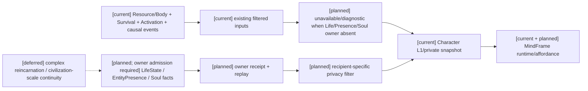
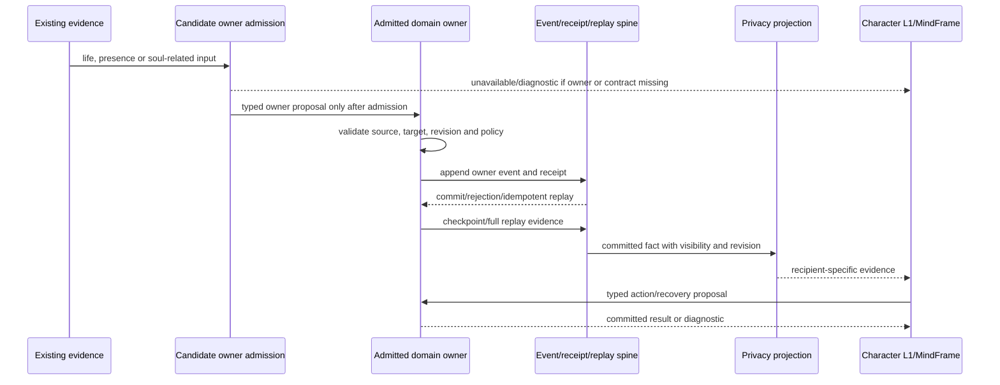
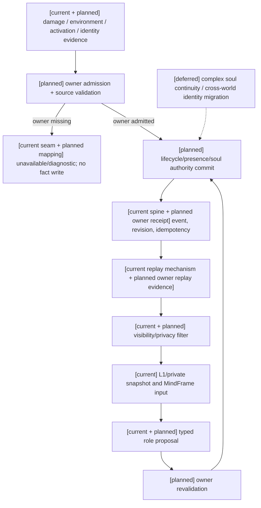

# 第五项：Life/Presence/Soul 真实 owner 与角色投影边界

状态：`analysis/planned/non-authorizing`；审查/决策回写日期：2026-10-11。本文件核对 D11/RW-09 的原设计、现有代码、测试、合同、receipt/replay 和角色私有投影。不创建 `LifeState`、`EntityPresence`、`SoulAccessGate` 或灵魂数值，也不授权计划04直接修改运行时代码。

## 1. 结论与范围

第五项的关键结论是：仓库目前没有可准入的完整 LifeState、EntityPresence 或 Soul/identity 事实 owner。

- `SurvivalAuthority` 是现有生存需求、环境状态和 expiry obligation 的 owner；它不是生命阶段、死亡、复活或实体生成/销毁 owner。
- `ResourceBodyRuntime` 和 `BodyInjury` 提供资源/功能伤势投影；不能由此推导 `Alive`、`Dead`、死亡原因或灵魂连续性。
- `ProfileActivationAuthority` 管 authored character profile 的 population activation、lock/pending、suspend/requeue 和 region assignment；它不证明通用 EntityPresence、incarnation、spawn/despawn、quota 或 Godot actor admission。
- `EntityCausalProjection` 是从已提交事件重建的只读 entity/relationship/causal dossier；事件 payload 中的 `lifecycle` 不是它拥有的生命周期事实。
- `RuntimeContinuityState` 只有 ongoing contact、interrupted action 和 transition kind；不是生命或实体 admission authority。
- 未发现 Soul/identity 事实模型、灵魂事件 schema、SoulAccessGate 实现、灵魂 receipt 或灵魂 replay 测试。

角色基础可以继续推进。缺 owner 时，角色只能收到经过现有权限/可见性边界的 unavailable/diagnostic 结果；不能把缺字段当作 `alive`、`safe`、可复活或 Soul allow。真实 owner 以后准入，再回验角色感知、表达和决策。

## 2. 原设计到代码的实际映射

| 原设计语义 | 十月原设计依据 | 当前代码/测试 | 证据状态 |
|---|---|---|---|
| 生命资源与功能伤势 | 战斗02 §1.1；战斗10 §1–4 | `resource_body_runtime.py` 的 `ResourceEntry`、`BodyInjury`、功能容量投影；`test_resource_body_runtime.py` | `[current]` 资源和基础伤势存在；不含 LifeState |
| 生存状态与环境状态 | 战斗05 §5–8；战斗10 §4 | `survival_runtime.py` 的 `SurvivalState`、`NeedState`、`SurvivalProjector`、`SurvivalAuthority`；`test_survival_runtime.py`、`test_survival_cross_domain_settlement.py`、`test_infra_semantic_survival_state_action.py` | `[current]` 仅为 survival domain；不能升级为死亡/复活 owner |
| 实体/关系/因果投影 | 战斗09 §1–8；战斗10 §6 | `EntityCausalProjection`、`EntityRecord`、`RelationshipRecord`、`CausalEventRecord`；`test_infra_semantic_entity_causal.py` | `[current]` 只读重建；不拥有 spawn/despawn 或生命周期写入 |
| 角色 population activation | 战斗10 §6.1–6.2；角色连续性设计 | `ProfileActivationAuthority`、`ActivationProposal/Receipt/Lock`、`population.activation.*` 事件；`test_population_continuity.py`、`test_population_runtime_lifecycle.py` | `[current]` profile activation/区域投影；不等于 EntityPresence |
| 角色私有感知与投影 | 角色06；规格12 §3、§5 | `CharacterAgentL1Service`、`CharacterPrivateWorldSnapshot`、`short_horizon_social_presence`、MindFrame 的 runtime/affordance cards | `[current]` 角色私有感知输入；不拥有世界生命/灵魂事实 |
| 生命阶段 | 战斗10 §3；规格12 §3、L01–L04 | 未找到可提交 `LifeState` 的 owner、事件族或专用 projector | `[planned/blocked]` owner admission 缺失 |
| EntityPresence / incarnation | 战斗10 §6；规格12 L05–L08 | 未找到通用 SpawnAdmission、DespawnReceipt、incarnation/quota/cleanup owner；Profile activation 不能替代 | `[planned/blocked]` |
| SoulContinuity / gate | 战斗05 §6–8；战斗10 §2、§7；规格12 L04/L09 | 未找到 Soul/identity authority、SoulAccessGate、soul event/replay 或 soul numeric meter | `[planned/blocked]` |

## 3. Owner、合同和证据边界

### 3.1 当前可证明的 owner

`SurvivalAuthority` 只接受自己 owner principal 和 `gameplay:survival:{actor_ref}` stream 的 batch，并通过 `GovernedAuthorityContractCatalog` 校验事件类型、scope 和 owner。其 `SurvivalProjector` 能从事件重建 needs、survival states、open obligations、source revision vector；这些 receipt/replay 证据只能证明 survival 合同。

`ProfileActivationAuthority` 以 `world_runtime.activation_authority` 写 `population:{world_ref}` stream，保留 authored identity digest、activation revision、scope grant、lock/pending、region evidence 和 `ActivationReceipt`。其 `profile_region_view_for()` 明确是 project region assignment，而不是 unrestricted presence view。它没有实体 incarnation、引擎 actor、spawn quota 或 despawn tombstone 合同。

`EntityCausalProjection` 按 `global_sequence` 重建 entity、thing、environment、relationship 和 causal event，并保留事件 revision/evidence/settlement refs。它没有命令或 append 入口，所以不能成为新的生命或 presence owner。

### 3.2 缺失的 owner 准入

以下只列待准入的 owner 类别和必须证明的合同，不把名称写成现有 API：

| 待准入事实 | 实施前必须确认 | 实施中产生 | 验收时验证 |
|---|---|---|---|
| LifeState | 状态集合、合法转换、lethal basis、health/injury/mind revision、时间/恢复政策和唯一写入口 | owner batch、transition event、receipt、幂等和 projection | `health==0` 不自动死亡；死亡/复活事件可回放；跨 owner 部分失败保留已提交事实 |
| EntityPresence | spawn/despawn、incarnation、quota、required components、控制/期限、引擎 adapter admission 与身份边界 | prepare/admit/activate/retire/cleanup/tombstone 事件和 receipt | prepared inactive 不可行动；迟到消息按 incarnation/cutoff 拒绝；重试不重复扣费、生成或通知 |
| Soul/identity | anchor、identity、true name、oath、possession、reincarnation 等事实的 owner、可见性、gate 前置和规则 revision | gate decision、owner event、receipt、失败/补偿与 replay pins | 未通过 gate 零事实写入；不产生 soul 数值；伪造标签、预算或 cache 不放行 |

### 3.3 不能使用的替代语义

- `SurvivalState`、`status:dead`、`BodyInjury` 或 `health` 不能直接改写 `LifeState`。
- `population.activation.committed`、region assignment 或 active profile 不能直接证明实体已在 Godot 世界中 active。
- `EntityRecord.lifecycle` 只能表示事件投影得到的字符串；不能解释为已有生命周期状态机。
- `soul:*` 标签、`capability:deathless` 或缺少 soul 字段不能创建 gate 结果、默认灵魂资源或安全结论。
- 模型、Laya、Siming、Godot 表现、preview 和缓存都不能提交上述事实。

## 4. 角色私有投影路径

现有角色链可消费已有的 `CharacterPerceivedEvent`、`SelfBodyPerceivedEvent`、L1 snapshot、MindFrame runtime/affordance cards 和已有 continuity/diagnostic blockers。第五项的接入顺序固定为：

1. 角色基础先使用已存在资源、身体、感知、关系和 activation/continuity 证据。
2. Life/Presence/Soul owner 未准入时，只写入权限过滤后的 unavailable/diagnostic 说明，带 source/freshness/visibility 或 blocker；不写猜测的生命阶段、presence 或 soul 状态。
3. owner 准入后，先通过现有 admission/receipt/replay 取得提交事实，再转换为 recipient-specific L1/MindFrame 输入。
4. 角色感知、表达和决策重新回验；owner 完整验收不反过来阻断角色基础开工。

## 5. 主流程时序

## 6. 数据流与证据等级

证据必须分级：

- **静态核验**：原设计 owner 章节、代码路径、事件名、模型和测试入口；不能证明 owner 已运行。
- **已有运行证据**：Survival、activation、generic event/replay、角色 L1/continuity 测试；只能证明各自已有窄合同。
- **实施中证据**：真实 Life/Presence/Soul owner admission、事件/receipt、失败恢复、checkpoint/full replay 和隐私过滤。
- **验收证据**：L01–L09、D01–D08 对应的独立 owner/角色回验；不能用 Survival 或 activation 测试替代。

## 7. 依赖、阻断与解锁

| 阶段 | 可启动内容 | 缺失时阻断 |
|---|---|---|
| 实施前 | 角色基础、已有资源/身体/感知/关系映射；owner/API/事件清单；unavailable/diagnostic 投影设计 | 不得冻结 LifeState、EntityPresence、Soul wire 或 writer |
| 实施中 | 在 owner admission 后实现相应 owner adapter、receipt/replay、失败恢复和隐私投影 | 未准入领域保持 unavailable；不开放生命/生成/销毁/灵魂事实写入 |
| 验收前 | 角色基础回归、已有 survival/activation/continuity focused tests | 不得声明完整 Life/Presence/Soul 或 B/C 使用这些事实通过 |
| 最终验收 | 独立 owner 证据、跨 owner 部分失败、角色私有投影和 A/B/C 依赖场景回验 | 仅阻断相关 owner、场景和新语义；不反向阻断不依赖它们的角色基础 |

第五项不重新打开 D14 自走棋，也不启动 D15 暂停的编辑器/AD专项。它阻断的是完整生命阶段、通用实体准入/销毁、灵魂规则写入及依赖这些事实的 B/C 结果；角色基础可以继续。

## 8. 关联文件

- 原设计：[战斗05](../战斗系统与角色技能，状态和资源/05-效果通道、环境场与生命精神灵魂规则设计.md)、[战斗10](../战斗系统与角色技能，状态和资源/10-生命状态、伤势与死亡连续性设计.md)。
- 收敛规格：[规格12](../规格/12-生命连续性关系状态与动态行为规格.md)。
- 实施计划：[计划04 Task5](../计划/04-通用合同与领域服务实施计划.md#task-5生命连续性实体-presence关系与-encounter-动态原语)。
- 决策登记：[实施待决闸门 D11](03-实施待决收敛与验证闸门.md)。

本审查包完成真实 owner 缺口和角色投影边界的静态收敛，不代表 Life/Presence/Soul 已实现或已通过最终验收。
