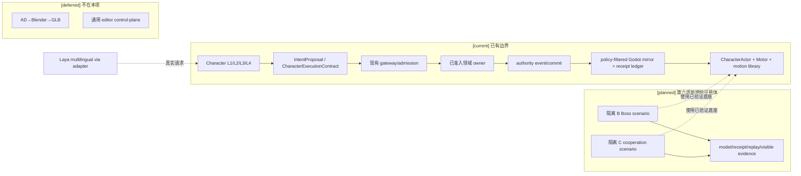
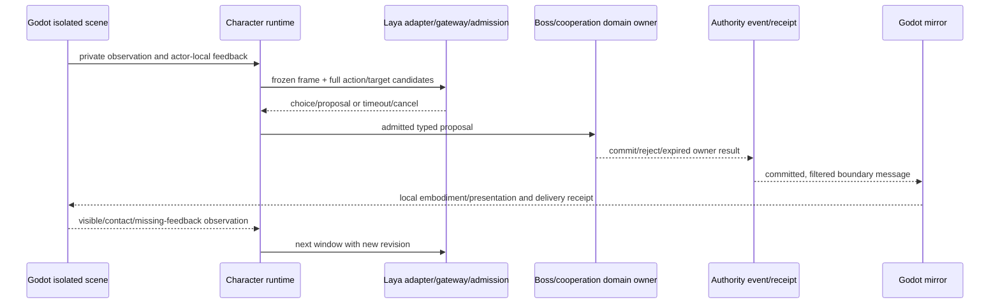
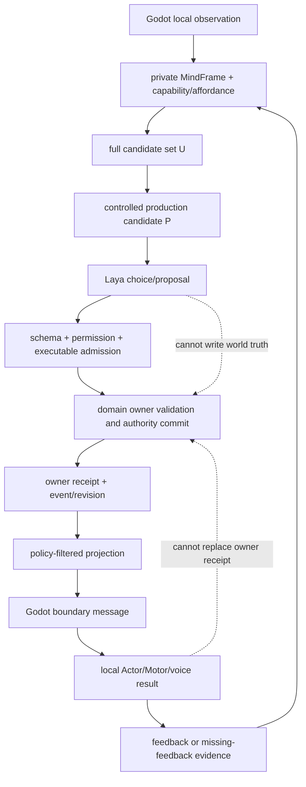

# 第六项：B/C 隔离 Godot 场景与真实边界证据

状态：`analysis/planned/non-authorizing`。本文是第六项的设计审查和证据计划，不创建运行时接口，不表示 Godot、Laya、Boss 或协同场景已经完成。

## 1. 结论与范围

十月原设计固定验证顺序为：A 单角色跨情境闭环，B 单角色连续 Boss，C 双角色连续协同；B、C 均为必验。B/C 必须使用新的隔离验收场景，不能把 `StreetCombatDemo` 的既有街战语义当作 Laya 验收场景。动作底座只复用已经在 `scenes/phase0/StreetCombatActorDemo.tscn` 中存在的 Actor、动作库、Motor、authority 接入和资格化证据。

当前能证明的是底座和边界：`CharacterActor` 有独立 `actor_id`、`driver_mode`、动作意图准入和本地具身；`IntentProposal` 拒绝世界写入字段，并保留 `authority_committed`/`authority_route` 作为输入边界；`MotionContributionComposer` 对 `pending`、`rejected`、`timed_out`、`cancelled` 和 `target_invalid` 不把本地运动当作成功；backend 已有 authority event、原子提交后的 Godot mirror、过滤后的投影和 delivery receipt ledger。

当前不能证明的是 B/C：仓库没有已准入的隔离 Laya Boss/协同场景、场景专用 Boss 规则 owner、协同通信 authority、B/C 的真实 Laya adapter 请求轨迹、owner 结算 receipt、Godot 可见运行结果或 B/C 独立留出报告。A 或动作底座通过不能替代 B/C。

## 2. 原设计与现有实现映射

| 原设计/收敛决策 | 当前代码或文档锚点 | 当前状态 | 第六项要求 |
|---|---|---|---|
| 角色02：A→B→C，B/C 必验，使用隔离新场景 | `docs/10月分析/角色/02-Laya快循环与快慢思考战斗设计.md` §验证顺序、§隔离场景；D02、D12 | 原设计已收敛；场景尚未创建 | B/C 分开建证据集，B 通过后才进入 C |
| 角色03：发送者局部观察，接收方独立 L1/local intent，不能共享团队脑 | `docs/10月分析/角色/03-协同作战与信息通信设计.md` §协同收敛；规格08 §11 | 合同是 planned；`CharacterOutcomePublisher` 不是通用通信 authority | C 必须验证可听/可见边界、独立选择、拒绝/退出和过期 |
| 动作由 Actor/Motor 本地实现，世界结果由 owner 提交 | `scripts/character/CharacterActor.gd`；`scripts/character/MotionContributionComposer.gd`；规格07 | 底座 current；B/C 场景接线 planned | 动画结束不能充当 owner receipt |
| proposal/model output → owner validation → authority commit → projection | 规格00 §统一边界；`IntentProposal.gd` | 边界 current/planned 混合，B/C 尚无专用 owner | 每个 B/C 结果必须关联 proposal、admission、owner receipt、projection |
| commit 后才发布 Godot mirror | `backend/app/gameplay/adventure_basic_mirror_runtime.py`、`godot_mirror_delivery.py`、`backend/app/services/authority_event_bus.py` | 通用 mirror 路径 current；不等于 B/C 场景完成 | 只接受真实提交后的边界消息和 receipt |

### 2.1 `StreetCombatDemo` 与 `StreetCombatActorDemo` 的差异

两份场景都引用同一 `CharacterActor.tscn` 和现有角色资产，但控制语义不同：

- `scenes/phase0/StreetCombatDemo.tscn` 根节点脚本是 `scripts/street_combat/StreetCombatDemo.gd`，协调器是 `StreetCombatCoordinator.gd`，HUD 是 `StreetCombatHUD.tscn`。它是 Phase 0 街战演示，包含玩家角色和两个街战角色的既有场景布置；它的场景语义不能代表 Boss encounter 或双角色协同。
- `scenes/phase0/StreetCombatActorDemo.tscn` 根节点脚本是 `scripts/street_combat/StreetCombatActorDemo.gd`，协调器是 `StreetCombatActorCoordinator.gd`，HUD 是 `StreetCombatActorHUD.tscn`。它是当前 Actor/Motor/动作和 authority 接入的底座验证载体，提供可复用的 Actor 实例、qualified package、motion library id 和本地控制边界。
- 复用只限于已验证的 Actor、动作库、Motor、authority 和资格证据。不能复制旧街战的 Boss、敌人、胜负、目标选择或场景协调语义；新场景必须以独立的 scenario/identity/admission 记录这些内容。

### 2.2 Actor、proposal 和本地具身边界

`CharacterActor.gd` 的 `actor_id` 是场景 Actor 的本地身份，`driver_mode` 区分 player/AI 等驱动方式；`submit_action_intent()` 先经过本地 action arbitration，再进入 `_realize_action_request()`。`_on_character_execution_payload_received()` 将 backend payload 转为角色安全的 intent/presentation 输入，不把 payload 直接当作世界事实。

`IntentProposal.gd` 明确拒绝 `damage`、`hit_result`、`inventory_mutation`、`status_write`、`transform` 和 `velocity` 等世界写入字段。其 `authority_committed` 与 `authority_route` 只用于合同和标签准入，不能由模型或 Godot 自行设置为成功事实。

`MotionContributionComposer.gd` 只消费已准入 contribution；`pending` 会 hold，`rejected`、`timed_out`、`cancelled` 和 `target_invalid` 会停止 root motion，并可产生受限恢复修正。`unknown` 也会冻结不安全运动。这个策略可复用，但不产生 Boss 伤害、死亡或协同成功事实。

### 2.3 Backend authority、mirror 和 receipt

现有 `adventure_basic_mirror_runtime.py` 只在 canonical authority result committed 且 outbox dispatch 后刷新 Godot mirror。`godot_mirror_delivery.py` 维护 policy-filtered snapshot、session scope、delivery sequence 和 receipt ledger，并拒绝 stale epoch、unknown sequence、非法 projection 或未授权 mirror。`authority_event_bus.py` 提供路由和恢复游标，但没有为 B/C 生成 Boss 或协同领域事实。

因此，B/C 的实现必须查明实际领域 owner 后再接入：Boss 的阶段、目标、伤害/生命、空间结果和结束条件由已准入 owner 提供；协同信号的传播和短期契约必须沿现有角色 L1/表达边界进入接收者。若实现前查不到 owner 或合同，相关能力保持 blocked，不能在 Godot 脚本、测试 fixture 或镜像 payload 中伪造成功。

## 3. B/C 最小能力和身份准入

### B：单角色连续 Boss encounter

B 的最小闭环是一个独立 Actor、一个已命名且已准入的 Boss/encounter owner、连续 action windows 和同一角色的连续 Laya 选择。每个窗口至少要能关联：冻结的私有输入、包络内完整候选、Laya 请求/响应、候选与合同 revision、admission 结果、owner execution receipt、反馈和下一窗口的输入 revision。

B 必须覆盖原设计要求的观察/试探、保持距离或防护、可用窗口、首次失败后的调整、新阶段变化、资源管理和撤退；具体次数和时间由已登记场景 policy 与实测确定，不能在本审查包中填产品数字。慢/Deep 重规划可以作为记录的升级路径，但慢模型结果不能算作 Laya 基础质量通过。

### C：双角色连续协同

C 至少需要两个独立 Actor 和两个独立 backend identity/profile。每个角色保留自己的私有输入、L1、local intent、候选和 Laya choice；发送者的局部观察通过实际可见/可听边界传播，接收者只能把它作为自己的 L1 evidence，不得直接复制发送者结论或私有 memory。短期协同契约必须支持有效期、失败条件、拒绝、退出和关键条件变化失效。

C 必须关联两方的模型轨迹、协同信号、各自 action proposal、各自 authority receipt 和双方可见结果。Boss 转身、队友倒地、target/revision 变化、租约过期或动作被打断时，旧契约不能重放；双方应基于当前合法输入重新选择。共享文本、生成音频、单元测试或一个角色的动画不能替代接收方 L1 和跨 Actor 真实结果。

### Actor admission 与 identity 分离

资产包注册、Skeleton/motion library 资格、Godot scene Actor、backend identity binding 和 active-control 是不同准入步骤。新增 B/C Actor 默认使用独立 identity；不能因为复用 `CharacterActor.tscn`、资产 package 或 profile 就替换现有 `StreetCombatActorDemo` Actor，也不能自动进入默认 roster 或取得 active-control。场景实例、backend identity、profile revision 和 control grant 必须在实施时逐项记录；当前仓库没有 B/C 专用 admission 文件，不能提前填写字段名或 owner 名称。

## 4. 真实模型和边界消息路径

正式路径沿既定 D07/D09：A 使用官方 `laya-multilingual`，backend 专用 adapter 经 gateway/admission 调用独立本地 `laya-serve` 的 `/v1/systemone`；端口来自部署配置。B/C 只能在 A 的真实输入/候选映射、provider revision、admission 和质量门可用后复用该路径。typed-decisions、慢模型或 Deep Model 不能悄悄替代首版 multilingual 基线。

每个真实窗口需要保存以下可关联证据：

1. provider/checkpoint revision、角色 profile/dossier revision、场景和 actor identity；
2. 经过 L1/能力包络/affordance/执行合同编译的输入与完整候选摘要；
3. gateway/admission request、response、stage、取消/过期/迟到拒绝和 provider usage/latency；
4. Laya choice 作为 proposal，owner admission/commit 作为事实来源；
5. authority event、owner receipt、projection revision、Godot boundary message 和 delivery/ack receipt；
6. Godot Actor 的可见动作、空间声音或失败/缺反馈结果，并能从截图/trace 回到同一 correlation/causation 链。

当前单题 `/v1/systemone` 探针只证明官方裸服务可启动和有一次真实响应；它没有经过 backend gateway/admission，也没有 B/C 候选、owner 或可见场景证据。因此不能作为 B/C 通过证据。

## 5. 证据分层与执行顺序

### 实施前必须确认

- `StreetCombatActorDemo` 的 Actor、动作库、Motor、authority 和资格证据仍为新鲜、可引用的底座；不把 `StreetCombatDemo` 当作 B/C 语义来源。
- B 所需 Boss/encounter owner、资源/空间/生命/关系 owner 及 revision；C 所需协同信号实际 ingress、SpeechLease/声音接收边界和两个独立 identity。缺 owner 只阻断对应 B/C 能力。
- 新场景的 actor admission、profile/dossier、active-control 和场景 policy；不复制旧 Actor 身份。
- Laya adapter 的真实 gateway/admission 请求合同、取消、过期和 stale choice 处理；provider、checkpoint、候选 policy 改变时要声明需要重跑的 A/B/C 证据。
- B/C 各自独立的开发/校准/final 留出轨迹及证据保存位置。A 结果、动作底座结果或共享 fixture 不能充当 B/C final。

### 实施中产生

- 隔离场景文件、场景脚本或配置、actor admission 记录和不替换旧场景的静态检查。
- 真实模型 request/response/stage、候选覆盖、选择、取消/过期和 fallback trace。
- 真实 domain owner proposal/admission/commit/rejection、authority event、owner receipt、replay/checkpoint 和 projection revision。
- Godot 通过已提交 boundary message 接收的本地 realization、missing-feedback、delivery/ack receipt；不可把本地动画完成补成成功。

### 验收时验证

- B：连续窗口中的 Laya 选择、模型选错、候选缺陷、admission/执行失败、owner 失败和 Godot 缺反馈分别归因；Boss 阶段变化、撤退和恢复都有真实 owner 结果。
- C：两方独立选择和局部认知，信号可达性/延迟/过期，拒绝/退出/关键条件失效，跨 Actor receipts 和双方可见结果。
- 负例：未准入 Actor、错误 target/revision、重复提交、旧 choice、未提交 authority 的本地表现、无权 mirror、断线/背压和 owner reject 都不能显示成功。
- 证据完整性：模型轨迹、边界消息、authority receipt、replay/checkpoint 和截图/trace 的 correlation/causation 可互相追溯；静态测试或场景文件存在不能替代 editor/runtime evidence。

## 6. 证据矩阵

| 证据 | B 要求 | C 要求 | 当前证据 | 缺口/结论 |
|---|---|---|---|---|
| Actor/动作底座 | `StreetCombatActorDemo` 的 Actor、动作库、Motor、authority 静态/运行证据 | 同 B，另需两个独立实例 | 场景和脚本存在；部分 backend/Godot 静态合同测试存在 | 可作底座基线，不能释放 B/C |
| 模型 request/response | 真实 adapter→gateway/admission→`/v1/systemone` 连续窗口 | 两个角色各自独立请求/响应 | 裸 Laya 单题探针已存在于仓库外记录 | 未经 backend admission，不是 B/C 证据 |
| 候选/执行合同 | 完整动作+目标、affordance、contract revision、裁剪审计 | 两个角色各自完整候选和协同目标 | 设计和现有 intent boundary 可引用 | 真实 compiler、覆盖和留出尚待计划01/02 |
| Admission/owner receipt | Boss 阶段、目标、资源/结果由 owner commit | 两个角色 action/协同相关 owner commit | 通用 authority/mirror 测试存在 | B/C 专用 owner 和 receipt 尚未准入 |
| Replay/checkpoint | 连续窗口、取消、过期、恢复、重复提交 | 双方各自 revision、契约失效和恢复 | 通用 event/recovery 底座可查 | B/C 关联链尚无真实报告 |
| Godot visible result | 可见动作/反馈和失败不成功显示 | 双 Actor 可见协同、空间信号和失败 | Actor/Composer 静态边界可查 | 无新隔离场景 editor/runtime evidence |
| Negative cases | stale/reject/target invalid/owner failure | inaudible/expired/rejected/withdrawn/changed precondition | 部分单元/静态合同 | 必须在真实 B/C 运行中逐项取证 |

## 7. 架构与交互图

### 架构边界

### B/C 主流程

### 数据流和权威边界

## 8. 阻断范围、顺序和回滚

第六项不阻断角色心智基础、A 的静态/离线准备或动作底座维护。它阻断的是 B/C 的运行验收和依赖真实 B/C 结果的生产声明。顺序固定为：

1. 先完成 A 的真实 Laya 输入/候选/admission 和角色基础 evidence，再冻结 B 场景所需 owner/identity/policy。
2. 新建隔离 B 场景，复用 Actor/Motor/authority 底座；取得连续 Boss 的真实模型、owner receipt、replay 和可见结果。
3. B 通过后，建立两个独立 Actor 的 C 场景；沿实际协同 ingress/L1/表达边界取得双方证据。
4. 任一 provider/checkpoint/candidate policy/owner contract revision 变化，都使受影响的 B/C 证据回到对应 A/候选/场景验证，不以旧报告继续宣称通过。

失败时只关闭本轮新增的场景接线、consumer 和 pending 请求，保留已有 Actor 身份、owner 事件和历史 trace；不能清空或伪造世界结果。没有 Godot editor/runtime 工具时，报告保持 `static-only`/`editor-unverified`，不降级为 B/C 通过。

## 9. 与规格、计划和原设计的同步项

- D19 登记在 [实施待决收敛与验证闸门](03-实施待决收敛与验证闸门.md)：B/C 必须有隔离场景和真实边界证据，A/动作底座不能替代；缺项只阻断 B/C。
- 总规格00、规格07、规格08补记本审查包的 current/planned/deferred 映射；计划00 Task 6A 和计划03 Task 6A 引用本矩阵。
- 角色02和角色03原设计末尾增加本批回写，明确 `StreetCombatActorDemo` 只作动作底座、`StreetCombatDemo` 不作语义来源，真实 owner/receipt/Godot 证据仍待实施。
- 回写登记新增 RW-20；审查索引新增本文。

