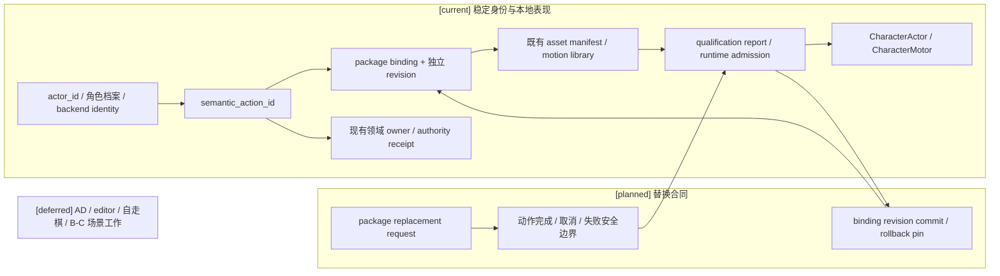
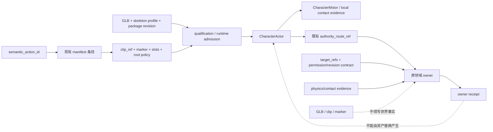

# 第二阶段：资产复用与动作可替换准入矩阵

状态：`analysis/planned/non-authorizing`。本审计只读取仓库文件和既有报告；不修改运行时代码，不启动 Godot、编辑器、玩法包或真实动作执行。`current` 表示直接静态证据，`planned` 表示已有设计但未实现，`blocked` 表示必要合同/证据缺失，`deferred` 表示用户明确暂停的工作。

## 1. 结论与范围

- `scenes/phase0/StreetCombatActorDemo.tscn` 是动作底座和资产资格基线，不是 Laya live 动作执行证据。
- `scenes/phase0/CharacterActor.tscn` 是共享 Actor/Motor 壳；单独存在不证明实例已经取得 identity、目标、owner 或动作准入。
- `scenes/phase0/StreetCombatDemo.tscn` 明确不参与 Laya A/B/C 语义复用。它的街战编排不能充当 Laya 场景/领域语义。
- 已有 live 输入使用 `ingest_siming_output` + `env_lamp`。15 个候选是无目标意图，选中 `observe` 并停在 `stage_ready`；没有领域 owner admission/commit receipt。该链路没有实际使用 Godot Actor、GLB、动作 clip、contact marker 或动作领域 owner。
- 静态 manifest 的近战登记不等于动作可以执行。所有动作还须有完整目标合同、owner admission/receipt 和对应接触证据。

## 2. 架构边界



Actor 与 backend identity、角色档案保持稳定；语义动作 ID 稳定；GLB、骨架、motion library、clip 和 marker 是带独立 revision 的 package binding。资产资格化不拥有世界事实，owner route 与授权不随资产变化。

## 3. 替换时序

```mermaid
sequenceDiagram
  participant Caller as 已有调用方
  participant Actor as CharacterActor / Motor
  participant Gate as 现有安全边界与资格检查
  participant Binding as 现有 package binding
  participant Owner as 现有领域 owner
  Caller->>Actor: 请求替换 package，带 semantic_action_id 与目标合同
  Actor->>Gate: 等待当前动作完成/取消/失败或其他既有安全边界
  Gate->>Gate: 校验 skeleton、动作、marker、root、slot、接触证据和 qualification
  alt 新 package 合格
    Gate->>Binding: 提交新 binding revision
    Binding-->>Actor: 固定新 revision 供后续动作使用
    Actor->>Owner: 按原 owner route 提交原目标合同
    Owner-->>Actor: owner receipt / reject
  else 不合格或提交失败
    Gate-->>Binding: 保留旧 binding revision
    Binding-->>Actor: 继续旧绑定；不得报告替换或动作成功
  end
```

活跃动作固定开始时的旧 package revision。新 revision 仅在安全边界提交；失败时保留旧 binding，不能无动作、错误动作或虚假成功。Skeleton profile 改变必须重新 retarget、qualification 与 admission。

## 4. 数据流与权限



`short_punch` 仅作为现有 backend 兼容语义；正式资产动作以 manifest 真实登记的 `semantic_action_id` 为准。不得自动 alias `action:melee.short_punch` 到 `action:melee.unarmed_punch`；迁移必须另有明确迁移合同和资产证据。

## 5. 动作可替换合同

| 规则 | 现有合同映射与状态 |
|---|---|
| `actor_id`、角色档案、backend identity 永远稳定 | [current] `CharacterActor.actor_id` 与角色 profile/dossier 是身份边界；资产清单只绑定表现资产。替换不改身份。 |
| `semantic_action_id` 是稳定动作语义键 | [current] `character-action-asset-manifest.v1.json` 的动作条目以该键映射 clip。 |
| GLB、骨架、动作库、clip、marker 属于可替换 package binding | [current] manifest、SkeletonProfile、MotionLibrary、Action 条目分开描述；没有统一替换 owner。 |
| package binding 有独立 revision | [planned] 当前所查 binding/manifest 没有统一独立 binding revision；不得借用 actor/profile/action semantic ID 代替。 |
| 活跃动作固定旧 package revision | [planned] 动作开始时 pin revision；中途静默替换禁止。 |
| 替换只在完成、取消、失败或既有安全边界生效 | [planned] 复用 Actor/动作 arbitration 与既有取消边界，不添加第二 scheduler。 |
| 新 package 先通过 skeleton、动作、marker、root、slot、接触证据及 qualification | [current] qualification manifest/report 已包含这些字段；[blocked] 缺项不得 admission。 |
| owner route、目标合同和权限不随资产变化 | [current] `authority_route_ref` 指向既有 route；`CharacterExecutionContract.target_refs`、revision/scope 与 owner admission 负责目标/权限。 |
| 替换失败保留旧 binding，不出现错误动作或假成功 | [planned] 失败关闭和旧 revision 保留；无替换事务实现/receipt 证据。 |
| skeleton 改变重新 retarget、qualification、admission | [current] motion retarget/qualification contract 分步管理；仅换 GLB 不充分。 |
| `short_punch` 不自动成为正式资产动作 | [current] backend 有 `action:melee.short_punch` 兼容映射；当前正式角色资产 manifest 没有该 semantic ID。 |
| 正式动作只认 manifest 实际登记 | [current] 至少有 `action:melee.unarmed_punch`、`action:melee.sword_slash` 和已有 locomotion/presentation semantic actions。 |
| 不自动 alias short punch | [current] 未发现资产迁移合同或资产证据支持该 alias；保持 blocked。 |

## 6. 场景与 Actor 盘点

| 场景 | Actor / `actor_id` | `driver_mode` / active-control | backend identity binding | 环境、HUD、Motor、authority | 结论 |
|---|---|---|---|---|---|
| `StreetCombatActorDemo.tscn` | `PlayerCharacter` / `street_bandage`；`AgentCharacterJK` / `char_a`；`AgentCharacterT` / `char_b` | `street_bandage`: PLAYER；`char_a/char_b`: Actor 默认 AI。后端 `char_a/char_b` 默认 `agent_full_auto`。场景静态 active-control 授权未见。 | char_a/char_b 有同 ID 后端 profile/runtime；未见场景到 backend identity 的独立 admission/binding receipt；street_bandage 未见匹配 backend identity。 | citystreets_209 visual、collision、navigation 与 `StreetCombatActorHUD` 已静态接线；共享 CharacterActor 含 CharacterMotor、authority/action ingress 合同。 | [current] 静态动作底座/资格基线；非 Laya live evidence。 |
| `CharacterActor.tscn` | 通用 `CharacterActor` 壳，`actor_id` 默认 `char_a`，由实例覆盖 | `driver_mode` 默认 AI；是否 active-control 由 backend profile/control mode 和明确 admission 决定 | 场景本身没有 backend binding 字段 | capsule、VisualRoot、CharacterMotor、反馈和 fact emitter 静态存在；没有场景 owner 结算证据 | [current] 共享运行时壳；单独不能准入动作或 actor。 |
| `StreetCombatDemo.tscn` | 复用 street_bandage、char_a、char_b | 街战场景自身控制语义 | 沿用 Phase 0 demo，非 Laya admission | 同一 citystreets_209、collision/navigation、旧 `StreetCombatHUD` 和 StreetCombat 控制器 | **明确不参与 Laya A/B/C 语义复用**；不作为 Laya 动作执行或场景 owner 证据。 |

`StreetCombatActorDemo` 的 actor 资产静态绑定：`street_bandage → female_bandage_external`、`char_a → female_jk_external`、`char_b → female_t_external`。这些映射不改变 actor/profile/backend identity。StreetControl demo 中另有 `crusader_knight` 本地 presentation preview；不属于上述 Laya action admission。

## 7. 角色模型 package 矩阵

digest 是 manifest 声明的 GLB SHA-256，不代表本轮重新哈希。`binding revision` 均未登记；不存在即为准入缺口，不能从 package digest 推导。

| package_id | GLB / digest | skeleton；body / calibration / IK | motion library | manifest / qualification | runtime admission / fallback | 动作及阻断 |
|---|---|---|---|---|---|---|
| `female_bandage_external` | `assets/active/female_bandage_external/female_bandage_external.glb`<br>`74D0F166382F078D7A20E897AC5195D629CEA3C302CAA5348A2FA7A2E054852E` | `humanoid.v1`；`body:female_bandage.default` / `calibration:humanoid.v1.street.default` / `ik:humanoid.v1.default` | `motionlib:humanoid.v1.core@1` | manifest `candidate_status=candidate`, `runtime_admission=qualified`；report `qualified` | qualified package registration；`full_body_exclusive`，`queue_until_compatible` | `action:melee.unarmed_punch`/`boxing`、`action:melee.sword_slash`/`SWORD ATTACK`；缺 target_refs、owner receipt、实际 physics/contact evidence 和 binding revision。 |
| `female_jk_external` | `assets/active/female_jk_external/female_jk_external.glb`<br>`7DE8F32FB6B5F062CA8F5DFDDF34EB6DF7F652D62BAD29ABF970B54367AF8968` | `humanoid.v1`；`body:female_jk.default` / `calibration:humanoid.v1.street.default` / `ik:humanoid.v1.default` | `motionlib:humanoid.v1.core@1` | manifest candidate；report `qualified` | qualification matrix qualified；`full_body_exclusive`，`queue_until_compatible` | `action:melee.unarmed_punch`/`boxing`、`action:melee.sword_slash`/`sword attack`；缺 target_refs、owner receipt、实际 physics/contact evidence 和 binding revision。 |
| `female_t_external` | `assets/active/female_t_external/female_t_external.glb`<br>`346290D7BB50DC5B224897817AD5686B9267A1B619E7505A356E31BA975D0580` | `humanoid.v1`；`body:female_t.default` / `calibration:humanoid.v1.street.default` / `ik:humanoid.v1.default` | `motionlib:humanoid.v1.core@1` | manifest candidate；report `qualified` | qualification matrix qualified；`full_body_exclusive`，`queue_until_compatible` | 与 JK 同语义，动作来源标注 derived-from JK；缺 target_refs、owner receipt、实际 physics/contact evidence 和 binding revision。 |
| `crusader_knight` | `assets/active/crusader_knight/crusader_knight.glb`<br>`54DF93C9529C8F7ABBA10361B34FED411980146B3E579C3D4825F4587B85C908` | `crusader_knight.skeleton.v1` → `humanoid.v1`；专用 body/calibration/IK profile 未声明 | `motionlib:crusader_knight.native@1`，`usage_scope=local_presentation_preview` | manifest runtime action available；report `qualified`，matrix `qualified_with_fallback` | local presentation preview；full-body exclusive、queue until compatible | sword slash 登记 `inspect_relic`，contact marker 要 physics evidence；preview 不得作为 Laya 动作执行资产。缺 actor/identity admission、target/owner receipt、正式 A runtime admission 与 binding revision。 |
| `external_character_b` | `assets/active/external_character_b/npc_animated.glb`<br>`55288101F6A435057A94D19D0E5EA40C9D2714CC8903A42CFF739BB757E38D62` | report `humanoid.v1` mapping；body/calibration/IK profile 未声明 | 未声明 | manifest qualification blockers；report `rejected` | rejected；presentation extension / `queue_until_compatible` 不解除拒绝 | 缺独立 locomotion clips、合格 upper-body realization，不能 admission。其 staff strike 还缺 target、owner receipt 和实际接触证据。 |
| `npc_candidate` | archive source `archive/assets/candidates/apartment_test/source/npc_animated.glb`<br>`55288101F6A435057A94D19D0E5EA40C9D2714CC8903A42CFF739BB757E38D62` | rejected report；canonical mapping 空，profile 缺失 | 无 | candidate manifest；report `rejected` | candidate-only / `do_not_admit` | 不在 runtime package 目录；来源贴图不自包含，无 skeleton mapping/qualification；不得执行。 |
| `female_trio_opt_in` | `archive/assets/candidates/female_trio/visual-0.4.0`<br>digest `unavailable` | rejected report；skeleton 缺失 | 无 | opt-in candidate manifest；report `rejected` | candidate-only / `do_not_admit` | 没有新 headless qualification report；不得执行。 |

Manifest 中已有 `markers`、`cancel_windows`、`root_motion_policy`、`required_slots`、`physics_claims` 与 `authority_route_ref` 字段。三套 Street 近战 marker 标明 `evidence_requirement=physics_contact`，但 `physics_claims` 对拳击为空，对剑击才列 hit volume；静态 marker 不是已发生的 contact。近战 action manifest 均未提供 `target_refs` 或本次 owner receipt，统一状态为 blocked。

## 8. 动作准入矩阵

| semantic_action_id / clip_ref | package | marker / cancel / root / slots / contact | owner route / target | 状态与允许性 |
|---|---|---|---|---|
| `action:melee.unarmed_punch` / `boxing` | female_bandage / female_jk / female_t | `punch_contact_window` (`melee_contact_candidate`, physics contact)；cancel `0.95–1.05s`；root `hold`；manifest required slots 空；`physics_claims` 空 | `esm`；无 `target_refs`；无本轮 owner receipt | [current] 正式资产登记；[blocked] 不可执行。需真实目标、接触 marker/tick/digest/physics pose、owner admission+receipt。 |
| `action:melee.sword_slash` / `SWORD ATTACK` 或 `sword attack` | female_bandage / female_jk / female_t | `sword_contact_window` (`melee_contact_candidate`, physics contact)；cancel `0.683333–0.75s`；root `hold`；slots sword/weapon hit volume；`physics_claims=weapon_hit_volume:sword` | `esm`；无 `target_refs`；无本轮 owner receipt | [current] 正式资产登记；[blocked] 不可执行。需真实目标、marker-tick-contact evidence、owner admission+receipt。 |
| `action:melee.sword_slash` / `inspect_relic` | crusader_knight | `melee_contact`，cancel `0.65–0.9s`，root hold，sword/hit-volume slots，physics contact requirement | `esm`；无 target/owner receipt | [current] local preview package 登记；[blocked] 禁止作为 Laya 动作执行资产。 |
| `action:melee.staff_strike` / `anim_knock` | external_character_b | `staff_contact`，cancel `0.7–0.95s`，root hold，staff/hit-volume slots，physics contact requirement | `esm`；无 target/owner receipt | [blocked] package rejected 且动作缺 target/contact/receipt，不可执行。 |
| `action:melee.short_punch` / `short_punch` | 无正式资产 binding | backend 兼容结算语义要求完整 attempt/evidence；不存在正式 manifest clip/marker | 现有 ESM 兼容 route；本轮无完整目标/owner receipt | [current] 仅后端兼容语义；[blocked] 不得视作正式资产动作或自动 alias unarmed punch。 |
| 现有 locomotion/presentation actions | shared humanoid library；crusader local preview 包另有 semantic registrations | 受 manifest clip、root policy、fallback 限定；非近战接触证明 | 不产生 owner/world fact | [current] 仅已 admission 的本地表现用途；本轮不执行。不能据此推导 A live 通过。 |

没有 `target_refs` 的动作、没有 owner receipt 的动作、没有 physics/contact evidence 的近战动作，均不得列为可执行。

### 8.1 Shared library 与本地 presentation semantic keys

下面的中央库/骑士原生库条目是 motion-library 内部 realization key。它们没有 package action manifest 所需的完整 target/owner/action evidence，不自动成为 Laya 执行动作，也不与 `unarmed_punch`、`sword_slash` 或 `short_punch` 互相 alias。

| manifest | semantic_action_id | clip_ref | marker / cancel | root / slots / physics evidence | route / 状态 |
|---|---|---|---|---|---|
| `street_locomotion.manifest.json` | `action:locomotion.idle` | `idle` | 无 | central library 未声明 action marker/cancel/slot/contact | 无 route；本地 shared locomotion realization only |
| 同上 | `action:locomotion.walk` | `walking2` | 无 | 同上 | 同上 |
| 同上 | `action:locomotion.run` | `running` | 无 | 同上 | 同上 |
| 同上 | `action:locomotion.jump` | `jump` | 无 | 同上 | 同上 |
| 同上 | `action:melee.boxing` | `boxing` | 无 | library key 无 root/slot/contact owner contract | blocked as executable; not an alias for `action:melee.unarmed_punch` |
| 同上 | `action:melee.sword_attack` | `sword_attack` | 无 | library key 无 root/slot/contact owner contract | blocked as executable; not an alias for `action:melee.sword_slash` |
| `crusader_knight/native_motion_library.manifest.json` | `action:presentation.observe` | `observe_watch` | 无 | native presentation manifest 不含 owner/target/physics action contract | local preview only |
| 同上 | `action:presentation.speak` | `speak_order` | 无 | 同上 | local preview only |
| 同上 | `action:presentation.alert` | `alert_recoil` | 无 | 同上 | local preview only |
| 同上 | `action:presentation.inspect` | `inspect_relic` | 无 | 同上 | local preview only |
| 同上 | `action:presentation.ambient` | `ambient_patrol` | 无 | 同上 | local preview only |

`action:melee.sword_slash` 的 `inspect_relic` 另在 crusader package action manifest 中登记 contact marker、cancel window、slots 和 ESM route；这不把同 clip 的 `action:presentation.inspect` 升级成领域动作。

## 9. 场景环境与 A 阶段资格

| 项目 | 静态事实 | 资格结论 |
|---|---|---|
| citystreets_209 visual | StreetCombatActorDemo 和 StreetCombatDemo 都引用 `environment.glb`；pack manifest 为 `candidate` | 可复用作静态环境引用，不等于 Godot runtime qualification。 |
| collision | 引用 `collision.glb`；manifest 明确需要 runtime qualification/tuning | [blocked] 未取得场景 runtime 碰撞证据。 |
| navigation | 引用 `navigation.glb` 和 NavigationRegion；manifest 要求 Godot bake/qualify | [blocked] 静态接线不能证明烘焙导航可用。 |
| HUD | StreetCombatActorDemo 使用 `StreetCombatActorHUD.tscn` | [current] 静态表现接线，不是 Laya 语义或 owner receipt。 |
| Actor/Motor/authority | 共享 Actor、CharacterMotor、action arbitration 与 authority ingress 在场景/脚本可定位 | [current] 动作底座合同；实际 Laya Actor realization、contact 和 owner commit 未证明。 |

本轮资产 **允许作为 A 阶段执行资产：无**。三套 Street 包是有 qualification 的本地资产资格基线，但动作 live 准入仍缺 target、接触 evidence、owner receipt 和 binding revision；环境 collision/navigation 也无 runtime 资格证据。静态资格不能提升成动作执行资格。

## 10. 准入总矩阵

`target requirement`、`contact requirement` 是执行前必须具备的请求/evidence，不表示静态 manifest 已满足；`current/static` 只指静态存在，`live` 一律未证明。所有 package/action 的 revision 与回滚要求相同：新 binding 独立 revision，活跃动作 pin 旧版，失败恢复旧 binding。

| 场景 | Actor | actor_id | package_id | GLB | skeleton_profile_id | motion_library_id | semantic_action_id / clip_ref | qualification status | runtime admission | target requirement | contact evidence requirement | owner route | current/static/live | A 阶段执行资产 | 替换 revision / rollback | 缺失证据 | 阻断原因 |
|---|---|---|---|---|---|---|---|---|---|---|---|---|---|---|---|---|---|
| StreetCombatActorDemo | PlayerCharacter | street_bandage | female_bandage_external | female_bandage_external.glb / `74D0F166…E054852E` | humanoid.v1 | humanoid.v1.core@1 | unarmed_punch/boxing; sword_slash/SWORD ATTACK | qualified | qualified | 必须有完整 `target_refs`/revision | physics_contact marker/tick/digest/pose | esm | current/static; no Laya live | no | 独立 binding rev；pin/rollback old | target、owner receipt、实际 contact、binding rev | manifest registration not owner execution |
| StreetCombatActorDemo | AgentCharacterJK | char_a | female_jk_external | female_jk_external.glb / `7DE8F32F…AF8968` | humanoid.v1 | humanoid.v1.core@1 | unarmed_punch/boxing; sword_slash/sword attack | qualified | qualified in qualification matrix | 完整 `target_refs`/revision | physics_contact marker/tick/digest/pose | esm | current/static; no Laya live | no | 独立 binding rev；pin/rollback old | target、owner receipt、实际 contact、binding rev、场景 identity admission | no exact action-target or owner commit |
| StreetCombatActorDemo | AgentCharacterT | char_b | female_t_external | female_t_external.glb / `346290D7…975D0580` | humanoid.v1 | humanoid.v1.core@1 | unarmed_punch/boxing; sword_slash/sword attack | qualified | qualified in qualification matrix | 完整 `target_refs`/revision | physics_contact marker/tick/digest/pose | esm | current/static; no Laya live | no | 独立 binding rev；pin/rollback old | target、owner receipt、实际 contact、binding rev、场景 identity admission | derived action 不产生目标或 receipt |
| CharacterActor template | CharacterActor | default char_a / instance override | none | n/a | n/a | n/a | none selected | n/a | none from scene alone | actor-specific | action-specific | actor-specific | current/static only | no | instance binding revision required | actor/profile/identity and package admission | shell presence is not admission |
| StreetCombatDemo | Street actors | street_bandage / char_a / char_b | same three packages | same three GLBs | humanoid.v1 | humanoid.v1.core@1 | legacy street combat semantics | package reports qualified | no Laya admission | not a Laya target contract | not Laya contact evidence | legacy street route | current/static; no Laya live | **no** | no Laya replacement | isolated Laya scene/owner evidence | explicitly excluded from Laya A/B/C semantic reuse |
| StreetCombatActorControlDemo local preview | KnightCharacter | crusader_knight | crusader_knight | crusader_knight.glb / `54DF93C9…87B85C908` | crusader_knight.skeleton.v1 | crusader_knight.native@1 | sword_slash/inspect_relic; local presentation actions | qualified; matrix qualified_with_fallback | local presentation preview only | must be explicit target for any future action | physics contact evidence | esm in manifest; no owner receipt | current/static preview; no Laya live | **no** | independent binding rev; pin/rollback old | target, contact, owner receipt, A runtime admission | local preview is not Laya execution asset |
| No admitted scene | no Actor | n/a | external_character_b | npc_animated.glb / `55288101…7E38D62` | report mapping humanoid.v1; manifest admission blocked | none registered | staff_strike/anim_knock | rejected | rejected | explicit target required | staff physics contact | esm declared; no receipt | current/static candidate; no live | **no** | revision only after requalification | locomotion, upper-body, target, contact, owner, admission | rejected qualification |
| No admitted scene | no Actor | n/a | npc_candidate | archived npc_animated.glb / `55288101…7E38D62` | missing | none | none | rejected | candidate-only/do_not_admit | n/a | n/a | none | current/static candidate; no live | **no** | none | skeleton mapping/report/runtime package | candidate-only rejected asset |
| No admitted scene | no Actor | n/a | female_trio_opt_in | archive visual-0.4.0 / digest unavailable | missing | none | none | rejected | candidate-only/do_not_admit | n/a | n/a | none | current/static candidate; no live | **no** | none | source digest/skeleton/new qualification | explicit opt-in does not qualify the package |
| StreetCombatActorDemo environment | shared scene | n/a | citystreets_209@0.3.0 | environment.glb + collision.glb + navigation.glb | n/a | n/a | n/a | candidate | scene references only | named spatial target/anchor required per action | collision/nav runtime qualification | actual action owner only | current/static references; no Laya live | no | environment binding revision required for swap | Godot collision/navigation qualification, scene-specific target/owner evidence | static reference is not a qualified Laya scene |
| Laya live request (审查03 §4.9) | no Godot Actor | char_a is backend input identity only | none used | none | none | none | selected observe; no asset clip | not applicable | `stage_ready`; no action owner admission | `env_lamp` input only; no action target contract | none | no domain owner receipt | current/live backend admission only; no Godot asset participation | **no** | no package binding | owner route, target, Actor boundary, package/action/contact and visible result absent | backend provider response is not Laya action execution |

`…` in this table abbreviates a digest already recorded in full in §7; it is not a shortened source value. This row grouping still preserves exact package/digest identity through the package matrix above.

## 11. Revision、回滚与未决项

- binding revision 当前缺失：替换开始前必须基于现有 manifest/binding contract 登记独立 revision，并固定活跃动作的旧 revision；不得新建第二 registry 或 patch owner。
- 只有现有动作终态/取消/失败或其他已定义安全边界能提交新 binding revision；进行中的动作继续使用原 pin。
- skeleton profile 变化时，必须为目标 GLB 重新跑 retarget、qualification 和 runtime admission，并记录源/目标 digest。
- qualification、binding commit 或 owner admission 失败时旧 binding 保持活动；失败回执不能转写为新动作成功。
- AD、Blender/GLB 新资格化、通用编辑器、自走棋工作与 B/C 场景执行属于用户明确暂停的 `deferred` 范围。本次不启动。
- 下一轮 Laya live 最小条件：冻结有效 actor/profile/backend identity 与 control mode；候选必须是已登记 `semantic_action_id + target_refs`；package/skeleton/motion/action manifest qualification 和 revision pins 完整；marker/slot/root/contact 与当前 physics evidence 可追溯；原领域 owner route 有真实 admission/commit receipt；Godot 场景边界消息及可见 Actor/Motor 结果可关联；失败/取消/旧 revision 负例零写入。达不到任一项，不发送动作执行请求。

## 12. 来源和静态验证入口

- 资产与动作格式：`assets/characters/README.md`、`docs/art-resource-swap-workflow.md`、`assets/validation/schemas/character-action-asset-manifest.v1.json`、`character-qualification-report.v1.json`、`motion-library-manifest.v1.json`。
- 动作承诺与反馈：[规格07](../规格/07-角色动作承诺具身反馈与失败恢复规格.md)；统一动作库：[规格16](../规格/16-角色动作工作流与统一动作库接入规格.md)。
- Laya/SIMING 请求与 owner 缺口：[审查03 §4.9](03-实施待决收敛与验证闸门.md#49-第二阶段环境解阻与-live-admission-取证)；B/C 底座和隔离证据：[审查08](08-第六项B-C隔离Godot场景与真实边界证据.md)。
- 本轮只允许静态合同测试：`backend/tests/test_character_asset_qualification_contract.py`、`scripts/verification/tests/test_motion_library_contract.py`、`scripts/verification/tests/test_street_combat_actor_demo.py` 中静态用例、`backend/tests/test_character_agent_control_modes.py`、`backend/tests/test_phase1_external_character_delivery_contract.py`、`backend/tests/test_character_presentation_asset_resolver_static.py`。不得运行会启动 Godot 的 live/probe 测试；这些测试仅证明 manifest/场景合同，不证明 Laya live。

## 13. CandidateCompiler 冻结映射状态（2026-10-12）

现有 `CandidateCompiler` 已接入 L3 prepared request。`U` 是经合法性、目标可见性、affordance 和 capability/policy 约束审查后的候选全集，`P` 是当前 envelope/policy 下允许提交给 Laya 的受控集合；二者均不把字符串意图当作完整动作候选。每个冻结项都携带 `candidate_id`、`semantic_action_id`、完整 `target_refs`（或明确无目标诊断）、target visibility/provenance、affordance result、现有 `CharacterExecutionContract` 映射、owner route 与 source/frame/policy/revision pins。无目标时允许 observe、ask_probe、diagnostic 或空可执行集合，不自动使用 `attention_target` 或当前玩家。

Laya wire 仍是已验证的字符串 label/criteria 合同，没有新增字段。backend evidence 保存有序 label 列表、wire label → frozen candidate_id、完整动作＋目标反向映射、mapping digest、provider revision 和 expiry。unknown、duplicate、reordered label，candidate revision 不一致，target stale/invalid、不可见、撤权或 affordance unknown/blocked 均 fail-closed。L4 能保留 semantic action 与 target refs，并固定 contract/envelope/policy pins；由于已有 owner admission/receipt 尚未形成，所有近战和其他需要领域提交的动作仍为 blocked，不因资产 manifest 或本矩阵而获得 Laya 执行资格。

本节只登记候选冻结与资产准入映射状态，不开启 `unarmed_punch`、`sword_slash` 或 `short_punch`，不把 StreetCombatActorDemo 作为 Laya 语义来源，也不改变 package binding、actor identity 或 owner route。下一阶段仍需在既有 owner 链存在后，补齐 ActionAttempt、owner receipt、physics/contact、replay/checkpoint 和 Godot boundary evidence。

## 14. 动作承诺与 owner ingress 回写（2026-10-12）

`CharacterExecutionContract` 继续是唯一动作承诺合同，L4 只保留冻结的 `semantic_action_id`、`target_refs`、contract/context/frame revision、expected observations、cancel/abort conditions 和 fallback。没有 owner admission/route 时，L4 只产生 `blocked/owner_admission_missing` diagnostic，不生成 `ActionAttempt`；有 owner 但没有 marker/tick/contact physics evidence 时仍为 blocked。stale target、expired revision、revoked grant、interrupted、owner rejection、missing feedback 和 late result 均保持 fail-closed/recovery 语义。

因此本轮仍没有 executable Laya action：`action:melee.unarmed_punch`、`action:melee.sword_slash` 和兼容语义 `action:melee.short_punch` 都不发送执行请求；StreetCombatActorDemo 只保留静态资格基线。真实 owner receipt、physics/contact、replay/checkpoint 与 Godot boundary evidence 仍是 A 最终验收缺口。
