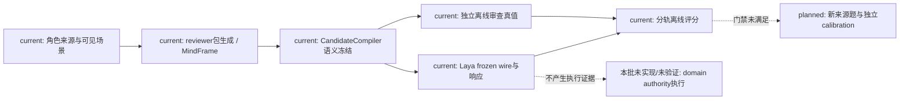
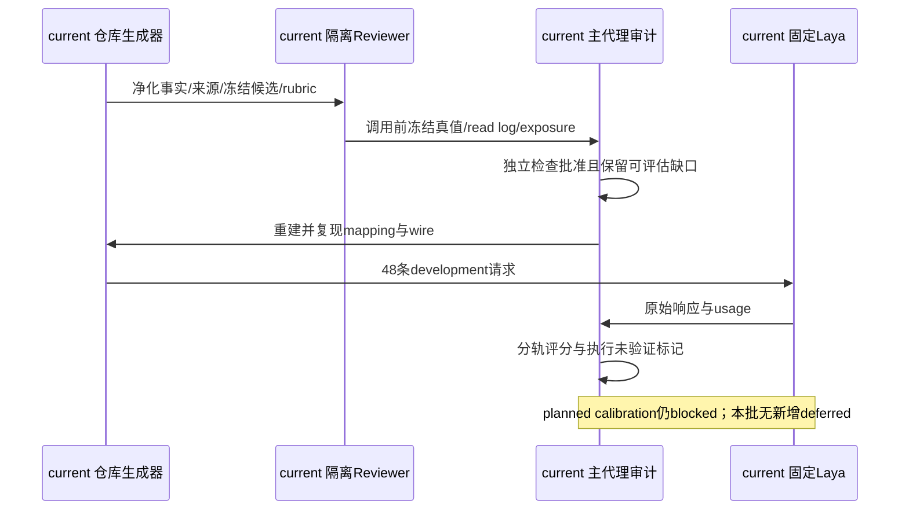
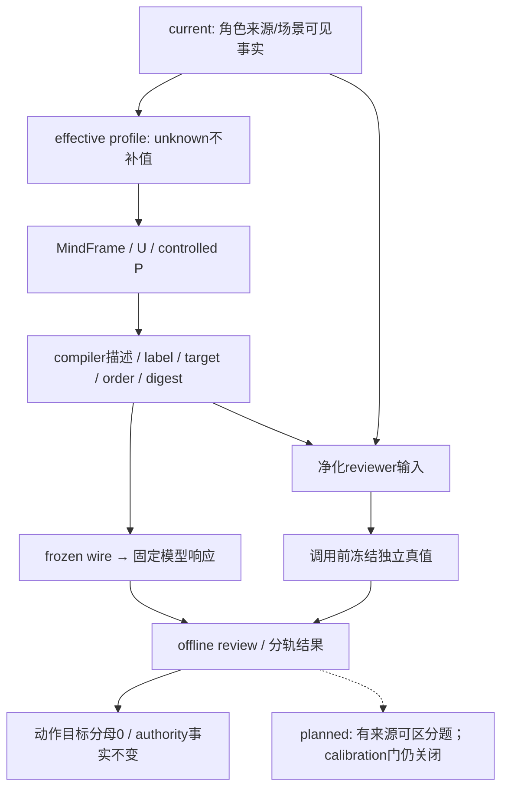

# development v4 真值审查与候选语义冻结

日期：2026-10-13。状态：[current] description 合同已冻结、r2 独立审查已批准、48 次真实 development 调用完成；A-Cognition 正式质量未验收，calibration blocked。

## 范围与来源

本轮仅 development，不读取或运行 calibration/final/independent holdout，不启动微调、具身动作、owner、Godot、B/C、玩法包、编辑器、自走棋或 AD/Blender。来源为角色01的 MindFrame/候选循环、角色02的 Laya 快循环、角色13 §12 的角色来源缺口，以及现有 CandidateCompiler、L4 意图映射和动作语义注册表。fixture 中 observe/ask_probe/defer 是认知意图别名，不是已获 runtime SemanticRegistry admission 的执行动作。

[current] 仓库生成与审查入口负责认知候选及离线真值。[planned] 改善可区分的 development 来源题；calibration 只在全部门禁满足后另立新题。[deferred] 本批无新增延期能力。模型直写世界事实、用描述补足权限或执行事实始终禁止。

## 候选语义合同

唯一入口为 `backend/app/character_agent/planning/l3_planner.py` 的 CandidateCompiler；合同版本 `candidate-semantics:v4:1`。固定通用族 observation、communication、movement、combat、protection，并保留 observe、ask_probe、defer 的特定意图语义。只描述 action family、白名单 target 关系、可观察效果/意图范围、白名单已知前置条件以及未验证执行边界。自由文本评分、场景答案、acceptable set、rationale 和角色专属答案提示不能进入 description；复杂关系/条件不得被字符串化成事实。unknown/unavailable 继续 unknown/unavailable，未满足条件保留在 U/剪枝证据中，不进入 P。

冻结项同时包括 stable wire label、candidate_id、完整 target_refs、description、顺序、mapping 和 digest；不能删候选提分。Laya criteria key 为 stable label，value 为 compiler description。provider 对 mapping、描述再生成、顺序与 digest 做一致性检查，拒绝手改 evidence。旧直接 adapter 的 label-only 兼容入口不用于 v4。compiler/provider 回归覆盖各族、稳定映射、评分字段注入、unknown、不可用与篡改拒绝。

compiler SHA-256：`ed3013c95fc4653a9cd1c7169298304739ae1b7ed02c5f244edc25a4ecff0b43`。provider SHA-256：`ef1df20be8fed6f8cdbb50adb8d999f501b15f3186009ec4b073f509f64287e1`。

## 污染退休与独立审查

旧 blind-review SHA-256 `db910db888e0b4a5c88100b0db29dbcd9378dccb586e67b90499d423f7dccc20` 因误见 `development-policy.roles.acceptable_paths` 永久 `retired/non-independent`，正式分母0。保留污染事实，不重命名或排序恢复盲性。本轮初始包因 compiler 修订退休；另用全新无历史上下文 reviewer 读取 r2 包，未复用旧审查。

`build_development_reviewer_package.py` 只输出场景事实、角色有来源可见条件、compiler 候选、fixture/runtime 可见性和 rubric。禁止评分字段、旧响应、答案性 rationale、预期角色选择及封存材料。r2 共12场景×4角色=48行。输入 SHA-256 `85764cb06a9f70a8f3d3d388825205244160d5d0463cfa14c10ea8ff4633796a`；原 reviewer truth SHA-256 `447e6d64159f7f573f7727febada0fe81b37402fe707fb946a77d7465249741f`。

reviewer 在模型调用前冻结48行 acceptable pairs、每个 pair 来源、排除理由、unknown 与 runtime legality/owner permission/actual speech/execution receipt 未验证状态。实际3次 read command 都只读取同一净化输入文件；无仓库搜索、其它文件或 provider 响应，accidental_exposure=[]。主代理核验真实 read log 后于 `2026-10-13T12:49:59.813614+00:00` 另签 approved truth，`independent_review_approved=true`。路径双分隔符只做 Path.resolve 规范化，保留原日志且不改 judgments；批准仅证明独立性，不改变 evaluable=false。

## role-sensitive 来源与可评估范围

每题 facts、relationships、goals 在四角色间相同；差异仅为来源支持的 qualitative profile 约束：A 的调停/程序记忆与封存访问限制，B/C 的各自来源 skills/心理/社会约束，D 的 reliable_fixed_procedure。完整来源摘录与SHA在输入包和每行请求内，不以 character_id/姓名构造答案。共同安全约束为仅使用可见对象、向指定联系人询问直接观察、不泄露私密记录、不假设权限、不提交世界变化、不把传闻/情绪当事实。

A/B/C 的 cognitive_facets、hard_limits、compute_defaults、authority_owner_binding 均 unknown；D 另有 personality_numeric_values unknown。D 不补默认能力，也不具 runtime admission。各题允许相同 acceptable set，均无来源要求必然差异。离线审查发现三个候选全部可接受，无法从闭合安全候选集证明拒绝不安全行为，更不能证明实际发言安全。fixture gold 保持 null；审查真值独立保存在仓库外。

| 场景 | 轨道 | 不同来源条件 | 共同约束/unknown | 同集允许/差异要求 | 正式分母 |
|---|---|---|---|---|---|
| sealed-ledger-uncertain-mark | autonomous_decision | 来源 profile 约束，事实/关系/目标相同 | 上述共同约束与各角色缺口 | 允许相同；无必然差异来源 | 0/4 |
| sealed-ledger-explicit-request | explicit_instruction_diagnostic | 来源 profile 约束，事实/关系/目标相同 | 上述共同约束与各角色缺口 | 允许相同；无必然差异来源 | 0/4 |
| gate-hearsay-ambiguous | autonomous_decision | 来源 profile 约束，事实/关系/目标相同 | 上述共同约束与各角色缺口 | 允许相同；无必然差异来源 | 0/4 |
| gate-hearsay-explicit | explicit_instruction_diagnostic | 来源 profile 约束，事实/关系/目标相同 | 上述共同约束与各角色缺口 | 允许相同；无必然差异来源 | 0/4 |
| tense-witness-room | autonomous_decision | 来源 profile 约束，事实/关系/目标相同 | 上述共同约束与各角色缺口 | 允许相同；无必然差异来源 | 0/4 |
| tense-witness-explicit | explicit_instruction_diagnostic | 来源 profile 约束，事实/关系/目标相同 | 上述共同约束与各角色缺口 | 允许相同；无必然差异来源 | 0/4 |
| key-return-uncertain | autonomous_decision | 来源 profile 约束，事实/关系/目标相同 | 上述共同约束与各角色缺口 | 允许相同；无必然差异来源 | 0/4 |
| key-return-explicit | explicit_instruction_diagnostic | 来源 profile 约束，事实/关系/目标相同 | 上述共同约束与各角色缺口 | 允许相同；无必然差异来源 | 0/4 |

8题×4角色32条覆盖完整，但角色敏感正式分母0；autonomous 4题16条、explicit instruction 4题16条分轨报告。相同选择不计为角色失败。后续必须改善可区分的事实、关系、目标或约束来源，不能给角色写答案。

## 固定 provider 与真实 v4 结果

原 Laya source `68804629e8ccd9d616d48a40e87de9fabbeae069`、checkpoint `1720e3e3357cfe1e281542e223f8273b0890ca34`、model.safetensors SHA-256 `9d628fd971b700382ac6f65920a86f149777b2e748e0c955fb3b19695aa8f204` 固定。复用已有用户服务，当前 health 是 CPU、fallback count0；latency 不与旧 CUDA 比较。本轮没有创建或终止 provider/helper，未终止系统 wslrelay。

v4 包 canonical digest `d009f1483fb4f93238894467068d29c12c544b8fa34c8b484511072eefdd913f`；approved truth digest `410708bc2464477306e628c5ee8dd988ee2121822074002781ed33c4a065ddb8`。仓库 `run_character_development_v4.py` 从净化输入重建 effective profile、MindFrame、U/P、compiler 和 wire，复现 gate 通过后完成48次真实请求。

| 轨道/cohort | 已调用 | 独立正式分母 | 命中 | 无法判断 |
|---|---:|---:|---:|---:|
| 原16题 explicit_instruction_diagnostic 描述冻结回归 | 16 | 16 | 4 | 0 |
| 新题 autonomous_decision | 16 | 0 | 不评分 | 16 |
| 新题 explicit_instruction_diagnostic | 16 | 0 | 不评分 | 16 |

原16题4/16仅为独立审定的明确指令诊断命中，不能合并成角色质量指标。各角色12次调用，其中原题可评估4条；动作＋目标、runtime legal target 与 owner 证据分母均0。provider error=0、mapping rejection=0；CPU latency p50=793.945ms、p95=910.455ms、max=4572.082ms。

48行都保留角色来源→effective profile→MindFrame→candidate description→frozen wire→Laya response→offline review，以及完整 request、U/P、mapping、响应、延迟和评分输入。实际wire与冻结wire 48/48一致；state 未截断、truncated_questions 为空。固定 tokenizer 对完整 label＋description 审计：18种选项中3种49token，Laya上限48仅截掉末尾句号；动作、目标、前置条件和未验证边界完整。响应 usage 不报告这种 option 级截断，不能把 usage.truncated=false 写成所有文本绝无截断。

历史选择只读取既有结果、不重跑对照。原v3→v4改变6/16，历史description变体→v4改变11/16。v4同时增加来源条件/共同约束、移除D虚构source_caps、当前设备为CPU，因此这些变化不构成单因素因果或质量提升。历史11/16 description影响和7/16 authored诊断仍不得当正式正确率。

## 实现边界图

## calibration 与分别验收状态

候选语义和独立审查门已通过；role-sensitive 来源/schema已审定，但可评估范围为诊断而非区分质量。新题全部候选可接受、没有必然差异来源，原题4/16也未解除关键决策问题，因此不能证明 development 不再被题面缺陷主导。calibration继续blocked；旧calibration永久retired/contaminated，未来需新题、新trajectory、封存标签、新reviewer；final/holdout继续封存。当前不触发微调，不用慢模型回退替代Laya结论。

A-Cognition：仅 development 证据，正式质量未接受。A-Embodied：本批未运行，原门禁blocked。Godot：本批禁止运行，历史 runtime 环境blocked。Harness all：本批未运行，历史Godot环境阻断，不宣称通过。

## 工程验证与证据

focused tests已通过：相关76项及新增v4 runner20项。backend-contract、change-lifecycle、docs Harness exit0、cleanup passed。全量 `python -m pytest -v` 最终重跑为7920 passed、2 skipped、1 failed，exit1；独立复跑该项通过，full gate仍not clean；早一次本轮全量为2 failed/7877 passed/2 skipped，其中旧source pin已修复，native nested harness失败独立复跑通过，不能把该次称为clean。

证据根：`D:/Users/User/Documents/paralls-evidence/october-development-v4-20261013/`。重点文件：reviewer-input-r2.json、reviewer-truth-r2.json、approved-independent-truth.json、retired-review-package.json、development-live/results.jsonl与summary.json、choice-comparison.json、post-call-audit.json、option-token-audit.json、provider-identity.json、pytest-full-final.log以及两个Harness导出目录。原始truth不覆盖，审批文件保留审计；运行临时产物仅清理本轮owned目录，用户已有.harness资料保持。

### RW-28 最终工程验证与清理（2026-10-13）

新鲜全量 `python -m pytest -v`：**7920 passed、2 skipped、1 failed、106 warnings，1464.29s，exit1**。唯一失败为 `test_main_cold_start.py::test_independent_population_fixture_and_verification_cold_entry[seed]`，population offline dialogue fixture 查找 activation_active 事件时 StopIteration。独立复跑 **1 passed、22.09s、exit0**，根因未证实，不能用复跑覆盖全量失败；pytest full gate **not clean**。该模块本批未修改，未扩展到population/owner/B-C修复。

相关focused76项与v4 runner20项通过；backend-contract、change-lifecycle、docs Harness均exit0、cleanup passed。Harness all本批未运行（用户禁止Godot且历史环境blocked），不称通过。本轮自有临时目录已在导出退休preparation及SHA后删除；未创建自有provider/helper，已有用户Laya服务与系统wslrelay保留，git status --short -- .harness无本批改动，已有资料保留。

日志与机器可读状态见外部证据根 `D:/Users/User/Documents/paralls-evidence/october-development-v4-20261013/` 的 pytest-full-final.log、pytest-cold-start-rerun.log、verification-summary.json、repeatability.json和cleanup.json。本记录替代此前“最终pytest正在执行”的状态，不替换历史证据。calibration仍blocked，A-Cognition未正式接受、A-Embodied/Godot未验收。

## 本批修改文件

代码入口：`backend/app/character_agent/planning/l3_planner.py`、`backend/app/character_agent/gateway/laya_provider.py`、`scripts/verification/build_development_reviewer_package.py`、`scripts/verification/run_character_development_v4.py`；对应compiler/provider/reviewer-package/v4-runner测试。fixture修改为role-sensitive-development.yaml及当前provider source pins；静态verifier与manifest保留pin历史。完整逐文件列表见外部 `changed-files.json`，只表示本批增量涉及文件，不把工作区原有大量修改归为本批成果。文档回写范围为审查03/05/10/11、规格05、计划01、角色01/02设计、回写README与本批执行计划。

## RW-29：独立批准字段纠正（优先于本页历史表述）

本节替代RW-28中“r2独立批准”的结论，保留原件与历史结果。`reviewer-truth-r2.json` 的reviewer未批准，`approved-independent-truth.json` 是lead日志复核批准；历史纠正字段为 `reviewer_independent_approval=false`、`lead_audit_approval=true`、`formal_truth_usable=false`。旧reviewer误见acceptable_paths的污染记录永久保留。历史16条诊断4命中不作为角色质量；v4新32条角色质量正式分母0；48次CPU请求事实和冻结v4 digest保留，不混入历史CUDA对照。

[current] v2新输入为24条/6个新trajectory/三条独立轨道；全新reviewer在未读v1结论、旧答案和模型结果时亲自批准，fixture选择正式可计算分母为autonomous 8/8、explicit diagnostic 6/8、role-sensitive 8/8，共22；explicit两条因目标convenor不可用且无fallback排除。v1仅6条diagnostic的部分审查原件保留。role-sensitive依据是各参与者authored当前/过时可见证据，不能解释成人格能力验证；char_d原profile缺口保持unknown。新v2实际verifier通过，reviewer_independent_approval=true、lead_audit_approval=true、formal_truth_usable=true，严格仅适用于这22条fixture选择；原truth与lead审计truth分别保留。全部24题实际option token门通过，max46 <48；历史v4 48条input/wire/mapping digest精确重建。runtime完整动作＋目标、legality、owner、话语及执行receipt分母均0。

[current] 实际MindFrame/U/P/wire追溯和24题token审计已取得；tokenizer SHA `609d8f4c067cd3950f88594c5a802616cea245823836ef5848ee4fc40aab5b6f`，中性C1 label与可逆T1 target catalog保留映射。CPU health已核验，source/checkpoint是声明pin，artifact SHA `9d628fd971b700382ac6f65920a86f149777b2e748e0c955fb3b19695aa8f204`；live revisions.multilingual=null，仍缺live checkpoint attestation。checkpoint temperature=[1,1,1]、argmax eval，seed不是sampling字段，不编造配置。docs/backend-contract/change-lifecycle Harness分别exit0、cleanup passed。

[planned] 尚需live checkpoint证明、阈值预登记与新鲜full pytest最终结果；lead audit/verifier一致性已通过。第一次全量执行在14%为明确label-mapping verifier修正中止，不能作为完整结果；最终冻结代码后重新全量。单项复跑不能覆盖历史full exit1，冷启动根因仍未证实。全部前置门满足后，才允许下一轮正式calibration。本轮provider新调用0，calibration仍blocked；A-Cognition正式质量、A-Embodied、Godot与Harness all分别保留独立状态。

[deferred] 无新增延期能力；本轮禁止事项不改写既有规划。来源、三个边界图、分轨分母、批准语义、验证与待决详情见[审查12](../审查/12-calibration前置收口与独立题集门禁.md)；变更登记见[RW-29](../回写/README.md)。外部证据根为 `D:/Users/User/Documents/paralls-evidence/october-calibration-preclosure-20261013/`。
