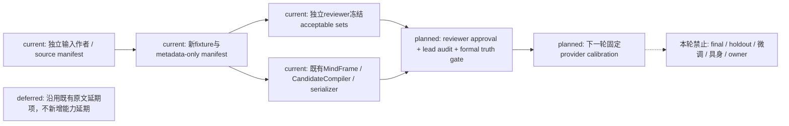
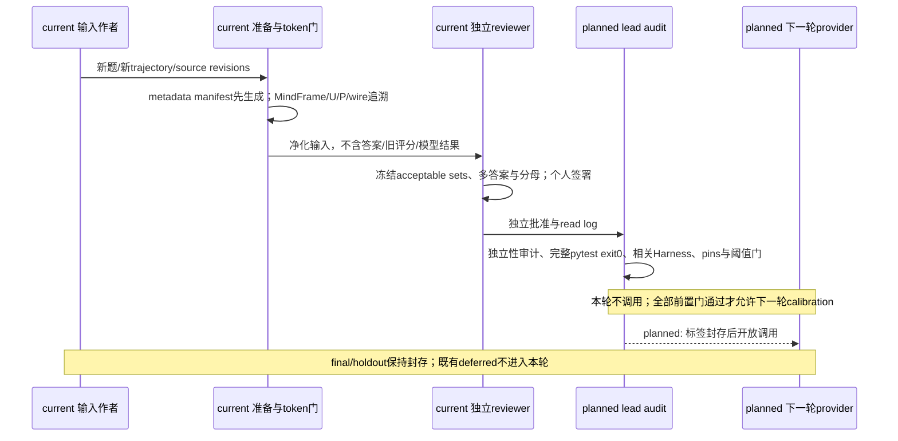
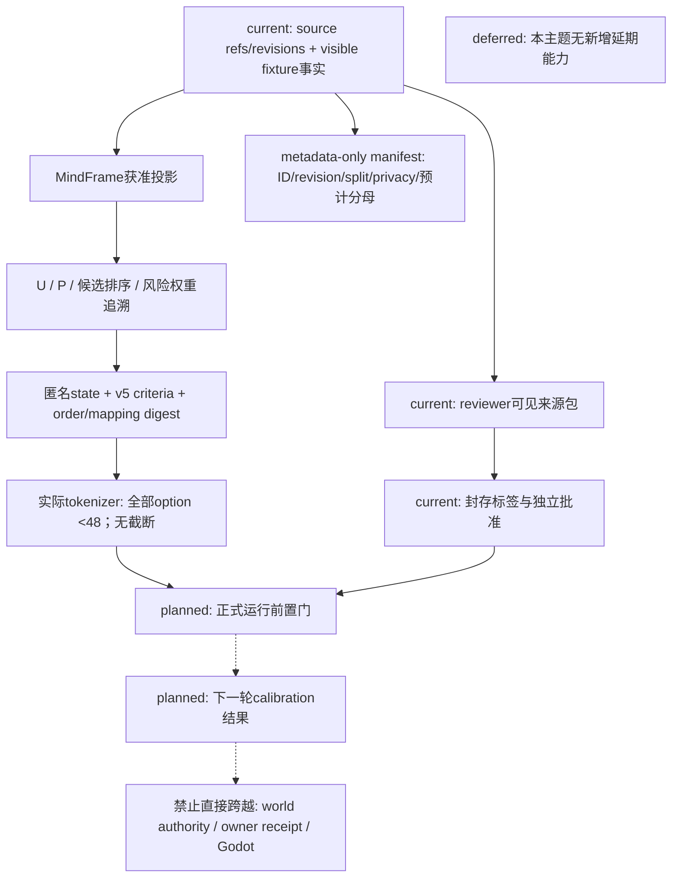

# Calibration 前置收口与独立题集门禁

状态：`analysis/planned/non-authorizing`；日期：2026-10-13。本记录优先于 RW-28 中关于独立批准的表述，不覆盖原始证据。来源为角色01心智模型、角色02 Laya快循环、角色13能力与算力设计，收敛到[规格05](../规格/05-角色能力图谱、认知包络与动态算力规格.md)和[计划01](../计划/01-角色心智运行时基础实施计划.md)。

| 原始来源 | 本轮对应边界 |
|---|---|
| [角色01](../角色/01-角色心智模型与模型驱动运行时设计.md) §3、§5、§7 | L1-L4职责、MindFrame输入与模型数据流 |
| [角色02](../角色/02-Laya快循环与快慢思考战斗设计.md) §3、§5 | 快循环能力与升级/降级；慢模型不能替代本轮Laya质量 |
| [角色13](../角色/13-角色能力图谱、认知包络与动态算力设计.md) §9、§10、§12、§13 | 门禁、冻结审计、角色来源验收及分别统计 |

现有实现入口为 `backend/app/character_agent/` 的MindFrame、planning/l3_planner.py及gateway/laya_provider.py；新fixture不增加心智对象、角色注册或authority。新准备器的实际路径、逐题投影和执行证据在生成后登记，不能从本页设计路径推定已验证。

## 当前事实与批准纠正

历史 `reviewer-truth-r2.json` 的 reviewer 自身未批准；`approved-independent-truth.json` 是主代理读日志后批准。两份原件保留，read log、净化输入复核与原污染记录分别保留。纠正后的历史字段为 `reviewer_independent_approval=false`、`lead_audit_approval=true`、`formal_truth_usable=false`。主代理批准不能替代 reviewer 的独立签署；净化输入或重新命名不能恢复已污染 reviewer 的盲性。早先误见角色级 acceptable_paths 的 reviewer 永久 retired/non-independent。

v4 48条真实 CPU 请求、provider error=0、mapping rejection=0仍是历史运行事实。原16条明确指令诊断当时报告分母16、命中4；纠正批准字段后不得称为已获独立批准的正式角色质量。新增32条同事实、关系、目标的题没有来源支持的决策差异，正式角色质量分母0。v4描述/请求digest保留可重建，不借新合同改写历史。

历史全量 pytest 为7920 passed、2 skipped、1 failed、exit1；单项通过不能覆盖全量失败。本轮冷启动诊断先保留完整 traceback、fixture入口与代码变更；只改善失败可观察性不能证明根因修复，也不能在未证明竞争、污染或环境原因时标记既有 flaky。本轮新鲜全量结果与 Harness 导出待验证记录更新。

## 新输入与三条轨道

[current] 新输入目录为 `backend/tests/fixtures/character_evaluation/calibration_preclosure_20261013/`：24条输入、6个新事件/trajectory groups，三轨各2场景、每场景4个匿名参与者。输入作者没有编写 acceptable sets；`inputs.json`、`sources.json` 和 metadata-only manifest 与评分标签分离。v2全新独立reviewer已亲自批准输入来源与fixture选择；v1仅6条diagnostic的部分审查原件外部保留，v2 reviewer未接触v1结论或历史答案。实际可计算fixture分母为autonomous 8/8、explicit diagnostic 6/8、role-sensitive 8/8，共22；explicit排除2条convenor不可用且无fallback的诊断。该分母没有任何provider得分。

| 轨道 | 新场景 | 评估边界 |
|---|---|---|
| autonomous_decision | indicator_gap、reply_slips | 只提供事实、记忆、目标、关系和约束，不直接给下一步 |
| explicit_instruction_diagnostic | timeline_check、muted_bell | 明确安全/权限/隐私/事实约束遵循，单独统计，不记角色质量 |
| role_sensitive_decision | message_channel、shared_reminder | 只有来源真实改变合理集合、排序或风险权重才计算决策分母；纯表达差异排除 |

每条差异保留 source reference、revision、privacy/visibility、MindFrame字段、U/P影响与 necessary/possible/not-required 判断。新事件属于 authored fixture，不是 runtime world truth；profile记忆/目标和 dossier关系种子分别标记来源。source_peer不得自动绑定新事件contact；身份、姓名、职业不能作为答案提示。char_d人格、认知、compute、能力与权限缺口继续unknown，不因新增输入填补。

[current] 全新独立 reviewer 仅读取净化后的v2新输入及来源摘录，在任何provider结果开放前冻结逐题 acceptable action set、多答案、fixture-only候选、分母类型与排除原因并亲自签署。read log/accidental_exposure保留；实际reviewer工具日志经lead核验，仅读取指定v2净化输入。实际verifier确认新v2 reviewer_independent_approval=true、lead_audit_approval=true、formal_truth_usable=true，严格适用于22条fixture选择，不能替代完整runtime门。原truth与lead-audited-truth分别保留。role-sensitive的有效差异为各参与者authored当前/过时可见证据，不是profile人格、认知或算力验收。新source digest和新trajectory不能替代对 development题目、场景答案和轨迹的非复用审查。final/holdout继续完全封存。

正式 runtime legality、owner permission、实际话语隐私、执行receipt和动作＋目标质量仍unknown/分母0。独立fixture决策分母即使非零，也不能解除这些边界。

## 输入与模型固定门

[current] 新候选表达采用独立v5语义合同与实际tokenizer门，保留action family、target、前置条件及未验证边界。每个实际label+description必须严格小于48token；缺tokenizer身份、超限或option-level truncation均fail closed。description、顺序与mapping digest重新冻结。v4历史描述不得被v5悄然覆盖。

[current] 全部24题实际token门通过，max46 <48；tokenizer SHA `609d8f4c067cd3950f88594c5a802616cea245823836ef5848ee4fc40aab5b6f`，候选使用中性C1 label、可逆T1 target catalog。v4全部48条input/wire/mapping digest精确重建。声明source commit `68804629e8ccd9d616d48a40e87de9fabbeae069`、checkpoint revision `1720e3e3357cfe1e281542e223f8273b0890ca34`、artifact SHA `9d628fd971b700382ac6f65920a86f149777b2e748e0c955fb3b19695aa8f204`、model multilingual；health证实实际CPU，但live revisions.multilingual=null，live checkpoint attestation仍blocked。checkpoint temperature=[1,1,1]、argmax eval；seed不是sampling字段，不编造seed旋钮。历史CUDA与v4 CPU结果不混合比较。本轮provider新调用0，离线token审计不是模型质量证据。

[current] 实际追溯：事实、可见证据与约束进入 `cognition_workspace.event_inbox[0]`；目标进入 `runtime_state.goal_context.payload.current_goal_state.goals`；所有记忆进入 `memory_evidence.cognitive_anchor.payload.active_anchors`；关系进入 `relationship_seed_context.payload.relationships`。逐题对照MindFrame、U/P、冻结候选与实际共享serializer的完整wire；来源metadata与差异影响说明不作为模型答案输入，不把acceptable action写入state。

## 边界图

### 架构图

### 主流程时序图

### 数据流图

## 验证与独立状态

外部证据根：`D:/Users/User/Documents/paralls-evidence/october-calibration-preclosure-20261013/`。代码/fixture/verifier变更后要求focused tests、完整 `python -m pytest -v`、相关获准Harness、`git diff --check`、外部证据导出与本轮owned临时资源回收。仅真实full exit0记clean；不终止系统wslrelay或用户已有服务；`.harness`只检查本轮增量，不删除用户资料。

| 门/范围 | 本记录写入时状态 |
|---|---|
| 新鲜全量pytest | 7937 passed、2 skipped、exit0；本轮 clean，历史失败保留 |
| 独立reviewer / lead audit | v2 reviewer/lead/formal truth均true，仅22条fixture选择；历史r2分别false/true/formal false |
| 新题正式分母 | fixture选择22：autonomous8、explicit6、role-sensitive8；runtime动作/legality/owner/话语/receipt为0 |
| 来源→MindFrame/U/P/wire | 已取得实际编译与serializer追溯；角色敏感仅当前/过时可见证据 |
| provider/device/token固定 | CPU health、v5、24题max46、tokenizer SHA已核验；live checkpoint attestation缺失 |
| calibration | blocked：live checkpoint attestation与阈值预登记未完成；调用0 |
| A-Cognition | 前置工程/输入证据，正式质量未接受 |
| A-Embodied | 未运行，blocked |
| Godot | 本轮禁止运行；历史环境缺失单列 |
| Harness all | 本轮不运行；docs/backend-contract/change-lifecycle各exit0、cleanup passed |

关键决策阈值须预先登记。只有正确输入进入wire、描述无歧义无截断、独立truth批准、非零正式calibration分母、固定provider/device且关键决策低于阈值全部成立，才讨论微调。慢模型回退不能替代Laya质量，calibration不得用于调参掩盖决策错误。[deferred] 本主题无新增延期项；本轮禁止范围不表示永久延期或新授权。

## 本轮最终工程结果（唯一待更新区块）

本轮 2026-10-14 已完成固定官方缓存的 Hub repo ID 离线加载验证：`snapshot_download(..., local_files_only=True)` 解析 `convaiinnovations/laya-multilingual@1720e3e3357cfe1e281542e223f8273b0890ca34`，权重大小 `643835514`、SHA `9d628fd971b700382ac6f65920a86f149777b2e748e0c955fb3b19695aa8f204`。自有 provider 使用 `HF_HUB_CACHE=/mnt/d/laya-probe-cache/official-snapshot-attempt`、`HF_HUB_OFFLINE=1`、`LAYA_EXTRA_MODELS={"multilingual":"convaiinnovations/laya-multilingual"}`、`LAYA_MODELS=multilingual`、`LAYA_DEFAULT_MODEL=multilingual`、`LAYA_DEVICE=cpu`，监听 `127.0.0.1:18765`，本轮 PID 5802 已回收；PID 555/8765 未触碰。健康结果为 loaded 仅 multilingual、revision 等于固定 checkpoint、device/checkpoint_devices 均为 cpu；真实 `/v1/systemone` 返回 200。该结果证明 Hub ID 分支会产生非空 health revision；本地 snapshot 路径分支不设置 `Agent.revision`，不能作为同等身份证据。

阈值 reviewer/lead 签署与 v2 truth approval 已复核，checkpoint 身份门已由本轮同实例 health attestation 补齐，因此正式 calibration 已按冻结规则执行。22 条正式请求全部封存后才读取标签；两条不可评分 diagnostic 保留在冻结总分母，未计入有效样本。final/independent holdout 未读取或运行，阈值 digest 保持 `sha256:a4bb6f41bc165ed1a645550ee54a7e1830ff5f5dbd8843bb73ecfbf6b6517ba1`。

本轮评分：autonomous `0/8`（有效 8/8，要求至少 6）；explicit diagnostic `0/6`（有效 6/6，要求至少 5）；role-sensitive `1/8`（有效 8/8，要求至少 6）；Policy A 三轨未同时通过。provider error=0、mapping error=0；延迟 min/max/mean=`753.275/921.623/790.193 ms`。逐题 archive digest=`sha256:28156259028341ea03b67de11f5b8a97f3daa624808de497b3427edab2caf5b1`，scored digest=`sha256:2113662a7d64ec26dcc3ab78c5abddd78e2e4a97f04fe2dab1a4a66d8a2cd109`，证据在仓库外 `D:/laya-probe-cache/october-calibration-run-20261014/`。

最终冻结代码后的全量 `python -m pytest -v`：**7937 passed、2 skipped、exit 0，23:51**。修复前的16 failures与历史full exit1均保留；修复后 focused 80 passed、v4 runner 21 passed，backend-contract Harness exit0且cleanup passed。`git diff --check` 无错误（仅既有 CRLF 警告）；`.harness` 本轮无新增或删除文件，wslrelay PID59520 保持。新v2 reviewer/lead/formal truth均true（22条fixture选择）。相关Harness已分别exit0、cleanup passed；此结果不等于Harness all。

审核证据：`preparation-v2/reviewer-tool-read-audit.json`；净化输入SHA `9d60dde395aa2fa5e9218bea3a1f62fa8df605f966984c7bead425098c2de475`；source input digest `ae9e92630e452f8e9d2ea2506c808fc77b3a40043aaec515ce923a510ea0a60c`。全部路径相对本页外部证据根，原始独立truth与lead审核truth均保留。

本批 provider token gate 导致旧 development source pin 确定性过期；完整 traceback 中16项均停在 provider SHA 检查，修复为显式更新 source pin（保留旧→新转换）及历史 preparation 显式 v4。未放宽 pin 检查或修改测试期望。冷启动历史缺失 activation_active 本轮未复现，新增诊断与拒绝回归；根因仍未确定，不称已修复或无关 flaky。

### 2026-10-14 封存后核对与归因限制

本轮正式calibration实例为PID 6110，启动时间 `Wed Oct 14 15:46:02 2026`、端口18765；前序身份探针PID 5802与正式实例分开记录，两者均已回收。正式实例的前后health记录loaded仅multilingual、固定checkpoint revision、实际checkpoint device CPU。身份attestation与准入记录分别位于仓库外 `D:/laya-probe-cache/checkpoint-live-attestation-20261014.json`、`D:/laya-probe-cache/october-admission.json`，逐题archive/score位于 `D:/laya-probe-cache/october-calibration-run-20261014/`。

封存响应的usage显示21/22条 `truncated=true`，同21条含 `truncated_questions=[choice]`；state丢弃55–1067 token。冻结评分仍为autonomous 0/8、explicit diagnostic 0/6、role-sensitive 1/8，有效样本字段仍为8/6/8，分母、标签、阈值与逐题记录不改。候选option token审计不能证明完整state进入模型；现有输入截断限制将失败全部归因于模型选择能力，必要领域微调触发条件尚未成立。本轮不训练，不修改同批输入后重测，不以慢模型替代质量结论。外部 `post-archive-token-audit.json` 保留逐题usage。

封存完整性复核：score以去除自身digest字段后的canonical JSON（UTF-8、sort_keys、ensure_ascii=false、紧凑分隔符）重算，与登记 `sha256:2113662a7d64ec26dcc3ab78c5abddd78e2e4a97f04fe2dab1a4a66d8a2cd109` 一致。archive采用同口径重算为 `sha256:a9169483075a17220ccd75ea845d507d94327c88fec75cd5e1444e87c639dbb8`，与登记 `sha256:28156259028341ea03b67de11f5b8a97f3daa624808de497b3427edab2caf5b1` 不一致；原封存前image/生成口径尚未恢复，不能称archive digest完整性已验证，也不据此推断篡改。保留原文件及登记值，此证据缺口需关闭后才能接受正式证据链。

A-Cognition保留本轮失败，仍缺完整输入/token门及archive完整性收口、后续独立final/holdout和runtime完整动作＋目标/legality/owner/receipt验收；22条fixture不能证明完整人格、认知上限、算力或具身质量。final/holdout未读取、未运行，A-Embodied独立blocked；Godot及其他关闭范围不启动。

### 2026-10-14 本批规格与计划回写：RW-31 calibration 只读取证

[current] 本轮原证据未重写；新只读诊断与三图见 [仓库外取证报告](D:/laya-probe-cache/calibration-audit-20261014-root/report.md)，逐题/清单/验证见同目录 per-question.json、inventory-expanded.json、verification.json。此项修正前文“archive原口径未恢复”的现状：历史发送命令明确 archive=canonical(records数组)，UTF-8、对象键排序、数组原序、ensure_ascii=false、compact、无末尾换行，185143字节，重算281562…一致。旧审计错误套用全对象去自身digest口径；score211366…与22题request/response digest也一致。records封存不覆盖顶层health/process，原HTTP抓包及服务端token IDs未保存，均unknown，不声称全链verified。

[current] 冻结prepared context state、wire与发送record逐题相同；正式发送直接取冻结wire，绕过runtime backend/provider.complete。固定tokenizer与Laya纯sequence代码离线复现全部22题usage：max_len1024/head_max_len256，题头195/152加SEP后state room828/871；21条在common.build_sequence取state_ids[:room]丢尾55–1067，唯一muted_bell participant04无截断。不是仅审计记录截断。原评分0/8、0/6、1/8及valid_samples8/6/8保持，不删除题、不缩小正式22分母；总观察命中1/22，不称0/22。历史评分漏检usage.truncated，与冻结invalid_handling.truncated合同冲突；calibration完整输入验收blocked，微调触发条件不可评估。另发现发送脚本封存前已加载含标签truth以筛正式ID，“封存后才读取标签”不能证明完整隔离；是否泄漏到模型unknown，不能擅自断言。已暴露calibration不是盲集或holdout。

[planned] 仅提出完整state+head预算门与足够max_len传输方案、truncated评分拒绝、无truth的ID-only准入及明确archive范围测试要求，均未实施；保留fixture/source/truth/U/P/阈值。扩大预算也会使模型看到原未见尾部，必须重新冻结transport/model-input digest、保留原digest，并由fresh独立reviewer复核合同及暴露边界；任何语义/候选/来源改变另冻结对应输入，不能覆盖原证据。细节与对应测试要求见外部报告，不授权下一轮调用。

[deferred] final/independent holdout继续封存未读未跑；A-Cognition质量未验收，A-Embodied/Godot/B/C/玩法包/编辑器/自走棋/AD/Blender保持关闭。阈值 manifest digest 重算一致且锁定 `sha256:a4bb6f41bc165ed1a645550ee54a7e1830ff5f5dbd8843bb73ecfbf6b6517ba1`。本轮provider/训练调用0，无运行时代码变更，不跑全量pytest；本条为取证回写，不是修复或运行时验收。
[RW-32 修复后诊断回写](../回写/calibration-repair-20261014.md)记录完整预算、runner/scorer 隔离、envelope 合同及本轮运行阻断证据；不得将本轮结果称为 final/holdout。

[RW-32 后续审查登记] 原2081是拼接估算；固定官方逐项head/特殊token计数最大2091且22/22等于封存usage。独立reviewer `/root/truth_reviewer_retry` 在未接触结果的读取范围内签署v3实际输入适用性，绑定来源、逐题request/candidate映射、旧truth、22题8/6/8分母及固定threshold；lead核读日志，未代签或改acceptable sets。评分准入后对原archive给出0/8、0/6、1/8，Policy A诊断未通过。普通运行时仅显式预算启用；v2执行身份/读日志未绑定。前述blocked是当时状态，本条为后续诊断，不是final/holdout验收；证据与限制见[RW-32后续](../回写/calibration-repair-20261014.md)。

[Harness登记] 本轮 all 的具体首阻断为 `character-agent-execution` 未发现 Godot 可执行文件，`failure_kind=environment`、attempt 0、cleanup passed；前五步通过，其余未执行。上一轮 all 逐步报告未留存，不能把本轮错误追认为其原始失败原因。
