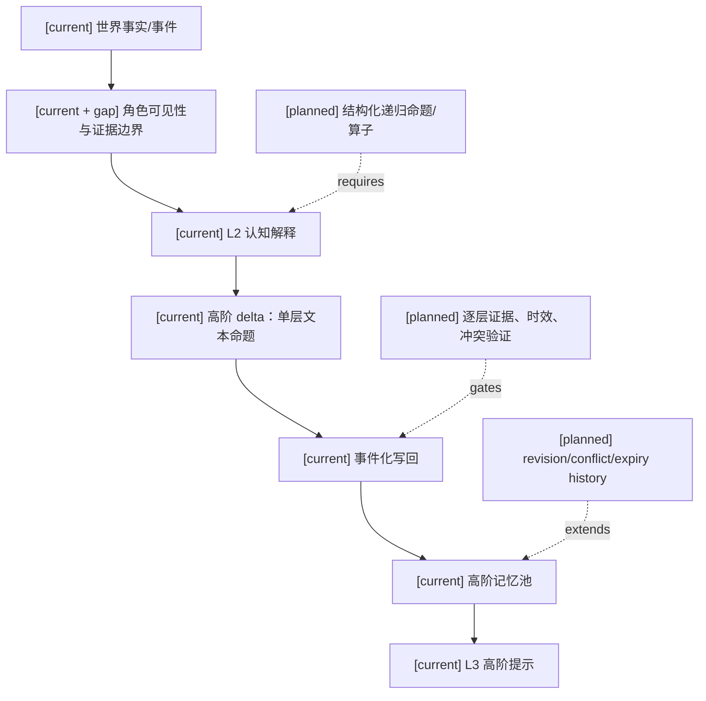
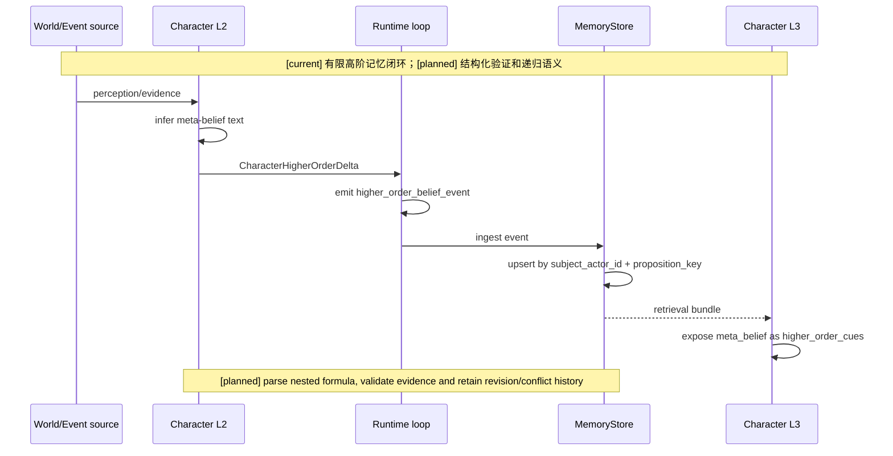
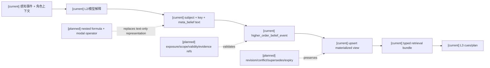

# 高阶记忆设计与实现差距

状态：`analysis/non-authorizing`

范围：本专题只审查原项目当前的角色高阶记忆设计、代码实现和测试证据。本文不新增运行时权限、不授权新的存储或事件系统，也不讨论其他项目分支。

## 1. 结论摘要

原项目已经实现了一个**有限的一阶高阶记忆闭环**：角色可以保存“关于另一角色的知识、信念或怀疑”的记录；该记录经过认知输出、事件写回、内存存储、召回后，能够进入后续 L3 规划。这个闭环有类型模型、置信度、来源事件和时间戳，并且有运行时与规划测试证明。

但设计要求的高阶心智逻辑还没有完整实现。当前高阶命题的核心内容仍是字符串 `meta_belief`，由 `subject_actor_id + proposition_key` 定位并覆盖当前记录。因此系统还不能可靠表达、验证、遍历或修订任意深度的递归命题，例如：

```text
角色 A 知道：角色 B 相信：角色 C 知道：命题 p
角色 A 希望：角色 B 以为：角色 C 不知道：命题 p
角色 A 认为：角色 B 知道：角色 A 知道：命题 p
```

准确判断是：**“有限高阶记忆的存储、写回和规划接入”已实现；“结构化、可验证、可递归运行的高阶认知系统”仍是设计与实现之间的 gap。**

## 2. 设计要求与实现状态

| 能力 | 状态 | 当前证据或差距 |
|---|---|---|
| 独立的高阶记忆类型 | [current] | `CharacterHigherOrderMemoryRecord` 独立建模，并与 event、observation、knowledge、social 分池 |
| 角色保存关于其他角色的判断 | [current] | 记录 `subject_actor_id`、`proposition_key`、`meta_belief`、`confidence` |
| 认知输出进入事件写回 | [current] | L2 产生 `CharacterHigherOrderDelta`，runtime 转成 `higher_order_belief_event` |
| 事件进入记忆存储和召回 | [current] | `MemoryStore` 接收事件并返回 higher-order memory bundle |
| 高阶记忆影响 L3 规划 | [current] | L3 将 `meta_belief` 转为 `higher_order_cues` |
| 来源事件和时间可追溯 | [current] | 记录 `source_event_id`、`source_event_refs`、`producer_ts` |
| 任意深度递归命题 | [planned] | 当前只保存字符串，没有递归命题树、嵌套节点或深度字段 |
| 结构化认知算子 | [planned] | 尚未区分 `knows`、`believes`、`hopes`、`intends`、`models` 等算子 |
| 每一层认知的证据验证 | [planned] | 没有可执行的“谁暴露给谁、谁知道什么、谁知道谁知道”的逐层验证器 |
| 可见性、时效和失效条件 | [planned] | 设计要求已有边界，但高阶记录本身没有完整的 exposure、scope、expiry、invalidation 合同 |
| 冲突集合与信念修订轨迹 | [planned] | 当前按 key 覆盖物化记录，历史可由事件回放获得，但当前模型没有显式 revision/conflict 集合 |
| “希望某主体相信某命题”等目标态度 | [planned] | 当前 `hope` 主要属于情绪/ affect 维度，不是结构化高阶希望命题 |
| 设计中允许延期的项目 | [deferred] | 本专题没有额外延期项；永久禁止越权读取/写入角色私有记忆仍然有效 |

## 3. 当前实现闭环

### 3.1 数据模型

当前记录模型包括：

```text
CharacterHigherOrderMemoryRecord
├── memory_id
├── actor_id
├── subject_actor_id
├── proposition_key: str
├── meta_belief: str
├── confidence
├── source_event_id
├── producer_ts
├── summary
└── source_event_refs
```

`proposition_key` 和 `meta_belief` 都是字符串。`subject_actor_id` 表示被谈论的主体，但没有字段表达该主体内部的下一层命题结构。

### 3.2 写入、存储与召回

当前链路是：


`CharacterHigherOrderMemory.upsert_meta_belief` 按 `(subject_actor_id, proposition_key)` 查找当前角色已有记录，找到后直接替换，找不到则追加。这个行为适合保存一份当前判断，但不等于递归命题存储，也不等于保留可查询的信念修订图。

### 3.3 规划接入

L3 规划会读取认知解释中的高阶 delta，将非空 `meta_belief` 加入 `higher_order_cues`。这证明高阶判断能够影响规划上下文，但目前主要是把文本提示传入规划层；规划层并不解析命题内部的主体、算子、嵌套层级或证明依据。

## 4. 已达到的设计要求

### 4.1 高阶记忆不是普通知识的别名

高阶记忆有单独的模型、存储池、事件类型和 retrieval bundle 字段。它不会被直接压入普通 knowledge memory。该分层满足“关于他者心智状态的判断”与“关于世界的事实知识”在类型上分开。

### 4.2 写回路径是事件化的

角色认知结果不是直接调用记忆对象修改状态，而是先生成 `higher_order_belief_event`，再由 `MemoryStore` 接收。这保留了来源事件、生产时间和运行时回放入口，符合“认知结果需经过写回边界”的方向。

### 4.3 置信度、来源和时间已进入记录

模型和事件携带 `confidence`、`source_event_id`、`producer_ts`，记录还可以携带 `source_event_refs`。因此当前实现已经能表达“这是某个时间、基于某个来源产生的带置信度判断”，只是还不能表达每一层嵌套判断分别依赖什么证据。

### 4.4 高阶记忆能进入后续规划

L3 suggestion/intent plan 会暴露 `higher_order_cues`，测试覆盖了例如“某角色怀疑另一角色知道更多”的输入。因此它不是只写入数据库而不参与行为的死数据。

## 5. 未实现到位的关键差距

### 5.1 字符串命题代替了结构化命题

当前：

```text
subject_actor_id = char_b
proposition_key = obj_letter:is_sensitive
meta_belief = "char_b suspects char_c knows more"
```

这个表示无法可靠回答以下问题：

- `char_b` 对谁的哪一个命题持有什么态度？
- “知道”“相信”“希望”“意图”分别是什么算子？
- `char_c knows more` 的对象命题是什么？
- 该命题是否还能继续嵌套下一层？
- 哪一层被新证据推翻，哪一层仍然成立？

因此目前是“可展示的自然语言判断”，不是可遍历的认知结构。

### 5.2 没有任意深度的递归表达

模型只声明一个 `subject_actor_id` 和一个字符串 `meta_belief`，没有：

```text
operator
proposition
subject / object
nested_proposition
depth
negation
temporal_scope
```

所以 `A 知道 B 知道 C 知道 p` 与 `A 知道 B 怀疑 C 知道 p` 只能靠文本约定区分，代码不能对它们做结构化查询、校验或计算。

### 5.3 没有逐层证据和可见性验证

现有设计明确区分世界事实、角色暴露、知道、记住和解释，但高阶记忆记录本身没有完整携带并由运行时执行的：

```text
exposure_basis
visibility_scope
evidence_type
valid_at / valid_until
invalidation_conditions
belief_revision
```

因此可以保存“某角色怀疑另一角色知道更多”，但不能仅凭记录本身证明：

```text
A 真的看到了足以判断的证据
A 有理由认为 B 知道 p
A 是否知道 B 知道 p
```

这也是为什么当前高阶记录应理解为 bounded inference 的结果，而不是经过完整 epistemic validation 的事实。

### 5.4 Upsert 覆盖当前视图，不是完整修订模型

同一个 `(subject_actor_id, proposition_key)` 的新记录会替换旧记录。这样能提供简单的当前视图，但无法在记录层直接回答：

- 过去的信念是什么？
- 哪次证据导致置信度下降或上升？
- 两个相互冲突的判断是否同时存在？
- 当前判断 supersedes 哪一个版本？
- 判断何时过期？

事件时间线仍可用于回放，但记忆记录本身尚未形成显式的 revision、conflict、supersedes 和 expiry 语义。

### 5.5 “希望”还没有成为认知命题

当前 affect 设计中的 `hope` 可以表示角色的情绪或动态状态，但它不等价于以下结构化命题：

```text
A hopes p
A hopes B believes p
A hopes B believes C does not know p
```

如果后续行为需要利用、操纵或对抗这些态度，就必须把“希望的对象”和“希望的嵌套命题”单独建模，不能用情绪数值或自然语言摘要替代。

## 6. 架构边界图



## 7. 主流程时序图



## 8. 数据流图



## 9. 验证证据

已存在的测试证明以下有限闭环：

1. L2 能把 `higher_order_deltas` 映射为 `CharacterHigherOrderDelta`。
2. Runtime 能把该 delta 写为 `higher_order_belief_event`。
3. MemoryStore 能把事件写入 higher-order memory bundle。
4. L3 能把高阶判断暴露为 `higher_order_cues`。
5. 记录可带来源事件、生产时间和置信度。

可复现的聚焦测试命令：

```text
python -m pytest -q backend/tests/test_character_agent_cognition_writeback.py backend/tests/test_character_agent_l2_reasoning.py backend/tests/test_character_agent_l3_planning.py
```

这些测试证明的是当前闭环可工作，不证明任意深度递归、逐层知识验证或完整信念修订已经实现。

## 10. 后续实现验收边界

后续若要把设计要求真正落地，至少需要同时满足以下可观察条件：

- 能以结构化数据表示 `K/B/H/I/M` 等认知算子及嵌套命题，而不是依赖 `meta_belief` 字符串解析。
- 能遍历和限制认知深度，并对每一层绑定主体、命题、有效时间和证据引用。
- 角色只能基于其可见、可接收或有效传播的证据形成高阶记忆；世界事实不能直接升级为角色知道。
- 新证据能产生修订、冲突、过期或撤回状态，并保留可回放的历史，而不是只有最后一条 upsert 结果。
- L2、写回、召回和 L3 使用同一套结构化命题合同，且无私有记忆越权读取或写入。
- 测试至少覆盖二阶、三阶命题、否定/冲突、证据缺失、过期修订和重复事件幂等性。

在这些条件满足前，不能把当前能力表述为“完整高阶心智逻辑运行时”；应表述为“已有高阶记忆骨架和有限闭环”。

## 11. 依据文件

- `backend/app/character_agent/models/higher_order_memory.py`
- `backend/app/character_agent/models/cognition_delta.py`
- `backend/app/character_agent/memory/higher_order_memory.py`
- `backend/app/character_agent/runtime/runtime_loop.py`
- `backend/app/character_agent/storage/memory_store.py`
- `backend/app/character_agent/planning/l3_planner.py`
- `docs/10月分析/规格/04-角色记忆分层、召回与写回规格.md`
- `docs/superpowers/specs/world-character-siming-authority-mainline/2026-08-22-character-simulation-memory-seed-continuity-design.md`
- `backend/tests/test_character_agent_cognition_writeback.py`
- `backend/tests/test_character_agent_l2_reasoning.py`
- `backend/tests/test_character_agent_l3_planning.py`

