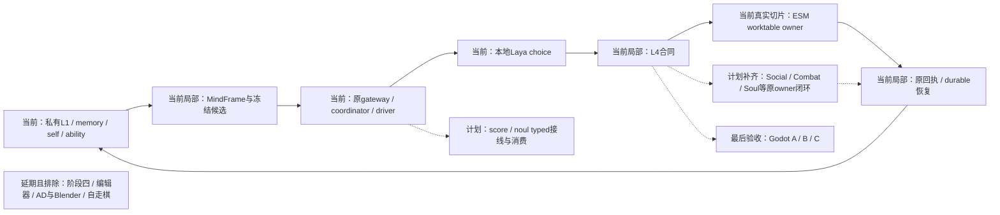
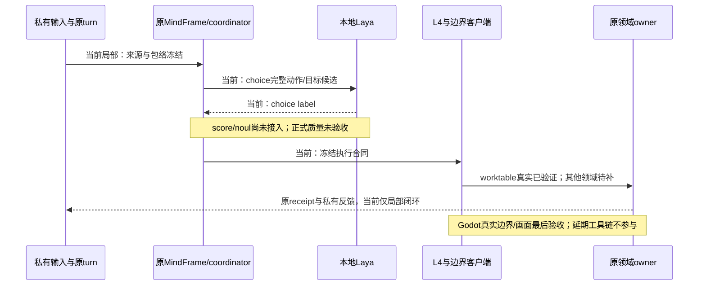
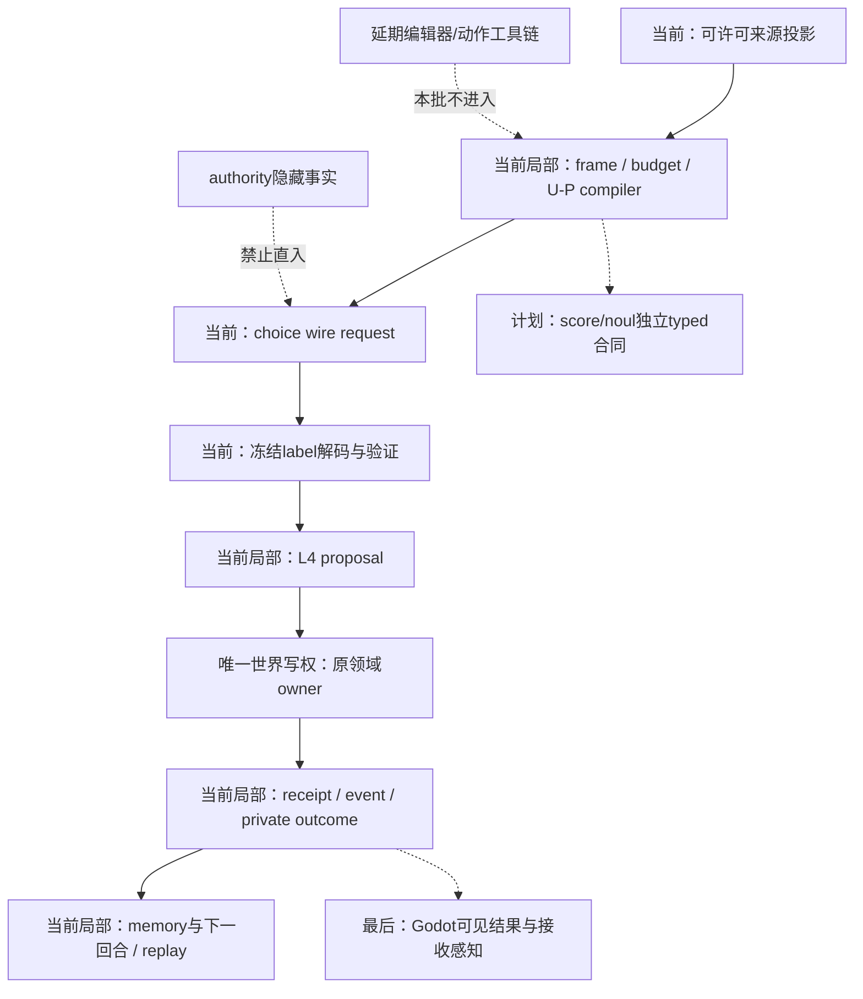

# Laya与角色智能体设计实现差距

更新日期：2026-10-23。状态：`analysis/non-authorizing`；实现为局部到位，整体未验收。

本文记录既有设计目标与当前实现差距，不新增模型权限、领域owner或运行时协议。执行进度见[阶段一至三执行进度](../计划/09-阶段一至三执行进度.md)，逐批原始证据见[统一验收矩阵](../回写/october-stages-1-3-acceptance-20261020.md)。本文复用历史运行证据，本次仅完成代码与文档核对。

## 设计目标与结论

依据[角色心智总规格](../规格/01-角色智能体心智运行时重构总规格.md)、[能力包络与质量规格](../规格/05-角色能力图谱、认知包络与动态算力规格.md)、[动作承诺规格](../规格/07-角色动作承诺具身反馈与失败恢复规格.md)及[协同表达规格](../规格/08-角色协同表达与精神边界规格.md)，目标是同一角色从私有L1信息、记忆、自身状态与能力编译MindFrame，经快慢模型产生合法意图，沿L4交由原领域owner提交；真实反馈进入下一回合，并可取消、恢复、回放。Laya是跨玩法快决策核心，连续战斗和协同是必验消费者；模型与Godot都不拥有世界真值写权。

当前已接通本地Laya的**choice一种输出类型**，并取得worktable单owner真实闭环证据；不能据此称Laya三类型、完整角色智能体、多领域闭环或正式质量已完成。差距不止恢复、质量和Godot三个尾项，还包括生产输入/候选完整性、动作与owner接线、学习、慢思考触发、语音与协同等核心能力。

## Laya三种输出类型核对

| 类型／规格语义 | 请求与响应实现 | 生产消费／测试 | 当前验收 |
|---|---|---|---|
| `choice`：候选选择与概率分布 | `laya_provider.py::build_wire_request`仅构造`questions.choice`；`complete`仅读`answers.choice`并校验冻结候选 | `model_provider.py`调用专用adapter，经gateway进入L3，恢复`selected_intent`；`test_character_laya_provider.py`覆盖请求、映射与未知选项拒绝 | 协议与worktable切片真实通过；输入/候选全集、完整多域消费及正式选择质量未验收 |
| `score`：有序等级期望值 | 未实现独立question构造、响应解码和对应验证 | 未找到生产typed consumer及专用合同测试 | 未接入，未验证 |
| `noul`：P(true) | 未实现独立question构造、响应解码和对应验证 | backend/app、backend/tests与scripts的Python源码未找到noul接线 | 未接入，未验证 |

源码入口：[provider](../../../backend/app/character_agent/gateway/laya_provider.py)、[生产路由](../../../backend/app/character_agent/gateway/model_provider.py)、[gateway](../../../backend/app/character_agent/gateway/model_gateway.py)、[provider测试](../../../backend/tests/test_character_laya_provider.py)。choice响应里的`probabilities`不等于独立score/noul输出支持。

规格01 §3.1已定义三种语义，但首版动作＋目标明确采用choice；score/noul具体消费任务、冻结输入、阈值与错误处理须按既有设计继续落实，不能只增加HTTP字段就宣称完整接入，也不能擅自将它们用作权限、命中或世界事实裁决。score不得四舍五入冒充argmax，noul不得直接冒充布尔，模型confidence不自动等于正确率。

2026-10-15仅验证choice的收口是历史轮次范围，当前扩大目标下应保留为实现缺口，不作为永久禁止。另外两种类型缺失也不抹去已有choice证据。

## 角色智能体差距矩阵

| 设计目标／验收ID | 已实现且可复用 | 未实现到位或未验证的部分 | 补齐后的验收证据 |
|---|---|---|---|
| 私有信息→同一MindFrame、包络；R01/R04–R06 | turn/context、私有感知、稳定能力、冻结候选、预算门；social重复authority投影移除后真实无截断 | 全部入口source/revision覆盖；dialogue/background总输入预算；完整动作/目标分母；不是所有有字段的输入都已证明来自正式owner | 同turn来源→frame→L2/L3→provider请求的pins/usage与候选来源清单，覆盖缺失/撤权/过期拒绝 |
| 记忆影响决策与结果写回；R02 | recall、分池记忆、writeback与恢复基础 | outcome与原authority receipt全程绑定、冲突和重开不重复；递归高阶心智未到位 | 私有可追溯召回、真实结果回写、下一回合消费与恢复；高阶部分见[专题01](01-高阶记忆设计与实现差距.md) |
| 快循环独立、慢模型按需升级；R01/R07 | 原goal owner慢提案、重复失败/context-conflict触发；controlled provider下慢任务pending时快回合可完成并拒绝stale慢结果 | phase change、goal conflict、复杂/高风险/持续信息失败缺独立生产producer；完整真实连续快慢循环与恢复未验收 | 每种触发真实来源、冻结、原owner回执、迟到零写；pending时连续合法行动，不能把controlled provider当真实Laya |
| 完整动作＋目标→L4→原owner；R05/R07/R08 | worktable use/finish两个真实Laya回合、原ESM提交与exact receipt恢复 | Social真实运行选observe未提交；Combat catalog仍无可执行intent/route且L4 egress未接combat；Speech recipient目录不完整；Soul caller缺失 | 各实际动作/目标原合同、真实boundary、原owner committed/rejected receipt与私有反馈 |
| 取消、重启与多域恢复；R09 | durable turn/session基础、worktable新进程zero-write replay、combat app cut/tail；ESM/Soul participant有界证据 | 多领域同app common cut、提交前后中断、session/world/writeback parity；ESM/Soul被排除activation fixture不得计通过 | 同cut的full与checkpoint-tail结果一致、原receipt、旧worker迟到零写、记忆不重复 |
| 学习与技能形成；R10 | learning来源验证、能力消费、episode mastery/difficulty结构合同 | 四路线的生产episode/source/teacher/time/resource/revoke与正式晋升语义缺失 | 真实学习证据→原skill owner→能力变化→后续合法候选及恢复；工程微调不替代角色学习 |
| 独立角色协同；R12 | signal sender准入、receiver-private传播和过期过滤 | 短契约owner/context revision、参与者状态与原回执；两名角色独立L1/Laya→执行连续协同 | 两套私有回合及各owner提交，契约失效、失败/恢复；最后G-C画面 |
| 三路径语音与可感知表达；R11/R13 | SpeechLease、dialogue continuation、TTS adapter；已去掉合成即听见的伪L1写入 | preset/catchphrase目录、三路径dispatch、取消迟到、Actor空间播放回执与接收L1；生成音频不足以证明听见 | played/heard来源、执行时recipient重验、取消/过期抑制、接收方独立感知 |
| 精神资源与Soul；R14/D10 | 私有resource投影、缺owner拒绝、bounded Soul owner及replay participant | production composition、完整life/mind语义与四门/操作、confirmed-time、private projection、L4消费 | 真实受信来源→Soul owner→原receipt→角色私有反馈→app恢复 |
| 正式模型质量；Q01–Q04 | 诊断和prepare/freeze/run/score工具、真实本地推理 | 历史质量未达阈值，候选位置/标签敏感；来源漂移待修；正式splits与final/holdout验收缺失 | 来源审阅、trajectory隔离、冻结阈值/预算，完整action+target基础质量与角色表现两轨独立评分 |
| A跨情境/B连续Boss/C双角色；G-A/B/C | 合格actor/motion底座与后端交接清单 | Godot原execution payload边界回传接线、真实physics producer与可见结果未完成/未验证 | 后端收口后集中取得boundary＋owner receipt＋visible result，不以前端signal或本地动画替代提交 |

## 当前、计划与延期边界图

## 推进约束

先修来源和输入，再按具体角色需求补原owner，返回真实Laya→L4→owner验收，最后验证多域恢复、正式质量与Godot A/B/C。score/noul按既有typed目标补齐，不能借此新造角色大脑或世界写权。复用历史合格证据，不重复请求挑选成功choice，不运行全量pytest/Harness all补文档；calibration/final/holdout隔离、冻结与来源要求不变，训练/微调需另提有证据方案。
