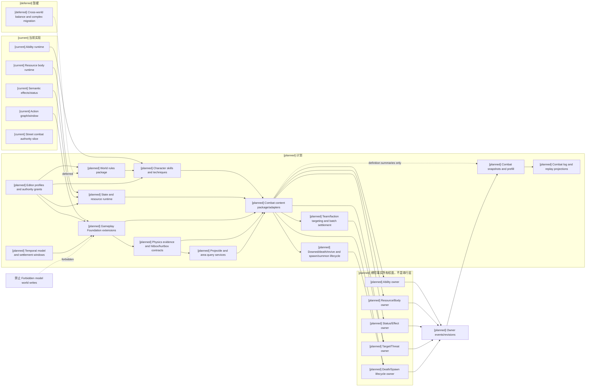
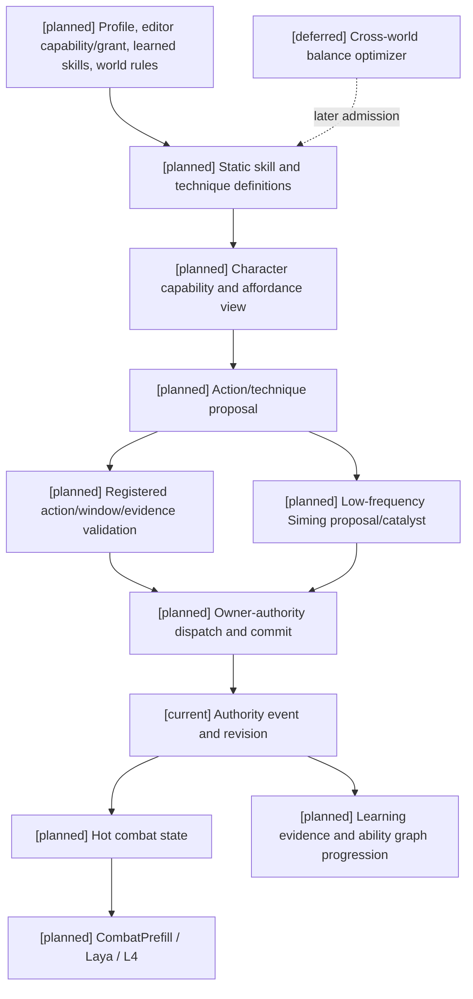

# 战斗系统与角色技能，状态和资源

状态：`architecture analysis; planned and non-authorizing`

编辑器能力开关、权限授予、预览、发布和运行时同步由独立目录 [编辑器与能力权限治理](../编辑器与能力权限治理/00-README.md) 负责。本目录只定义战斗、技能、状态、资源和结算的领域消费合同；08 仍是标签与元标签治理 owner。

玩法包的通用分层、组合、编辑器应用和生命周期由 [玩法包与编辑器应用治理](../玩法包与编辑器应用治理/00-README.md) 负责。本目录只提供 Combat、Character、Resource、Status、Equipment、Environment 等领域包可复用的消费合同和 authority 边界。

本目录围绕三条主线展开：**战斗系统、角色技能、状态和资源**。设计首先满足魔法、修仙、武侠、玄幻及其他非常世界观中的复杂技法与资源规则，同时让通用 Gameplay Foundation 通过内容包表达常规世界观中的拳脚、武器、护甲、体力、伤势、医疗、冷却和战术效果。本目录设计战斗内容包及其领域 authority 如何消费通用基础，不提出独立 `Combat Core`。Street Combat 仅是验证建模的 slice，不作为架构范本。

跨玩法时间坐标、profile、调度和结算窗口由 [16-通用玩法时序模型与编辑器设计](../16-通用玩法时序模型与编辑器设计.md) 唯一负责；本目录只通过战斗适配描述动作窗口、冷却、持续效果和空间证据如何消费时间合同。

## 目录

| 主线 | 设计文档 | 范围 |
|---|---|---|
| 角色技能 | [01-技法构筑、司命裁定与世界观规则计划](01-技法构筑、司命裁定与世界观规则计划.md) | 技能、技法、功法/心法、模仿学习、升级/分支/融合/进化、司命裁定 |
| 状态和资源 | [02-角色战斗资源与资源转换计划](02-角色战斗资源与资源转换计划.md) | 生命、体力、蓝条/内力、专注、回蓝、状态、伤势、冷却、社会/环境资源 |
| 战斗系统 | [03-攻防治疗招数数据与动作参数计划](03-攻防治疗招数数据与动作参数计划.md) | 攻击、防御、治疗、控制、空间证据、投射物、目标、范围、距离、时序和打断 |
| 三条主线的读取支撑 | [04-战斗状态、CombatPrefill 与高频读取计划](04-战斗状态、CombatPrefill与高频读取计划.md) | 稳定快照、热状态、delta、遭遇视图、结算记录、日志/回放和 L2/L3/Laya/L4 消费边界 |
| 效果通道与世界规则 | [05-效果通道、环境场与生命精神灵魂规则设计](05-效果通道、环境场与生命精神灵魂规则设计.md) | 跨通道技法、环境场、生命/精神关系、灵魂规则和可触达条件 |
| 外物与使用限制 | [06-外物、装备、药品与使用限制定义](06-外物、装备、药品与使用限制定义.md) | 持久装备、限次装备、一次性药品、弹药、媒介、阵法组件、耐久、次数和药效 |
| 战斗影响源与标签 | [07-战斗影响源、标签与跨维度效果设计](07-战斗影响源、标签与跨维度效果设计.md) | 职业/身份标签、装备、药品、技能在时空、数值和规则维度的统一影响合同 |
| 对象标签、编辑与版本治理 | [08-对象标签、编辑与版本治理设计](08-对象标签、编辑与版本治理设计.md) | 对象/组件/关系/状态/事件标签、元标签、创作者编辑、角色改变、司命改变和 revision |
| 战斗动态原语与战斗倾向 | [09-战斗动态原语、关系状态与战斗倾向设计](09-战斗动态原语、关系状态与战斗倾向设计.md) | Resource、Condition、Relation、Disposition、GroupState、Perception、Objective、Threat、Fear、Morale |
| 生命状态、伤势与死亡连续性 | [10-生命状态、伤势与死亡连续性设计](10-生命状态、伤势与死亡连续性设计.md) | LifeState、外伤/内伤、饥饿/灼烧/疾病、倒地/死亡/复活、生命/精神/灵魂连续性；EntityPresence、生成/销毁/召唤、身份/控制/清理合同 |
| 通用装备系统 | [11-通用装备系统设计](11-通用装备系统设计.md) | 装备定义、实例、栏位、触发器、目标选择、效果、合成/变体接口和 authority |
| 自走棋装备玩法包 | [12-自走棋装备玩法包设计](12-自走棋装备玩法包设计.md) | 棋盘栏位、二合一配方、羁绊、回合事件、随机奖励和实现案例 |
| 通用玩法时序消费 | [16-通用玩法时序模型与编辑器设计](../16-通用玩法时序模型与编辑器设计.md) | 时间坐标、profile、settlement window、实时/回合/帧级组合和编辑器 revision；本目录只定义战斗 adapter |

## 设计主张

1. 技能先有通用能力内核，再由世界观内容包补充特殊能量、媒介、规则和术语。常规世界观不需要强加魔法资源，奇幻世界也不受常规模板限制。
2. “战斗大招”不作为核心抽象；使用 `Method`、`InnerMethod`、`Technique`、`ActionPattern` 和 `TechniqueVariant` 表达完整程度不同的技法系统。
3. `Technique` 是跨通道效果组合，不是独立伤害属性；来源、传递方式、效果通道和结算模式必须正交表达。
4. `environmental` 既可以表示自然危害，也可以表示技能创造或修改的环境场；环境防御由暴露、掩体、适应、离场或破坏场核心等规则表达，不强迫所有角色拥有同名抗性。
5. 生命和精神由世界包选择合并、耦合或独立模型；灵魂默认是无数值的规则存在，只有通过 `SoulAccessGate` 才能触达。
6. “减蓝增伤增范围”是构筑参数关系的示例。具体输入资源、效果增幅、范围扩展和风险/反制由司命结合世界规则裁定。
7. 攻击、防御、治疗、控制、环境场和灵魂规则共享 effect module、targeting、timing、resource 和 settlement 结构，差异通过通道、模式、标签和规则包表达。
8. 高频战斗数值由 Gameplay Foundation 的领域 authority/投影提供结构化快照；模型不推算当前生命、距离、冷却、状态或资源可用量。
9. 低频学习/创新循环和高频战斗循环分离。创新提案必须经过权威事件后才进入稳定能力快照。
10. 外物、装备、药品、弹药、媒介和阵法组件共享对象身份与 authority 边界，但耐久、剩余次数、库存数量、冷却和药效持续必须分别建模。
11. 职业和身份属于标签；标签、装备、药品和技能都可以通过统一影响源在时空、数值和规则维度作用于战斗，但未注册的标签不能自行产生效果。
12. 战斗内容包与物理引擎通过通用 Gameplay Foundation 协作：物理引擎提供连续空间、碰撞、轨迹和接触证据，战斗所属 authority 按已注册规则解释为伤害、控制、资源、状态和规则结果，并把结构化动作/场意图返回物理适配器。
13. 标签是跨玩法的语义编辑载体，但不是资源、效果、状态生命周期、库存、耐久或世界真值的替代物；元标签只治理标签的适用对象、生命周期、可见性、编辑权限、合并冲突和 authority 要求。
14. 仇恨、恐惧、战意和士气不是同一种资源：仇恨是有向关系，恐惧是个体条件，战意是个体倾向，士气是群体状态；它们共享 effect、revision 和 authority，但保留各自语义。
15. 能力开关、角色资格、权力授予和效果结算是四个独立轴；编辑器配置前三者，领域 authority 负责最后结算。
16. 装备系统分为通用核心和玩法包：装备对象、栏位抽象、触发器、目标选择和效果结算进入通用层；棋盘、羁绊、二合一组件、回合事件和随机奖励进入自走棋玩法包。
17. 装备编辑器只编辑定义、binding、触发器、配方、变体和玩法政策；当前装备归属、耐久、计数、冷却、库存和随机结果仍由运行时 owner authority 保存。

## 当前、计划与暂缓

```text
[current]  INF TagDefinition/TagAssignment、SemanticSnapshot/Selector、受限 MetaRuleDefinition；resource body、ability runtime、action graph、action window、semantic effects、status tags、effective stats，以及用于验证建模的 Street Combat slice
[planned]  通用 Gameplay Foundation 扩展、多世界观技能/状态/资源/战斗内容包、跨通道效果和环境场、生命/精神模型、灵魂规则 gate、外物与使用限制、通用装备核心、装备触发器/目标选择/合成/变体接口、自走棋装备玩法包、战斗影响源与标签、对象元标签治理、战斗动态原语、司命裁定、TemporalProfile、CombatStablePrefill、CombatHotSnapshot、CombatDelta；PhysicsEvidence、Hitbox/Hurtbox/GuardVolume、ProjectileDefinition/ExecutionState、Area/Distance/LineOfSight/Cover/Reachability 查询、Team/Faction 目标资格、批量结算、Death/Downed/Revive 生命周期、Spawn/Despawn/Summon 生命周期、CombatLog/Replay 投影
[deferred]  复杂创作者协作/存档迁移与跨世界观平衡优化；无约束规则脚本、模型直接写事实和未接纳规则激活始终禁止
```

## 通用模块补充范围与验收入口

以下为本次 `[planned]` 设计的详细入口，表中“已展开”表示有对象、权限、主要流程、失败政策和验收案例，不表示运行时已完成，也不替代正式实现授权。公共合同由唯一文档维护，其他文档只定义消费接点。

| 模块 | 唯一设计定义/消费接点 | 已展开的关键边界 |
|---|---|---|
| Hitbox/Hurtbox、物理证据适配 | 03 第 4.2 节；16 第 7.5 节消费 adapter 能力 | geometry/units、来源版本、admission、迟到/重复、精度准入与可见性 |
| 空间查询 | 03 第 4.2.1–4.2.3 节 | QueryResult、authority/actor 视图、稳定排序、截断/continuation、timeout 和 freshness |
| 投射物 | 03 第 4.3 节；生成合同消费 10 | 射线/弹体、命中 slot、穿透/反射/追踪/爆炸、终止与归因 |
| 团队/阵营目标与仇恨 | 09 第 3.1、5.1.1 节 | 可选 ThreatPolicy、来源转移、当前资格复验、关系变化与未知值 |
| 通用时序、确定性与有限 rollback | 16 第 2–4、7 节 | 正交配置、数值/随机、隔离预测、确认/冲突、adapter 兼容、编辑器预览 |
| 跨 owner 批量结算 | 16 第 2.4 节；09 第 5.1 节战斗适配 | frozen read-set、依赖、receipt、timeout 查询、部分提交恢复、补偿和确认游标 |
| 倒地/死亡/复活 | 10 第 3、5–6 节；09 消费资格 | LifeState、死亡依据、生命/精神和灵魂连续性、跨 owner 提交 |
| 生成/销毁/召唤 | 10 第 6.1–6.3 节；03/09 消费 | EntityPresence、incarnation、quota/admission、支付/引擎失败、控制/继承、cleanup/tombstone |
| 日志/回放/检查点 | 16 第 7.4 节通用合同；04 第 4.2–4.4 节投影 | 结果/领域验证/物理重模拟分开，consistent cut、tail、版本/缺证据诊断和权限 |

`[current]` 仍仅是原有资源/身体、ability/action、状态/effect、时钟及 event/receipt 主干。`[deferred]` 保留跨平台 bitwise physics、任意长 rewind、复杂的已授权跨时间线迁移和大规模自治群体；绕过 owner/admission 的复制或迁移始终禁止。发布前的设计验收关注合同一致性；真正实现后还需证明上述故障案例及性能预算，不能用目录覆盖率当作完成证据。

## 历史术语与架构边界纠正

本目录原先部分内容使用 `Combat Core`，这里统一纠正：它不是当前实现，也不再作为目标架构中的独立中心。后续文档使用以下边界：

```text
Gameplay Foundation                 通用动作、资源、状态、效果、时序、证据、批次和 authority 接入基础
Temporal model (见 16)               跨玩法时间坐标、调度、profile、settlement window 和回放边界
Combat content package               战斗通道、目标、伤害、治疗、控制、仇恨和死亡规则
Domain owner authorities             按事实类型独立校验与提交；横切领域内容包
Physics/Input/Presentation adapters  接收或返回引擎证据和本地表现
```

Street Combat 只证明有限建模和边界可验证性，不作为通用架构范本。01–09 的战斗设计均为战斗内容包和领域 authority 如何消费通用基础的计划，不代表已经存在完整 Combat Core。

`Domain owner authorities` 是事实所有权面，不是串在内容层之后的中央结算层。技能资格归 Ability owner，资源/身体变化归 Resource/Body owner，状态与效果生命周期归 Status/Effect owner，目标/威胁关系和死亡/生成等事实继续归其已接纳的 owner。领域包提供定义和规则输入；通用 Gameplay Foundation 提供时间、证据、批次、revision 等合同；各 owner 只提交自己拥有的事实。跨 owner 批次必须声明参与 owner、幂等键、提交结果和部分失败策略，不能假定一个全局事务。新增事实类型或 owner 必须单独准入，不能靠内容包名称取得写入权。

以下编号仅表示能力与投影的依赖视图，不要求所有领域实现为同一进程或严格串行服务。Authority owners 横切 L1–L3，依据各自事实边界接收提案/证据并提交事件；司命、模型和通用调度器都不成为中央事实写入层：

```text
L0 Engine / Platform Adapters
   Physics、Rendering、Input、Network、Animation、Audio

L1 Gameplay Foundation
   时间、动作、空间证据、资源/状态/效果合同、批次、revision、replay pins

L2 Gameplay Domain Packages
   Combat、Economy、Ecology、Social、Character 等领域语义和消费规则

L3 World / Game Content
   世界资源、技法、装备、阵营、标签绑定、效果参数和规则配置

Authority ownership plane (cross-cutting; not L4)
   Ability | Resource/Body | Status/Effect | Target/Threat | Lifecycle 等已接纳事实 owners

L5 Projections and Records
   Prefill、HotSnapshot、Delta、CombatLog、Replay、UI 和模型读取视图
```

## 标签议题 owner 与审查结论

标签作为语义编辑载体，可以挂在对象上，也可以与组件、资源、效果、状态、关系并列并相互引用。分类、语义类别、生命周期、是否绑定效果、触发方式是不同轴；标签不因分类或名字自动获得效果。元标签治理标签定义/赋予/绑定；元规则产生受限提案；司命提供催化和裁定协调；已注册的领域 authority 校验并提交世界事实。

| 文件 | 本轮标签审查修正 | 后续设计验收点 |
|---|---|---|
| 00 | 登记 08 为对象标签 owner，拆分司命与事实写入 | 标签语义、组件事实与 authority 无双重 owner |
| 01 | 技能/学习标签与掌握证据分离 | 模仿和标签编辑不能绕过能力/认知上限 |
| 02 | 世界资源白名单、回蓝 binding 与状态生命周期 | 无蓝世界无隐形蓝条；回蓝来源去重、可停用 |
| 03 | 使用受限 selector，区别标签语义与效果/空间数值 | 命中、控制、闪避、免伤仍由 authority 结算 |
| 04 | 定义与运行时 revision 分离；可见性变化失效 | 状态 tick 不重建稳定 prefix；权限撤销清缓存 |
| 05 | 环境与灵魂标签作为条件或事实投影 | 环境能输出；灵魂无数值且受 gate 限制 |
| 06 | 外物标签、组件与消耗分离 | 未使用药品不生效；移除装备无遗留 binding |
| 07 | 注册影响源、来源去重与效果撤销 | 同一 binding 不因标签/物品两个入口重复计入 |
| 08 | 定义/赋予/元标签/编辑/版本的统一合同 | 创作者、角色改变、司命改变三条路径可审计 |
| 09 | 战斗动态对象边界与更新顺序 | 仇恨/恐惧/战意/士气不被压成单一资源或任意标签 |
| 11 | 通用装备核心与触发器边界 | 装备栏、触发器、目标选择和效果不依赖自走棋规则 |
| 12 | 自走棋作为玩法包实现案例 | 棋盘、羁绊、二合一、回合和随机池不污染通用核心 |

以上是文档静态一致性审查，不代表运行时已通过这些验收。涉及元标签治理的新字段、编辑器能力 profile、权限 grant、四层对象适配、通用 EffectBinding 和 Combat prefill 均为 [planned]。编辑器治理的唯一 owner 是 [编辑器与能力权限治理](../编辑器与能力权限治理/00-README.md)；当前边界见 08 第 8 节，代码映射见其第 13 节；图中的 current 事件节点表示复用已有提交主干，不表示新增标签事件已获接纳。

## 目录级架构边界



## 目录级主时序

```mermaid
sequenceDiagram
  participant C as Character/Laya
  participant T as Skill/technique registry
  participant S as Siming proposal/catalyst
  participant W as Temporal window/physics evidence
  participant G as Corresponding fact owners
  participant P as Combat prefill
  Note over C,P: [planned] full flow; [current] registry/runtime/owner spine; [deferred] complex creator collaboration/migration
  C->>T: read stable skill/technique and affordance
  alt registered high-frequency combat
    C->>W: typed intent with definition pins and current revision
  W->>G: mapped evidence, frozen window and owner-bound intent
  else low-frequency learning or innovation
    C->>S: composition or tag-change proposal and evidence
    S->>S: interpret rules, risk and counterplay
    S->>G: submit owner-bound proposal
  end
  G->>G: validate owned facts and commit per-owner event vector
  G-->>P: publish revisioned hot state
  P-->>C: typed combat snapshot/delta
```

## 目录级数据流图


