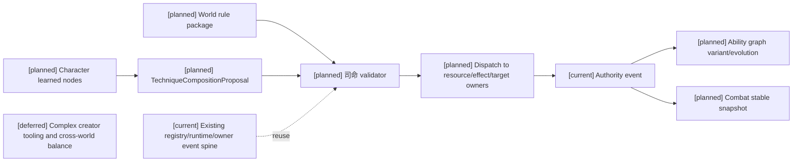
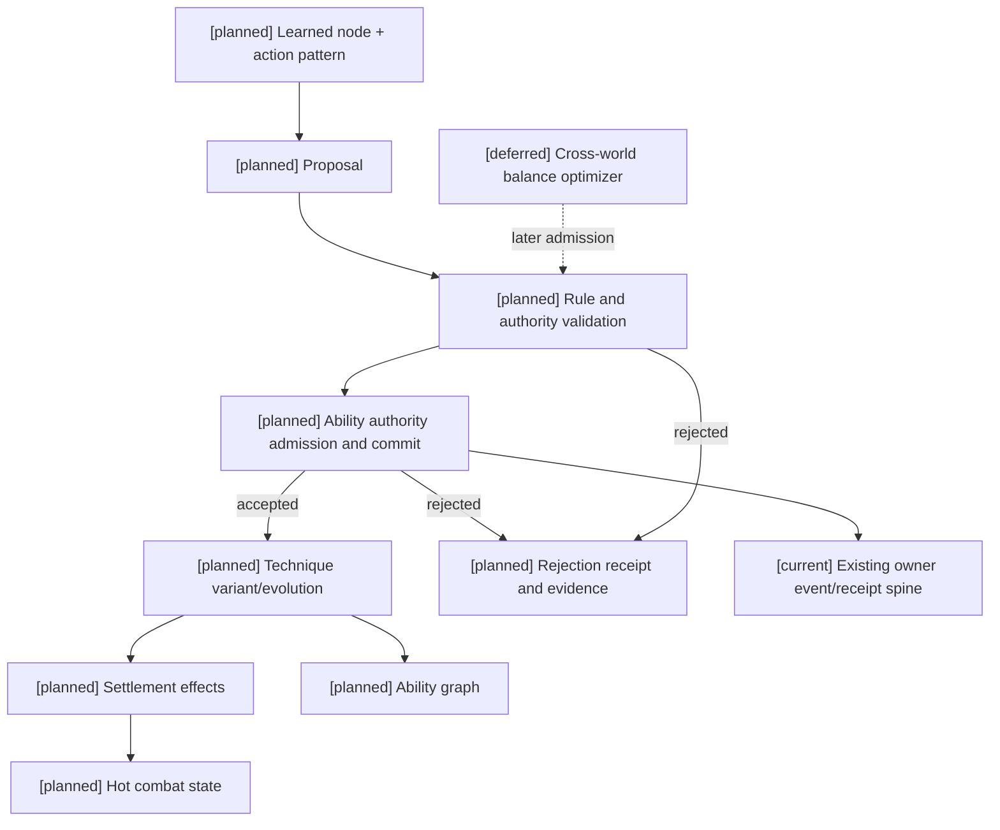

# 01 技法构筑、司命裁定与世界观规则计划

状态：`architecture analysis; planned and non-authorizing`

标签定义、四类生命周期和元标签治理由 [08-对象标签、编辑与版本治理设计](08-对象标签、编辑与版本治理设计.md) 负责；编辑器能力开关、权限授予、预览和发布由 [编辑器与能力权限治理](../编辑器与能力权限治理/00-README.md) 负责；本文件只定义技法领域如何消费它们。新增治理合同均为 `[planned]`。

## 1. 核心抽象

“大招”过于窄，不能表达完整功法、心法、动作片段和未完成学习状态。建议采用分层对象：

```text
Method            功法/体系：多个心法、技法和资源循环的组织
InnerMethod       心法：内在原理、呼吸/能量循环、被动条件
Technique         技法：可被执行和结算的效果组合
ActionPattern     动作构型：姿态、步法、连击、施法手势和时间结构
TechniqueVariant  技法变式：同一核心在目标、资源、范围或风险上的变化
```

一套技法可包含：原理、动作片段与动作图、资源循环、触发条件、效果模块、克制关系、风险/反噬、进化边和世界规则绑定。掌握可以只覆盖片段，不要求一开始拥有完整 `Method`。

### 1.1 技法不是单一输出维度

`Technique` 是跨通道的构筑对象。来源、传递方式、效果通道和结算模式必须分别记录：

```text
source          ordinary_attack / spell / technique / method / equipment / ritual
delivery        melee / projectile / beam / area / field / mental_link
effect_channel  physical / magical / mental / environmental / spiritual_rule
resolution      numeric / status / resource / field / rule
```

因此同一技法可以同时包含物理、魔法、环境和精神模块。`TechniqueDefenseProfile` 也必须按模块提供物理、魔法、环境、精神、打断、离场和规则 gate 的应对，而不是用单一的“技法防御”数值代替。

## 2. 世界观内容包

修仙、武侠、魔法和玄幻是重要的复杂用例，但不能假设它们穷尽所有非常世界观。规则内核应提供通用接口，世界观内容包负责命名、资源、媒介和限制。相同内核也必须能通过常规世界观内容包表达拳术、剑术、体能训练、战术配合和常规医疗，不强行引入超自然资源：

```text
energy_model       mana / qi / ether / faith / heat / blood / causality
媒介与来源         meridian / spellbook / weapon / contract / bloodline
effect vocabulary  damage / heal / shield / control / cleanse / summon
cost rules         消耗、转换、借贷、过载、反噬和债务
counterplay        抵抗、打断、封印、属性相克、地形和社会禁忌
vitality model     fused / coupled / independent
environment rules  field creation、持续、扩散、衰减、覆盖、驱散和离场
soul rules         spiritual_rule、SoulAccessGate、契约/真名/附身等规则
```

内容包不得绕过通用 authority；它只注册规则、标签、参数范围和解释文本。

## 3. 构筑提案

角色可提交 `TechniqueCompositionProposal`：

```json
{
  "base_nodes": ["inner.breath.v1", "sword.arc.v2"],
  "action_pattern": {"combo": ["step", "arc", "recovery_cancel"]},
  "intents": ["increase_damage", "extend_radius"],
  "resource_trade": {"mana": 18, "cooldown_ms": 2400},
  "expected_effect": {"damage_multiplier": 1.25, "radius_multiplier": 1.2},
  "accepted_risks": ["longer_recovery", "interruptible_charge"],
  "evidence_refs": ["learning-episode-18"],
  "context_revision": "world-812"
}
```

提案只表达构筑意图和来源，不直接写入效果。`减蓝增伤增范围`是此类底层参数创新的一个例子：更多资源支付可能换来更高伤害、更大半径、更远距离或更长持续，但需要同步增加冷却、前摇、暴露、失控、过热、反噬或后续债务，实际权衡由世界规则决定。

## 4. 司命裁定

[planned] 司命对学习/创新提供规则解释、提案和裁定协调；通用 Gameplay Foundation 与已注册的领域 authority 执行确定性校验与结算。以下是联合流程，司命的模型输出本身不具有写权限；已注册的常规战斗/被动/tick 不必每次调用司命模型：

1. 校验节点存在、版本、角色前置和世界观绑定。
2. 校验动作图、目标筛选、空间和当前上下文 revision。
3. 计算资源预留、实际消耗、转换、借贷和恢复锁定。
4. 计算攻击、防御、治疗、控制和状态效果。
5. 计算环境场创建、持续、范围、tick、暴露和反制窗口。
6. 在存在灵魂模块时，检查生命/精神脆弱性、灵魂链接和 `SoulAccessGate`，未通过不得写入灵魂规则。
7. 计算范围、距离、持续、tick、冷却、打断和反制窗口。
8. 计算副作用、失败回退、克制关系和可观察反馈。
9. 决定这是一次普通变式、技能升级、融合、突变还是拒绝。
10. 由对应领域 authority 原子追加事件，并由 committed events 投影能力图边和可重放证据。拒绝返回原因；不伪造已发生的能力或效果事件。

返回值应包含 `decision_id`、`authority_event_id`、`accepted_effects`、`resource_delta`、`risks`、`counterplay`、`new_node_refs`、`rejection_reason` 和 `revision`。模型不能宣称未返回的效果已经发生。

## 5. 克制与连击

连击是动作图与状态条件的组合，不是模型自由拼接的字符串。每一段应声明：前置窗口、命中/未命中分支、取消目标、资源锁、可被打断阶段、状态标签和可接续边。克制关系可以来自：距离、属性、状态、姿态、资源耗尽、动作窗口、地形或世界观禁忌。

## 6. 与能力图和学习的关系

已掌握节点提供构筑候选和 affordance；学习证据只能形成提案依据。提案经司命协调及能力 authority 校验提交后，能力图新增 `variant_of`、`requires`、`counters`、`evolves_to` 或 `fuses_with` 边，并把结果投影到下一版稳定快照。学习中的片段可以被观察和练习，但不应作为稳定战斗 affordance 暴露。

## 7. 常规与非常世界观的适配

两类世界观共享节点、动作图、效果、资源、状态、证据和 authority 合同，差异由内容包的能力组合决定：

| 领域 | 常规世界观示例 | 非常世界观示例 |
|---|---|---|
| 技能/技法 | 拳击组合、剑术、防守步法、急救 | 灵剑诀、咒式、心法、血脉技 |
| 资源 | 体力、弹药、药品、专注 | 法力、内力、灵力、信仰、生命力 |
| 效果 | 伤害、压制、包扎、掩护 | 元素伤害、护盾、净化、召唤、空间控制 |
| 限制 | 训练、器材、视线、身体状态 | 媒介、境界、阵法、契约、反噬 |

常规包可以只启用有限资源和效果类型；非常包可以注册额外规则，但不修改共享合同，也不绕过 authority。

## 8. 当前、计划与暂缓

- `[current]`：`ability_runtime.py` 的技能状态和路径、动作图/窗口、语义效果、状态标签、有效属性以及 owner settlement 接入骨架。
- `[planned]`：世界观内容包、提案/裁定合同、跨通道 Technique、环境场和灵魂 gate、通用 targeting、连击/克制和能力图进化事件。
- `[deferred]`：复杂跨世界观平衡器。模型直接激活世界规则或用文本替代结构化动作图始终禁止；模型可提出受审查的新规则草稿。

## 9. 架构图



## 10. 时序图

```mermaid
sequenceDiagram
  participant C as Character/Laya
  participant R as Registry
  participant S as 司命
  participant A as Ability/Combat authority
  Note over C,A: [planned] full flow; [current] registry/runtime/owner spine; [deferred] complex creator tooling
  C->>R: read available nodes and constraints
  C->>S: composition proposal
  S->>R: validate definitions and prerequisites
  S->>S: calculate cost, effect, risk and counterplay
  S->>A: submit proposal and evidence
  A->>A: validate owner contract and commit or reject
  A-->>C: result and next snapshot revision
```

## 11. 数据流图



## 12. 技法对象的标签和学习写入边界

`Method`、`InnerMethod`、`Technique`、`ActionPattern` 和 `TechniqueVariant` 都可以拥有定义标签、实例标签、派生标签和运行时状态标签。标签用于表达通道、媒介、前置、风险、动作风格和可迁移性；掌握阶段、学习证据、动作稳定性和能力图边仍由 `MasteryState`/ability graph 保存。

```text
technique:moon_arc
  definition: channel:physical, channel:magical, delivery:melee
  instance: style:counter, lineage:personalized
  derived: derived:unstable, derived:cross_channel
  runtime: status:charging, status:interrupted
```

观察、模仿、指导、练习、实战、失败复盘、研究、师承和跨技能迁移可以产生带来源的学习证据与构筑提案；角色不能直接赋予 `mastery:*`、`technique_variant:*` 或 effectful 标签。司命批准后，能力 authority 才能追加 `variant_of`、`requires`、`evolves_to` 或 `fuses_with` 边，并发布新的稳定 revision。元标签中的 `meta:edit_policy`、`meta:derived` 和 `meta:requires_authority` 应作为提案校验条件，不是学习结果本身。

标签可编辑范围必须同时通过对象元标签政策、技能前置、角色能力图和认知包络。贴上 `capability:*` 不等于学会技能；贴上 `lineage:personalized` 不等于生成变式。学习仍记录多维证据，升级、分支、突变、融合与进化仍是不同的能力事件。标签可以组织、筛选和描述这些事件，但不能将它们压成一次加经验值或全能标签。增加模型预算也不提高准入上限。

验收：低能力角色提出复杂跨通道编辑被拒绝；同一角色增加 token 后仍被拒绝；有效学习证据通过已注册合同后，能力事件与下一版稳定快照同步更新，已进行的动作保持原定义 pins。

## 13. 本批规格与计划回写（2026-10-10）

本批把 Method/Technique/ActionPattern、世界观内容包和司命裁定保留为通用领域设计，但不把示意提案对象、世界规则包或模型输出当作现有 API。技法通过规格11的 typed proposal、空间/动作证据和对应 owner settlement 接入；学习结果仍由学习/能力 owner 提交。常规世界与非常世界观都必须走同一 authority 边界。

映射：规格06、11；计划02 Task4–6、计划04 Task4。跨通道 owner、灵魂 gate 和世界包 schema 仍待准入。
