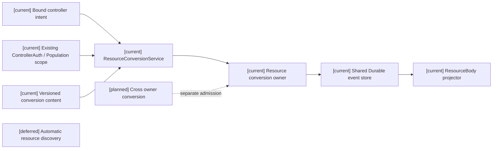
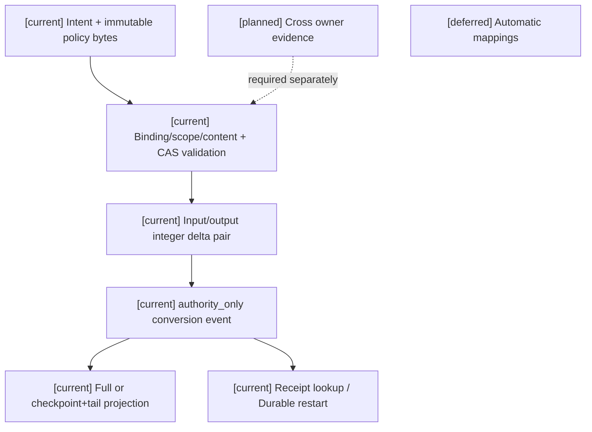
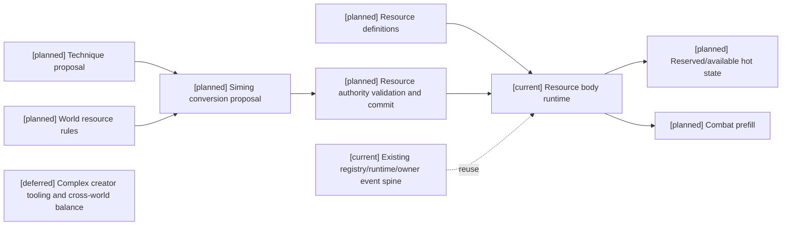
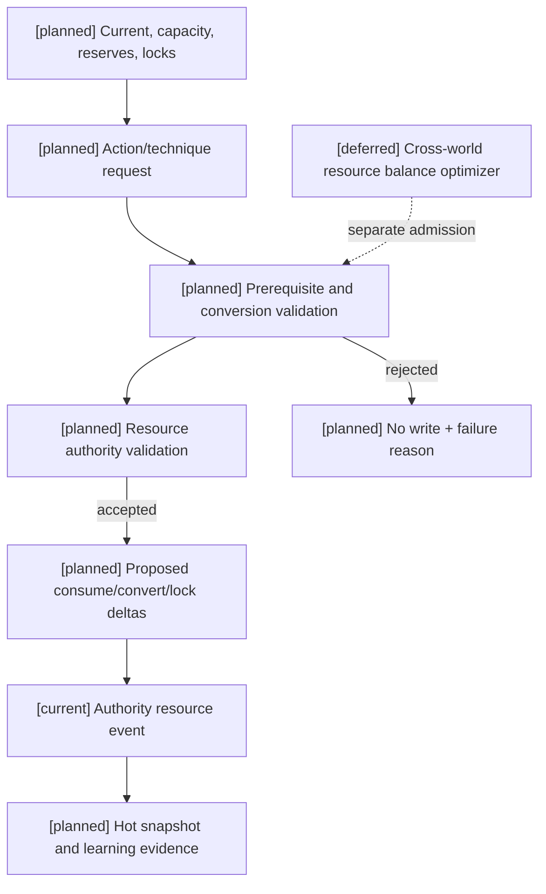

# 02 角色战斗资源与资源转换计划

状态：`architecture analysis; planned and non-authorizing`

## 阶段三增量：同 Resource owner 转换准入（本次设计并实现）

本段基于用户本轮授权自主确定数值政策，仅本段实施合同获得授权；不把原分析或目录名当作既有授权。版本化内容位于 `assets/gameplay/resource-equipment/resource-conversion.v1.yaml`，revision `resource-conversion:char_a-core@1`，发布者 `project-content:stage3`，事实 owner `actor_gameplay.resource_conversion_domain`。此为本次新增内容，不是既有业务来源。`char_a` 限定在 `world:bakery/timeline:main`，可提交体力 5 换法力 2、法力 10 换行动点 1 的整数批次；无隐式反向、无默认映射、即时不可逆、不允许欠值、无冷却或随机。转换只消费未预留量；已有锁是预留子集，故消费预留外余额不会重复扣锁。输出超过当前 capacity 整笔拒绝。

服务读取同一 Population world/timeline、既有 ControllerAuth binding；binding 仅证明连接主体，不单独授予资源写权限。阶段三转换 capability 必须由应用 composition 从既有权限/phase policy issuer 注入并提交前重验；缺 capability 默认拒绝，当前测试 caller 是显式授权 fixture，不伪称生产 issuer。服务在提交前重新解析 binding、capability、world scope 与 policy bytes；冻结 revision/digest、请求、Resource stream CAS 与 read-set。policy 内容变更需新 revision，旧内容保留用于 receipt/replay，不自动迁移旧事件。授权仅允许被既有 issuer 明确授予的 actor/world 自身资源操作；无管理员能力。首次与 exact duplicate 均要求有效 binding/capability，撤权由原 issuer 承担。duplicate 从原 transaction 重验事件和 receipt，changed duplicate 拒绝；丢响应只查询/retry 同 key。单一 conversion event 保存两侧整数 delta，store 原子追加，无半笔资源转换；event 为 authority_only，客户端只接收过滤后的 receipt。Durable 重开恢复与 full/checkpoint+tail 使用同一 Resource projector/store，不建立第二账本。

R05 跨 owner 转换仍为 `[planned]`，Inventory custody 从不混入本合同；没有已准入真实跨 owner 需求前不声称闭合 R05。



```mermaid
sequenceDiagram
  participant C as Bound controller
  participant S as Conversion service
  participant A as Existing auth and content
  participant O as Resource owner
  participant E as Shared store
  Note over C,E: [current] same owner; [planned] cross owner; [deferred] automatic discovery
  C->>S: Explicit policy revision/digest, batches, CAS
  S->>A: Resolve binding and freeze bytes/scope
  S->>O: Validated intent and read-set
  O->>O: Validate integer policy, locks, debt, capacity
  O->>A: Revalidate via service before append
  O->>E: One atomic conversion event
  E-->>C: Receipt or zero-write rejection
```



标签定义、四类生命周期和元标签治理由 [08-对象标签、编辑与版本治理设计](08-对象标签、编辑与版本治理设计.md) 负责；编辑器能力开关、权限授予、预览和发布由 [编辑器与能力权限治理](../编辑器与能力权限治理/00-README.md) 负责；本文件只定义资源领域如何消费它们。新增治理合同均为 `[planned]`。

## 1. 资源分类

状态和资源是并列的运行时输入：资源表达可消耗、可恢复或可锁定的量，状态表达持续条件、伤势、增益、减益和规则标签。资源统一采用 typed definition，但不强迫所有世界观拥有同一组资源：

| 类别 | 例子 | 典型用途 |
|---|---|---|
| 生存资源 | health、life、injury capacity | 承受伤害、濒死、治疗和失能 |
| 身体资源 | stamina、breath、posture | 移动、闪避、近战、蓄力和恢复 |
| 世界能量 | mana、qi、ether、faith、blood | 施法、功法、元素或契约效果 |
| 认知资源 | focus、concentration、sanity | 瞄准、维持、复杂构筑、抗干扰 |
| 时间资源 | cooldown、action window、charge time | 限制连续使用和承诺窗口 |
| 社会/权威资源 | reputation、favor、authority token | 召援、契约、禁术或阵营行动 |
| 环境资源 | terrain charge、light、cover、ritual medium | 借力、范围、属性和世界规则条件 |

### 1.1 生命、精神与灵魂的边界

本节只定义资源域的边界和 `fused/coupled/independent` 选择。`Alive/Downed/Dying/Dead/Reviving`、伤势、死亡事件和灵魂连续性的唯一设计 owner 是 [10-生命状态、伤势与死亡连续性设计](10-生命状态、伤势与死亡连续性设计.md)；本文件不重复定义生命周期。

`life_domain` 和 `mind_domain` 是效果作用域；`health`、`focus`、`sanity` 是资源或状态投影。世界包必须显式选择二者关系：

```text
vitality_model = fused       # health/focus 是同一生命力的投影
vitality_model = coupled     # 独立账本，但允许显式转换
vitality_model = independent # 独立账本，不允许隐式转换
```

例如 `coupled` 可以注册 `mental_damage -> focus_loss`、`focus_zero -> collapse`、`focus_loss -> health_damage` 或 `health_low -> mental_vulnerability_up`。这些都是规则转换，不得由模型从叙述自行推导。

灵魂不是资源，也不默认拥有生命值或抗性值。灵魂相关内容记录为规则事实：`soul_anchor`、`identity`、`true_name`、`oath`、`possession_state`、`reincarnation_link` 和 `rule_authority`。只有通过生命或精神脆弱性、链接和权威检查，灵魂规则才可写入。

## 1.2 蓝条资源合同

“蓝条”是用户界面和角色认知中的俗称，运行时使用 namespaced resource id：

```text
magic:mana             法术世界的法力
cultivation:qi         修炼世界的真气/灵力
mental:focus           认知或精神专注
```

它们共用资源 runtime 合同，但不要求不同世界观使用同一个资源。没有注册 `magic:mana` 的常规世界观，不会出现隐形的 0 蓝条。

每个蓝条资源至少包含：

```text
resource_id             namespaced id
current                 当前值
capacity                当前上限
base_capacity           角色和世界包提供的基础上限
reserved                已为动作预留
locked                  暂时不可用的数量
available               current - reserved - locked
debt                    透支量和债务上限
base_regen              基础回蓝速率，单位 / second
regen_modifiers         技能、职业、装备、药品、阵法和状态修正
recovery_delay          消耗/受击后的恢复延迟
recovery_conditions     战斗内外、姿态、区域、媒介等条件
revision                authority resource revision
```

推荐的派生计算为：

```text
max_mana = base_capacity
          + level_growth
          + class_bonus
          + equipment_bonus
          + permanent_status_bonus

regen_per_second = (base_regen
                   + class_regen
                   + equipment_regen
                   + formation_regen
                   + temporary_regen)
                   * regen_multiplier
                   * recovery_state_multiplier

available = max(0, current - reserved - locked)
```

`max_mana` 和 `regen_per_second` 不是固定全局常数，具体上限、软上限、恢复延迟和乘区由世界观内容包注册。运行时必须保留修正来源，避免把装备、职业和阵法的效果合并成无法解释的黑盒数字。

建议默认修正顺序为：

```text
基础值
-> 同类加法修正（职业、装备、技能、阵法）
-> 来源/套装上限与互斥处理
-> 乘法修正（状态、领域、世界规则）
-> 恢复抑制、恢复延迟和资源锁定
-> clamp 到 [0, capacity] 或进入 overdraft
```

同一装备、药品或阵法的重复效果由 `stack_policy` 决定；不能让同一来源通过重复事件无限叠加。

## 1.3 蓝条消耗

技能消耗应拆成不同阶段，不能只记录一个最终整数：

```text
upfront_cost             开始动作时消耗
reserved_cost            蓄力/承诺期间预留
per_tick_cost            持续施法或领域每 tick 消耗
release_cost             成功释放时额外消耗
recovery_cost            结束或维持阶段消耗
refund_policy            取消、打断、未命中时的返还
overdraft_policy         是否允许透支以及债务/反噬
```

一次技能的实际消耗可以表达为：

```text
cost = base_cost
     + power_scaling_cost
     + range_scaling_cost
     + duration_scaling_cost
     + target_count_cost
     + variant_cost
```

“减蓝增伤”“消耗当前蓝量扩大范围”属于 `TechniqueCompositionProposal`，角色只能提出意图；司命必须校验上限、预留、债务、打断和反制，再生成实际 `resource_delta`。

## 1.4 回蓝来源

### 技能

技能可以提供：

- 释放后固定回蓝；
- 命中/击杀/暴击/施加状态后的回蓝；
- 持续施法期间的循环回蓝；
- 将生命、体力、环境能量或其他资源转换为蓝；
- 降低下一次技能的蓝耗；
- 在特定姿态、连击或元素共鸣中提高回蓝。

这些效果必须记录触发事件、目标范围、冷却、内置间隔和是否受减益影响，不能由模型自行把“命中后回蓝”写入资源。

### 职业标签

职业是角色档案中的 `profession` 标签；职业内容包为标签注册稳定的资源影响绑定：

```text
class_base_capacity
class_base_regen
class_combat_regen
class_cost_modifier
class_resource_affinity
```

因此 `class_bonus` 和 `class_regen` 是标签 effect binding 的结算结果，不是与标签系统平行的职业对象。职业标签不直接覆盖临时装备、伤势或封印修正。角色可以有低蓝高回复、低回复高上限、依赖命中回蓝或依赖阵地回蓝等路线。职业/身份标签影响战斗的统一规则见 [07-战斗影响源、标签与跨维度效果设计](07-战斗影响源、标签与跨维度效果设计.md)。

### 装备

装备可以修改：

- 蓝条上限；
- 基础回蓝和战斗回蓝；
- 特定通道/技能的蓝耗；
- 命中回蓝、受击回蓝或脱战回蓝；
- 回蓝倍率、恢复延迟和透支上限；
- 蓝量低于阈值时的保命或转换效果。

装备效果必须带 `source_ref`、叠加规则、槽位/套装条件和版本，避免换装后旧修正残留。

### 药品

药品是一次性内服物；它可产生瞬时或持续的资源效果：

```text
instant_restore       立即恢复固定值或最大蓝量比例
over_time_restore     在 duration 内分 tick 恢复
capacity_boost        临时提高上限并定义超额处理
recovery_suppression  与其他药剂或状态互斥
cooldown/toxicity     使用间隔、过量和副作用
```

药品不能绕过资源锁定、封印或世界规则；若允许在控制中使用，必须由内容包明确注册。

### 阵法/领域

阵法是环境资源来源，不是角色固有面板属性：

```text
formation_id
owner_or_controller
radius / topology
regen_rate
shared_pool_or_personal_pool
activation_cost
line_of_effect
disruption_conditions
expiry
```

阵法可以提供持续回蓝、共享蓝池、降低技能消耗或把环境资源转为法力，但离开范围、节点被破坏、阵法被压制或控制者失去连接时，效果必须停止或衰减。

## 1.5 回蓝状态机

回蓝不是一个永远生效的加法。建议按资源事件维护状态：

```text
normal
  -> recovery_delay       刚消耗/受击，等待恢复
  -> recovering            满足条件，按 tick 增加
  -> suppressed            封印、沉默、领域或状态压制
  -> overdrafted           透支，先偿还债务
  -> full                  达到 capacity，溢出按规则处理
```

恢复 tick 由 authority/runtime 生成；每次变化都带 `from_revision`、`to_revision` 和来源事件。低频角色模型只读取恢复速率、预计可用时间和原因摘要，不自行累计时间。

状态至少记录 `status_id`、层数/强度、来源、目标、开始与过期时刻、叠加/互斥规则、移除条件、对能力/资源/动作/感知的 modifier 和 authority event 引用。常规世界观可用流血、疲劳、骨折、压制、掩护、士气；非常世界观还可扩展中毒、燃烧、封印、诅咒、元素共鸣等。

## 2. 统一状态字段

资源 entry 与状态实例分开存储，状态不能伪装为资源数值。状态可以修改资源上限、恢复、可用技法或动作约束，但变化必须由规则结算并带来源。

状态实例保存 status_id、source/target、开始/过期 tick、强度/层数、叠加/驱散政策、effect/modifier 引用和 authority event。runtime_status_tag 是其语义投影，不是第二份独立状态。

每个资源 runtime entry 至少应有：

```text
current       当前总量（不等于扣除预留/锁定后的 available）
capacity      当前上限
reserved      已为承诺动作预留
available     current - reserved - locked
locked        因动作、状态或 authority 暂时不可用
overdraft     是否允许借贷，借贷上限和债务
recovery      恢复速率、恢复延迟、恢复条件
revision      资源状态版本
source_refs   影响来源和解释
```

`resource_body_runtime.py` 当前已有 current/minimum/maximum/reserved/available（available=current-reserved）、预留/消耗/释放和身体 injury projection，可作为旧合同基础；尚无 capacity/base_capacity。目标字段、多资源转换、债务、恢复锁定和世界观规则引用仍须通过来源、owner 和集中迁移准入，不能按本段直接实施。

## 3. 资源转换

资源转换是技法构筑的一部分，必须显式声明输入、输出、比例、延迟、风险和可逆性：

```text
mana -> damage amplifier
stamina -> movement range
health -> emergency shield
focus -> targeting precision
environment charge -> area expansion
social favor -> external assist
```

转换不能由模型直接计算。司命根据内容包裁定实际比例和边界；如转换造成借贷或透支，必须生成债务/反噬状态，并在快照中可读。

## 4. 资源与人格/能力

人格影响风险选择、资源储备和恢复行为：尽责角色更早保留安全余量，开放角色更愿意尝试高波动转换，神经质角色更早停止蓄力。一般认知能力影响同时管理的资源条件数和转换解释能力；不能把认知高低直接变成资源上限。

## 5. 资源读写权限

角色可读经过私有过滤的 current、available、恢复预估和风险提示，可提出 reserve/release/convert intent。L4 可管理动作承诺生命周期。只有对应事实 owner 的 authority settlement 能写入实际消耗、伤害、治疗、债务、恢复和 revision；它不是一个中央结算服务。高频读取必须使用结构化数字，不要求模型从历史文本估算。

## 6. 常规与非常世界观的适配

常规世界观可只启用 health、stamina、equipment、cooldown 和常见伤势/战术状态；非常世界观可注册 mana/qi/faith 等能量、转换债务、属性状态和额外恢复/反噬规则。两者使用同一套 revision、reservation、status stacking、modifier 和 authority event 机制，内容包决定哪些类型存在。

## 7. 当前、计划与暂缓

- `[current]`：`resource_body_runtime.py` 的资源定义和预留/消耗/释放；现有 ability path 主要支持 stamina；街头战斗固定 hp/stamina 结算。
- `[planned]`：多资源 registry、生命/精神关系模型、转换/债务、恢复锁定、环境资源/暴露、世界观资源包，以及资源与效果统一 settlement；生命状态、死亡连续性和灵魂 gate 的详细合同见 [10](10-生命状态、伤势与死亡连续性设计.md)。
- `[deferred]`：首期不实现无限种类的自动资源发现；不允许资源数值由 prompt 自由解释。

## 8. 架构图



## 9. 时序图

```mermaid
sequenceDiagram
  participant L as Laya/L4
  participant B as Resource runtime
  participant S as 司命
  participant A as Authority settlement
  Note over L,A: [planned] full flow; [current] registry/runtime/owner spine; [deferred] complex creator tooling
  L->>A: reserve intent with expected revision
  A->>A: validate resource owner and reserve atomically
  A-->>B: committed reservation projection
  B-->>L: filtered reservation result
  L->>S: execute/convert proposal
  S->>A: submit conversion proposal and risks
  A->>A: validate owner contract, costs and atomic commit or rejection
  A-->>B: resource delta and new revision
  B-->>L: updated available/recovery state
```

## 10. 数据流图



## 11. 资源标签和蓝条来源

资源定义可以挂 `definition_tag`，具体账本、恢复状态和债务可以通过组件投影出 `instance_tag` 或 `runtime_tag`；标签只声明语义和注册 binding，不保存 `current`、`capacity` 或 `regen` 正式数值。

```text
resource:magic_mana
  definition tags: resource:energy, channel:magical
  instance tags: affinity:moon, source:formation_linked
  derived tags: derived:recovery_suppressed, derived:overdrafted
  runtime tags: status:mana_lock, status:mana_regeneration
```

职业、装备、技能、药品和阵法的回蓝来源可以各自注册 effect binding，并带 `source_ref`、生命周期、优先级和叠加策略。元标签的 `meta:attachable_to` 与 `meta:requires_authority` 决定可提出回蓝候选的适用范围和提交要求；具体写入 owner 来自已接纳的 owner contract，不能由元标签任意指定；它们不能直接把蓝条写成某个数值。`current/capacity/reserved/locked/debt` 仍只能来自 resource runtime 和 authority event。

[planned] 世界内容包的 active resource definitions 决定资源是否存在、单位、上限与恢复策略。标签 `resource:energy` 只描述角色或组件使用的能量类别，不能注册一个新账本；未知/未启用 resource id 或 owner contract 缺失时拒绝对应 binding。生命、精神模型来自已激活的世界规则，不能靠贴标签改变。

回蓝候选使用 source instance、assignment、binding revision、trigger event/tick 与 target 的来源键去重。阵法离场、装备卸下/破损、药效过期、职业资格撤销或封印都应重新校验 binding；只停止定义声明应停止的效果，独立药效状态继续按自身 lifecycle 结算。

验收：同一职业/装备回蓝不能被重复事件叠加；阵法离场后的下一合法 tick 不再恢复；无 mana 世界拒绝 mana binding；蓝量与状态标签投影在同一 committed revision 上一致。

## 12. 本批规格与计划回写（2026-10-10）

资源字段语义保持本设计原文：`capacity/base_capacity/reserved/locked/available/debt/recovery` 不是可任意改名或合并的一组别名。本批选择在角色基础合同稳定后采用一次集中迁移：由 Resource owner 审定字段映射、schema revision、旧数据兼容、锁定/透支/恢复语义、receipt 与 replay；完整迁移验收未通过前，不开放新版本消费，也不逐资源散落升级。

当前代码的 `minimum/maximum/current/reserved` 仅是实现基线，不能推导 `maximum == capacity` 或 `reserved == locked`。这是 D06 对实施路径的收敛，不修改本设计规定的资源语义。映射至规格10 §3、计划04 Task3；owner 映射、迁移兼容及全套验证仍未完成。

### 12.1 第四项迁移窗口与兼容回写（2026-10-11，D17/RW-18）

逐项原文/代码/owner/consumer/receipt/replay 核对和架构、时序、数据流图见 [审查06](../审查/06-第四项通用资源集中迁移与兼容边界.md)；同步 [规格10 §3.1](../规格/10-通用资源状态效果影响源与装备领域规格.md#31-第四项集中迁移的静态准入与证据分界2026-10-11)、[计划04 Task3](../计划/04-通用合同与领域服务实施计划.md#task-3投影分类和通用资源状态效果影响源装备接入) 及 [回写登记 RW-18](../回写/README.md)。

本轮细化集中切换的操作路线：迁移窗口暂停新的资源承诺；已有动作继续按原注册合同完成、consume 或 release。迁移流程不主动取消动作、不清空 reservation；预留未结清、超时或状态未知时迁移保持 `pending`。旧资源语义继续服务已批准 consumer，目标 schema/new consumer pins 在字段映射、排空、迁移 receipt 和完整 replay 验收前不开放。

原文 §2 曾把 `resource_body_runtime.py` 写作已有 current/capacity/reserved/available；本轮代码核对纠正其实现描述：实际已有 `minimum/maximum/current/reserved`，派生 `available=current-reserved`。capacity/base_capacity、locked、debt、recovery 仍为原设计 planned，不能从 maximum 或 reserved 改名推出；本回写纠正实现映射，保留前文历史与目标语义。

兼容迁移保留旧事件、snapshot/checkpoint 和来源；提交前失败可保留旧服务，owner 已提交后只允许保留 receipt 并按批准的后继修复/补偿合同处理，不能删除历史或用旧投影掩盖提交。status/effect/ability/equipment/inventory 的事实仍归各 owner；战斗目录中的通用资源合同也供开放世界非 Combat consumer 使用。完成静态收敛不等于目标字段、排空机制或完整迁移已实现。


### 本批规格与计划回写：Task3 前置审查（2026-10-16，RW-39）

[current] 资源 maximum/reserved/current-reserved 不推导 capacity/locked/完整available；目标 debt/recovery/source accounting 和迁移 schema 尚待 owner 裁定。 逐对象 owner、consumer、持久版本和兼容入口见[本轮矩阵与三图](../回写/stage3-task3-20261016.md)，对应规格10与计划04 Task3。

[planned/blocked] 集中迁移仍缺已审定目标字段/schema、完整pause/drain与真实非战斗核心资源caller。本轮只完成审查和迁移夹具设计，没有新增资源切片；D17不取消动作、不清reservation、不伪造退款，失败保留旧事实、关闭新admission。[deferred] prediction、随机、Godot及评估/训练不在本轮。


## RW-41 资源字段来源与实现边界（2026-10-16）

本次只作 Task3 资源前置解阻，保持 analysis/planned，不授权运行时实现。[逐切片 A/B/C 与来源、责任、版本及解除条件](../回写/stage3-task3-20261016.md#8-task3-资源切片-abc-准入矩阵2026-10-16rw-41)、[规格10 B 接口设计](../规格/10-通用资源状态效果影响源与装备领域规格.md#rw-41-task3-资源前置接口设计仅文档)为本节伴随合同；架构/时序/数据流见[共同三图](../回写/stage3-task3-20261016.md#84-rw-41-共同伴随三图)。

[current/A] 实现只有 minimum/maximum/current/reserved/available=current-reserved、定义版本及投影 revisions，旧 reservation/adjusted/bounds 合同与恢复可核对。projector 负责只读重建，写事实由既有 reservation/action/rule authority 或 patch lifecycle 承担；现有降 maximum/clamp 含 lost_amount，不代表目标无损迁移。

[planned/B] §1.2 的容量/来源解释、D06 集中映射和 D17 排空/提交后恢复，可形成有条件的正式接口设计，不能直接赋新字段/版本。原文 §1.2 的修正顺序是建议，不是具体已注册政策；§1.4–1.5 的来源与状态机不是已具名资源恢复 owner。不得把负 minimum 当 debt、reserved 当 locked、一般正 delta 当 recovery，也不得把资源02的数值示例设为全局默认。

[deferred/C] 具体容量基础来源/政策、lock 生命周期、透支与偿债、恢复/来源账、持久 pause/drain 责任、目标 codec、资源级授权、真实非战斗 caller 依矩阵 C1–C8 待用户决策。无新资源切片可进入实现；下一项仅为已有 caller 与资源内容的来源决策记录。保留原 clock/scheduler/store 和所有旧历史；facility repair 不参与本轮解阻，仍 deferred。

### 本次设计并实现回写：Population 时间资源恢复与 modifier 区间

本阶段已由用户授权自行补齐缺失产品数值，版本化 authored character template 的资源政策见规格10 §3/§2026-10-19；这些字段明确为本次设计并实现，不冒充历史模板/外部 issuer。ResourceRecovery 复用 Population confirmed world tick 与同一 Gameplay store。2026-10-19 复验修正：modifier 必须按真实 attach/detach 事件区间应用于完整周期结算点；最终 ledger 不足以恢复已卸载修正的历史区间。实现/证据/当前 planned modifier admission 缺口见[规格10 区间回写](../规格/10-通用资源状态效果影响源与装备领域规格.md#2026-10-19-resource-modifier-recovery-interval-correction本次设计并实现)及[计划04](../计划/04-通用合同与领域服务实施计划.md)。不改变 RW-44、D06 集中迁移、facility repair deferred，也不扩展为完整 R03。

## RW-42 非战斗来源与容量决策同步（2026-10-16）

本轮[Task3 C8+C1 来源决策包](../回写/stage3-task3-c8-c1-source-decision-20261016.md)核对了五类已有非战斗入口。生产输出入库具备领域 caller、内容 binding、Inventory owner route 与 receipt/replay，但没有核心 `ResourceEntry` 容量映射；粮食收获没有生产应用 caller；预算、设施槽位/产出、生态节点水量不是核心资源容量。没有候选同时满足 C8+C1，**可实施切片仍为零**。

[current] 本设计中的资源字段语义和领域 owner 不变；[planned] 用户需选定真实 caller、资源定义/容量内容与 policy、映射、可见性和迁移责任；[deferred] D06 集中迁移、目标 codec 与 C2–C7 继续关闭。不得以领域字段、测试 helper 或 direct API 代替核心资源来源，不新增运行时代码；facility repair 仍 C/deferred。

## RW-44 生产输出核心资源准入决定（2026-10-16）

用户决定生产输出继续由 Inventory custody 管理，当前不纳入核心 `ResourceEntry`。Inventory item quantity 与容器容量不映射为通用资源字段。若未来出现明确业务需求、命名资源和容量内容来源，再重开 C1 来源审查；任何新核心版本仍须先通过 D06 集中迁移门禁。本决定不授权运行时变更，Task3 可实施切片仍为零。
