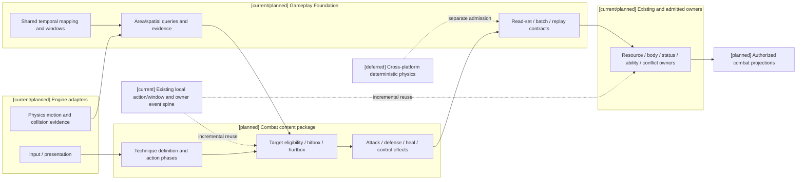
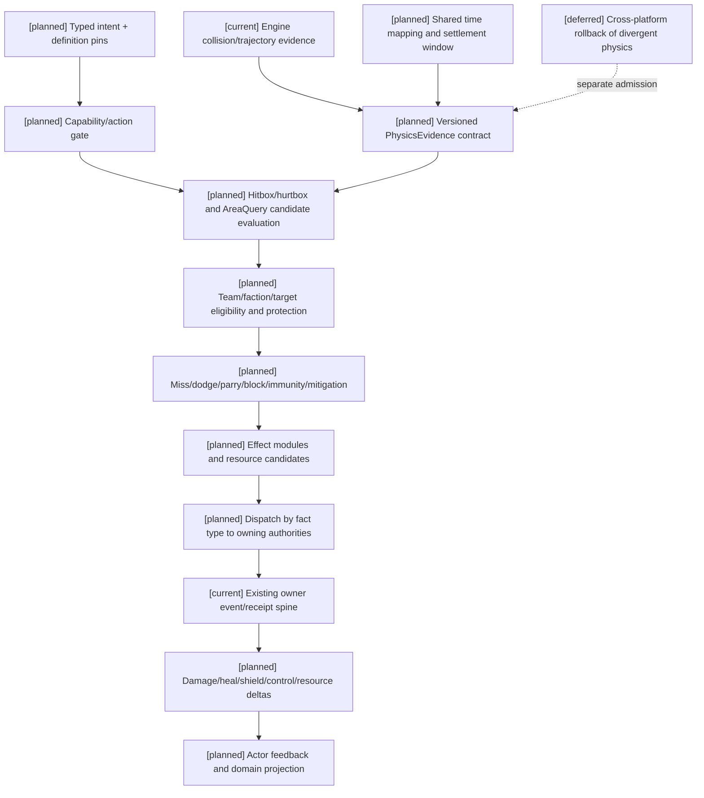

# 03 攻防治疗招数数据与动作参数计划

状态：`architecture analysis; planned and non-authorizing`

标签定义、四类生命周期和元标签治理由 [08-对象标签、编辑与版本治理设计](08-对象标签、编辑与版本治理设计.md) 负责；编辑器能力开关、权限授予、预览和发布由 [编辑器与能力权限治理](../编辑器与能力权限治理/00-README.md) 负责；本文件只定义动作和结算领域如何消费它们。新增治理合同均为 `[planned]`。

## 1. 技能定义与 runtime 分离

静态定义描述“这招是什么”，runtime state 描述“这次能不能用、进行到哪里”：

```text
TechniqueDefinition: effect modules, targeting, action graph, costs, tags, rules
TechniqueRuntime: phase, charge, cooldown, reservations, interruption, revision
```

## 2. 统一招数数据

每个 `TechniqueDefinition` 至少应声明：

```text
effect_modules       damage / heal / shield / mitigation / control / cleanse / summon
targeting            self / ally / enemy / area / chain / cone / line
shape                point / sphere / cone / capsule / line / ring / volume
range                min/max distance, radius, width, height, falloff
target_filter        faction, tag, status, line-of-sight, max target count
timing               startup, active, tick interval, duration, recovery
charge               min/max charge, release rule, interruption behavior
cooldown             group, duration, reset and partial refund
costs                resource types, reservation, conversion and debt
control              stun, slow, root, silence, displacement, cleanse
counterplay           resistance, dodge, guard, interrupt, dispel, terrain
```

对于 `magic:mana`、`cultivation:qi` 或其他世界包资源，`costs` 还应明确阶段和回蓝交互：

```text
upfront / reserved / per_tick / release / recovery
refund_policy / overdraft_policy
cost_scaling_source       power / range / duration / target_count / variant
regen_block_on_cast       是否施法期间暂停恢复
regen_delay_after_cost    消耗后的恢复延迟
```

技能本身可以提供回蓝、命中回蓝、资源转换或降低后续蓝耗，但这些都是受事件触发的效果模块，不能由模型直接修改资源。

### 2.1 来源、通道和效果模块

`Technique` 不是伤害属性，而是可以跨通道组合的来源对象。每个模块至少标记：

```text
source          ordinary_attack / spell / technique / equipment / environment
delivery        melee / projectile / beam / area / field / mental_link
effect_channel  physical / magical / mental / environmental / spiritual_rule
resolution      numeric / status / resource / field / rule
```

统一模块包括：

```text
damage / heal / shield / mitigation / guard / parry / dodge_window
control / cleanse / displacement / resource_transform / summon
field_create / field_modify / field_damage / soul_rule
```

普通动作、主动技能、被动、反应式和环境触发共享这些模块；差异由触发方式、准入、前置、成本、动作图和稳定性表达。

`environmental` 可以是输出通道。技能可创建火海、毒雾、重力井、光场或时间迟滞区，并以 `duration`、`radius`、`width`、`height`、`tick_interval`、`intensity`、`propagation_speed`、`falloff` 和 `overwrite_policy` 控制场生命周期。

### 2.2 生命、精神和灵魂目标域

本节只规定效果如何选择生命、精神或灵魂目标域。`LifeState`、伤势、倒地/死亡/复活和身体/灵魂连续性的唯一设计 owner 是 [10-生命状态、伤势与死亡连续性设计](10-生命状态、伤势与死亡连续性设计.md)。

效果通道与目标域分开：

```text
physical / magical / environmental -> life, body, space, resource
mental -> mind, focus, perception, decision
spiritual_rule -> soul facts and rule state
```

生命和精神的合并、耦合或独立由世界包选择。灵魂默认没有数值生命条；存在灵魂模块时必须先经过 `SoulAccessGate`，检查生命/精神脆弱性、灵魂链接、施术权威和更高规则。

同一合同需要适配两类世界观。常规内容包可注册拳击、武器攻击、护甲格挡、急救、压制与掩护；非常世界观内容包可追加元素、法术、功法、召唤、空间/领域效果或特殊媒介。特殊效果通过扩展 effect module 和规则引用进入结算，不要求常规世界观实现空置的 mana/元素字段。

### 2.3 攻击

攻击效果至少区分基础量、属性/标签、命中判定、穿透/减伤、暴击或弱点规则、命中反馈和后续状态。固定“近战拳击/剑击伤害 20”只能作为 fixture，不能成为通用模型。

### 2.4 防御

防御可以是 guard、dodge、parry、barrier、damage reduction、redirect 或 invulnerability window。必须记录方向、覆盖角、持续、姿态资源、可打断阶段和成功后的反制窗口。

### 2.5 治疗

治疗要区分 direct heal、hot、shield、revive、cleanse、injury repair 和 overheal。治疗目标、上限、削弱、禁疗、资源来源和延迟结算需结构化记录。

### 2.6 数值维度与结算层次

数值属性不是固定面板，而是由内容包注册的 typed stats。常见维度包括：

```text
输出：physical_attack_power、spell_power、technique_power、mental_power
      attack_speed、cast_speed、crit_chance、crit_multiplier
      damage_amp、penetration、true_damage、lifesteal

防御：health、armor、magic_resistance、mental_resistance
      damage_reduction、shield、block、parry、dodge、tenacity

续航：resource_capacity、resource_regeneration、healing_power
      received_healing、resource_cost_reduction、resource_conversion
```

这些属性必须标记适用通道和乘区，不能把 `technique_power` 当成独立伤害类型。推荐的结算层次为：

```text
base + channel scaling
-> critical policy
-> damage/heal amplification
-> penetration and resistance
-> target mitigation / shield
-> health or mind/resource change
-> status, control and lifesteal
```

护甲、魔抗、暴击、真实伤害、护盾和吸血的顺序由世界包注册；系统不能把某个游戏版本的固定公式作为全局真理。必须分别记录 `miss`、`dodge`、`parry`、`block`、`immunity`、`invulnerability`、`mitigation` 和 `shield_absorb`。

### 2.7 蓝条结算示例

假设一个技法当前蓝条为 80/120，已有 10 点被另一动作预留：

```text
available = 80 - 10 = 70
upfront_cost = 24
reserved_cost = 12
per_tick_cost = 4 x 3
```

司命先检查 `available >= upfront_cost + reserved_cost`，成功后只锁定预留部分并消耗 upfront；每个持续 tick 再结算 4 点。如果施法被打断，返还多少由 `refund_policy` 决定，不能因为模型判断“应该返还”就自动回蓝。

## 3. 动作阶段

```text
queued -> startup -> charge -> active -> tick* -> recovery -> completed
              \-> interrupted / cancelled / failed
```

阶段数据要包含前摇、激活、持续、tick、后摇、冷却、蓄力、取消目标、打断窗口和恢复路径。每个阶段都引用 context revision 和空间快照，避免动作开始时距离有效、结算时目标已离开却仍按旧事实命中。

## 4. 范围与空间

不要只存一个“范围”数字。至少分开：最小/最大距离、半径、宽度、高度、形状、方向、落点、目标数量、衰减、视线和遮挡。`action_window_runtime.py` 已有 distance band、visibility、sound、contact 和 spatial revision，可接入 targeting validator。

## 4.1 Gameplay Foundation 与物理引擎协作

战斗内容包不是物理引擎的替代品。它通过通用 Gameplay Foundation 的物理证据适配合同协作；`PhysicsCombatAdapter` 是战斗对该通用合同的一个配置接点：

```text
Combat content package -> typed action/field/force intent -> Gameplay/Physics adapter
Physics runtime -> contact/collision/trajectory/impulse/visibility evidence -> Gameplay evidence contract
Pure combat rule evaluation -> owner-bound fact candidates -> corresponding owner validation/commit
Physics runtime -> local motion, animation, particles and presentation
```

物理引擎负责连续空间事实：

```text
rigid body / collision / hitbox / hurtbox
trajectory / projectile motion / contact normal
impulse / force / obstruction / line of sight
```

战斗领域规则按已注册定义和证据形成候选结果，再依据事实类型交给对应 owner；没有一个 authority 同时拥有所有战斗结果：

```text
hit / miss / dodge / parry / block candidates
damage / heal / shield / control candidates
resource / status / field / rule candidates -> respective fact owners
```

物理接触不自动等于伤害，伤害也不要求每次都来自刚体碰撞。物理证据需要带 `physics_revision`、`source_id`、`target_id`、时间戳、空间快照和接触置信度；纯规则评估器按已注册技能、通道、抗性和反制规则形成候选结果，之后由相应事实 owner 校验并提交。已注册技法的高频窗口使用结构化规则和纯评估；司命模型只在低频学习、创新或异常裁定的提案路径中参与。

时间单位、physics/frame 到世界 step 的映射及结算窗口消费 [16-通用玩法时序模型与编辑器设计](../16-通用玩法时序模型与编辑器设计.md)。前摇、持续、冷却等字段必须带单位及 profile revision，不能把现有局部整数 tick 当作任意世界中的统一秒数。

环境场同样采用协作方式：战斗内容定义场的边界、持续、强度和效果，通用 Gameplay/物理适配器负责区域查询、遮挡、移动约束和局部表现。

## 4.2 命中证据、身体区域与空间查询

命中链必须把引擎提供的空间事实和战斗规则解释分开。推荐的通用合同如下：

```text
Hitbox {
  hitbox_ref / source_entity_ref / component_ref
  active_window_ref / shape_ref / channel_scope
  origin_policy / follow_policy / max_hits / repeat_policy
}

Hurtbox {
  hurtbox_ref / target_entity_ref / body_region_ref
  shape_ref / protection_group / vulnerability_refs
  active_policy / coverage_policy
}

GuardVolume {
  guard_ref / owner_ref / direction / coverage_angle
  channel_scope / posture_cost / active_window_ref
}

PhysicsEvidence {
  evidence_ref / adapter_ref / physics_revision
  source_ref / target_ref / hitbox_ref? / hurtbox_ref?
  simulation_time / position / normal / velocity
  contact_kind / line_of_sight / occlusion / confidence
  spatial_revision / source_revision_vector
}
```

`AreaQuery`、`DistanceQuery`、`LineOfSightQuery`、`CoverQuery` 和 `ReachabilityQuery` 只返回候选实体及证据引用。它们不能直接产生伤害或控制，也不能把未被角色观察到的实体放入模型上下文。最终顺序是：

```text
空间查询候选
-> 物理/引擎证据
-> 目标资格与保护关系
-> 命中/闪避/格挡/无敌判定
-> 效果模块和防御规则
-> 对应 owner authority 提交
```

身体区域、护甲、护盾和掩体可以引用标签或组件，但正式覆盖角、弱点、免伤和生命周期由组件/状态/效果 owner 保存。`hitbox` 标签不等于碰撞事实，`immune:*` 标签不等于已经通过免疫判定。

### 4.2.1 查询结果与证据新鲜度 `[planned]`

查询服务返回的是可审计的 `QueryResult`，不是裸实体列表：

```text
QueryResult {
  query_ref / query_kind / query_revision
  requester_ref / world_scope_ref / consumer_context_ref / temporal_window_ref
  candidate_refs / excluded_refs
  evidence_refs / spatial_revision / visibility_revision
  evaluated_at / expires_at / freshness_policy_ref
  ordering_key / truncation_policy / failure_code?
}
```

候选必须说明为什么被纳入、为什么被排除以及是否因预算被截断。`stale`、`late`、`duplicate`、`incomplete` 和 `unsupported` 是不同诊断；exact duplicate 可返回原查询结果且不产生新应用，changed duplicate 拒绝。其余默认拒绝或延后，不能用旧候选自动替代新证据。查询服务可在同一窗口缓存相同参数，但缓存键必须包含请求者视图类型/可见性、空间 revision、时间窗口、规则 revision 和查询参数摘要。authority evaluation view 可按合同包含隐藏候选用于真实范围结算；它与经 L1 过滤的 actor view 分开，不能把所有排除原因或隐藏 entity id 原样交给模型。

查询的最小保证由内容包声明：

`consumer_context_ref` 在战斗中引用 encounter，在生态/交互中引用所属领域 scope；通用查询不强制所有玩法建立遭遇。预算上限、距离单位、遮挡层与返回视图由编辑器注册配置选择，adapter 支持能力仍需验证，不能靠标签绕过。

```text
AreaQuery       几何相交/包含/距离带和候选上限
LineOfSight     起点、终点、遮挡层、穿透策略和证据时间
CoverQuery      掩体体积、暴露比例、遮挡方向和可破坏性
Reachability    导航/移动能力、到达时间上限和路径 revision
```

物理适配器不能把“查询成功”解释成“目标命中”。查询超时、证据过期或 adapter 能力不足时，对应 owner authority 必须选择 `reject`、`defer` 或内容包声明的保守结果，并记录原因。

### 4.2.2 证据生命周期与异常边界 `[planned]`

```text
sampled -> admitted -> consumed -> superseded
                    \-> rejected
                    \-> expired
```

`sampled` 只表示引擎采样；只有在来源、时间映射、权限和 revision 校验后才进入 `admitted`。consumed 表示已被引用，不删除证据，也不禁止多个合法效果共用一次接触。实际效果应用按 `action_instance + effect_module + target/incarnation + impact/tick slot` 去重；跨窗口重用须有新 admission receipt，不能以同一接触重复制造伤害。物理适配器重启、网络补发、局部丢帧和跨 timeline 输入都必须保留诊断，不得静默伪造接触或命中。

### 4.2.3 几何、精度与批量查询 `[planned]`

空间参数必须带坐标系、单位、shape revision、边界包含政策及 origin transform；身体挂点和动画驱动 hitbox 还固定 skeleton/attachment revision。adapter capability 声明支持静态 overlap、sweep/连续碰撞、接触法线、可破坏遮挡与导航查询中的哪些能力，不支持时不得用相似名字冒充。

引擎 broad phase 只生成粗候选，narrow phase 提供相交/接触证据，最后领域规则应用 body-region、guard 和通道政策。高速投射物优先消费 sweep/连续证据，离散采样能力不足时显式拒绝所需精度或采用作者批准的近似模式；render frame 不能补造物理采样。同窗接触排序固定为量化 impact time、规则优先级、entity/incarnation、shape ref；边界相切、起点在碰撞体内和相等距离都有版本化 tie-break。

查询上限和技能 target count 分开：前者是运行预算，后者是效果规则。`incomplete` 不能作为“没命中”的证据，也不能把未扫描实体当不存在。批量查询共享 frozen spatial snapshot 与参数 pins，按稳定分区/continuation token 继续；预算无法满足 deadline 时整项延后/失败，只有内容包明确允许的有限抽样才可产生近似结果，并标记覆盖范围。确认后不得因后台扫描补齐追写旧窗口命中。

## 4.3 投射物、轨迹与影响归属

投射物拆成定义、执行状态、轨迹证据和影响归属四部分，不另建战斗中央运行时：

```text
ProjectileDefinition
  shape / speed / acceleration / lifetime / penetration / homing_policy

ProjectileExecutionState
  phase / current_transform / remaining_lifetime / hit_count / owner_revision

TrajectoryEvidence
  sampled_path / collision_revision / occlusion / impact_candidates

ImpactAttribution
  canonical_origin_ref / controller_ref / owner_ref / transfer_policy
```

物理引擎负责连续轨迹和碰撞采样；Gameplay Foundation 负责时间映射、证据版本和窗口归属；战斗规则评估形成候选，相关 owner authority 分别决定命中、穿透、衰减以及伤害/控制归属于投射物、施术者、主人或环境。召唤物和投射物不得同时为同一事件贡献一次仇恨或伤害。

投射物执行必须有独立身份和终止原因：

```text
ProjectileExecutionState {
  projectile_instance_ref / definition_revision
  creator_ref / controller_ref / canonical_origin_ref
  spawn_window / current_window / transform_revision
  remaining_lifetime / remaining_penetrations / hit_registry_revision
  status: pending | active | paused | redirected | expired | impacted | destroyed
  termination_reason?
}
```

命中登记使用 `(projectile_instance_ref, effect_ref, target/incarnation, impact_slot, impact_policy_revision)` 去重；once_per_target、每次碰撞和周期重击的 slot 政策分别声明。穿透、链式跳转、反弹和持续区域必须分别声明是否生成新影响实例。暂停或时间场效果只能改变已声明的消费者，不得把同一投射物复制到两个时间线。投射物 owner 消失、控制权转移或召唤者死亡时，按 `transfer_policy` 选择继续、失控、立即销毁或转为环境来源。

| 交互 | 设计规则 |
|---|---|
| 瞬时射线/延迟弹体 | 同一效果可选 ray evidence 或连续轨迹；不强制枪械都生成持久实体 |
| 穿透 | 固定入口/出口与厚度证据、剩余穿透次数/能量、目标间衰减、停止条件 |
| 反弹/反射 | 普通弹跳保留实例并增加 bounce slot；规则反射记录新控制/归因 revision，必要时接纳新实例 |
| 追踪/丢锁 | 角速度/转弯限制、重选资格、丢锁继续或终止政策；不能从隐藏目标坐标无限追踪 |
| 爆炸/链式 | 每次产生独立 impact application，AreaQuery 或每跳目标重选；max hops 与同链目标去重防循环 |
| 护盾/拦截 | 先求接触与合法拦截，再由 effect/body owner 判断吸收/穿透；视觉拦截不等于资源吸收成功 |
| 同窗死亡/到期 | impact 与 expiry/owner death 的顺序固定；不按消息先到后到决定是否生效 |

投射物生成/销毁和 incarnation 合同复用 [10 第 6.1–6.2 节](10-生命状态、伤势与死亡连续性设计.md)，不得在轨迹模块里另建生成事实账本。内容作者可编辑形状、速度、寿命、追踪、反弹/穿透预算、重复命中与归因政策；引擎支持能力、所有权和角色能力上限仍需发布前校验。

投射物的 `[current]` 仅是引擎轨迹和局部动作基础；定义、执行状态、命中登记、终止回执和跨窗口重放均为 `[planned]`。跨平台重新模拟物理轨迹属于 `[deferred]`，回放优先使用已记录的 `TrajectoryEvidence`。

## 4.4 防御结果与生命周期

防御结果必须显式区分：

```text
miss / dodge / parry / block / guard
immunity / invulnerability / mitigation / shield_absorb
interrupt / cleanse / redirect / counter
```

`Downed`、`DeadPending`、`Dead`、`Reviving` 和 `Revived` 属于生命生命周期，`despawned` 属于实体 presence；二者不是普通状态标签的别名。旧设计称 `DeadPendingConfirmation/DeadConfirmed` 的阶段统一消费 10 的 `DeadPending/Dead`，不建立第二枚举。转换、死亡原因、复活资格、身份与灵魂连续性见 [10](10-生命状态、伤势与死亡连续性设计.md)；复活、召唤、生成和销毁由相应 owner contract 提交，技能只能提出意图并提供效果候选。

## 5. 状态与技能的交互

招式的可用性、效果和反制应读取结构化状态：疲劳可能降低动作精度，失衡可能关闭格挡，专注可能决定持续技法能否维持；非常世界观还可能有封印、元素共鸣或领域压制。状态 modifier 必须带来源和优先级，不能由模型从描述自行推导并写回。

## 6. 当前、计划与暂缓

- `[current]`：动作节点时长窗口、取消目标、条件引用、空间快照、距离带；语义效果已有整数 magnitude、抗性 basis points、状态层数和过期 tick。
- `[planned]`：统一 effect module、物理/魔法/精神/环境通道、跨通道 Technique、环境场生命周期、生命/精神模型、灵魂 gate、攻防治疗字段、targeting 形状/筛选、AreaQuery 查询结果与证据新鲜度、Hitbox/Hurtbox、PhysicsEvidence admission、Projectile 执行/终止/去重、蓄力/冷却/打断和结果回放；死亡/倒地/复活的详细合同见 [10](10-生命状态、伤势与死亡连续性设计.md)。
- `[deferred]`：首期不让模型生成逐帧姿态；不在静态定义中硬编码所有世界观的伤害公式。

### 6.1 物理与投射物设计验收 `[planned]`

| 案例 | 必须证明 |
|---|---|
| 高速穿透、起点在目标内部、边界相切 | 正确选择 sweep/overlap 能力和边界政策；相同证据稳定排序 |
| 同一次接触同时造成伤害/控制 | 可复用证据但效果各有键；重发不重复生效 |
| 周期重击与 once_per_target | slot 允许合法再次命中且防止重复包，无无限命中 |
| 查询预算截断/目标不可见 | 不能将 incomplete 当 miss，不能向 actor 泄漏隐藏候选 |
| 反射后控制转移、飞行中阵营变化 | 当前资格和归因 revision 可追踪，过去贡献不被重写 |
| adapter 重启/迟到接触/消失实体 | 检查来源、时序和 incarnation，拒绝旧证据作用于新实体 |
| 链式/反弹/爆炸循环 | max hops、repeat policy 和反应预算有界，成本与效果可重放 |

## 7. 架构图



## 8. 时序图

```mermaid
sequenceDiagram
  participant C as Character/Laya
  participant X as Action executor / Actor (L4)
  participant T as Shared time and spatial evidence adapter
  participant S as Combat rule evaluator
  participant A as Corresponding fact owner(s)
  Note over C,A: [current] local action window and owner event spine; [planned] shared evidence/target/effect contract; [deferred] cross-platform deterministic physics
  C->>X: typed technique intent
  X->>T: action phase, hitbox intent and time mapping
  T-->>X: frozen spatial candidates and PhysicsEvidence refs
  X->>S: evidence, target candidates, definitions and reservations
  S->>S: check target eligibility, geometry, defense, effects and counterplay
  S->>A: owner-bound effect candidates and revision pins
  A->>A: validate only owned facts, freshness, idempotency and local costs
  A-->>A: commit/reject with per-owner receipt
  A-->>X: phase/result and interruption state
  X-->>C: structured feedback at decision window
  Note over T,A: Spatial candidates and contact evidence are not themselves damage or world truth
```

## 9. 数据流图



## 10. 标签作为 targeting 和效果输入

招式定义、动作构型、目标、状态和环境场可以通过受限 `SemanticSelector` 引用标签。例：`require_all_tags=["status:bleeding"]` 筛选流血目标，`component_scope="weapon", require_all_tags=["weapon:sword"]` 校验武器，环境 selector 使用已注册 `context:wet`；前置/克制关系引用这些 selector id，而不是拼出 `target:status:*` 等私有查询语言。这些标签只参与准入、筛选、克制和 effect binding 选择，不能绕过命中、闪避、免伤、护盾、抗性、打断和 authority 结算。

```text
definition tags -> targeting/effect candidates
instance/runtime tags -> current eligibility and exposure
meta-tags -> visibility, lifecycle, conflict and authority checks
physics evidence + spatial revision -> final geometry decision
```

`environmental` 仍可由技能创建或修改：场的半径、宽度、高度、持续、tick、衰减和离场路径来自结构化字段，标签只声明“火场/真空/月光场”等语义。`immune:*`、`resistance:*` 和 `policy:*` 不能被当作任意标签直接赋予，必须引用已注册的抗性/策略定义。

标签参数可在编辑器中调整“控制强度、前摇、持续、范围、吸血倍率”等已注册绑定参数；编译时必须校验类型、单位、世界上限、适用动作/通道、能力前置和反制。主动/被动/反应式是 activation，普攻/技能是来源，控制/治疗等是效果类型，不因带标签而合并成一个枚举。攻击力、法强和 technique_power 可为属性输入；Technique 仍是跨通道构筑对象。

验收：未绑定的“吸血/免伤”标签不生效；绑定吸血必须引用本次实际结算结果并声明护盾吸收、真实伤害、环境 tick 的计入政策与触发预算；控制时长、韧性和免疫有确定性 trace。标签驱动的空间变化产生结构化请求，由物理运行时提供证据，不能把“命中标签”当作碰撞事实。

## 11. 本批规格与计划回写（2026-10-10）

本批将本文的 TechniqueDefinition/Runtime、空间证据和多通道效果收敛为非战斗专属的动作/结算适配合同。规格11复用现有 action graph、CharacterExecutionContract、时间/批次和领域 owner；不创建名为 `GameplayActionAttempt` 或 `OutcomeEvidence` 的假定现有类型，也不把物理接触直接当成语义命中。缺少 effect/target/physics owner 时保留 not-ready。

映射：规格07、11；计划02 Task5–6、计划04 Task4/6。完整攻防治疗、空间和跨 owner 证据仍待准入。

现有 `ability_runtime.py`、`action_graph_content.py` 和 `action_window_runtime.py` 已提供分离的起点，但当前 effect 和 targeting 仍不足以覆盖通用攻防治疗。
