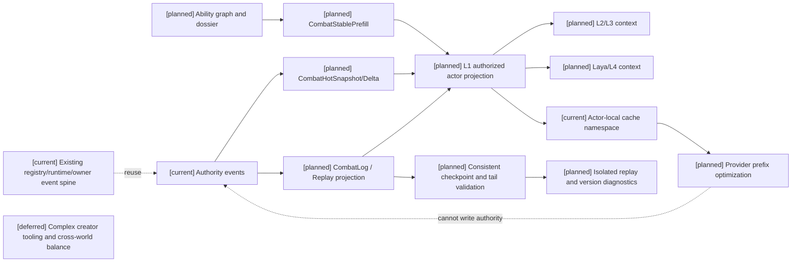
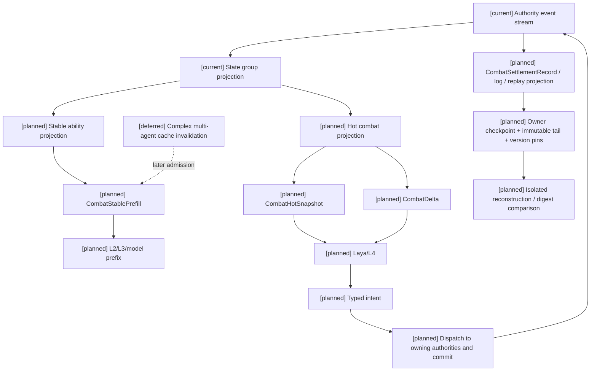

# 04 战斗状态、CombatPrefill 与高频读取计划

状态：`architecture analysis; planned and non-authorizing`

标签定义、四类生命周期和元标签治理由 [08-对象标签、编辑与版本治理设计](08-对象标签、编辑与版本治理设计.md) 负责；编辑器能力开关、权限授予、预览和发布由 [编辑器与能力权限治理](../编辑器与能力权限治理/00-README.md) 负责；本文件只定义战斗读取和缓存领域如何消费它们。新增治理合同均为 `[planned]`。

## 1. 目标

战斗中的资源、冷却、状态、距离和动作阶段变化频繁，不能每次都依赖长上下文或模型推算。建议为每个角色提供三层结构化输入：

```text
CombatStablePrefill  低频变化：能力、技法定义、限制、克制和个人化路线
CombatHotSnapshot     高频完整视图：资源、冷却、状态、空间、动作阶段和可用 affordance
CombatDelta            从上一个 revision 到当前的最小变化
```

## 2. `CombatStablePrefill`

内容包括：

- actor 私有身份和 cache namespace；
- 当前稳定能力图节点、技能等级、掌握阶段和可靠性；
- 技法定义摘要、动作图摘要、资源成本区间、前置和克制关系；
- 蓝条资源定义、基础上限/回蓝规则、消耗阶段和来源依赖摘要；临时 capacity、effective regen 和阵法连接当前状态归 hot snapshot；
- 装备槽位、耐久/限次规则、药品与弹药的使用限制，以及当前阵法/环境锚点的稳定定义摘要；
- 已注册的职业/身份/能力标签及其 effect binding、作用条件、优先级和冲突摘要；
- 人格/认知包络对战斗选择的表达约束；
- 允许的 ThoughtMode、Laya 候选上限和失败回退；
- 最近一次学习/进化 authority event 的 revision。

它在能力图、dossier、稳定标签/绑定定义或世界 active revision 变化时重建，不能把当前 hp、临时 capacity、距离、状态或冷却混入长期 prefix。

## 3. `CombatHotSnapshot`

```json
{
  "actor_id": "actor-07",
  "context_revision": "combat-1842",
  "resources": {
    "health": {"current": 72, "capacity": 100, "available": 72},
    "magic:mana": {"current": 18, "capacity": 120, "reserved": 6, "locked": 0, "available": 12, "regen_per_second": 4.5, "recovery_delay_ms": 800, "recovery_state": "recovering"},
    "stamina": {"current": 31, "capacity": 60, "available": 31}
  },
  "cooldowns": {"sword_arc": 820, "guard": 0},
  "statuses": [{"status_id": "status-instance-18", "tag_ref": "status:bleeding", "stacks": 1, "expires_at_tick": 1845}],
  "space": {"distance_band": "near", "distance_m": 1.8, "line_of_sight": true, "spatial_revision": "space-91"},
  "action": {"phase": "recovery", "remaining_ms": 180, "interruptible": true},
  "affordances": [{"id": "guard", "reason": "available"}, {"id": "sword_arc", "reason": "cooldown"}]
}
```

字段必须来自 authority/runtime。`affordances` 需要带原因，避免模型把缺失技能误认为暂时不可用；高频数值不从自然语言状态重建。

### 3.1 跨通道和环境场读取

需要按权限过滤提供以下结构化摘要：

```text
defense_channels:
  physical / magical / mental
field_exposure:
  field_id / distance_to_boundary / intensity / remaining_ms / escape_options
vitality_model:
  fused / coupled / independent
life_mind_vulnerability:
  current gates and reasons, not model-invented percentages
soul_gate:
  reachable / blocked / missing_link / insufficient_authority
```

灵魂快照只暴露当前角色有权知道的 gate 结果和原因，不暴露不可见的规则事实。环境场的强度、边界、持续和反制路径来自 runtime；模型不能从地图文字自行估算。

## 4. `CombatDelta`

delta 以 `from_revision`、`to_revision`、字段路径、旧/新摘要和 authority event 引用组成。典型变化包括资源消耗、预留释放、状态叠层、冷却开始/结束、距离带变化、动作阶段变化、打断和目标失效。发现 revision 不连续时，消费方必须请求完整 snapshot。

### 4.1 实体批次视图与投射物/召唤物

大型遭遇不能把所有实体完整状态塞入每个角色 prompt。快照使用作用域和候选引用表达本角色可行动的信息：

```text
EncounterView {
  encounter_ref / encounter_revision / temporal_window_ref
  self_state_ref / team_summary_ref / eligible_target_refs
  spatial_query_ref / target_policy_revision
  projectile_refs / summon_refs / lifecycle_event_cursor
}

EntityCombatSummary {
  entity_ref / visible_state_revision / spatial_revision
  life_cycle / distance_band / visible_conditions
  target_eligibility / protection_summary / threat_estimate?
}
```

它不缓存隐藏仇恨表或敌方未暴露资源。AreaQuery 候选、Hitbox/Hurtbox 证据和角色能观察到的实体集合是不同字段，不能相互推导。

### 4.2 批量结算、日志与回放投影

`CombatLog` 是依据既有 owner events、受信输入和物理证据形成的可读投影，不是第二事件 store。一个窗口的可回放记录至少需要：

```text
CombatSettlementRecord {
  encounter_ref / temporal_profile_revision / window_ref
  input_commitment_refs / action_phase_refs / evidence_refs
  definition_and_rule_pins / read_set_revision_vector
  owner_event_refs / receipts / result_digest
  visibility_scope / projection_revision
}
```

Replay 从正式 owner events 重建结果；重算领域规则时使用固定的 `PhysicsEvidence`，不能要求另一个物理引擎重新猜测碰撞。真正的物理重模拟还需要受支持的引擎快照与输入记录，不能只凭接触证据承诺。rollback 预测记录与正式提交记录隔离，只有到达 confirmation 条件并经 owner 提交后才出现 authority receipt。日志缺失、投影延迟或 cache miss 不改变世界事实。

### 4.3 三种回放模式与检查点 `[planned]`

| 模式 | 输入与输出 | 权限与限制 |
|---|---|---|
| 结果/观战回放 | 已提交事件 -> 受权限过滤的状态/表现轨迹 | 不重算伤害；角色战后复盘只能读取授权部分 |
| 领域验证回放 | 原规则、read-set、输入、受信证据、随机上下文 -> 候选 digest 对比 | 在隔离只读环境验证，禁止再次 append/消费库存 |
| 物理重模拟 | 引擎快照、同版本模拟能力、输入与物理配置 -> 轨迹/碰撞对比 | 必须满足 16 的 profile 能力准入；证据回放不证明该模式可用 |

公共 `ReplayCheckpoint` 与 consistent cut 合同由 [16 第 7.4 节](../16-通用玩法时序模型与编辑器设计.md) 定义。战斗检查点固定 encounter/phase、实体 incarnation、动作与投射物、资源预留/状态、生命/实体 presence、目标关系、到期任务游标及参与 owner 的 revision vector。不能把某一 actor 的 HotSnapshot 当成整个遭遇快照，也不能逐个抓取不同时间的 owner 最新值后宣称一致。

检查点后的 tail 按 operation/owner sequence 和因果依赖恢复，跨 owner 以 receipt 与 dependency edges 验证，不按墙上时间排序。必须同时覆盖：完成窗口、部分提交且可恢复窗口、正式事件对应的原定义 revision。正式检查点与 prediction checkpoint 分开保存；重放时已提交操作只恢复其效果，不再次发生成/召唤/掉落/通信请求。

`CombatSettlementRecord` 扩展引用 `checkpoint_ref`、`batch_plan_ref`、`completeness`、`prediction_branch_ref?`、`random_context_ref`、`adapter_capability_revision` 和 `serialization_revision`。它引用证据与事件，不把完整世界秘密复制成每个角色日志。完整证据保存于受授权的审计读取路径；filtered replay 单独携带 visibility policy revision，不足以保证全量确定性重建时明确标注。

### 4.4 重建、版本与读取故障 `[planned]`

同一 pins 下比较全量事件重建和 checkpoint + tail 的领域 digest；失败报告定位首个分歧窗口、owner、operation、缺失引用与版本，不能让模型猜出过去生命值。definition/schema 版本保留或提供已注册只读解码器；若缺少旧版本，返回 `unreplayable`，不能把旧事件按新版数值重算。创作者可预览版本差异，但不会修改历史 receipt。

日志投影有自己的处理 cursor；投影失败从最后已确认 cursor 幂等恢复。只有完整 tail 才推进 verified replay range；缺段不按“没有发生”填空。用户/角色视图的权限在读取时重新校验，撤权清除旧缓存；authority audit 读取也需专门权限，creator preview 不自动获得生产世界秘密。

HotSnapshot/Delta 增加 `owner_revision_vector`、`batch_ref/completeness` 与 `committed/provisional` 标记。跨 owner 暂时不齐的状态可如实显示，但不可用于要求一致 read-set 的结算；Laya 按原因选择已注册回退，不等待长模型修复，也不能自行补齐资源。actor delta 丢失回退完整授权快照，prediction delta 丢失则回退同分支快照，不混用正式流。

| 设计验收案例 | 必须证明 |
|---|---|
| 全量重建与 checkpoint + tail | 生命/资源/状态、动作、投射物、目标关系和结果 digest 一致 |
| 日志晚到/缺段/重复 | 正式事实不变；cursor 与 verified range 不虚报完整 |
| 旧 schema/规则版本缺失 | 明确不可验证/不可重建，不以新版猜测 |
| 召唤与消耗历史重放 | 重建身份与账本但不重复实例化真实实体或扣费 |
| 隐藏治疗/目标回放 | actor view 不泄露隐藏实体、仇恨表、seed 或灵魂事实 |
| partial batch checkpoint | 可恢复已提交部分，未提交依赖不被标成完成 |

## 5. 缓存和隐私

缓存键至少包含：

```text
actor_id + cache_namespace + stable_ability_revision + world_rules_revision + persona_projection_revision
```

热状态不进入跨 actor 共享缓存；私有伤势、记忆、学习进度和角色不可见信息按 actor 隔离。缓存命中不能越过 context revision 校验。provider prefix caching 是优化选项，不改变 authority 和隐私边界。

## 6. L2/L3/Laya/L4 消费边界

本节的 `L4/Actor` 沿用角色运行时的执行层命名，不等同于架构视图中的 authority ownership plane。事实 owner 是横切的，按能力、资源/身体、状态/效果、目标/威胁和生命周期等合同分别校验并提交。

| 层 | 读取 | 不负责 |
|---|---|---|
| L2 | 技法语义、风险、克制、学习/复盘上下文 | 推算真实资源和效果 |
| L3 | 稳定能力、候选策略、动作承诺和长短规划 | 直接写入资源或技能节点 |
| Laya | 热状态、可用 affordance、空间和动作阶段 | 自行结算伤害/治疗 |
| L4/Actor | 阶段、取消、身体表现和回执 | 成为 world truth owner |
| Corresponding fact owners | 各自的 evaluation view、owned revision 与确定性校验/提交；投影汇总带 owner receipt 的结果 | 形成中央事实 owner 或代替角色选择主观目标 |
| 司命 | 受授权的规则解释/trace、创新提案和催化输入 | 绕过 owner contract 或直接提交世界真值 |

低能力角色可以使用更小的候选集、更短的规划跨度和更低的模型推理预算，但仍读取同一份经权限过滤的事实快照。低算力不等于全能，也不能绕过能力门禁。

## 7. 学习与战斗边界

战斗事件形成学习证据，但不会在当前动作中即时改变稳定能力。学习/创新循环在边界点消费事件，提交提案并等待司命协调后由对应能力/内容 owner 提交的事件；下一版 `CombatStablePrefill` 才暴露新技法或变式。这样可以避免同一回合“边打边凭空升级”。

## 8. 当前、计划与暂缓

- `[current]`：`CharacterGameRuntimeState`、state group projection、`mind_frame`、L1 actor cache namespace、VLA cache、prompt summary、body hints 和 affordance summaries。
- `[planned]`：`CombatStablePrefill`、`CombatHotSnapshot`、`CombatDelta`、作用域化 `EncounterView`、跨通道防御和环境场摘要、生命/精神模型与灵魂 gate、revision/freshness 合同、战斗专用 prefix cache、CombatLog 和 Replay 投影。
- `[deferred]`：首期不承诺 provider 一定支持可控 thinking effort；不让缓存替代新鲜度校验；不把完整战斗状态塞进每次自然语言 prompt。

## 9. 架构图



## 10. 时序图

```mermaid
sequenceDiagram
  participant A as Authority
  participant R as Runtime projection
  participant C as Cache/prefill builder
  participant L as Laya/L2/L3
  participant LOG as Combat log/replay projection
  Note over A,LOG: [planned] full combat views and replay; [current] registry/runtime/owner spine; [deferred] unbounded cross-platform rewind
  A->>R: append settlement event revision n
  R->>C: publish stable/hot projection
  C->>C: validate freshness and actor privacy
  C-->>L: snapshot or delta with revision n
  L->>A: bounded intent with expected revision n
  A-->>R: settle or return conflict
  A->>LOG: committed event refs, evidence pins and revision vector
  LOG-->>L: filtered log/replay view
  opt replay verification
    LOG->>LOG: load consistent checkpoint and pinned event tail
    LOG->>LOG: reconstruct without writes and compare result digest
    LOG-->>L: authorized result or explicit incomplete/divergent status
  end
```

## 11. 数据流图



## 12. 验收方向

至少要证明：资源、冷却、状态、距离和动作阶段能以 revisioned snapshot 读取；delta 丢失会回退完整 snapshot；不同 actor 缓存隔离；模型无法凭空修改高频状态；高频循环不等待学习慢循环；司命批准的技法变式能在下一稳定 revision 中出现并可重放。

## 13. 标签 revision 与缓存失效

`CombatStablePrefill` 摘要 actor 可见的稳定标签/绑定规则及与决策相关的治理结果，不把完整元标签管理档案塞进每次 prompt。稳定缓存键包含以下定义/投影版本（均为 [planned] 字段，先复用现有 actor namespace）：

```text
semantic_registry_revision
active_tag_revisions
effect_binding_revision
world_rules_revision
stable_tag_projection_revision
visibility_policy_revision
```

定义/绑定/元标签政策或稳定实例标签变化重建相关 stable projection；运行时状态标签、派生暴露条件和有效数值只刷新 hot snapshot/delta，不能每个 tick 改稳定 prefix。hot/delta 单独携带 assignment/state/spatial revision、from/to revision、event refs 和 active semantic digest。缺失或乱序 delta 回退完整快照；已提交事实先可读，模型 prefix 延迟重建不阻塞 authority。

所有角色可感知的外部状态经 L1 授权投影后才进入 L2/L3/Laya；不能用 cache builder 作为隐藏事实查询通道。authority 使用 authority_evaluation_view，创作者预览使用 creator_debug_view。可见性过滤先于缓存写入；权限撤销或视图政策变化清除相关缓存，不能向角色透露被移除的秘密标签旧值。静态公开内容可共享，角色私有 prefix 不能跨 actor 复用。

验收：流血 tick 仅产生 hot delta；技能学会或标签绑定新版本改变 stable key；权限撤销后旧 prefix 不再命中；低算力候选集收缩不会扩大读取范围或能力上限。
