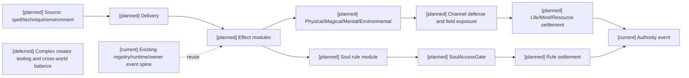
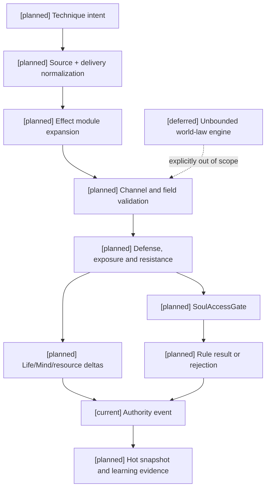

# 05 效果通道、环境场与生命精神灵魂规则设计

状态：`architecture analysis; planned and non-authorizing`

标签定义、四类生命周期和元标签治理由 [08-对象标签、编辑与版本治理设计](08-对象标签、编辑与版本治理设计.md) 负责；编辑器能力开关、权限授予、预览和发布由 [编辑器与能力权限治理](../编辑器与能力权限治理/00-README.md) 负责；本文件只定义效果通道与世界规则领域如何消费它们。新增治理合同均为 `[planned]`。

本文件是战斗效果通道、环境场、生命/精神作用域和灵魂 gate 原则的 owner。它补充 01 的技法构筑、02 的资源账本和 03 的动作/效果合同，不把 `Technique` 当作一种伤害属性。生命阶段、伤势、死亡连续性和复活流程由 [10-生命状态、伤势与死亡连续性设计](10-生命状态、伤势与死亡连续性设计.md) 唯一负责。

## 1. 四个正交维度

战斗对象必须分开记录来源、传递方式、效果通道和结算模式：

```text
source
  ordinary_attack / spell / technique / method / equipment / environment / ritual

delivery
  melee_contact / projectile / beam / area / field / mental_link / ritual_link

effect_channel
  physical / magical / mental / environmental / spiritual_rule

resolution_mode
  numeric / status / resource / field / rule
```

`Technique` 是跨通道的效果组合和动作构型，不是与 `physical`、`magical` 并列的第五种伤害。一个技法可以同时包含物理、魔法、环境和精神模块。

## 2. 效果通道

### 2.1 `physical`

作用于身体、物体和动量，常见防御是护甲、格挡、招架、姿态和物理减伤。拳、剑、枪、冲撞和爆炸冲击都可以产生物理模块。

### 2.2 `magical`

作用于法术、元素、能量和超自然媒介，常见防御是魔抗、元素抗性、法术屏障和媒介破坏。法术不必只造成伤害，也可以治疗、护盾、净化、召唤或改变空间。

### 2.3 `mental`

作用于认知、注意、情绪、感知和短期意志，常见效果是恐惧、混乱、魅惑、幻觉、失明和专注打断。它可以影响 `mind` 域，也可以按世界包规则转化为生命损失。

### 2.4 `environmental`

作用于空间环境和暴露条件。它既可以是自然危害，也可以由技能创造或修改：火海、毒雾、真空、重力井、时间迟滞、光场和领域都属于环境效果。环境效果可以进一步对生命、精神、资源、移动和视线产生影响。

环境通道不要求每个角色都有一个固定的 `environmental_resistance`。防御可能来自抗性、掩体、地形、装备、环境适应、离开区域或破坏场核心。

### 2.5 `spiritual_rule`

灵魂默认不是数值伤害通道，而是规则层。它作用于灵魂锚点、自我身份、真名、契约、附身、诅咒、驱逐和转生联系。它不提供通用 `soul_hp` 或 `soul_resistance`。

## 3. 跨通道 `Technique`

```text
Technique
  ├─ physical numeric module
  ├─ magical numeric/status module
  ├─ environmental field module
  ├─ mental status/resource module
  └─ spiritual rule module (optional and gated)
```

例如“日月同辉”：

```text
source: technique
delivery: area + beam + field

modules:
  physical: radiant_impact -> life
  magical: solar_fire + lunar_cold -> life/environment
  environmental: light_field + temperature_shift -> movement/visibility
  mental: sensory_overload -> mind
  spiritual_rule: none by default
```

跨通道防御也必须是组合防御，而不是一个笼统的 `technique_defense`：

```text
TechniqueDefenseProfile {
  physical_response
  magical_response
  environmental_response
  mental_response
  interruption_response
  field_escape_response
  rule_gate_response
}
```

## 4. 环境场生命周期

环境技能必须显式声明：

```text
FieldEffect {
  shape, origin, radius, width, height
  duration, first_tick, tick_interval, tick_count
  intensity, propagation_speed, falloff
  line_of_sight, occlusion, friendly_fire
  persistence, overwrite_policy, dispel_policy
  affected_channels, target_filter, owner
}
```

场效果可以造成直接伤害，也可以只改变条件：降低移动速度、阻断视线、改变资源恢复、提高某个元素效果、阻止传送或改变动作窗口。离开范围、场强衰减、场核心破坏和反向覆盖都属于可观察的反制路径。

## 5. 生命与精神模型

生命和精神必须先由世界包选择关系模型：

```text
vitality_model = fused       # health/focus 是同一生命力的投影
vitality_model = coupled     # health/focus 独立，但允许显式转换
vitality_model = independent # 两者独立，不能隐式互转
```

`life_domain` 表示身体生命和生理完整性；`mind_domain` 表示意识、认知、情绪和意志；`health`、`focus`、`sanity` 是资源或状态投影，不应与效果通道混为一谈。

在 `coupled` 模型中，世界包可以声明：

```text
mental_damage -> focus_loss
focus_zero -> stun / collapse
focus_loss -> health_damage
health_low -> mental_vulnerability_up
```

所有转换都必须是明确规则，不能由模型根据自然语言自行推断。

## 6. 灵魂规则与可触达条件

灵魂是角色的另一种存在形态，使用事实和规则状态而非数值条：

```text
soul_anchor
identity
true_name
oath
possession_state
reincarnation_link
curse_binding
rule_authority
```

灵魂效果先经过 `SoulAccessGate`：

```text
soul_attack_allowed =
  (life_vulnerability >= required_gate
   OR mind_vulnerability >= required_gate)
  AND spiritual_link_valid
  AND attacker_authority_sufficient
  AND no_higher_rule_blocks
```

“虚弱”相对于攻击强度、目标状态和内容包规则计算，不固定为所有世界观相同的百分比。未通过 gate 时，灵魂模块不得产生规则写入。

通过 gate 后，灵魂效果可以是：

```text
possess / bind / banish / sever / curse / seal
block_reincarnation / alter_identity
```

灵魂规则需要记录前置、媒介、因果联系、规则优先级、反制和可重放证据。它不应被降级成 `spiritual_power - spiritual_resistance`。

## 7. 统一结算顺序

每个模块都遵循同一 authority 边界：

```text
admission
-> target and geometry
-> timing and release
-> hit / dodge / miss / immunity
-> channel defense and mitigation
-> field creation or field exposure
-> life/mind/resource settlement
-> status and control
-> soul access gate and rule settlement
-> counterplay window and event append
```

具体护盾、减伤、吸血、暴击和资源转换顺序由世界包注册，但最终结果必须由领域 authority 校验并提交事件，司命提供提案和催化。模型只能提出跨模块意图，不能直接写入数值或规则状态。

## 8. 当前、计划与暂缓

- `[current]`：语义效果、状态标签、抗性基础值、有效属性、动作窗口和空间快照；没有完整环境场调度、跨通道技法结算或灵魂规则 gate。
- `[planned]`：来源/传递/通道/结算模式四轴；环境场生命周期；生命/精神三种关系模型；灵魂规则层和 `SoulAccessGate`；跨通道防御 profile。生命状态、伤势和死亡连续性见 [10](10-生命状态、伤势与死亡连续性设计.md)。
- `[deferred]`：完整因果、真名、契约、转生和规则优先级引擎；首期不实现无限制的通用世界法则编辑器。

## 9. 架构图



## 10. 主流程时序图

```mermaid
sequenceDiagram
  participant C as Character/Laya
  participant S as 司命
  participant F as Field/Spatial runtime
  participant A as Authority
  Note over C,A: [planned] full flow; [current] registry/runtime/owner spine; [deferred] complex creator tooling
  C->>S: submit bounded multi-channel technique intent
  S->>F: validate geometry, field and exposure revision
  S->>S: resolve hit, defenses, life/mind and resources
  S->>S: evaluate SoulAccessGate if spiritual rule module exists
  S->>A: submit owner-bound proposal, rules and counterplay
  A->>A: validate owner contract and atomically commit or reject
  A-->>C: revisioned result and CombatDelta
```

## 11. 数据流图



## 12. 验收标准

1. 一个 `Technique` 可以在同一结算中包含物理、魔法、环境和精神模块。
2. 环境场能创建、持续、衰减、覆盖、被驱散并产生可验证的反制窗口。
3. 世界包可以选择生命/精神的合并、耦合或独立模型。
4. 灵魂没有数值生命条，未通过 `SoulAccessGate` 时不能发生灵魂规则写入。
5. 模型不能直接修改生命、精神、环境场或灵魂事实；所有变更来自 authority event。

## 13. 标签、环境与灵魂规则边界

`environment:*` 标签可以描述自然环境、技能创建的场、领域覆盖和暴露条件；它通过已注册 `FieldEffect` binding 进入空间查询、持续和反制计算，不能直接写入环境强度或伤害。`mental:*` 标签描述精神通道的抵抗、脆弱、专注或感知条件；`soul:*` 标签只可作为规则 gate、链接、真名、契约或存在形态的语义引用，不代表灵魂数值。

当世界包选择生命与精神融合或耦合模型时，标签可以引用已注册转换规则；当二者独立时，不能因为存在同名标签而隐式转换。元标签中的 `meta:derived`、`meta:runtime_only` 和 `meta:requires_authority` 约束灵魂/环境标签的来源和写入入口，不能由模型自行推断“虚弱”或突破 `SoulAccessGate`。

[planned] `mental:*`/`soul:*` 是编辑器词汇示例，需注册为既有 property/state/capability/relation 类别或引用正式规则事实，不能新增任意 category。灵魂锚点、真名、契约和身份归明确的 owner；可见标签只作引用或权限过滤后的投影。“精神虚弱”必须读取实际生命/精神资源和世界规则判定，不能通过贴 `state:weak` 自动通过 gate。

验收：同一“日月同辉”可按模块产生物理/魔法/环境/精神效果；不带灵魂模块时不会隐式写灵魂事实。伪造脆弱标签、提高模型预算或修改 actor cache 都不能使 SoulAccessGate 放行；环境场暴露/离场标签随空间证据刷新。
