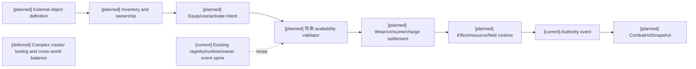
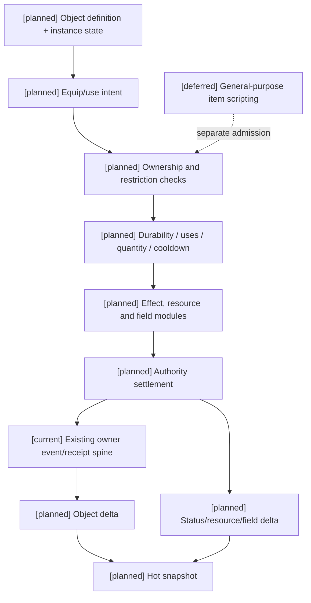

# 06 外物、装备、药品与使用限制定义

状态：`architecture analysis; planned and non-authorizing`

标签定义、四类生命周期和元标签治理由 [08-对象标签、编辑与版本治理设计](08-对象标签、编辑与版本治理设计.md) 负责；编辑器能力开关、权限授予、预览和发布由 [编辑器与能力权限治理](../编辑器与能力权限治理/00-README.md) 负责；本文件只定义外物领域如何消费它们。新增治理合同均为 `[planned]`。

本文件定义战斗相关的外物对象，补充 02 的资源账本、03 的效果模块和 05 的环境场。外物是角色之外存在、可被持有、装备、消耗、损耗或布置的对象；模型不能直接改变外物数量、耐久度或效果。通用装备定义、栏位、触发器、目标选择、合成/变体接口见 [11-通用装备系统设计](11-通用装备系统设计.md)；自走棋的棋盘和羁绊政策见 [12-自走棋装备玩法包设计](12-自走棋装备玩法包设计.md)。本文件仍是外物分类、使用限制和药效生命周期的 owner。

## 1. 外物对象总类

```text
ExternalObject
  PersistentEquipment   持久装备：长期携带，使用产生耐久损耗
  LimitedUseEquipment   限次装备：可多次激活，有 uses_remaining
  ConsumableMedicine    一次性内服物：使用一次，作用可瞬时或持续
  Ammunition             弹药：按发/组消耗，通常与武器动作绑定
  Material               材料：制作、修理、炼制或合成输入
  RitualMedium           仪式媒介：施法/阵法/契约的外部条件
  FormationComponent     阵法组件：布置后形成环境场或共享资源
  EnvironmentAnchor      环境锚点：持续连接地点、领域或能量源
  CurrencyOrToken        货币/凭证：社会、交易、召援或权威资源
```

这些对象共享身份、所有权、位置、数量、版本和 authority event，但不共享同一种使用限制。

## 2. 共同对象字段

```text
object_id
definition_id
definition_revision
owner_id / holder_id
location_id
quantity
stack_policy
bound_state
tag_assignment_refs       注册的标签赋予引用，非自由字符串事实袋
condition
active_effect_refs
source_refs
revision
```

`quantity` 只表示库存数量，不表示装备耐久、剩余次数或药效持续时间。后面三者必须独立建模。

## 3. 持久装备

持久装备是可以反复使用的外物，例如剑、枪、护甲、法杖、护符、义肢、战术设备和可重复施放的法器。

```text
PersistentEquipment {
  slot / mount
  durability_current
  durability_max
  wear_policy
  repair_requirements
  broken_threshold
  passive_modifiers
  active_technique_refs
  activation_costs
  equipment_cooldowns
  attunement_or_proficiency
  ownership_and_binding
}
```

### 3.1 耐久度

耐久度是连续或分段的损耗量：

```text
durability_current -= wear_amount
```

`wear_amount` 可由以下因素决定：

- 使用次数或命中次数；
- 承受冲击、格挡强攻或过载；
- 环境腐蚀、火焰、寒冷、污染；
- 技能变式的超额输出；
- 维护状态和材料质量。

装备达到 `broken_threshold` 后，可以变为：

```text
disabled
degraded
reduced_effect
unsafe_to_use
```

耐久归零不等于物品从库存消失。修理、重铸、替换部件或世界规则恢复可以生成新的 durability revision。

## 4. 限次装备

限次装备仍然是外部装备，但它的限制是离散激活次数，而不是连续耐久。例如：一次性护符、三次传送卷轴、有限充能法器、烟雾弹发射器和战术装置。

```text
LimitedUseEquipment {
  uses_current
  uses_max
  recharge_policy
  recharge_source
  activation_window
  consume_on_start / consume_on_success
  failure_refund_policy
  cooldown
  passive_modifiers
  active_effect_refs
}
```

必须区分：

```text
durability_current   使用造成磨损，通常可维修
uses_current         激活次数，耗尽后不能使用
quantity             库存中有多少个对象
cooldown             两次激活之间的时间限制
```

一个法器可以同时拥有耐久、剩余次数和冷却，三者不能互相替代。

## 5. 一次性内服药品

药品属于 `ConsumableMedicine`，使用动作消耗一个库存单位，但药效持续时间不固定。

```text
ConsumableMedicine {
  quantity_consumed = 1
  ingestion_or_use_time
  onset_delay
  immediate_effects
  periodic_effects
  duration
  tick_interval
  snapshot_policy
  status_refs
  resource_restore_or_conversion
  max_health_or_mana_change
  stack_policy
  interaction_policy
  toxicity_or_overdose
  medicine_cooldown
}
```

药品可以产生：

- 立即恢复生命、法力、体力或专注；
- 持续回蓝、持续治疗或持续净化；
- 临时提高最大生命/蓝量；
- 临时提高回蓝、攻击力、法强、抗性或韧性；
- 延迟生效或分阶段生效；
- 反噬、药毒、耐药、冲突和过量状态。

药品“使用一次”和“效果只持续一次 tick”不是同一个概念。库存消耗发生在服用结算点，药效由独立的 status/effect runtime 管理。

### 5.1 药效快照

药效必须声明：

```text
snapshot_at_ingestion       服用时锁定数值
recalculate_each_tick       每个 tick 按当前属性重新计算
refresh                      重置持续时间
stack                        增加层数
replace                      替换同类药效
reject                       同类药效不能重复
```

例如药品在服用时获得 20 点法强，然后装备变化不影响本次药效；或者每个 tick 按当前法强计算治疗量。两种行为必须由定义明确指定。

## 6. 弹药、媒介与阵法组件

### 6.1 弹药

弹药是与动作或武器绑定的离散消耗物：

```text
ammo_type
quantity
magazine_capacity
reload_time
misfire_policy
effect_payload
```

弹药可以携带物理、魔法、环境或控制模块，但不能把弹药本身当成技能等级。

### 6.2 仪式媒介

仪式媒介是释放规则、召唤、契约或领域效果的必要条件：

```text
medium_type
required_quantity
consumed_or_preserved
quality
link_target
ritual_duration
interruption_policy
```

### 6.3 阵法组件

阵法组件可以消耗后创建 `FieldEffect`，也可以作为长期设施存在：

```text
component_slots
activation_cost
maintenance_cost
field_radius
field_duration
shared_pool
node_durability
disruption_policy
```

阵法提供回蓝、降耗或环境强化时，效果属于环境场或共享资源规则，不直接写入角色蓝条。

## 7. 装备与药品如何影响蓝条

外物只能通过结构化 effect/modifier 影响资源：

```text
equipment -> max_mana_modifier
equipment -> regen_modifier
equipment -> cost_modifier
medicine -> immediate_restore / periodic_restore
formation -> field_regen / shared_pool / cost_suppression
```

最终资源变化仍由 Resource/Body owner 的 authority settlement 产生：

```text
use/equip intent
-> ownership and availability check
-> durability/quantity/uses/cooldown check
-> effect and resource validation
-> consume, wear or activate
-> apply status/resource/field effects
-> append authority event and revision
```

## 8. 权限与失败结果

角色可以提出：

```text
equip(object_id)
unequip(object_id)
use(object_id, target)
reload(ammo_type)
activate(formation_id)
repair(object_id)
```

模型不能直接宣称物品已装备、药品已服用、耐久已减少或药效已生效。司命可协调提案；最终由已注册的物品/资源/状态 owner contract 生成结构化结果：

```text
accepted / rejected
failure_reason
consumed_quantity
durability_delta
uses_delta
cooldown_until
applied_effects
resource_delta
field_revision
authority_event_id
```

## 9. CombatHotSnapshot 读取

高频快照只暴露当前决策需要的摘要：

```text
equipment:
  item_id / slot / usable / durability_ratio / uses_current / cooldown
consumables:
  item_id / quantity / medicine_cooldown / active_effect_summary
ammo:
  ammo_type / loaded / reserve
formations:
  field_id / active / remaining_ms / disruption_state
```

详细物品说明、历史维修记录和药品配方属于低频稳定上下文，不应每个战斗 tick 注入模型。

## 10. 当前、计划与暂缓

- `[current]`：资源预留/消耗/释放、身体 injury、能力和动作窗口基础；没有统一外物账本、装备耐久、限次装备、药效 runtime 或阵法组件合同。
- `[planned]`：外物对象层、装备/限次装备/药品/弹药/媒介/阵法组件定义、耐久/次数/数量/冷却分离、authority 使用结算和 CombatHotSnapshot 摘要。
- `[deferred]`：首期不实现无限物品生成、模型自由创造配方或无需定义的耐久/药效规则；复杂制作、维修经济和交易系统另行定义。

## 11. 架构图



## 12. 主流程时序图

```mermaid
sequenceDiagram
  participant C as Character/Laya
  participant I as Inventory runtime
  participant S as 司命
  participant A as Authority
  Note over C,A: [planned] full flow; [current] registry/runtime/owner spine; [deferred] complex creator tooling
  C->>I: request equip/use/activate
  I->>S: object identity, owner and revision
  S->>S: validate quantity, durability, uses, cooldown and target
  S->>A: submit owner-bound use proposal
  A->>A: validate owner contract and atomically commit or reject
  A-->>I: object delta and new revision
  A-->>C: structured result and resource/effect delta
```

## 13. 数据流图



## 14. 验收标准

1. 持久装备的耐久度、限次装备的剩余次数、药品库存数量和冷却可以独立变化。
2. 药品库存只消耗一次，但药效可以立即、延迟、持续 tick 或带状态延长。
3. 装备、药品和阵法都能影响蓝条，但只能通过结构化效果进入对应 owner 的 authority settlement。
4. 物品使用失败不会错误消耗数量、耐久或次数，除非定义明确声明失败也消耗。
5. 快照能区分可用性、耐久、剩余次数、药效和阵法状态，模型不能自行推断外物事实。

## 15. 外物的标签和元标签

武器、护甲、药品、弹药、媒介、阵法组件和环境锚点都可以挂定义、实例、派生和运行时标签。例如：

```text
definition: weapon:sword, material:moon_iron, medicine:consumable
instance: quality:tempered, binding:owner_bound, batch:moon_brewed
derived: derived:low_durability, derived:medicine_tolerance
runtime: status:heated, status:field_linked, status:poisoned
```

`meta:attachable_to` 防止把药品专属标签挂到角色资源账本，`meta:lifecycle` 只描述标签/绑定的持续与撤销政策；耐久、次数、库存和药效持续由各自组件和 runtime 独立建模，`meta:edit_policy` 区分创作者定义、角色锻造/服用和 authority 变更，`meta:effectful` 只引用已注册 effect binding。标签不能替代 `durability_current`、`uses_current`、`quantity` 或药效状态；使用、消耗、磨损和绑定仍由 已注册 Inventory/Equipment/Body/状态等 owner contract 写入；“Medicine authority”只是职责称呼，不代表已有独立模块或新的通用写入者。

## 本批规格与计划回写（2026-10-10）

本批保留外物、装备、药品、弹药、媒介和阵法组件的独立限制，但将其接入规格10的通用 resource/status/equipment owner。装备不自动等于战斗能力，药品消耗与持续效果分属不同 owner；自走棋专属数量、棋盘和回合约束不写入通用定义。现有 runtime 仅作为映射基线，缺完整 owner 时保持 planned/blocked。

映射：规格10；计划04 Task3/6。定义/实例/使用结算与迁移证据仍待准入。

标签接点示例必须按对象分别挂载，不能把 `weapon:sword`、`medicine:consumable` 混成同一必选标签集合。持有药品提供使用候选，服用 committed event 才创建药效；持有装备、装备到槽位、激活限次能力是三个不同条件。锻造改实例标签，创作者改定义版本，服药不修改药品定义，学习不创造物品库存。

[planned] 复用已有 Inventory/Equipment、状态与事件基础；本文件没有声明当前已存在通用耐久、限次装备和药效合同。验收：卸下武器后相应被动 binding 失效；已生成且定义允许脱离来源持续的药效继续计时；锻造/炼药失败成本只按明确失败政策提交。


### 本批规格与计划回写：Task3 前置审查（2026-10-16，RW-39）

[current] Inventory quantity、reservation 与装备 grant 为既有合同；药品/uses/durability 的完整实例生命周期没有本轮准入，不把库存预留等同 Resource locked。 逐对象 owner、consumer、持久版本和兼容入口见[本轮矩阵与三图](../回写/stage3-task3-20261016.md)，对应规格10与计划04 Task3。

[planned/blocked] 集中迁移仍缺已审定目标字段/schema、完整pause/drain与真实非战斗核心资源caller。本轮只完成审查和迁移夹具设计，没有新增资源切片；D17不取消动作、不清reservation、不伪造退款，失败保留旧事实、关闭新admission。[deferred] prediction、随机、Godot及评估/训练不在本轮。
