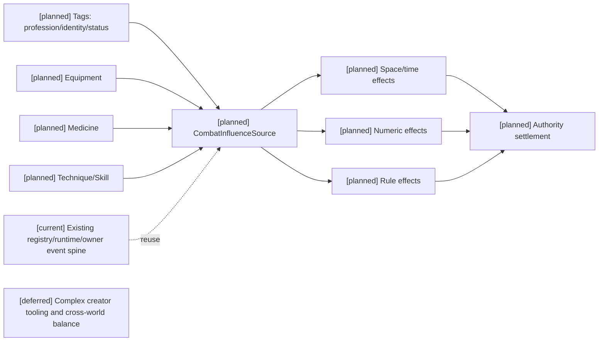
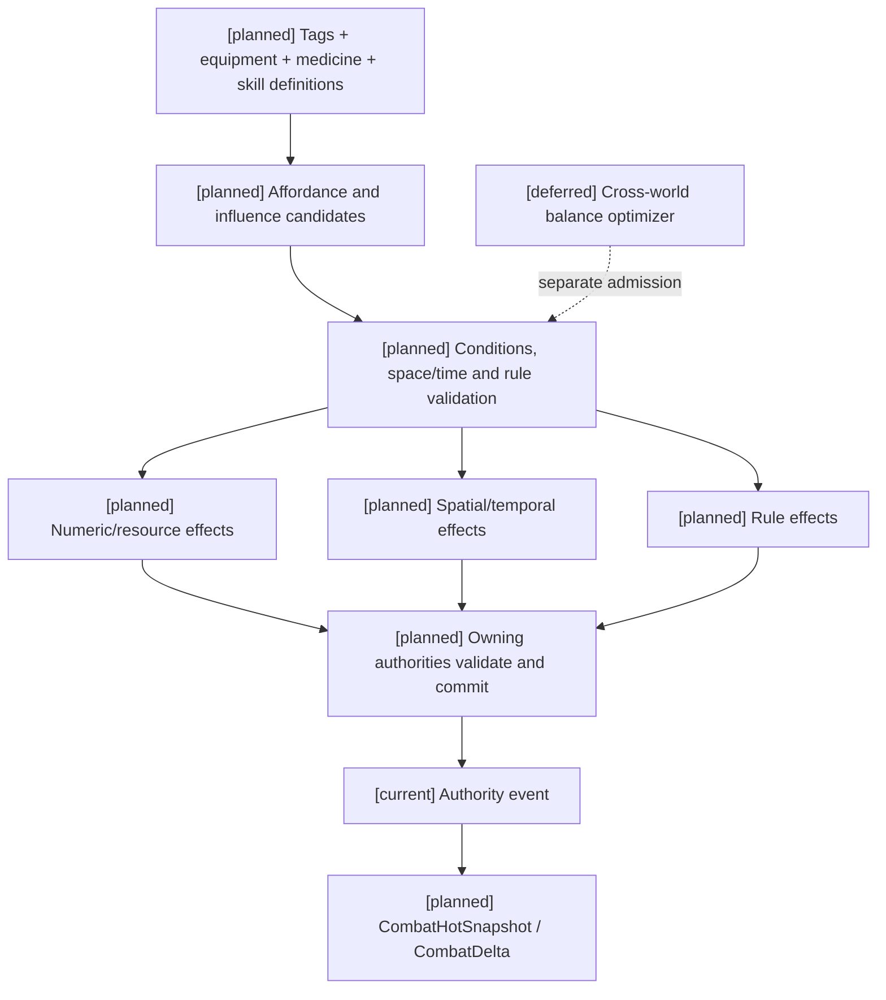

# 07 战斗影响源、标签与跨维度效果设计

状态：`architecture analysis; planned and non-authorizing`

标签定义、四类生命周期和元标签治理由 [08-对象标签、编辑与版本治理设计](08-对象标签、编辑与版本治理设计.md) 负责；编辑器能力开关、权限授予、预览和发布由 [编辑器与能力权限治理](../编辑器与能力权限治理/00-README.md) 负责；本文件只定义影响源领域如何消费它们。新增治理合同均为 `[planned]`。

本文件定义职业、身份、标签、装备、药品和技能如何统一影响战斗。它们不是同一种对象，但都可以注册为 `CombatInfluenceSource`，在时空、数值和规则三个维度产生可验证效果。装备对象、触发器、目标选择和栏位抽象由 [11-通用装备系统设计](11-通用装备系统设计.md) 定义；本文件只定义它们如何编译为影响源。自走棋的羁绊和回合事件见 [12-自走棋装备玩法包设计](12-自走棋装备玩法包设计.md)。

## 1. 统一影响源

```text
CombatInfluenceSource {
  source_kind       tag / equipment / medicine / skill / status / field
  source_id
  definition_revision / semantic_active_set_digest
  assignment_ref / assignment_revision / effect_binding_revision
  source_instance_ref / canonical_origin_ref / target_ref
  compiled_governance_ref / owner_contract_ref
  owner_or_subject
  activation        passive / active / reactive / scheduled / environmental
  conditions        state, target, space, time, resource and rule predicates
  spatial_effects   range, shape, anchor, movement, teleport, visibility
  temporal_effects  startup, duration, tick, cooldown, phase, delay
  numeric_effects   stat, resource, cost, damage, heal, shield, resistance
  rule_effects      eligibility, immunity, authority, targeting, transformation
  priority
  stack_policy
  source_refs
}
```

影响源只描述“能够产生什么影响”和“在什么条件下生效”，不直接写入生命、蓝条、耐久或世界规则。司命提供裁定协调，实际变化必须经过对应已注册 owner 的 authority settlement；这不是中央事实服务。

## 2. 标签不是只有文字分类

按是否存在注册效果绑定区分两种参与方式；这与 08 的四类生命周期、INF category 及 activation 互相独立：

```text
descriptive_tag
  只描述分类，不自动产生战斗效果

effectful_tag
  由世界包注册 effect bindings，可产生被动、准入或规则效果
```

常见内容词汇/命名空间（不是新增 TagDefinition.category）：

```text
profession       职业：医师、剑士、工程师、术士
identity         身份：王族、军人、罪犯、使徒、亡灵
capability       能力：夜视、游泳、飞行、灵魂锚定
relation         关系：盟友、敌对、师徒、阵营成员
species/origin   种族/来源：人类、机械、血族、异界生物
status           状态：中毒、燃烧、封印、恐惧、隐身
environment      环境：火场、领域、阵法覆盖、真空区
```

例如 `profession:field_medic` 和 `identity:royal_guard` 首先是角色档案标签；只有内容包为它们注册 effect binding 后，它们才影响战斗。未注册的描述标签不能被模型自行解释成属性加成。

## 3. 三个影响维度

### 3.1 时空维度

影响位置、范围、距离、方向、遮挡、时间阶段和持续窗口：

```text
空间：range、radius、width、height、anchor、line_of_sight、cover
时间：startup、duration、tick、delay、cooldown、phase、reaction_window
移动：speed、displacement、teleport、root、field_boundary
```

职业标签可以改变可用动作窗口，装备可以建立空间锚点，药品可以延长状态持续，技能可以创建具有边界和 tick 的环境场。

### 3.2 数值维度

影响属性、资源和效果结果：

```text
attack_power / spell_power / technique_power
armor / magic_resistance / mental_resistance
health / mana / stamina / focus
damage / heal / shield / control_potency
cost / regeneration / cooldown / penetration
```

数值修正必须标记通道、乘区、来源和叠加策略，例如：

```text
source = profession:field_medic
target = healing_power
operation = multiply
value = 1.15
scope = ally_heal
```

### 3.3 规则维度

影响是否允许发生、对谁生效以及效果如何解释：

```text
prerequisite / eligibility
target_filter / faction_rule
immunity / resistance_override
resource_conversion
skill_admission
soul_access_gate
contract / oath / true_name
registered_rule_priority
```

规则效果不一定产生数值。例如 `identity:royal_guard` 可以允许进入王室阵法、命令特定 NPC 或获得护送目标的特殊选项，但不能因此自动获得无限攻击力。

## 4. 四类来源的生命周期

| 来源 | 典型触发 | 生命周期 | 典型效果 |
|---|---|---|---|
| 标签绑定 | 被动、条件、关系/状态/场变化 | 依定义、实例、派生或运行时来源及绑定政策 | 职业路线、身份准入、阵营规则、能力偏好 |
| 装备 | 装备、激活、受损 | 装备期间或耐久/次数存在期间 | 属性、技能、空间锚点、资源修正 |
| 药品 | 服用一次 | 库存消耗一次，药效按定义持续 | 立即恢复、持续回蓝、临时属性、药毒 |
| 技能 | 主动、被动、反应、环境 | 动作阶段、状态、场或冷却期间 | 伤害、治疗、控制、环境、资源和规则效果 |

同一影响源合同可以表达四类来源，但必须保留不同的所有权、消耗、持续、取消和失败规则。

## 5. 完整角色例子：玄火宫战地医师

角色档案：

```text
profession:field_medic
identity:royal_guard
capability:fire_affinity
capability:mental_stability
```

### 5.1 职业标签：`profession:field_medic`

```text
numeric:
  healing_power +15%
  ally_healing_received +10%
  magic_regen_when_stationary +2 / second

spacetime:
  emergency_treatment_range = 8m
  triage_action_window = +250ms

rule:
  can_target_ally_incapacitated
  can_use_field_medicine_actions
```

治疗加成要求盟友、医疗动作及已掌握医疗能力；静止回蓝另检查在岗/静止/恢复未被抑制等条件，不要求同时施放治疗。职业标签不能凭空赋予医疗技能；身份准入需要真实关系/授权事实。

### 5.2 身份标签：`identity:royal_guard`

```text
numeric:
  guard_stance_resistance +10%

spacetime:
  escort_anchor_radius = 6m

rule:
  may_protect royal_target
  may_enter royal_formation
  hostile_to_royal_target becomes restricted_targeting
```

身份主要影响目标关系、准入和保护规则，不直接等于战斗等级。

### 5.3 装备：`moon_eclipse_staff`

```text
durability_current = 82 / 100
uses_current = 3 / 3

numeric:
  spell_power +24
  magic_resistance +8
  mana_cost_for_field_skills -10%

spacetime:
  creates_light_anchor radius 5m
  anchor_duration 8s

rule:
  allows_moonlight_detection
  can_stabilize_field_effects
```

每次激活会消耗一次 `uses_current`，普通施法会消耗耐久；两者不能混为一谈。

### 5.4 药品：`凝神丹`

```text
quantity -= 1
onset_delay = 1s
immediate:
  magic:mana +30
periodic:
  mana_regeneration +2 / second for 10s
rule:
  cannot_stack_with_same_medicine
  overdose_after_3_uses_in_60s
```

药品只消耗一个库存单位，但回蓝效果持续十秒，并可能产生药毒状态。

### 5.5 技能：`日月同辉`

```text
cost:
  upfront mana 24
  reserved mana 12
  per_tick mana 4 x 3

physical:
  radiant_impact -> life

magical:
  solar_fire + lunar_cold -> life/environment

environmental:
  light_field radius 5m duration 8s
  visibility and temperature modifiers

mental:
  sensory_overload -> mind

spiritual_rule:
  none by default
```

如果目标生命或精神足够虚弱，并且另一个技法提供灵魂模块，才可能进入 `SoulAccessGate`；“日月同辉”本身不会自动攻击灵魂。

## 6. 叠加、优先级与冲突

影响源必须声明：

```text
add / multiply / override / cap / suppress
unique / stack / refresh / replace / reject
priority
source_scope
```

推荐默认顺序：

```text
基础值
-> 标签和职业稳定修正
-> 装备和永久效果
-> 药品和临时状态
-> 技能/环境场即时修正
-> 抑制、封印、免疫和规则覆盖
-> corresponding owner authority settlement
```

同一来源不能通过重复事件无限叠加；规则覆盖也不能绕过更高优先级的世界规则。

## 7. Authority 流程

```text
source discovery
-> condition evaluation
-> spatial/temporal validation
-> numeric modifier resolution
-> rule eligibility resolution
-> compute consumption/wear/cooldown and effect deltas (proposal only)
-> owner contract / revision / idempotency validation
-> atomically append accepted authority events
-> project effect/resource/status/field changes
```

模型只能提出“装备法杖”“服用凝神丹”“激活日月同辉”或“利用战地医师标签进行急救”等意图；不能直接宣称标签生效、耐久减少、药品消耗或回蓝完成。

## 8. 当前、计划与暂缓

- `[current]`：角色档案、能力/状态标签、装备和资源的部分基础结构；效果修正、状态和 authority event 基础存在，但没有统一的跨维度影响源合同。
- `[planned]`：`CombatInfluenceSource`、effectful tag、职业/身份标签绑定、装备/药品/技能的统一时空/数值/规则效果、优先级和冲突结算。
- `[deferred]`：复杂社会身份、法律权限和经济影响另行建模。模型直接激活标签效果、身份权限或世界规则始终禁止；可提出受审查草稿。

## 9. 架构图



## 10. 主流程时序图

```mermaid
sequenceDiagram
  participant C as Character/Laya
  participant P as Profile/Inventory/Skill registry
  participant S as 司命
  participant A as Authority
  Note over C,A: [planned] full flow; [current] registry/runtime/owner spine; [deferred] complex creator tooling
  C->>P: read tags, equipment, medicine and skill affordances
  C->>S: submit bounded combat intent
  S->>P: resolve source definitions and revisions
  S->>S: evaluate space, time, numeric and rule effects
  S->>A: submit owner-bound consumption/effect proposal
  A->>A: validate owner contract and atomically commit or reject
  A-->>C: event result, delta and new revision
```

## 11. 数据流图



## 12. 验收标准

1. 职业和身份可以作为标签参与战斗，但未注册 effect binding 的标签不能自动产生属性。
2. 标签、装备、药品和技能可以在时空、数值和规则维度产生效果，并保留不同生命周期。
3. 耐久、次数、库存、冷却和药效持续独立结算。
4. 影响源的所有效果都能追溯到定义、条件、来源和 authority event。
5. 模型不能直接写入标签效果、物品状态、资源数值或规则事实。

## 13. 元标签治理如何进入 CombatInfluenceSource

`CombatInfluenceSource` 读取的是经过元标签治理的 active semantic snapshot，而不是任意标签字符串。编译步骤应为：

```text
TagAssignment
  -> attachable_to/component_scope validation
  -> visibility/lifecycle/edit-policy validation
  -> merge/conflict and binding revision resolution
  -> space/time/numeric/rule influence candidate
  -> corresponding owner authority settlement
```

元标签决定“能否作为来源、何时有效、谁可见、谁可编辑、如何冲突”；EffectBinding 决定“可能影响什么”；司命和领域 authority 决定“这次是否实际发生”。因此 `profession:field_medic`、`equipment:moon_staff`、`medicine:focus_elixir` 和 `technique:moon_eclipse` 可以共享三维影响合同，但仍保留各自的所有权、消耗和生命周期。

同一装备既以 equipment 来源出现，又以其 tag binding 出现时，必须使用 `canonical_origin_ref + binding_revision + trigger_event/tick + target_ref` 的来源键去重，不能将同一加成计两遍。标签参数合并、effect modifier 叠加和资源/伤害结算是不同阶段：`merge_policy` 不自动成为数值乘区政策。

来源卸下、资格撤销、封印或过期后，撤销条件型 binding；已生成状态/环境场是否继续存在按 effect lifecycle 的 snapshot/live-binding 政策决定。注册规则优先级不能改变 domain owner，也不能由低级标签覆盖更高世界规则；规则传播保留 phase、priority、conflict、budget、chain guard 和 trace。

验收：同一武器的标签与装备两个入口仅加成一次；卸下不留下回蓝修正；药效与药品库存生命周期不同；重复结算不重复消耗；未知 binding/缺 owner 时拒绝且不写世界事实。
