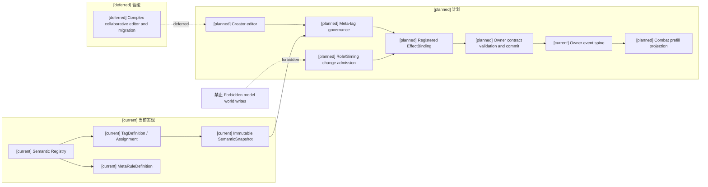
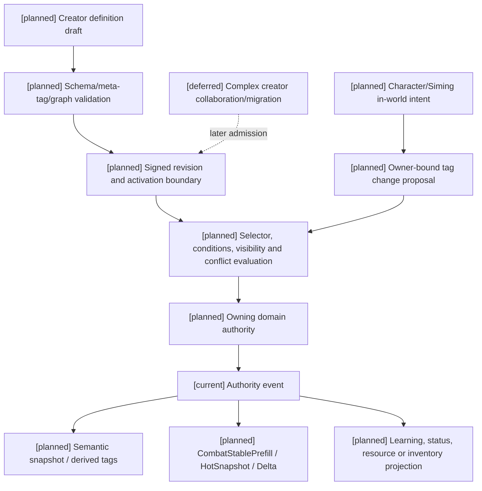

# 08 对象标签、编辑与版本治理设计

状态：`architecture analysis; planned and non-authorizing`

本文件恢复并收敛战斗目录中的对象标签设计。它把标签作为角色、技能、状态、资源、装备、药品、环境和关系的统一语义编辑载体，同时保留组件、效果 runtime、状态生命周期、库存和领域 authority 的正式所有权。它不授权代码实现，也不把模型输出当作世界事实。

编辑器的能力开关、权限矩阵、预览、发布和运行时同步由独立的 [编辑器与能力权限治理](../编辑器与能力权限治理/00-README.md) 负责；本文只拥有标签/元标签治理，并向编辑器提供注册、绑定、可见性、编辑策略和 revision 接口。

## 1. 标签的定位和边界

标签定义为：

> 对对象、对象组件、关系、状态或事件进行语义声明，并可通过已注册绑定参与规则求值的结构化语义载体。

标签可以：

- 为编辑器提供统一的分类、筛选、参数和依赖入口；
- 为 Gameplay Foundation 的领域适配器提供 targeting、前置、克制、抗性和 effect binding 的 selector 输入；
- 描述职业、身份、材料、能力、环境暴露、状态和技能路线；
- 产生经注册、版本化、可追溯的数值、时空或规则影响候选；
- 作为 CombatStablePrefill、CombatHotSnapshot 的来源摘要。

标签不能替代：

```text
resource ledger             生命、体力、法力、专注和社会/环境资源账本
effect definition            伤害、治疗、护盾、控制、净化、召唤等变化描述
status runtime               层数、强度、开始/过期、tick、驱散和叠加生命周期
inventory / durability      数量、所有权、装备耐久、限次和药品库存
skill mastery               学习证据、掌握阶段、动作稳定性和能力图边
authority event              事实写入、回放、revision 和冲突结算
```

推荐关系是：

```text
Tag -> registered EffectBinding -> EffectDefinition/Modifier
                                      -> owning domain authority
Tag -> selector / prerequisite / counterplay input
Component -> formal resource, status, inventory or mastery data
```

标签本身描述语义；组件保存正式数据；效果描述变化；runtime 管生命周期；领域 authority 批准并写入变化。

## 2. 标签适用范围和四种生命周期

同一标签系统可挂在实体、组件、关系、状态和事件上，但赋予位置必须明确，不允许把所有对象压成字符串袋。

```text
definition_tag  定义级标签：适用于定义/内容包，描述类别、媒介、通道和能力模板
instance_tag    实例级标签：适用于具体武器、药品、技能、角色或阵法实例
derived_tag     派生标签：由已提交事实和规则求值产生，默认不直接持久化
runtime_status_tag 运行时状态标签：由状态/环境/动作生命周期托管，带 tick 和过期
```

示例：

```text
WeaponDefinition: weapon:sword, material:moon_iron, channel:physical
WeaponInstance:   attunement:moon, binding:owner_bound
Derived:          derived:low_durability, derived:moon_phase_resonant
Runtime:          status:sealed, status:field_linked
```

定义标签随内容 revision 版本化；实例标签由对象所属 domain authority 赋予或移除；派生标签记录输入事实、计算规则及 revision，默认只读、可重算；运行时状态标签由状态/环境 owner 管生命周期。动作 `phase:*` 和本地 `state:*` 来自受信执行 runtime，属于过程证据，不自动成为 Gameplay 的已提交伤害、控制或资源事实。

## 3. 元标签：治理标签而不是自由效果

元标签是描述标签定义和绑定如何被治理的元数据。它们可以由结构化字段实现，也可以在编辑器中以 `meta:*` 形式呈现；两者必须落到同一个注册合同。元标签不直接造成伤害、回蓝、治疗或权限变化。

建议的元标签字段：

| 元标签/字段 | 作用 |
|---|---|
| `meta:attachable_to` | 允许挂载到 actor、component、relation、state、event、field 等对象范围 |
| `meta:category` | type/material/substance/property/state/capability/relation/context 等已注册类别 |
| `meta:stability` | definition、instance、derived、runtime 的生命周期级别 |
| `meta:visibility` | public、actor_filtered、owner_only、authority_only、creator_debug |
| `meta:edit_policy` | creator、craft、role、Siming-proposal、authority-only 等变更入口 |
| `meta:owner` | 定义 owner 与实例/状态写入 owner 的引用 |
| `meta:lifecycle` | permanent、until_removed、timed、tick、event_scoped |
| `meta:merge_policy` | replace_by_specificity、additive、minimum、maximum、exclusive、compose；复用当前枚举 |
| `meta:conflict_group` | 与其他标签/绑定互斥或需仲裁的组 |
| `meta:effectful` | 是否存在已注册 EffectBinding；不是直接效果值 |
| `meta:derived` | 是否只能由规则派生，禁止外部直接赋予 |
| `meta:runtime_only` | 是否不能进入稳定定义或创作者发布包 |
| `meta:requires_authority` | 是否必须经指定 domain authority 提交 |
| `meta:privacy_scope` | 角色、队伍、创作者或司命可见范围 |
| `meta:version` | 元数据与标签定义的独立 revision |

当前 `TagDefinition` 已有 `category`、`parent_refs`、`parameter_schema`、`merge_policy`、`specificity`、`version`；`TagAssignment`、`SemanticSnapshot`、`SemanticSelector` 和 `MetaRuleDefinition` 已提供实例赋予、快照、受限查询和元规则基础。上述 `attachable_to`、visibility、edit policy、owner、lifecycle、effectful、derived、runtime_only 等治理字段属于 `[planned]`，不能写成 `[current]` 实现。

元标签的约束：

1. 元标签必须有 schema、版本和冲突校验；不能接受任意键值脚本。
2. 元标签不能把 `effect`、`resistance`、`policy` 或正式资源账本偷换成普通标签类别。
3. `meta:derived` 和 `meta:runtime_only` 标签不能从模型文本直接写入。
4. `meta:requires_authority` 只声明提交要求，不授予写权限；设为 false 也不能开放资源、状态、库存或规则写入。
5. definition owner、instance owner 和 admitted write owner contract 分开；修改 owner 元数据不能改变已接纳的事实所有权。子标签继承不能放宽隐私、权限或世界硬约束；冲突时取交集或拒绝。
6. 元标签、绑定和规则依赖也需要 cycle detection、phase、priority、conflict、evaluation/chain budget 与 trace。模型可提出标签/效果草稿；正式激活走控制面治理。

定义、治理 descriptor、binding 和规则 revision 在同一 ActiveSemanticSet 固定 digest。EffectBinding 参数须声明类型、单位、上下限、允许编辑阶段、能力前置、风险和反制；元标签不能将数值编辑转换成角色准入权限。参数合并、modifier 叠加与实际伤害/资源结算分别保留 trace。

## 4. 对象模型和标签关系

武器、药品、功法、技能、阵法和角色都可以挂标签，但仍保留各自的正式组件：

```text
Weapon
  WeaponComponent / DurabilityComponent / EquipmentComponent
  TagAssignments / EffectBindings / StatusRefs / OwnershipRef

Medicine
  ConsumableComponent / InventoryComponent / EffectBindings
  TagAssignments / StatusTemplateRefs / ToxicityPolicy

Method
  MethodDefinition / InnerMethodRefs / TechniqueRefs / MasteryState
  ResourceCycle / TagAssignments / EffectBindings

Field
  FieldDefinition / SpatialBoundary / TickSchedule / ResourcePool
  TagAssignments / EffectBindings / StatusRefs
```

标签可以和对象、组件、资源、效果、状态、关系并列为语义节点，也可以通过 `component_scope` 指向具体组件。标签不能承担耐久、库存、蓝量或技能掌握的正式字段。

## 5. 标签与战斗影响源

`CombatInfluenceSource` 接收标签及其元标签治理结果，但只把通过注册的 binding 编译为影响候选：

```text
TagAssignment
  -> active semantic snapshot
  -> visibility / lifecycle / edit / conflict validation
  -> EffectBinding candidates
  -> space + time + numeric + rule modifiers
  -> Siming proposal / corresponding owner settlement
```

例：

```text
attunement:moon
  attachable_to = weapon/equipment/method/technique/field
  effectful = true
  conflict_group = elemental_attunement
  binding:
    magical.ice_power +10%
    lunar_field.duration +2s
    prerequisite technique:moon_linked
```

这里 `attunement:moon` 只提供语义和绑定引用；实际伤害、持续时间、资源成本和冲突由通用 Gameplay Foundation 的领域 authority 计算。未注册标签不会因为名字看起来像“火焰”或“王族”而自动获得效果。

## 6. 两种编辑和权限边界

### 6.1 创作者编辑

创作者编辑器是未来内容包和玩法生态的重点工具。它可以编辑：

```text
tag definition / parent graph / parameter schema
attachable objects / component scope / visibility
effect binding / trigger / conditions / counterplay
merge and conflict policy / lifecycle / version
preview fixtures / explanation text / package dependencies
```

这里的“编辑器”是创作者编辑入口；能力开关、权限授予、草稿预览、发布和激活边界的完整合同见 [编辑器与能力权限治理](../编辑器与能力权限治理/00-README.md)。08 不重复定义 `CapabilityProfile` 或 `AuthorityGrant`。

编辑流程：

```text
draft -> schema/graph/conflict validation -> preview simulation
      -> replay oracle -> editor review -> signed revision
      -> staging/canary -> active semantic set
```

预览只产生候选和诊断，不写入正式世界。发布 revision 后，世界在明确的 activation boundary 使用新定义；旧 revision 保留用于回放。

### 6.2 世界内变化：角色改变与司命改变

角色可以提出或执行具备能力和工具前提的意图，例如锻造武器、炼制药品、修炼功法、附魔、服药、建立阵法连接或解除封印。角色不能直接把提案当成事实：

```text
角色意图
  -> 能力/工具/材料/资源检查
  -> 时空、风险、冲突和权限检查
  -> corresponding owner authority settlement
  -> TagAssignmentChanged / StatusChanged / SkillEvent
```

司命改变是由司命催化或协调的 authority 变化，不等同于“司命万能写入”：

```text
Siming catalyst
  -> registered rule evaluation / proposal / trigger
  -> environment / skill / inventory / body / world authority
  -> committed authority event
  -> semantic snapshot and combat projection
```

例如日蚀可以让司命提出 `environment:lunar_eclipse` 或派生共鸣标签；环境 authority 才能写入场边界和持续，角色的技能/资源 authority 才能写入其蓝条或状态。

## 7. 版本、继承、冲突和生效时机

标签定义只能沿已注册的父图继承，发布时拒绝环。参数合并必须遵守定义中的 `merge_policy`，冲突组不能靠最后写入覆盖。

生效政策区分 immediate（提交后下一次读取）、next_action（当前动作定义 pins 不变）、next_stable_revision（新能力/定义经激活边界进入候选）与 scheduled（指定 tick/条件）。缓存重建不是提交时刻：已提交状态先投影，模型 prefix 延迟重建不阻塞 authority；新定义通过 activation boundary 发布，缺 migration/pins 时拒绝或回退，不静默换定义。

每个战斗上下文至少固定：

```text
semantic_registry_revision
active_tag_revisions
effect_binding_revision
world_rules_revision
stable_tag_projection_revision
visibility_policy_revision
```

定义/绑定/治理或稳定实例标签变化使相关 CombatStablePrefill 失效；高频 runtime/derived 条件进入 HotSnapshot/Delta，携带 assignment/state/spatial revision，不改变 stable_tag_projection_revision。可见性政策变化或权限撤销清除相关缓存；delta 不泄露被移除秘密标签的旧值。稳定缓存键包含 actor namespace 和上述版本摘要，hot/delta 单独维护 from/to revision。

authority_evaluation_view、经 L1 授权的 actor_perception_view、creator_debug_view 分开。过滤先于缓存写入，角色不能通过 cache builder 查询隐藏真值；低能力角色使用更小候选集与摘要，增加预算不扩展权限或能力上限。具体消费合同见 [04](04-战斗状态、CombatPrefill与高频读取计划.md)。

## 8. 当前、计划与暂缓

- `[current]`（有限注册合同范围）：`TagDefinition`、`TagAssignment`、标签继承与参数 schema、参数合并、immutable `SemanticSnapshot`、受限 `SemanticSelector`、`MetaRuleDefinition` 的 phase/priority/conflict/budget/trace，以及 authority settlement bridge/replay/digest；Gameplay 已有状态标签、effective stats、资源/身体基础和部分标签投影。
- `[planned]`：四类标签生命周期的统一对象适配、元标签治理字段、标签到 `EffectBinding` 的注册合同、编辑器的标签治理适配、角色改变/司命改变 admission、binding revision 对 Combat prefill 的失效规则、跨组件标签索引和可见性投影；能力开关、权限授予、预览和发布由独立编辑器目录负责。
- [deferred]：创作者协作发布和复杂存档迁移工具、通用跨世界观平衡优化；完整制作/交易/法律身份系统另行定义。
- 始终禁止：模型直接写事实、任意字符串自动生效、标签代替资源/库存/所有权账本、元规则绕过 owner，以及未经 schema/签名/admission 的运行时规则激活。

## 9. 架构图



## 10. 主流程时序图

```mermaid
sequenceDiagram
  participant E as Creator
  participant R as Registry/control plane
  participant C as Character
  participant S as Siming catalyst
  participant D as Owning domain authority
  participant P as Filtered projection
  Note over E,P: [planned] governance/editor; [current] registry and owner spine; [deferred] collaboration/migration
  E->>R: draft tag/meta-tag/binding definition
  R->>R: schema/graph/conflict validation and isolated preview
  R-->>E: preview or rejection; no world writes
  E->>R: publish approved signed revision
  R->>P: activate definition pins at boundary
  alt character change
    C->>D: registered action/tag-change intent and evidence
  else Siming change
    S->>D: owner-bound catalyst/proposal
  end
  D->>R: resolve admitted definition, governance and owner contract
  D->>D: validate capability, materials, time, risk, revision and idempotency
  alt accepted
    D->>D: atomically commit owner events
    D-->>P: committed changes and revisions
    P-->>C: L1 authorized stable/hot/delta view
  else rejected
    D-->>C: rejection receipt; explicit failure costs only
  end
```

## 11. 数据流图



## 12. 验收标准

1. 标签可挂在角色、武器、药品、功法、技能、组件、关系、环境场和事件上，并能说明挂载位置和生命周期。
2. 元标签能约束适用对象、可见性、编辑权限、生命周期、合并/冲突和 authority 要求，但不能直接写入效果或资源。
3. 未注册的标签不能自动产生攻击力、法强、回蓝、控制或免疫；注册 binding 的效果可以追溯到 definition、assignment、binding revision 和 authority event。
4. 创作者编辑、角色改变和司命改变使用不同 admission 路径，预览/提案不等于世界事实。
5. 旧 revision 能支持回放，新 revision 只在明确 activation boundary 生效；相关 Combat prefill 在 revision 变化后失效。
6. 标签查询遵守 actor、creator、authority 的可见性边界；模型不能通过增加预算读取或写入隐藏标签和世界真值。
7. 同一 binding 不因装备/标签两个入口重复计入；卸下/过期后撤销 live binding，已生成状态/场按自身 lifecycle 处理。
8. 高频状态/派生条件变化只刷新 hot/delta；定义/绑定/稳定实例/治理变化重建 stable。权限撤销使旧私有 prefix 失效。
9. 低能力角色不能通过 capability 标签编辑或高预算绕过学习、技能复杂度、动作稳定性和认知包络门禁。

## 13. 审查补充：命名空间、编辑操作和实现映射

标签生命周期（definition、instance、derived、runtime）与语义类别（type、material、property、state、capability、relation、context）是两个独立轴；`descriptive/effectful` 描述是否存在注册 binding，`active/passive/reactive` 描述触发方式，不能互相替代。当前 registry 复用既有封闭类别，不允许玩法包凭前缀创建新类别。

```text
ObjectTagEditView { definition_ref, assignment_ref, component_scope,
  typed_parameter_values, source_ref, event_refs,
  definition_revision, assignment_revision, binding_revision,
  status_instance_ref, compiled_governance_ref }

TagEditIntent { subject_ref, component_scope,
  operation: add_tag/remove_tag/replace_tag/update_value,
  tag_ref, typed_parameter_values,
  expected_definition_revision, expected_assignment_revision,
  active_semantic_set_digest, evidence_refs, idempotency_key }
```

角色、创作者或司命只能提交意图；对应 owner contract 必须校验所有权/授权、能力、材料、资源、时空、风险、冲突、版本和幂等。结果必须区分 proposal、accepted event 和 rejected receipt。失败是否消耗材料、耐久或次数只能由内容定义的失败策略决定。

ObjectTagEditView 是编辑器聚合视图，复用 TagDefinition/TagAssignment、组件、状态和 binding 引用，不另建 TagBinding 世界数据库。[current] TagAssignment 只有 entity_ref、component_ref、tag_ref、parameter_values、source_ref、revision；过期、层数、权限、事件 id 和绑定列表均不能伪称已实现。关系/事件等 subject adapter 仍为 [planned]。

对象例子（均为 [planned] 内容）：

- 月铁剑：`weapon:sword`/`material:moon_iron` 是定义标签，`quality:tempered` 是实例标签，耐久 76/100 独立保存。角色申请 `attunement:moon` 并提供月炉锻造证据；符合媒介、能力、月相和冲突条件后，注册的物品/制作 owner contract 原子提交材料消耗、耐久 -8、assignment 变化。冰系法强 +10% 与月场持续 +2 秒是注册 binding 示例，未装备或未满足条件不生效。
- 赤焰吐纳：`method:inner_cultivation`、`channel:magical.fire` 描述定义，ResourceCycle 引用 `cultivation:qi` 资源；个人化学习由能力 authority 生成变式/图边和 `lineage:personalized`。标签不自动提升境界、掌握度或认知上限。
- 凝神丹：`medicine:consumable`/`batch:moon_brewed` 是对象标签。EffectBindings 引用 `effect:mana_restore` 和 `effect:focus_restore`，二者不是可赋予的普通标签。持有只提供服用候选；成功服用消耗一单位、生成回蓝状态。库存归零不移除仍有效的药效，tick/耐药/药毒由状态 runtime 管理。

| 复用基础 | 代码或已有设计 | 增量边界 |
|---|---|---|
| 定义/赋予、继承、参数、Selector、MetaRule | [semantic_registry.py](../../../backend/app/gameplay/semantic_registry.py) | 治理 descriptor 和对象适配为 planned；当前 evaluator/bridge 限定已注册合同 |
| 状态生命周期与 effective stats | [status_tags.py](../../../backend/app/gameplay/status_tags.py)、[effective_stats.py](../../../backend/app/gameplay/effective_stats.py) | 复用层数、过期、modifier；不造第二状态库 |
| 效果、资源与能力 | [semantic_effects.py](../../../backend/app/gameplay/semantic_effects.py)、[resource_body_runtime.py](../../../backend/app/gameplay/resource_body_runtime.py)、[ability_runtime.py](../../../backend/app/gameplay/ability_runtime.py) | 通用跨通道 binding、回蓝和学习/构筑准入仍为 planned |
| INF 语义与 owner 边界 | [8 月标签设计](../../8月分析/世界基础设施增量指导/00-标签体系与元规则引擎.md)、[实体档案设计](../../8月分析/世界基础设施增量指导/13-实体档案语义因果与元规则.md) | 元标签不是 MetaRuleDefinition；两者不取代领域 owner |
| 玩法包治理与动作命名空间 | [玩法包契约](../../8月分析/创作与运营/15-玩法包契约垂直样板与验证.md)、[统一动作/INF 合同](../../superpowers/specs/2026-09-14-unified-character-action-foundation-and-inf-tag-contract-design.md) | 复用 active revisions、签名和注册接纳，不将 action/status/intent 混为事实 |

可参考当前 [语义规则测试](../../../backend/tests/test_infra_general_semantic_rule.py) 和已登记 INF semantic profiles；本轮没有重新声称运行时验收完成。

### 13.1 编辑器两种视图与标签词汇

[planned] 对象属性面板和标签/组件图面板编辑同一份注册草稿：属性面板可显示攻击力、法强、持续、范围等 binding 参数，图面板可显示标签、组件和效果关系。两种视图不可各建事实库。世界内实时数值若需修改，编译为 owner-bound 意图；正式世界状态在任一面板都是只读投影。

当前 category 只支持 type、material、substance、property、state、capability、relation、context。profession/identity/species、weapon、medicine、method 等是内容词汇，定义时选择既有 category，不能因为名字新增 category；effect、resistance、policy 引用单独注册定义或治理上下文。definition/instance/derived/runtime 为生命周期轴，四层都可能纯描述或绑定效果。

同一对象可有标签绑定，也可有并列的技能/组件直接效果引用；不能强迫所有效果变成标签。同一 binding 按 source instance、assignment/binding revision、trigger event/tick 与 target 去重。删除来源撤销 live binding；已生成状态/场是否继续存在按其 snapshot/live-binding lifecycle，不回滚已结算伤害或消耗。

## 14. 本批规格与计划回写（2026-10-10）

本批采用本文的注册、版本化、生命周期和元标签边界，但将实现限定为既有 semantic registry、受限 selector、对象 owner 和编辑器控制面准入。不会新建第二套 tag registry 或规则引擎；creator/in-world 变化先形成 proposal 或 authority event。规格10、13、14分别消费标签合同，不把标签字段当作资源/效果/库存/学习事实。

映射：规格10、13、14；计划04 Task3、计划05 Task3–5。完整 registry、assignment、冲突合并和 editor preview 仍为 planned/blocked。


### 本批规格与计划回写：Task3 前置审查（2026-10-16，RW-39）

[current] 标签和meta-tag仅按既有注册及owner路由；不直接写资源、库存、状态或世界真相，不新增第二规则引擎。 逐对象 owner、consumer、持久版本和兼容入口见[本轮矩阵与三图](../回写/stage3-task3-20261016.md)，对应规格10与计划04 Task3。

[planned/blocked] 集中迁移仍缺已审定目标字段/schema、完整pause/drain与真实非战斗核心资源caller。本轮只完成审查和迁移夹具设计，没有新增资源切片；D17不取消动作、不清reservation、不伪造退款，失败保留旧事实、关闭新admission。[deferred] prediction、随机、Godot及评估/训练不在本轮。
