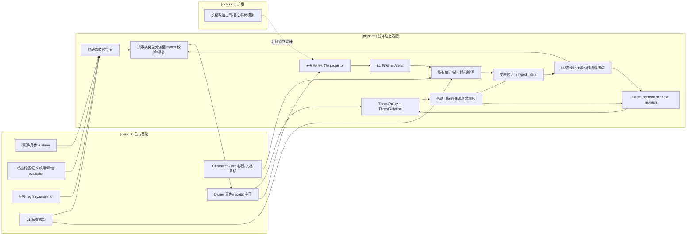
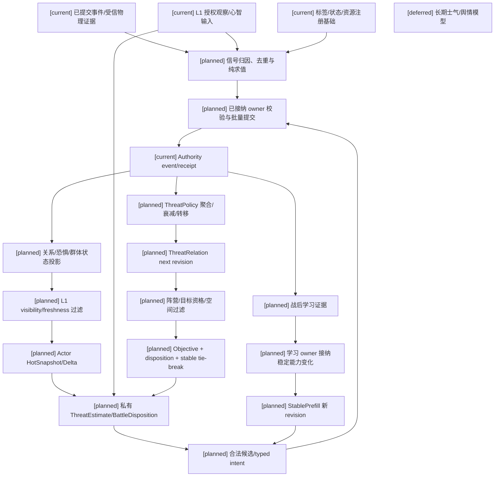

# 09 战斗动态原语、关系状态与战斗倾向设计

状态：`architecture analysis; planned and non-authorizing`

本文件审查并收敛仇恨、恐惧、战意、士气与角色战斗选择的关系。保留“角色拥有技能、状态和资源”的主线，并补充关系、群体状态和私有认知投影；不把它们全部压成资源、标签或一个精神值。

标签定义、元标签、编辑与版本治理由 [08](08-对象标签、编辑与版本治理设计.md) 唯一负责；编辑器能力开关、权限授予、预览和发布见 [编辑器与能力权限治理](../编辑器与能力权限治理/00-README.md)。资源与转换见 [02](02-角色战斗资源与资源转换计划.md)，动作/控制/物理协作见 [03](03-攻防治疗招数数据与动作参数计划.md)，缓存见 [04](04-战斗状态、CombatPrefill与高频读取计划.md)，通道与生命/精神/灵魂规则见 [05](05-效果通道、环境场与生命精神灵魂规则设计.md)，生命状态、伤势和死亡连续性见 [10](10-生命状态、伤势与死亡连续性设计.md)，影响源见 [07](07-战斗影响源、标签与跨维度效果设计.md)。本文只定义这些领域对战斗动态对象的接点，不授权代码实现。

## 1. 结论与对象边界

以下战斗专用合同均为 `[planned]`；已有基础的具体范围见第 8 节。

| 对象 | 定位 | 不能替代 |
|---|---|---|
| `ThreatRelation` | 主体到目标的有向目标压力关系，可供特定玩法做仇恨排序 | 危险程度、社会敌意、目标锁定或全知情报 |
| `FearCondition` | 已结算的个体恐惧条件，具有强度、来源和生命周期 | `AffectState.fear`、生命或精神资源 |
| `BattleDisposition` | 从角色可知信息、心智基线与当前条件编译的战斗倾向向量 | 攻击力、技能掌握、动作意图或强制控制 |
| `MoraleState` | 队伍/编队的群体稳定与协同状态 | 每个成员的情绪、意愿或可消耗的士气点 |

`BattleDisposition` 统一表示战意，避免使用 `BattleIntent` 与执行用的 typed intent 混淆。这四类不是所有世界或所有角色的必备字段。

更底层的分类保留不同语义和数据 owner：

```text
Resource      有容量、消耗、恢复、预留等账本语义；债务需世界规则另行准入
Condition     有应用、持续、叠加、衰减、移除或转移的运行时条件
Relation      主体到目标的有向关系；仇恨关系不等于社会关系
Disposition   当前行为倾向、承诺和风险偏好，可重算的私有派生视图
GroupState    群体状态；可含聚合值及具有独立生命周期的溃败进程
Perception    观察、相信、怀疑和未知的角色私有投影
Objective     当前目标、任务、优先级和期限
Capability    能否做、做到什么程度，受技能与认知包络约束
Constraint    规则/控制/动作阶段带来的硬限制
Context       空间、环境场、掩体与通信条件的受权投影
Tag           注册的语义声明、资格输入或状态投影
Effect        描述变化；求值不等于提交
```

不同分类不要求各建一个新运行组件。优先复用已有 owner、事件主干、纯 evaluator 和 projector；只有后续设计审查证明现有合同不足时，才申请扩展。

## 2. 来源、生命周期与投影合同

### 2.1 共同来源信息 `[planned]`

复用既有来源/revision 合同，建议共享以下最小信息；它是结构化追溯合同，不是另建动态值数据库：

```text
DomainValueMetadata {
  object_ref / subject_ref / owner_contract_ref
  source_refs / provenance_refs / committed_event_refs
  definition_revision / active_semantic_set_digest
  source_revision_vector / projection_revision
  visibility_policy_revision / visibility_scope
}

LifecyclePolicyRef { started_at_tick, expires_at_tick?, decay_policy_ref? }
EvidenceQuality { observed_at_tick, confidence, freshness, uncertainty }
```

生命周期仅由需要它的对象引用，资源、目标和派生视图不强制具有相同过期机制。`EvidenceQuality` 属于证据和认知投影；权威值的有效性由提交、来源和 revision 决定，不能用模型置信度代替。

各定义还需声明数值单位、合法范围、固定精度/舍入、阈值、来源合并、冲突和更新时间。通用数值修正复用 effective stats；目标锁定、免疫、状态转移等规则不能被压成普通 additive modifier。

### 2.2 三种结果分开

```text
transition proposal     变化建议，携带 expected revisions / evidence / idempotency
committed domain state  owner 校验并提交的事实，可重放
actor projection        经 L1 授权的观察/估计/未知与派生倾向
```

提案不能进入“已生效状态”；私有估计不能覆盖权威对象。派生视图可随感知与心智 revision 更新，不必为每次候选排序追加 Gameplay 事件。若需要持久化学习、承诺或情绪变化，仍走对应 Character Core 写回合同。

## 3. 四个核心战斗对象

### 3.1 仇恨关系与危险估计

```text
ThreatRelation {
  relation_ref / threat_owner_ref / candidate_target_ref / encounter_ref
  pressure_value / contribution_refs / policy_revision
  first_signal_tick / last_signal_tick / decay_checkpoint_tick
  lifecycle_policy_ref / relation_revision / metadata
}

ThreatSignal {
  signal_id / encounter_ref / threat_owner_ref / candidate_target_ref
  source_ref / affected_entity_ref / event_ref / signal_kind
  raw_contribution / unit
  attribution_basis_ref / visibility_basis_ref
  event_tick / phase_ref / causal_chain_id / canonical_origin_ref
  active_semantic_set_digest / expected_relation_revision
}

ThreatPolicy {
  policy_id / policy_revision / value_definition_ref
  accepted_signal_kinds / signal_weight_refs
  attribution_policy_ref / visibility_policy_ref
  aggregation_policy_ref / decay_policy_ref / cap_policy_ref
  transfer_policy_ref / reset_policy_ref / tie_break_policy_ref
  target_scope_ref / phase_policy_ref
}

ThreatEstimate {
  observer_ref / target_ref
  estimated_danger / perceived_priority / target_preference
  evidence_quality / known_counterplay / projection_revision
}
```

`ThreatRelation` 的键始终是 `(encounter_ref, threat_owner_ref, candidate_target_ref)`：owner 是维护仇恨表并做目标选择的实体/编队，例如 Boss；candidate 是可被其选为目标的实体。它不是“观察者在心里的主观关系”。`ThreatEstimate` 则属于 observer 私有视图，表示角色认为目标多危险、应该优先处理多少。高仇恨不等于高实力：治疗者可能产生很高目标压力，但不一定有很高输出。长期仇怨、信任和阵营关系仍由社会领域保存，只在已注册接点提供输入。

仇恨是**内容包可选的目标策略**，不是每种战斗的必备机制。内容包先注册带版本的 `ThreatPolicy` 与 `ThreatValueDefinition`；单位、精度、范围、上下界、溢出/封顶、聚合、衰减、来源归因、目标范围和并列排序均需固定。内核不提供一套通用的“伤害×仇恨系数”公式，也不允许模型或普通标签临场发明系数。多种战斗可以选用不同策略；没有启用仇恨策略时，目标选择直接使用目标资格、Objective 和角色 disposition。

典型 `signal_kind` 可由内容包从注册枚举中选取：`damage`、`healing`、`shielding`、`protection`、`taunt`、`control`、`dispel`、`summon`、`objective_progress`、`resource_disruption`、`proximity`、`threat_transfer`、`scripted_event`。每种信号的单位和权重由策略定义；策略还必须定义每个事件如何映射为 threat owner 与 candidate，例如“Boss 受伤 -> Boss threat owner / 攻击者 candidate”，“Boss 队伍受到治疗 -> encounter threat owner / 可归因的治疗者 candidate”。来源归因要处理施法者/弹体/召唤物/主人/装备等 `canonical_origin_ref`，防止同一个 authority event 同时按弹体和主人重复计入。无法归因的信号按策略拒绝、隔离或计入匿名环境来源，不由模型猜测。

受伤、伤害、治疗、保护、接近、嘲讽、资源破坏和任务干扰可提供 `ThreatSignal` 候选。来源归因必须经过世界政策：

- 感知型策略只使用该主体实际观察、被授权通信或规则允许感知的证据；
- 特定 MMO/Boss 仇恨策略可按已准入规则计入不可见的伤害贡献，但不把隐藏来源、身份或坐标暴露给角色认知；
- 失去视线可以保留带新鲜度的旧估计，不能更新隐藏位置。施放仍要校验当前目标合法性。

`target_pressure`、`target_preference` 是排序输入；`target_lock` 是动作/targeting runtime 的锁定；`forced_target` 是控制状态带来的硬约束。后两者独立拥有目标失效、持续、解除和动作阶段政策，不能因为 pressure 足够高就自动生成。

危险度、任务优先级和仇恨偏好分别保存：`estimated_danger` 是角色的威胁判断，`objective_priority` 来自任务/命令 owner，`target_preference` 是目标排序偏好。它们可以共同排序，但不能合并为一个名为 priority 的真值。Boss 仇恨可在内部使用隐藏信号，不因此让角色得知威胁表、治疗者身份、精确贡献或不可见坐标。

嘲讽必须由内容定义明确选择“提高仇恨”“偏好目标”或“强制目标”，并声明感知/传播、命中、抗性、免疫、距离、持续和反制。理性角色与玩家角色如何接受强制控制也由控制合同明确规定，模型不得通过自称勇敢或聪明跳过它。

### 3.1.1 ThreatPolicy 求值与目标选择

仇恨 signal 按 encounter 和关系 revision 聚合；采用加法、最大值、分桶、按来源衰减或其它方式都由已注册 `aggregation_policy_ref` 决定。时间推进复用世界的权威 tick，不新增后台仇恨时钟。定义必须固定衰减离散点、舍入、饱和顺序、来源过期和 phase 转换行为；同一输入 revision 重放必须得到相同 `pressure_value`。不同事件的重复投递按 event/idempotency key 去重，同一因果链的标签/装备多个入口按 canonical binding/source 去重。

**合法目标筛选先于仇恨排序**：

```text
1. 收集 AreaQuery/感知/动作规则产生的候选实体及 evidence revision
2. 校验 encounter、阵营/队伍、同意/可攻击资格与目标类型
3. 校验存活/倒地/死亡、可选中、隐身/无敌规则及目标存在
4. 校验距离、空间、视线、可达性与动作的合法交付方式
5. 应用合法且有效的 forced-target/control constraint
6. 按 registered ThreatPolicy 读取或计算候选 threat score
7. 结合 Objective priority 与角色可知 ThreatEstimate/Disposition 排序
8. 按稳定 tie-break policy 选取目标并生成 typed intent
9. 执行时由 authority 重新验证最新 revision、空间与动作条件
```

物理命中最终仍由物理证据和动作结算决定；仇恨不是命中概率，也不扩大招式范围。AreaQuery 只能给候选集合，不能把未观察实体暴露给角色模型。

### 3.1.2 锁定与强制目标生命周期

`TargetLock` 是 action/targeting owner 管理的短期选择稳定器，不是仇恨字段；它必须包含 `source_ref`、`target_ref`、`started_at_tick`、`expires_at_tick`、`break_conditions`、`replacement_policy` 和 revision。目标死亡、离开合法范围、变得不可选、锁定来源撤销或更高优先级硬规则介入时按内容合同解除/替换。

`ForcedTargetConstraint` 是控制/status owner 产生的硬约束，关联原始控制实例、施加者、目标、强度/抗性结果、持续/解除条件和目标失效政策。它可被免疫、抗性或特定目标无效化；不得通过普通仇恨值、AI 候选偏好或模型角色扮演创建。

### 3.1.3 转移、遭遇与阶段边界

`ThreatTransfer` 必须是独立的注册操作，而非复制任意数值：

```text
ThreatTransfer {
  transfer_ref / encounter_ref / from_relation_ref / to_target_ref
  mode: redirect | split | copy | inherit | suppress | freeze | accelerate_decay
  amount_or_ratio / duration / source_policy_ref
  conflict_policy_ref / expected_revision / authority_event_ref
}
```

策略需分别声明 source relation 是否保留、比例如何舍入、是否允许再次转移、循环转移如何拒绝及转移终止后的衰减。召唤物仇恨归属按来源归因规则选择实体自身、主人或二者分摊；同一贡献不可隐式计两次。

`encounter_ref` 是关系键的一部分。遭遇结束、脱战、Boss phase 改变、目标死亡/复活、地图/实例切换时的保留、清空、冻结或迁移行为由 `reset_policy_ref` 明确声明。跨遭遇关系不得仅因角色 ref 相同而自动延续；回放与 rewind 必须使用相同 encounter 和 phase revision。

### 3.1.4 阵营、队伍与目标资格

仇恨排序前必须先完成目标资格解析。阵营和队伍不是仇恨值的别名，也不自动决定敌对关系：

```text
TeamMembership       成员、队长、编组和 membership revision
FactionRelation       阵营、同盟、敌对、中立与规则来源
TargetEligibility     是否可选中、可攻击、可治疗、可保护或可观察
ProtectionRelation    护卫、分摊、掩护、无敌和替代目标
TargetLock            短期选择稳定器
ForcedTarget          控制/status owner 产生的硬约束
```

推荐解析顺序：

```text
AreaQuery / 感知候选
-> encounter 和阵营/队伍关系
-> 存活、倒地、隐身、无敌和目标类型
-> 距离、视线、遮挡、可达性和交付方式
-> 保护关系与 forced target
-> ThreatPolicy 排序
-> Objective / BattleDisposition 稳定 tie-break
```

目标筛选结果必须带来源和 revision。目标数量、链式跳转、友军误伤、召唤物归属和跨阵营临时许可都由内容包注册；模型不能通过输出目标 id 绕过资格校验。

### 3.2 恐惧条件与自然情绪

```text
FearCondition {
  condition_instance_ref / subject_ref / source_refs
  intensity / stacks / exposure_basis
  resistance_basis_refs / response_profile_ref
  lifecycle_policy_ref / break_policy_ref / contagion_policy_ref
  accepted_effect_refs / metadata
}
```

分为三个层次：

1. `AffectState.fear`：`[current]` 心智情绪字段；紧张、担忧或主观害怕不自动成为 Gameplay 控制。
2. 自然威胁响应：`[planned]` 角色按自身感知、人格、训练和经历形成谨慎、犹豫或撤退倾向；普通情绪不必全转为 status。
3. 玩法恐惧条件：`[planned]` 威吓、精神攻击、环境场或事件触发经 owner 校验后产生 `FearCondition`，具体规则可以造成软修正或硬控制。

`unease / hesitation / panic / freeze / flight / submission / terror` 是可选响应词汇。名称不自动触发僵直、强制逃跑、投降或资源损失；对应 control/effect binding 必须注册。

恐惧可影响专注、施法稳定、反应窗口、风险偏好与通信；强度、控制时长和抗性各自结算。世界可不支持独立精神资源；恐惧仍可存在。若支持生命/精神转换，按 02/05 显式支付与结算，不新增隐形精神条。恐惧也不自动满足灵魂可触达条件；灵魂无数值，继续受 `SoulAccessGate` 限制。

传播必须有可观察的呼喊/表情/逃跑、授权通信或已注册心灵链接等媒介，并声明范围、延迟、衰减和传播预算。不能把队友私有 fear 数值直接广播给全队。

### 3.3 战意与人格、能力

```text
BattleDisposition {
  subject_ref / objective_commitments
  initiative / aggression / protectiveness / risk_tolerance
  resolve / tactical_confidence / sacrifice_willingness
  retreat_threshold / surrender_threshold / response_preferences
  mind_revision / perception_revision / state_revision_vector
  policy_revision / projection_revision
}
```

这是受控、可复现的派生视图。输入分两类：角色可知的威胁、队友消息与目标；自身经授权的身体、资源、控制条件和心智基线。authority 隐藏真值不能直接进入其战术判断。

`tactical_confidence` 是主观信心，区别于证据可信度。自信不会提高攻击力、识别隐藏敌人或赋予新技法；主动性也不是动作参数里的攻击速度或前摇。

大五人格只形成倾向，并与训练和证据共同求值：

| 人格因素 | 可能影响的战斗倾向 | 保留的硬边界 |
|---|---|---|
| 开放性 | 探索新组合、试探与迁移路线 | 未掌握技法、创新准入和复杂度上限 |
| 尽责性 | 纪律、资源保留、按阶段执行与复盘 | 身体、动作稳定性和规划跨度 |
| 外向性 | 主动通信、集结与交战倾向 | 可用通信通道与当前行动能力 |
| 宜人性 | 保护、援护和降级冲突 | 技能、距离、同意/阵营与资源条件 |
| 神经质相关维度 | 压力敏感、警戒与风险反应 | 情绪不等于法术控制，信心仍受证据限制 |

这些不是对人格的固定战斗公式。高纪律与高恐惧可以同时存在，低技能角色也可以勇敢；勇敢不能让其执行复杂连击。若世界注册“战意增伤”，读取已准入来源，经 effect binding 与属性 owner 结算，不能把模型声明的决心当增伤。

### 3.4 士气与群体差异

```text
MoraleState {
  group_ref / membership_revision / subgroup_refs
  cohesion / group_confidence / command_trust / mission_commitment
  loss_pressure / communication_quality / formation_stability
  rout_progress / phase / aggregation_policy_ref
  lifecycle_policy_ref / metadata
}
```

阶段可定义为 `steady -> pressured -> shaken -> collapsing -> routed`，也允许规则明确的恢复路径。入队/离队、伤亡、指挥中断和重新集结需固定成员 revision，缺失观测不按零恐惧或满士气填充。

群体聚合不是成员情绪的简单平均；人数/权重、子队、通信范围、失联和阈值迟滞由内容包定义。同队可有溃逃者、坚持者与未收到撤退令的人，群体阶段不覆盖每人的 `BattleDisposition`。

只读聚合可从既有提交事件重算；持续的溃败进程、编队崩解和规则增益若需写入，必须进入接纳的群体/状态 owner 合同。首期没有合法 owner 时保持未准入，不建立通用群体写入器。需要消费“士气点”时另注册资源，其账本和 `MoraleState` 分离。

### 3.5 生命、倒地、复活与召唤生命周期

本节只说明战斗动态如何消费生命周期投影；`LifeState`、伤势、死亡、复活与灵魂连续性的唯一设计 owner 是 [10-生命状态、伤势与死亡连续性设计](10-生命状态、伤势与死亡连续性设计.md)。

战斗动态对象需要引用生命和实体生命周期，但不能把它们压成 `health == 0`：

```text
LifeState: Alive / Impaired -> Downed / Dying -> DeadPending -> Dead
                                           \-> Reviving -> Revived
EntityPresence: proposed -> admitted -> activating -> active -> retiring -> despawned
```

死亡、复活、生成和销毁由对应 owner contract 负责。战斗领域只消费生命周期投影并决定目标资格、仇恨重置、保护关系和可用效果。召唤物必须声明 `owner_ref`、控制范围、资源支付、寿命、仇恨归属、状态继承和主人死亡政策；投射物、召唤物和环境场不能因多个入口重复计入同一影响。

召唤/生成至少分为四类对象，不能用一个 `spawn=true` 字段替代；共同合同由 [10 第 6.1–6.2 节](10-生命状态、伤势与死亡连续性设计.md) 维护，以下只是战斗消费摘要：

```text
SpawnIntent       角色/技能提出生成意图，包含定义 pin、位置证据和资源预留
SpawnAdmission    Lifecycle owner 校验数量、空间、权限、来源和唯一实例键
SpawnedEntity     已生成实体的身份、owner、控制权、寿命和继承快照
DespawnReceipt    从实例移出的正式结果；死亡/控制转移不自动等于 despawn
```

同一 spawn intent 重试必须幂等；空间不可用、数量超限、资源不足和 owner 已失效时不得留下可战斗的影子实体。已提交预留或 admission 需依 10/16 清理/恢复，不能承诺所有跨 owner 失败都未产生事实。控制权、仇恨归属和可见性变化各由相应 owner 产生 revision；主人死亡政策不能由模型临时决定。

`Downed` 可作为可治疗、可处决、可搬运或等待确认的中间阶段；是否允许复活、复活后的资源/状态、灵魂规则和跨 encounter 保留由世界包定义。未接纳的复活或召唤政策只返回不可用原因，不创建影子实体。

## 4. 扩展与世界观兼容

| 概念 | 推荐归属 | 接点 |
|---|---|---|
| 警觉、信心 | 私有认知/Disposition | 观察新鲜度、准备度与偷袭识别 |
| 犹豫、疼痛 | 情绪倾向或已注册 Condition | 只有状态 binding 可改动作窗口 |
| 压制 | Condition 产生 Constraint | 射击压制、施法受阻或行动限制 |
| 疲劳 | Condition；体力是独立 Resource | 读资源与伤势形成稳定性影响，避免重复扣减 |
| 认知负载 | 心智运行态/包络投影 | 限制上下文、候选与多目标处理 |
| 战斗目标 | Objective | 保护、撤离、拖延、占点、护送 |
| 阵地控制 | Context/环境与空间投影 | 地形、掩体、场边界及可通行路径 |
| 协同质量 | GroupState/协同投影 | 同步、通信、援护与队伍分工 |

常规世界可使用枪械压制、疼痛、纪律和队伍通信，无蓝条、灵力或灵魂模块。魔法世界可启用精神恐惧与法力支付；武侠可使用内力、威压和训练抗性；其他非常世界可使用机械指令、集群信号或异质存在的自定义条件。不是所有机械角色都“免疫恐惧”，也不是所有非常世界都需要精神资源。

资源由世界包白名单注册；回蓝、药品和阵法仍走 02/06/07，不能因出现 `fear`、`morale` 或标签名就新增资源。未知对象/效果/owner 合同不得默认激活。

## 5. 更新阶段与跨对象影响

恐惧、战意与士气可以互相影响，但下列关系均为 `[planned]` 的内容政策示例：

```text
Fear -> retreat weight / caution / cast-stability modifier
Disposition.resolve -> response preference; registered policy may affect resistance
Morale.cohesion -> coordination preference; registered binding may affect resistance
ThreatEstimate -> perceived priority / threat exposure
```

抗性和施法稳定的实际数值变化仍由 effect/stat owner 结算；倾向只影响选择，不能移除硬控制。可能出现“高战意+高恐惧仍保护目标”“高纪律+高恐惧守阵”“高攻击性+高恐惧先攻击”“低士气+高恐惧撤退”。

每个更新窗口固定 prior read-set，并按以下阶段处理：

```text
committed events + validated physics evidence + admitted actor observations
-> pure evaluation of registered relation/condition/group transitions
-> per-owner validation and commit, with pinned input revisions
-> L1 authorized projection + accepted Character Core state
-> derive disposition / rank legal candidates
-> Character or Laya typed intent -> L4 realization / per-owner settlement
-> next evidence window
```

主观目标、命令和消息只能提供意图/通信证据，目标是否有效、命令是否收到分别验证。不同对象的 feedback 使用下一窗口或显式有预算的结算阶段；不能同 tick 无限制“恐惧降士气、士气增恐惧”。迟滞避免阈值附近反复抖动，衰减读取现有权威时钟，不添加第二时钟或每角色后台循环。

共享来源按 `causal_chain_id + source_event_ref + canonical_origin_ref + binding_ref + target_ref + phase` 识别重复应用；同事件可有不同合法模块，但装备入口和其标签入口不能重复触发同一 binding。

### 5.1 批量结算与确定性边界

批量结算不是一个新的中央事实 owner。共同 `BatchSettlementPlan`、`OwnerCommitReceipt`、恢复游标和部分提交政策由 [16 第 2.4 节](../16-通用玩法时序模型与编辑器设计.md) 唯一维护；本文给该合同绑定 encounter/phase、战斗来源、目标、效果和 threat 政策。阶段协调器不能替 owner 改写资源、状态、目标或生命周期。投影及时发布已提交变化和 batch completeness，receipt 不完整不得发布“全批次成功”。

同一 simulation window 中的伤害、治疗、护盾、控制、资源和仇恨信号必须先进入批量结算计划，再按固定阶段提交。建议的最小阶段为：

```text
collect evidence
-> validate source/origin and deduplicate causal chains
-> freeze candidate/read-set and encounter phase
-> resolve target legality and action delivery
-> resolve resource reservation and effect magnitudes
-> append entity/status/resource/death events
-> derive ThreatSignal from committed results
-> aggregate ThreatRelation for next revision
-> publish filtered snapshot/delta
```

这样可以固定以下边界：

- 同一窗口同时命中不会依赖网络到达顺序决定仇恨；
- 护盾吸收、过量治疗、范围伤害和召唤物来源按内容策略归因；
- 同一窗口内新仇恨默认在下一 revision 参与目标排序，除非时间模型显式准入同窗口后续阶段；
- 死亡、倒地、复活和脱战事件按照 `Death/Downed/Revive` 规则先结算，再决定关系保留或重置；
- 丢失、重复或改变的 batch 输入遵守 authority 的零写入、幂等和冲突回执。
- owner 部分失败不会自动回滚已提交事实；后续补偿必须是已注册事件，且引用原 batch、原因和新 revision。
- `deferred` 窗口保留游标和证据 pins，不能在预算耗尽时推进 confirmation boundary。

目标排序必须使用稳定键，例如 `pressure desc -> objective_priority desc -> policy-defined role/phase key -> distance band -> stable_entity_id`；结算顺序另由 batch ordering policy 声明，不能用仇恨优先级隐式决定谁先造成伤害。禁止依赖模型输出、字典顺序、物理碰撞返回顺序或网络到达顺序。固定精度、随机流、时间和证据版本消费 16 的 `TemporalProfile` 确定性配置，不另造 `DeterministicSimulationProfile`；rollback/rewind 只能重算尚未确认的窗口，不能撤销已经提交的 authority event。

同窗“同时发生”由内容包声明 simultaneous aggregate 或 ordered phases。前者先按 frozen read-set 形成候选，再按目标汇总生命净变化、护盾吸收、治疗封顶和 lethal basis；后者按显式顺序产生 revision。两者都必须声明死亡/治疗、反击、吸血和护盾消耗冲突规则，不能称同时结算却逐个目标按到达顺序变更事实。效果依赖图必须有界，吸血/反伤不允许递归无限触发；按 causal chain 和 reaction budget 截断并记录原因。

### 5.1.1 团队与资格变化 `[planned]`

`TeamMembership`、`FactionRelation`、`TargetEligibility` 和 `ProtectionRelation` 分别引用 membership、关系、lifecycle、控制与空间 revision。同隊关系不是绝对治疗资格，也不保证禁止友军误伤。内容包明确：自我目标、盟友/中立/敌对、倒地/尸体/召唤物、不可选中与无敌、对物体/环境、魅惑/叛队、临时许可各自如何筛选。

默认在动作准入与每次 impact/tick 重新校验资格；投射物保持原目标还是按当前阵营改选、链式技能每跳是否重选，由固定政策决定。队伍/阵营在飞行中变化时，不使用施放时旧关系绕过当前 gate。明确允许快照资格的动作必须 pins 原政策和适用范围，不能给所有效果默认豁免。

空间、目标关系或 membership 不完整时返回 unknown/reject/defer，不按敌人或盟友补默认值。护卫/重定向需对替代实体再次校验目标与距离，不能靠保护标签攻击不可触达目标。转移控制权后仇恨归因按 3.1 保持来源链，过去已提交的贡献不被默默改名。

### 5.2 关系投影与角色读取

权威仇恨表可按 `encounter_ref`、主体和目标重建；角色只收到经 L1 过滤的估计、目标排序摘要或“未知”。`CombatStablePrefill` 只携带 ThreatPolicy 定义、信号类型、目标筛选和 tie-break 摘要；当前压力、贡献、锁定和衰减进入 `CombatHotSnapshot`/`CombatDelta`。策略 revision、来源绑定或可见性变化使 stable projection 失效；单个 signal 和压力变化只刷新 hot/delta。

## 6. 标签如何承载编辑与动态语义

08 是唯一标签 owner。以下轴互相独立，不能再将 `descriptive/effectful/derived/capability` 写成四种并列标签类型：

| 轴 | 09 的接点 |
|---|---|
| 生命周期 | definition / instance / derived / runtime_status |
| INF category 与 namespace | 使用既有封闭类别；`status:`、`capability:` 等前缀不创建权限 |
| 是否绑定效果 | descriptive / effectful |
| activation | active / passive / reactive / scheduled 等由注册 binding 定义 |

例如：

- 定义标签 `trait:disciplined` 描述训练路线；有 binding 才提供已准入修正候选。
- 派生标签 `status:panicked`、`group:shaken` 是条件/群体事实的只读语义投影，记录规则与来源 revision，不保存强度或溃败进程。
- 运行时状态标签 `status:taunted` 关联正式控制实例，目标、时长、解除与叠加仍由状态/targeting runtime 保存。
- `capability:fear_resistant`、`capability:taunt_immune` 可参与前置/selector；名字不等于免疫，实际规则必须有已接纳 binding。

标签参数可成为编辑器入口，并与资源、状态、关系组件并列引用。角色/司命修改提交 owner-bound 意图或催化；创作者修改定义草稿并发布版本。元标签限定挂载范围、只读/运行时属性、可见性、冲突和提交要求，不授予写入权限。以上战斗适配均为 `[planned]`。

派生标签只重算，运行时标签只由所属 lifecycle 改变；解除控制后撤销 live binding。技能生成的场/状态按自身 lifecycle 处理，不能靠删标签跳过驱散或资源成本。标签与关联 condition 同属一次语义来源，不能把派生的 `panicked` 再算作一份新恐惧刺激。

## 7. Authority、角色与读取边界

### 7.1 owner 与读写矩阵 `[planned]`

此处 owner 指需要接纳的领域责任，不宣称以下战斗服务已存在。复用现有 owner；能力不足时另立正式合同。

| 对象 | 正式数据责任 | 改变途径 | 角色能读取什么 |
|---|---|---|---|
| ThreatSignal | 证据来源/Combat settlement adapter；不保存最终关系值 | 已提交动作/效果/空间证据经 attribution 和去重后生成 | 仅暴露角色有权知道的来源线索 |
| ThreatPolicy | 内容包/战斗规则 registry | 创作者发布或规则 revision 激活，不由角色临场改变 | 允许的策略摘要和版本 |
| ThreatRelation | 已接纳的战斗关系/targeting owner | signal、聚合、衰减、转移和关系结算事件 | 自身排序摘要或经 L1 估计；敌方仇恨表不默认公开 |
| FearCondition | 已接纳的 status/effect owner | 应用、刷新、抗性、驱散、到期/转移 | 自身体感；其他角色仅可感知症状 |
| BattleDisposition | Character Core 输入 + 受控纯投影 | 心智/目标/感知/state revision 变化后重算 | 自身偏好和阈值；不读敌方真实决心 |
| MoraleState | 群体聚合投影；持久状态由接纳的领域 owner | 成员、损失、集结等提交证据 | 可感知阶段/协同摘要；不是全队私有情绪 |
| TargetLock / ForcedTargetConstraint | targeting/action 或 status/control owner | 锁定、强制、解除、失效和替换 | 只读当前约束及原因 |
| ThreatEstimate | L1 私有视图与受控认知 | 观察、记忆、通信、重观察和过期 | 仅自身可知估计及新鲜度 |

所有外部事实先经 L1 授权；自身状态按既有具身体感合同投影。authority 使用 `authority_evaluation_view`；创作者使用隔离的 `creator_debug_view`。Character Core 可按既有门禁接受情绪/目标解释，不因此获得 Gameplay 数值写入权限。

### 7.2 提案与提交

模型可以提出 `focus_fire / taunt / protect / rally / retreat / surrender`，也可提出学习与标签变更意图；这些名称仅为候选示例，需先绑定已准入 action。不能直接写 `threat=100`、`fear=0`、`morale=100`、免疫或锁定目标。

高频已注册动作不每次调用司命模型。司命在低频解释规则、协调创新和催化提案；对应 owners 根据各自合同校验来源、能力、资源、空间、时序、抗性、反制、visibility、expected revisions 和幂等键，提交各自原子事件及 receipt；跨 owner 恢复消费 16 第 2.4 节。

纯 `StateTransitionPlan` 不选择 owner、不追加事件、不创建跨领域事务。跨资源/状态/关系的联动必须有明确准入的事件向量；没有合同就拒绝，不将多次提交伪称原子成功。重复请求返回既有结果，changed duplicate/stale revision/缺失来源在本次提交范围内零写入；已发生的施放成本与显式失败事件仍按动作合同处理。

### 7.3 Stable / Hot / Delta 与各层消费

| 层/视图 | 读取内容 | 失效与限制 |
|---|---|---|
| CombatStablePrefill | 动态规则模板、稳定人格/纪律、能力上限、群体政策、标签/binding 摘要、抗性基线 | 当前 fear/pressure/morale、临时抗性和冷却不入 prefix |
| CombatHotSnapshot | 经授权的当前条件、群体摘要、目标约束、资源、空间与 affordance；私有估计/倾向明确标注 projection 来源 | 携带 state/spatial/perception/mind revision vector，不能冒充权威原始全量视图 |
| CombatDelta | 过滤后的视图变更、from/to revision 和可见来源 | 丢失/乱序请求完整 snapshot；权限撤销不给秘密旧值 |
| L2 | 情境含义、情绪解释、失败与学习证据 | 不能把解释写成控制、伤害或资源事实 |
| L3 | 能力、目标、倾向和承诺，受限策略候选 | 不因自信绕过复杂度、规划或技能门禁 |
| Laya | hot/delta、合法动作与响应偏好 | 仅选 typed intent，不算当前资源/距离/结算结果 |
| L4/Actor | 执行契约、阶段、取消、空间与具身回执 | 物理证据不直接等于伤害或控制 |
| authority/司命 | 各自授权的规则/来源视图 | authority 校验提交；司命提案协调 |

过滤先于角色缓存写入；角色 namespace、可见性政策和定义 pins 必须隔离。当前状态、派生标签和估计只刷新 hot/delta；稳定能力、标签/绑定/治理、世界规则版本使相关 stable 失效。权限撤销立即清除相关私有缓存，不能等待下一次 prefix 重建。

低能力角色缩小候选、规划跨度、上下文与推理预算，保留必要的生存/强制控制信息；小上下文不篡改事实。高预算不扩大能力、权限或允许的动作复杂度。高频 runtime 与 Laya 可在已有授权策略下运行；超时/模型不可用时使用已注册回退。战后低频观察、模仿、训练、复盘和迁移按 [14](../14-角色学习系统、模仿与技能进化设计计划.md) 消费证据，不能按一次 fear 或胜利事件直接授予免疫、技能或人格变化。

## 8. 与当前实现的映射

代码存在证明可复用基础，不表示本文战斗链已经集成或经本轮运行验证。

| 基础 | `[current]` 代码与准确范围 | `[planned]` 差距 |
|---|---|---|
| 资源/身体 | [resource_body_runtime.py](../../../backend/app/gameplay/resource_body_runtime.py)：整数 current/minimum/maximum/reserved/available，reserve/consume/release 与身体伤势投影 | 通用回蓝、locked/debt、细粒度恢复与动态对象适配；不能把目标 capacity 命名当现有字段 |
| 状态标签 | [status_tags.py](../../../backend/app/gameplay/status_tags.py)：注册、来源、层数/互斥、apply/remove/expire 事件和属性模板 | 恐惧强度、强制控制、传播与完整自动生命周期，不等于已有通用 fear runtime |
| 语义效果 | [semantic_effects.py](../../../backend/app/gameplay/semantic_effects.py)：抗性定点计算、叠加/到期义务、驱散/转换和纯 StateTransitionPlan | 动态关系/士气模块及接纳的 owner 提交；纯计划本身无写入权 |
| 标签注册 | [semantic_registry.py](../../../backend/app/gameplay/semantic_registry.py)：TagDefinition/Assignment、SemanticSnapshot/Selector、受限 MetaRuleDefinition | 08 的元标签治理与关系/群体 adapter，通用战斗 binding |
| 有效属性 | [effective_stats.py](../../../backend/app/gameplay/effective_stats.py)：additive/multiplicative/override/clamp 与叠加策略，只读确定性求值 | 动态策略输入映射；锁定/控制语义仍需独立合同 |
| 目标/空间基础 | 现有 action graph/window、L1 空间事实和物理/Gameplay 证据接点 | AreaQuery、Hitbox/Hurtbox、PhysicsEvidence、Team/Faction targeting 与 ThreatPolicy 的正式适配 |
| 社会关系 | [shared_contracts.py](../../../backend/app/gameplay/shared_contracts.py) 的 RelationshipRecord；[social_memory.py](../../../backend/app/character_agent/models/social_memory.py) 的 trust/suspicion 等私有字段 | 仇恨关系、事件贡献、衰减与 targeting，不直接复用社会关系分数 |
| 心智/人格 | [dynamic_state.py](../../../backend/app/character_agent/models/dynamic_state.py) 的 AffectState/TensionState/MotivationState；[personality_projection.py](../../../backend/app/character_agent/profile/personality_projection.py) 的 PersonalityProjectionResolver | 战斗倾向编译、状态连接与硬门禁，不是现有 BattleDisposition 类型 |
| 感知/目标/规划 | [character_agent_l1.py](../../../backend/app/services/character_agent_l1.py)、[goal_runtime.py](../../../backend/app/character_agent/models/goal_runtime.py)、[l3_planner.py](../../../backend/app/character_agent/planning/l3_planner.py) | ThreatEstimate、战斗目标与受控候选适配 |
| 提交与回放 | [event_store.py](../../../backend/app/gameplay/event_store.py) 与既有 owner append/receipt 主干 | 新战斗事件/跨对象向量必须独立准入，不增加第二事件总线 |

当前不存在可据此宣称完整实现的 ThreatRelation、FearCondition、BattleDisposition 或 MoraleState 战斗链。组织与通信基础也不证明已实现士气/编队。CombatStablePrefill/HotSnapshot/Delta 和 Laya 对本设计的完整接入仍属计划。

## 9. 状态与典型案例

- `[current]`：上表有限基础与既有主线边界。
- `[planned]`：本文动态对象、ThreatSignal/ThreatPolicy/ThreatTransfer、合法目标筛选与排序、锁定/强制目标生命周期、召唤/生成 admission、批量结算计划与 owner receipt、确定性与 rollback 边界、owner admission、角色私有投影、标签接点和战斗快照。
- `[deferred]`：长期政治士气、跨阵营舆情、复杂群体意识、完整投降谈判与大规模协同模拟。
- 始终禁止：模型或元标签直接写世界事实、隐藏情绪/仇恨泄漏、未接纳规则自动生效；这些不是 deferred 功能。

以下为 `[planned]` 内容示例，无固定通用数值公式：

| 角色/来源 | 处理链 | 能力差异与反制 |
|---|---|---|
| 低技能、高纪律的持盾护卫 | 观察爆炸形成 fear；继续“守护”目标，选择已掌握格挡/撤退 | 小候选与短计划，不凭纪律执行高级反制 |
| 脆弱但善于保护队友的医师 | 伤亡消息提高压力；优先掩护内治疗或求援 | 关怀不产生额外蓝量；无治疗技能就不能施放 |
| 高训练的法师与恐惧术 | 法力支付、传播/命中、抗性、状态时长依次结算 | 抗性训练减弱已注册效果，不能以高预算取消硬控制 |
| 带标签的军旗装备 | instance 标签 -> registered binding -> 范围内集结/抗恐惧候选 | 距离、遮挡、通信和耐久有效才生效；卸下撤销 binding，已生成状态按 lifecycle 到期 |
| 一次性定神药 | 服用与库存消费 -> 有限持续的抗恐惧状态 | 未服用无被动收益；药品标签与药效不重复生效 |
| 无蓝条的枪械小队 | 弹药、体力、疼痛、掩体、压制与可见撤退通信 | 无隐形精神/士气资源；部分成员失联时只获得局部群体摘要 |

## 10. 架构图

图中 owner/admission 是既有领域的计划扩展责任；不表示增加独立“动态 authority”。



## 11. 主流程时序图

```mermaid
sequenceDiagram
  participant X as Physics/Gameplay evidence
  participant A as Admitted owner authorities
  participant Q as Pure transition evaluator
  participant P as Projector and L1 filter
  participant C as Character/Laya
  participant S as Siming
  Note over X,S: [current] event spine/L1/mind; [planned] combat adapters and snapshots; [deferred] political morale
  X->>A: contact/effect evidence with source pins
  A->>A: freeze batch read-set, encounter and phase revisions
  A->>Q: admitted rules and authorized observations
  Q-->>A: transition plan, no writes
  A->>A: validate owned facts, attribution, revisions and idempotency
  A->>A: per-owner append with dependency receipts and recovery cursor
  alt incomplete batch
    A-->>P: publish committed revisions with incomplete dependencies
    A->>A: query original receipt and recover; do not retract committed events
  else required operations closed
    A->>A: derive threat signals only from committed results
  end
  A->>A: aggregate only admitted committed contributions for next threat revision
  A-->>P: committed receipt and revision vector
  P-->>C: filtered hot/delta through L1
  C->>C: compile private disposition and rank legal candidates
  alt registered combat action
    C->>A: typed intent via L4, definition and state pins
    A->>X: accepted execution contract
    X-->>A: phase/contact evidence
    A->>A: settle declared resource/effect/status results
    A-->>P: committed result and next revision
  else low-frequency innovation or catalyst
    C->>S: evidence and composition/tag proposal
    S->>A: owner-bound catalyst/proposal
    A->>A: admitted contract or reject with zero writes
    A-->>P: receipt, publish only accepted changes
  end
  Note over A,X: [planned] rollback may recompute unconfirmed windows only; committed authority events are not silently retracted
  P-->>C: refreshed filtered snapshot/delta
```

实际动作预留、施放支付、打断和最终结算的阶段由 03 定义；图中不是“动画播放完才结算一切”。拒绝提案只产生拒绝/诊断，不能发布已生效的新状态。

## 12. 数据流图



H/D 只在 actor namespace 缓存；P 是 owner 视图，不能直接作为模型上下文。typed intent 和纯转移提案跨越提交边界后仍必须校验。学习证据不是技能授予，稳定能力变化也不自动证明创作者或学习工具已实现。

## 13. 验收矩阵与后续设计文档顺序

下列为 `[planned]` 验收要求；本轮静态审查不等于通过运行验收。

| 场景 | 必须证明 |
|---|---|
| 动态分类 | 技能/状态/资源、关系、倾向、群体、认知与标签各有语义和 owner；可选模块不强加给全部角色 |
| 信号与策略 | `ThreatSignal` 有来源、归因、单位、因果链和 revision；`ThreatPolicy` 固定权重/聚合/衰减/封顶/转移/重置/并列排序 |
| 目标解析 | 阵营、资格、存活、隐身、空间、视线和控制约束先于仇恨排序；仇恨不能绕过目标合法性或扩大命中范围 |
| 隐藏治疗/仇恨 | 不同仇恨政策可配置；隐藏治疗者不因 pressure 增加泄漏身份/位置，估计与关系分开 |
| 锁定与转移 | 锁定/强制目标由独立 owner 管理；嘲讽、护卫、召唤物、分摊和重定向可重放且不重复计数 |
| 遭遇边界 | 脱战、死亡、复活、phase、地图切换和跨 encounter 的保留/清空策略明确 |
| 批量与确定性 | 同一窗口先固定 read-set、归因和效果，再生成下一 revision 仇恨；稳定 tie-break、幂等、owner timeout/partial 恢复、replay 和 rollback 边界可证明 |
| 在途资格变化 | 飞行/持续 tick 中换队、魅惑、死亡、护卫替换有明确资格复验政策；旧关系不能绕过当前 gate |
| 恐惧层次 | AffectState 变化不直接制造控制；soft fear 与 forced flight 的 binding、抗性、时长和解除各自可追踪 |
| 群体分歧 | 同组有人坚持有人撤退；成员变化/失联不能生成全知情绪或伪造稳定士气 |
| 多来源 | 军旗/装备及标签入口去重；卸下、药效过期、驱散后的 modifier 与派生标签同步撤销 |
| 数值与世界规则 | 无蓝条世界不生成蓝量/精神条；生命/精神转换显式结算，恐惧不能绕过无数值灵魂 gate |
| 模型权限 | 直接输出 threat/fear/morale/immune/lock 数值被拒绝；司命只提交已准入提案 |
| Revision/幂等 | stale/缺源/changed duplicate 在所属原子操作内零写入，exact duplicate 不重复支付；跨 owner partial 保留既有提交并按合同恢复；full replay 与 checkpoint-tail 一致 |
| 更新稳定性 | 同 tick feedback 有阶段/预算；阈值迟滞与衰减可重放，无递归传播和第二时钟 |
| 缓存/能力 | 状态与私有估计只改 hot/delta；丢 delta 回退全量；撤权清缓存；高预算不突破低技能上限 |
| 快慢循环 | 已注册战斗及回退不等待学习/创新模型；战后证据经过 owner 接纳才更新稳定能力 |
| 物理协作 | 接触/可见性/位置证据来自物理/runtime，经 authority 解释；本地画面不伪造结算成功 |

建议后续设计文档顺序：

1. 先固定 02/03/05 的资源、控制、时空/物理证据与通道合同，以及 08 的标签治理依赖。
2. 先定义仇恨纵切片：ThreatSignal/ThreatPolicy + 合法目标筛选 + ThreatRelation 聚合/衰减 + 稳定排序；明确已有 owner 的增量事件与零写入拒绝。
3. 再定义 fear 软硬边界、私有 disposition 与独立锁定/强制目标生命周期。
4. 接入 04 的 L1 私有 hot/delta、能力门禁、Laya/L4 消费和回放证据。
5. 增加 Morale 的只读聚合；持久溃败/传播独立准入，验证成员分歧和隐私。
6. 最后接入学习/模仿/复盘与编辑器治理；每份设计文档先完成静态审查和边界确认，再决定是否进入后续正式流程。本分析文件不授权实现。

## 14. 本批规格与计划回写（2026-10-10）

本批保留 ThreatRelation、FearCondition、BattleDisposition 和 MoraleState 的分轴语义，但不把这些战斗命名对象实现成当前已有资源或全知目标系统。规格12把关系/群体事实、角色私有估计和派生倾向分开；缺对应 relation/status/group owner 时只做 proposal/diagnostic，不写角色 belief 或世界事实。

映射：规格12；计划04 Task2/5–6。关系、群体聚合、隐私投影和回放仍待 owner admission。
