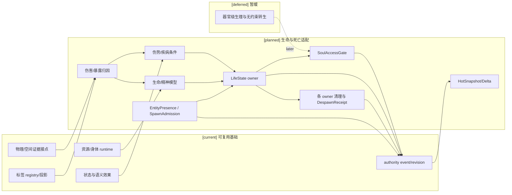
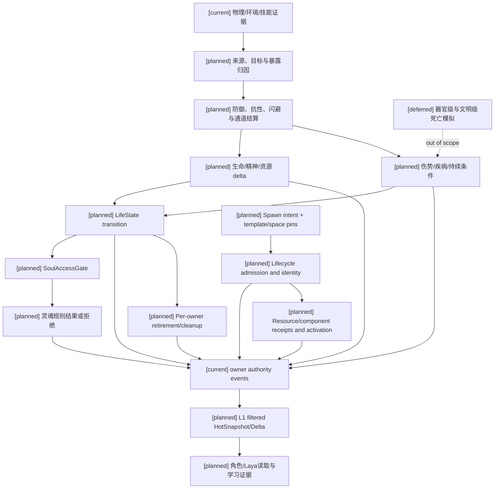

# 10 生命状态、伤势与死亡连续性设计

状态：`architecture analysis; planned and non-authorizing`

本文件是战斗目录中生命状态、伤势、疾病、死亡连续性和灵魂关系的设计 owner，并维护通用实体 presence、生成/销毁/召唤合同。它复用 02 的资源与转换、03 的效果/动作/物理证据、05 的生命/精神/灵魂规则、08 的标签治理和 09 的战斗动态投影；不建立第二套资源、状态、标签或事件真值系统。

## 1. 设计结论

生命相关概念必须分层：

```text
Damage/Evidence       一次伤害或暴露证据
Effect                对资源、条件或规则的声明式变化
Resource              health、life、focus 等可结算账本
Condition             hunger、burn、bleeding、infection 等持续条件
Injury                带部位、机制和功能影响的伤势记录
LifeState             alive、downed、dying、dead 等实体生命周期
SoulContinuity        灵魂锚点、身份、契约和转生联系等规则事实
```

它们不能被统一成 `health <= 0`、一个状态标签或一个 `soul_hp`。

```text
[current] 资源/身体、状态标签、语义效果、有效属性、authority event/revision 基础
[planned] 生命状态 owner、伤势/疾病合同、死亡与复活 admission、生命/精神转换和灵魂连续性 gate；EntityPresence、生成/销毁/召唤 admission、控制/继承、清理与恢复合同
[deferred] 器官级完整生理模拟、通用病原体生态、复杂且有规则约束的转生/灵魂连续性和文明级死亡系统
```

## 2. Owner 与边界

| 对象 | 正式 owner | 作用 | 不能替代 |
|---|---|---|---|
| `DamageEvidence` | 物理/环境/动作适配器 | 接触、轨迹、暴露、命中候选和来源证据 | 伤害真值 |
| `EffectApplication` | 效果/战斗 authority | 描述伤害、治疗、控制、资源变化或状态候选 | 已提交资源/状态 |
| `ResourceEntry` | Resource/Body authority | health、life、focus 等当前值、上限、预留和 revision | 伤势部位和死亡阶段 |
| `InjuryCondition` | Status/Body authority | 外伤、内伤、灼伤、流血、感染及功能影响 | 当前生命总量 |
| `LifeState` | Lifecycle/Body authority | 存活、倒地、濒死、死亡、复活和实体资格 | 普通状态标签或魂值 |
| `SoulContinuity` | Soul/identity authority（准入后） | 灵魂锚点、身份连续性、附身、契约、转生联系 | 精神资源、生命值 |
| 标签 | Semantic registry + 各对象投影 owner | 分类、selector、binding 输入和只读投影 | 上述正式事实 |

死亡不是普通状态标签。`status:dead` 可以作为 `LifeState.dead` 的派生投影；真正的死亡时间、原因、不可逆性和复活资格必须由生命周期 owner 提交。

## 3. `LifeState` 生命生命周期

### 3.1 最小状态集合 `[planned]`

```text
Alive          可执行普通动作，可能带伤势或功能缺陷
Impaired       仍存活，但关键身体/精神功能受限
Downed         不能正常执行战斗动作，可被救治、搬运或处决
Dying          存在进行中的死亡窗口或不可逆风险
Unconscious    意识不可用，身体和资源是否继续变化由规则决定
DeadPending    已满足死亡条件，等待同一结算窗口或规则确认
Dead           死亡事实已提交，实体不再具有普通生命资格
Reviving       已接纳复活过程，尚未恢复普通生命资格
Revived        复活事件已提交，资源、伤势和灵魂状态按规则重建
Despawned      实体从当前世界实例移除，不等同于灵魂消失
```

不是所有世界都启用全部阶段。世界包必须声明允许的状态、进入/退出条件、是否可逆、时间窗口、目标资格和跨 encounter 政策。

### 3.2 转换原则

```text
damage / disease / starvation / rule effect
-> resource and injury evaluation
-> LifeState transition proposal
-> lifecycle authority validation and commit
-> body/mind/soul projections
-> targeting, relation and perception updates
```

`health == 0` 只是一个输入条件，不能自动等于 `Dead`。同样，规则型即死可能在 health 大于零时触发，但必须有已注册的 `lethal_rule` 和 authority contract。

建议转换至少记录：

```text
from_state / to_state
cause_refs / lethal_basis
health_revision / injury_revision / mind_revision
irreversibility / confirmation_policy
recovery_policy / revive_policy
encounter_ref / phase_revision
authority_event_ref / projection_revision
```

### 3.3 目标资格与战斗关系

生命状态变化后，Target/Threat owner 重新计算：

- `Downed` 是否仍可被攻击、治疗、搬运或处决；
- `Dead` 是否从敌方目标候选中移除；
- `Reviving` 是否可以被打断；
- 召唤物、投射物、环境场的 owner 是否继续存在；
- 仇恨、护卫、保护和队伍成员关系保留、冻结或清空。

这些是投影和关系策略，不由 `LifeState` 直接修改仇恨或目标。

## 4. 伤势、疾病与持续伤害

### 4.1 伤害与伤势分开

```text
DamagePacket / Exposure
  -> immediate resource delta
  -> condition/injury application
  -> functional modifier
  -> possible LifeState transition
```

一次伤害可以没有伤势，伤势也可以在后续 tick 继续造成生命或精神损失。

建议 `InjuryCondition` 字段：

```text
condition_instance_ref
subject_ref / body_region / internal_or_external
mechanism                 cut / blunt / thermal / chemical / mental / rule
severity / stacks / intensity
bleed_rate / burn_rate / toxin_load
pain_level / shock_level
functional_impairments    movement / guard / cast / perception / breathing
infection_risk / chronicity
started_at / tick_policy / expires_at?
healing_policy / dispel_policy
source_event_refs / authority_event_ref
```

伤势字段不是每个世界都启用。常规世界可启用流血、骨折、灼烧、感染和疼痛；魔法世界可增加诅咒伤、元素灼蚀和灵力反噬；机械或异质生命可以把它们替换为结构损坏、过热或核心失稳。

### 4.2 饥饿、脱水和代谢损伤

饥饿通常是条件，不是生命资源本身：

```text
缺乏摄入/代谢需求
-> HungerCondition / DehydrationCondition
-> recovery and stamina modifiers
-> focus/sanity vulnerability
-> starvation damage or organ impairment
-> Downed / Dying / Dead according to world policy
```

世界包可以使用营养资源、身体储备或灵食/能源替代，但必须显式注册输入、消耗、恢复和死亡规则。没有饥饿模块的世界不能因存在 `health` 自动生成饥饿。

### 4.3 灼烧、内伤与环境暴露

灼烧应拆成不同来源：

```text
thermal_damage       即时热伤害
burn_condition       持续燃烧和 tick
smoke_inhalation     呼吸/精神影响
heat_exhaustion      体力与专注恢复下降
fire_field           空间暴露和离场条件
```

钝击可以造成即时生命损失，也可以生成延迟内伤；火场可以不直接命中，但通过暴露和持续 tick 产生效果。物理引擎提供接触、轨迹、遮挡和位置证据，效果/身体 authority 决定是否应用伤势。

## 5. 生命、精神与灵魂

### 5.1 生命/精神关系

复用 02、05 的三种世界模型：

```text
fused       health/focus 是同一生命力的不同投影
coupled     独立账本，但允许已注册转换
independent 独立账本，不允许隐式转换
```

`focus`、`sanity`、`health` 不必同时存在。精神枯竭可以表示昏迷、精神崩溃、意志失能或死亡，具体由 world rule 明确；模型不能从名称推断结果。

### 5.2 死亡不是灵魂数值归零

身体死亡、意识终止和灵魂连续性是三个不同结果：

```text
body_death          身体生命资格终止
mind_collapse       意识/认知不可用或连续性受损
soul_severance      灵魂锚点、身份或存在联系被切断
```

默认情况下：

- 身体死亡不自动证明灵魂消失；
- 精神崩溃不自动打开灵魂攻击；
- 灵魂没有通用 `soul_hp` 或 `soul_resistance`；
- 灵魂规则只能通过 `SoulAccessGate` 进入。

### 5.3 `SoulAccessGate`

```text
soul_rule_allowed =
  life_or_mind_vulnerability_satisfied
  AND soul_link_or_anchor_valid
  AND attacker_authority_sufficient
  AND target_scope_valid
  AND no_higher_rule_blocks
```

通过 gate 后才可能执行：

```text
possess / bind / banish / sever / curse / seal
block_reincarnation / alter_identity
```

这些是规则结果，不是数值伤害。`soul_anchor`、`true_name`、`identity`、`oath` 和 `reincarnation_link` 的正式事实由 soul/identity owner 保存；标签只能作为 selector 或投影。

## 6. 结算顺序和跨 owner 提交

```text
admission and source attribution
-> target/geometry/exposure
-> hit/dodge/miss/immunity
-> channel defense and mitigation
-> immediate resource delta
-> injury/status tick and functional modifiers
-> LifeState transition evaluation
-> SoulAccessGate and soul rule evaluation
-> owner validation and admitted batch append
-> filtered hot/delta and learning evidence
```

同一窗口先冻结 read-set、规则 revision、物理证据和 encounter phase。各 owner 只提交自己拥有的事实；涉及资源、伤势、生命状态和灵魂规则的跨 owner 结果必须声明参与者、幂等键、部分失败策略和回放 pins。不能把司命或模型当作中央死亡写入器。

### 6.1 实体生成、销毁与召唤合同 `[planned]`

`LifeState` 描述存在于世界中的实体是否具有生命/行动资格；`EntityPresence` 描述实例是否被接纳、激活和移出世界。两者是正交轴：尸体可以 dead + active，离场角色可以 alive + despawned，无生命投射物不必被赋予 alive。实体生成/销毁共同合同在本节维护，03 定义投射物消费，09 定义队伍/目标/仇恨消费。

此合同也支持机关、环境场载体、建造物和生态实体，不强制附加 LifeState、角色智能体、蓝条或仇恨模块。只有具备自主角色语义的实例才按角色准入接入 character service；资产模板、引擎对象、领域实体和后端角色身份继续分别注册与绑定。

```text
EntityPresence: proposed -> admitted -> activating -> active -> retiring -> despawned
                     \-> rejected
SpawnIntent {
  intent_ref / definition_ref / definition_revision / creator_ref
  world_instance_ref / spatial_evidence_refs / window_ref
  participant_contract_refs / reservation_refs / requested_count
  control_policy_ref / lifetime_policy_ref / quota_policy_ref
  inherited_component_refs / expected_revision_vector / input_digest
}
SpawnAdmission {
  intent_ref / admission_ref / allocated_entity_refs
  definition_pins / spatial_pins / quota_reservation_ref
  status / dependency_receipts / expires_at / rejection_reason?
}
SpawnedEntity {
  entity_ref / incarnation_ref / world_instance_ref / definition_pins
  creator_ref / controller_ref / canonical_origin_ref
  presence / life_state_ref? / component_revision_vector
  control_policy_ref / scheduled_expiry_ref / activation_receipt
}
DespawnReceipt {
  entity_ref / incarnation_ref / retirement_cause / last_action_cutoff
  cleanup_operation_refs / outstanding_dependency_refs
  lifecycle_event_ref / before_revision / after_revision
}
```

`entity_ref + incarnation_ref` 防止复用 id 时旧命中/控制消息作用于新实例；使用渲染对象池不复用世界身份。资产/模板注册与实体实例接纳分开，默认追加独立身份，不替换既有角色。召唤既可以生成新实体，也可以召来已有实体；后者必须声明原实例离场/目标实例接纳与身份连续性，不复制成第二个同身份角色。

生成流程为：校验已接纳模板和来源能力 -> 冻结位置/目标证据 -> 生命周期 owner 接纳名额与实例身份 -> 对应 Resource/Inventory owner 预留/支付 -> 注册组件并准备所需引擎绑定 -> 收齐组件 receipt 与 required adapter ready evidence -> 生命周期 owner 提交 activation -> 引擎开放已接纳的执行/表现并发布投影。准备中的引擎对象不开放战斗。无物理实体的生成可以声明无需该 adapter，不能为物理必需的模板跳过 ready 条件。具体支付阶段由内容包定义，预留不能由生命周期 owner 直接改账。能力准入不等于模板具备有效 owner；没有完整参与合同则拒绝激活。

`admitted/activating` 实体不参加普通目标查询和战斗。引擎创建失败后按政策重试、保持受限 pending 或提交正式取消与退款；不能因有动画就宣称生成成功，也不能因掉线从 backend 擅自删除已激活实体。使用固定实例键重试，不重复占名额或支付。位置在激活前失效则重新准入或失败，不能移到未经批准的位置。

### 6.2 控制、期限、继承与销毁 `[planned]`

| 内容政策 | 必须编辑的语义 |
|---|---|
| 名额与控制 | 每来源/阵营/实例上限、并发 admission 名额预留、控制半径、指令权限、自治与计算预算 |
| 继承 | 继承模板、生成时快照或有来源的 live binding；技能资格、资源、标签不得按“继承全部”默认复制 |
| 生命周期 | 期限、维持费、提前解除、死亡后尸体/残留物、离场后已生成效果的寿命 |
| 主人变化 | 主人死亡/离线/失联/叛队/控制转移时继续、冻结、自治、转移或退场 |
| 归属 | 原始来源、当前控制者、奖励/仇恨/伤害分别如何归因，不多入口重复计数 |
| 界面投影 | 谁能观察身份、位置、期限、生命和资源，权限撤销如何失效缓存 |

召唤智能实体仍受其自己的能力与认知包络限制；大量低能力召唤物使用更小候选与受限调度，不通过继承主人高预算取得全能。装备/阵法或标签仅引用已注册召唤政策，不能从标签字符串制造实体。

销毁先标记 retiring 并关闭新动作/目标准入，再按各 owner 合同取消动作、释放资源预留、解绑控制、撤销 live binding、停止未来任务并处理群体/仇恨关系；已提交伤势、已造成伤害和已经独立生成的效果按各自生命周期保留。所有 cleanup 操作可幂等恢复；必要清理缺失时保持 pending，不报告全量销毁完成。正式 despawn receipt 后通知引擎删除/回收表现，保留 tombstone 供迟到输入拒绝和历史回放。

控制转移不等同 despawn，也不等同死亡。跨世界实例迁移使用明确的 departure/admission 事件和新 instance pin；不能两端同时 active。死亡/复活主体可保留原身份，是否产生新 incarnation、如何继承资源/状态由 3/5 节政策决定。正式生成/销毁的重放从 lifecycle events 恢复，不再次扣费、生成实例或发送外部通知。

### 6.3 生命周期故障验收 `[planned]`

| 案例 | 必须得到的结果 |
|---|---|
| 两个召唤同时争抢最后一个名额 | 由 owner 的 revision/预留约束只接纳合法数量 |
| 支付成功但组件/引擎失败 | admission 可恢复；固定键重试或注册取消/退款，无第二次付费 |
| 主人死亡与维持费同窗 | 按固定阶段和主人死亡政策，未接纳的额外消耗不发生 |
| 销毁中收到旧命中或控制消息 | 检查 incarnation、cutoff 和 revision，不作用于新实例 |
| 引擎对象池复用 | 新 world identity 与旧实例无混同，历史日志仍可解析旧对象 |
| 已死实体仍作为尸体存在 | dead 与 active 可共存，攻击/治疗/搜取资格分别判断 |

当前资源/状态/event 基础可复用；本节共同生成/销毁合同、控制转移与恢复链均为 `[planned]`。大规模自治群体、复杂的已授权跨世界迁移为 `[deferred]`；绕过 admission、身份连续性或 owner 权限的复制/迁移始终禁止。

## 7. 标签与编辑边界

标签只承载语义和编辑入口：

```text
definition: injury:thermal / environment:fire_field
instance: body:lung / soul:anchored
derived: life:dying / status:starved / status:dead
runtime_status: status:burning / status:bleeding / status:unconscious
capability: fire_resistant / deathless / soul_bound
```

这些标签不保存伤害数值、tick、剩余时间、健康值或死亡事件。正式数据分别存在伤势、资源、生命状态和灵魂事实 owner 中。`capability:deathless` 也不自动赋予不死；它只能引用已注册的资格/规则 binding。

装备、药品、技能和环境标签可触发候选 binding；卸下、过期、资格撤销和场离开按 08 的生命周期规则重新求值。已经提交的伤势或灵魂规则不能通过删除标签直接抹除。

## 8. 当前映射与差距

| 能力 | `[current]` 可复用基础 | `[planned]` 增量 |
|---|---|---|
| 生命资源 | `resource_body_runtime.py` 的 current/capacity/reserved/available 与身体投影 | health/life 多资源关系、生命 owner 和伤害批次 |
| 伤势状态 | 身体 injury projection、`status_tags.py`、`semantic_effects.py` 的层数/过期/转换 | 部位、机制、内外伤、tick、功能影响和疾病链 |
| 生命阶段 | 03/09 已定义 Downed/DeadPending/Dead/Reviving 等设计词汇 | LifeState owner、转换事件、复活 admission 和目标资格 |
| 实体 presence | 引擎对象/资产注册、已有 owner 事件主干；不证明完整生成链 | SpawnAdmission、incarnation、名额/控制合同、跨 owner 支付恢复、清理/tombstone |
| 精神模型 | 02/05 的 life/mind 作用域和 fused/coupled/independent | 精神崩溃、昏迷、精神死亡及与生命状态的正式转换 |
| 灵魂规则 | 05 的规则对象和 `SoulAccessGate` 设计 | soul/identity owner、链接生命周期和可重放规则结果 |
| 标签投影 | 08 的生命周期、selector、binding 和可见性治理 | 生命/伤势/灵魂标签 adapter，不让标签成为第二真值 |

当前没有完整的 LifeState、伤势疾病 runtime 或 SoulAccessGate 实现；本文件是设计收敛，不代表代码已完成。

## 9. 架构图



## 10. 主流程时序图

```mermaid
sequenceDiagram
  participant X as Physics/Environment evidence
  participant Q as Effect/Body evaluator
  participant R as Resource/Status authority
  participant L as Lifecycle authority
  participant S as Soul authority
  participant P as Projection/L1
  participant C as Creator/Character intent
  Note over X,P: [current] evidence/event/runtime foundations; [planned] life, injury, death and soul adapters; [deferred] unrestricted resurrection
  opt entity spawn / summon
    C->>L: template/space pins, creator and spawn intent
    L->>L: admit quota and allocate independent identity/incarnation
    L->>R: resource/component operations with pinned admission
    R-->>L: per-owner receipt or pending dependency
    L->>X: prepare required adapter binding; no combat activation
    X-->>L: ready evidence or adapter fault
    alt required dependencies and evidence valid
      L->>L: commit activation
      L-->>X: activate prepared entity with committed identity
      L-->>P: committed presence and lifecycle revisions
    else failed / pending dependencies
      L->>L: keep pending or submit admitted cancellation/recovery
      L-->>C: diagnostic; no active shadow entity
    end
  end
  X->>Q: contact, exposure, trajectory and source evidence
  Q->>Q: validate target, channel, defense and mitigation
  Q->>R: typed resource/status/injury proposals with pinned revisions
  R->>R: commit health/mind/resource and condition changes
  R->>L: life-state transition proposal
  L->>L: validate lethal basis, recovery, encounter and idempotency
  alt spiritual rule module exists
    L->>S: gate input with committed life/mind vulnerability
    S->>S: validate link, authority, scope and higher rules
    S-->>L: rule result or rejection
  end
  L-->>P: committed lifecycle revision
  opt entity retirement / despawn
    L->>R: owner-bound cleanup with incarnation and cutoff
    R-->>L: cleanup receipts or pending dependencies
    L->>L: commit despawn only after required cleanup
    L-->>X: committed lifecycle result for engine presentation
  end
  P-->>P: filter private injury, death and soul projections
  P-->>L: hot/delta publication receipt
```

## 11. 数据流图



## 12. 验收标准与后续顺序

1. `health == 0` 不会绕过 LifeState owner；即死规则也必须有显式规则和 authority contract。
2. 同一事件可以产生即时生命变化和持续伤势，但二者来源、生命周期和撤销/治疗路径可分别追踪。
3. 饥饿、脱水、灼烧、流血、内伤和疾病可作为可选内容包模块，不会为没有这些模块的世界生成隐形资源或状态。
4. `Downed`、`Dead`、`Reviving` 和 `Despawned` 是生命周期事实，不是普通标签别名；派生标签不能直接写入它们。
5. 身体死亡、精神崩溃和灵魂断裂可以分别发生；身体死亡不自动等于灵魂消失。
6. `SoulAccessGate` 读取已提交的生命/精神脆弱性和灵魂链接，伪造标签、提高预算或修改缓存不能放行。
7. owner 事件具有 revision、来源、幂等和回放 pins；过滤后的 HotSnapshot/Delta 不泄露私有伤势或灵魂事实。

建议的正式设计推进顺序：

```text
生命/精神模型与 LifeState
-> 外伤、内伤、灼烧、流血和饥饿条件
-> Downed/Death/Revive owner contract
-> SoulAccessGate 与灵魂连续性
-> 疾病、感染、复杂复活和世界观扩展
```

本文件仍是十月分析设计，不是正式 spec、implementation plan 或代码授权。
