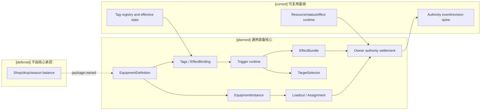
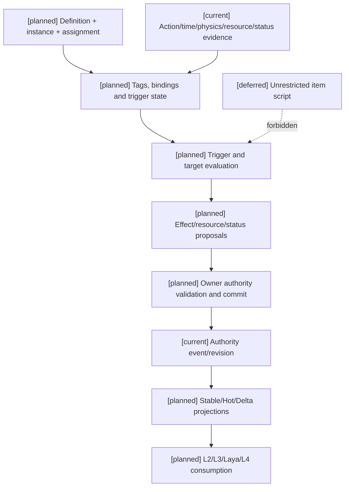

# 11 通用装备系统设计

状态：`architecture analysis; planned and non-authorizing`

本文件定义跨 RPG、动作、战术、枪械、魔法、修仙和策略玩法复用的装备核心。自走棋的棋盘、回合、羁绊、组件二合一、选秀和掉落规则见 [12-自走棋装备玩法包设计](12-自走棋装备玩法包设计.md)，不在本文件中固化。

装备核心负责对象身份、持有与装备关系、栏位抽象、属性/效果绑定、触发器、目标选择、使用限制和 authority settlement。它不拥有商店、掉落、阵容经济或具体赛季平衡。

## 1. 通用核心与玩法包边界

| 机制 | 通用装备核心 | 玩法包/内容包 |
|---|---|---|
| 装备定义、实例和 assignment | `EquipmentDefinition`、`EquipmentInstance`、`EquipmentAssignment` | 具体物品内容 |
| 装备栏 | `EquipmentSlotDefinition`、`EquipmentLoadout` 抽象 | 栏位数量、可装备类别和替换政策 |
| 属性与效果 | `EffectBundle`、`EffectBinding`、`TargetSelector` | 数值、文本和世界观参数 |
| 触发器 | `TriggerDefinition`、`TriggerBinding`、runtime state | 玩法事件和触发策略 |
| 耐久、次数、充能、冷却 | 独立生命周期字段和校验 | 是否启用、恢复方式和数值 |
| 合成 | `CompositionRecipe` 抽象 | 二合一组件、锻造、升级、拆分规则 |
| 变体 | `EquipmentVariant` 抽象 | 光明装备、神器、赛季变体 |
| 标签 | 复用 08 的注册标签与元标签 | 羁绊、武器类型、阵营和世界观标签 |
| 随机候选 | 确定性 offer 接口 | 选秀、商店、掉落和奖励池 |
| 事实提交 | 对接各 domain owner | 玩法包提供参与 owner 和事件向量 |

原则是：核心提供语义和生命周期合同，玩法包提供事件、政策和内容；玩法包不能用名称或标签绕过 owner authority。

## 2. 核心对象

### 2.1 `EquipmentDefinition`

```text
EquipmentDefinition {
  equipment_id
  definition_revision
  category
  rarity
  tags / tag_binding_refs
  allowed_slots
  prerequisites
  unique_groups
  passive_binding_refs
  active_binding_refs
  trigger_binding_refs
  variant_refs
  recipe_refs
  lifecycle_policy
}
```

定义描述“这类装备是什么”，不保存某个角色当前的耐久、层数、充能或随机结果。

### 2.2 `EquipmentInstance`

```text
EquipmentInstance {
  instance_id
  definition_id
  owner_ref
  holder_ref
  location_ref
  quantity
  durability_current / durability_max
  uses_current / uses_max
  charges_current / charges_max
  bound_state
  instance_tag_assignment_refs
  instance_revision
}
```

`quantity`、`durability`、`uses`、`charges` 和 `cooldown` 必须独立建模。标签不能替代这些字段。

### 2.3 栏位与 assignment

```text
EquipmentSlotDefinition {
  slot_id
  slot_kind
  capacity
  allowed_categories
  allowed_tags
  conflict_groups
  replacement_policy
}

EquipmentLoadout {
  holder_ref
  slot_definitions
  assignments
  loadout_revision
}

EquipmentAssignment {
  equipment_instance_ref
  holder_ref
  slot_ref
  assignment_source
  assigned_at
  assignment_revision
}
```

“每人三件装备”是玩法包的栏位政策；核心只负责容量、资格、冲突和 assignment 校验。

## 3. 触发器与标签

标签是触发器的语义入口，不是触发器执行器：

```text
TagAssignment
  -> registered TriggerBinding
  -> TriggerDefinition
  -> TriggerRuntimeState
  -> EffectBundle / resource / status proposal
  -> owner authority settlement
```

### 3.1 触发器合同

```text
TriggerDefinition {
  trigger_id
  event_kind
  phase
  condition_refs
  target_selector_ref
  cooldown_policy
  charge_policy
  counter_policy
  stacking_policy
  effect_bundle_ref
  priority
  causal_chain_policy
}

TriggerBinding {
  binding_id
  source_kind
  source_ref
  tag_ref?
  trigger_definition_ref
  activation_policy
  definition_revision
  owner_contract_ref
}

TriggerRuntimeState {
  binding_ref
  source_instance_ref
  counter_values
  stack_count
  charges_current
  cooldown_until
  armed
  last_trigger_event
  runtime_revision
}
```

通用事件可以包括 `equip`、`unequip`、`combat_start`、`attack`、`hit`、`damage_taken`、`spell_cast`、`resource_spent`、`health_threshold`、`status_applied`、`owner_died` 和 `time_elapsed`。玩法包可以注册额外事件，但必须通过事件 schema 和 owner admission。

标签可以作为事件、条件、目标选择、资格和唯一组输入；标签不能保存攻击计数、触发冷却、当前护盾、随机结果或装备归属。

## 4. 效果、目标和结算

```text
EffectBundle {
  numeric_effects
  resource_effects
  status_effects
  control_effects
  field_effects
  rule_effects
}

TargetSelector {
  relation_filter
  team_filter
  category_filter
  spatial_shape
  range
  line_of_sight
  ordering
  tie_break
  max_targets
  random_policy
}
```

吸血、护盾、阈值触发、持续伤害和控制必须分别进入资源、状态、效果和动作 owner。装备只提交结构化提案，不能直接写入生命、法力、状态、库存或世界事实。

```text
equip/use/trigger event
-> assignment, ownership, durability, uses, charges and cooldown checks
-> prerequisite, target, space, resistance and counterplay checks
-> resource/effect/status/field proposals
-> participating owner authority settlement
-> authority event/receipt/revision
-> CombatStablePrefill / CombatHotSnapshot / CombatDelta
```

跨 owner 变化必须声明参与 owner、幂等键、提交顺序和部分失败策略；不能假定所有装备效果自动构成一个全局事务。

## 5. 合成、变体与随机接口

通用核心只定义接口：

```text
CompositionRecipe {
  recipe_id
  input_requirements
  output_definition
  consume_policy
  inheritance_policy
  failure_policy
  priority
  recipe_revision
}

EquipmentVariant {
  base_definition_ref
  variant_kind
  inherited_bindings
  replaced_bindings
  added_bindings
  power_budget_ref
}

DeterministicOffer {
  pool_revision
  seed_ref
  candidate_filter
  candidate_count
  selection_event
}
```

具体配方、光明装备、神器、随机掉落、商店或选秀由玩法包提供。

## 6. 当前、计划与暂缓

- `[current]`：资源账本、状态标签生命周期、语义效果、有效属性、标签 registry/snapshot、动作窗口、authority event/revision 和部分外物基础。
- `[planned]`：通用装备定义/实例/栏位/assignment、TriggerDefinition/Binding/RuntimeState、TargetSelector、EffectBundle、合成/变体/确定性 offer 接口、装备 settlement batch 与 Combat prefill 接入。
- `[deferred]`：无约束装备脚本、自动生成数值、跨玩法共享商店、复杂协作发布和跨赛季迁移。

## 7. 架构图



## 8. 主流程时序图

```mermaid
sequenceDiagram
  participant C as Character/Laya
  participant T as Equipment/trigger runtime
  participant A as Domain authorities
  participant P as Combat projection
  Note over C,P: [current] runtime/event foundations; [planned] equipment contracts; [deferred] unrestricted scripting
  C->>T: equip/use/typed action intent
  T->>T: resolve assignment, tags, trigger state and target candidates
  T->>A: owner-bound proposals with revisions and causal chain
  A->>A: validate source, resource, status, space, resistance and idempotency
  alt accepted
    A->>A: append participating owner events
    A-->>P: receipt and revisioned object/effect deltas
    P-->>C: filtered stable/hot/delta view
  else rejected
    A-->>C: rejection receipt; no unapproved fact write
  end
```

## 9. 数据流图



## 10. 验收标准

1. 装备定义、实例、栏位、assignment、运行时触发状态和标签 assignment 不混为同一对象。
2. 耐久、数量、次数、充能和冷却可独立变化并可回放。
3. 同一装备 binding 通过标签和装备两个入口只结算一次。
4. 触发器必须有事件、条件、目标、冷却/计数、效果、优先级和 owner contract。
5. 装备不能直接写资源、状态、库存、空间或世界事实。
6. 装备定义和 binding revision 能使 stable prefill 失效；触发计数和冷却只进入 hot/delta。
7. 常规世界不启用自走棋事件时，不产生棋盘、羁绊、回合或隐含三件装备限制。

## 11. 本批规格与计划回写（2026-10-10）

本批继续采用本设计的通用装备核心边界：定义、实例、栏位、assignment、触发器、目标选择、效果与 owner settlement 不绑定战斗或自走棋。计划05只推进通用装备定义/编辑和开放世界 owner contract；自走棋的“三件”、棋盘、回合、羁绊和随机池由未来单局适配独立承载，不写入通用 schema 或当前 editor active gate。

映射：规格10、14；计划04 Task3、计划05 Task4–5；未来自走棋来源见规格15/计划06。


### 本批规格与计划回写：Task3 前置审查（2026-10-16，RW-39）

[current] 实际为 EquipmentProfile、EquipmentActivation 与 InventoryItem，非完整设计三实体；装备 grant 与 learned ability 分别恢复，撤装备不撤学习。 逐对象 owner、consumer、持久版本和兼容入口见[本轮矩阵与三图](../回写/stage3-task3-20261016.md)，对应规格10与计划04 Task3。

[planned/blocked] 集中迁移仍缺已审定目标字段/schema、完整pause/drain与真实非战斗核心资源caller。本轮只完成审查和迁移夹具设计，没有新增资源切片；D17不取消动作、不清reservation、不伪造退款，失败保留旧事实、关闭新admission。[deferred] prediction、随机、Godot及评估/训练不在本轮。
