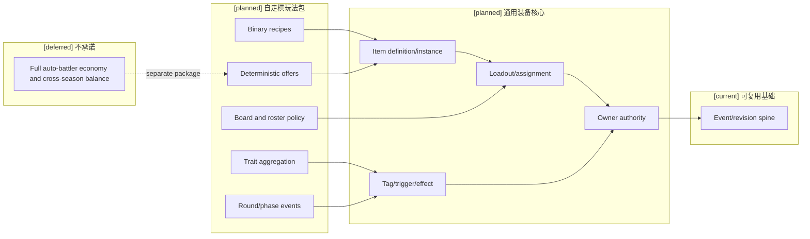
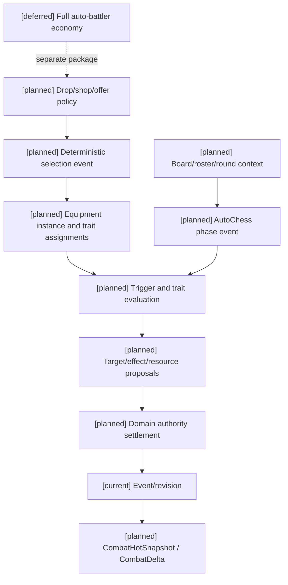

# 12 自走棋装备玩法包设计

状态：`architecture analysis; planned and non-authorizing`

本文件使用 [11-通用装备系统设计](11-通用装备系统设计.md) 作为底座，定义自走棋类玩法如何接入装备、触发器、标签、羁绊、回合和随机奖励。这里的“自走棋”是实现案例，不是通用装备核心的默认规则。

## 1. 玩法包边界

自走棋玩法包拥有：

- 棋盘单位和阵容上下文；
- 装备栏位数量与装备分配阶段；
- 组件二合一配方；
- 转职装备和羁绊聚合；
- 回合/阶段/战斗开始事件；
- 选秀、商店、野怪掉落、法球和神器池；
- 随机候选与确定性 seed；
- 单位死亡、召唤物和装备处理政策。

玩法包复用通用核心的装备实例、assignment、标签、触发器、效果、目标选择和 authority settlement，不创建第二套装备 runtime。

## 2. 棋盘装备栏与分配政策

```text
AutoChessLoadoutPolicy {
  max_items_per_unit
  allowed_item_categories
  unique_group_policy
  equip_phase
  transfer_phase
  combat_transfer_allowed
  death_drop_policy
  item_persistence_policy
}
```

典型内容可以配置 `max_items_per_unit = 3`，但这只是内容包政策。装备赋予单位、卸下、转移和替换仍产生 `EquipmentAssignment` 事件。

棋盘位置、同排、邻格和格数必须通过玩法包的空间 adapter 映射到通用 `TargetSelector`，不能把“格”写死在核心空间合同中。

## 3. 组件与成装

```text
BinaryCombinationRecipe {
  input_a
  input_b
  completed_item
  consume_inputs = true
  decomposable = false
  duplicate_policy
  recipe_revision
}
```

例如：

```text
大剑 + 拳套 -> 无尽之刃
大剑 + 女神之泪 -> 朔极之矛
锁子甲 + 巨人腰带 -> 日炎斗篷
```

合成阶段必须固定输入实例、内容 revision、消耗策略和失败策略。合成后不自动继承全部输入标签；继承哪些标签由 recipe 明确定义。

## 4. 转职装备与羁绊

转职装备的本质是通用标签赋予加自走棋阵容聚合：

```text
EmblemEquipment
  -> TraitGrant
  -> RosterTraitProjection
  -> TraitBreakpointRule
  -> team effect binding
```

```text
TraitGrant {
  trait_id
  holder_ref
  source_equipment_ref
  assignment_revision
}

RosterTraitProjection {
  roster_ref
  trait_id
  counted_members
  count
  roster_revision
}

TraitBreakpointRule {
  trait_id
  threshold
  effect_bundle_ref
  activation_policy
  deactivation_policy
}
```

标签负责语义和资格，`RosterTraitProjection` 负责统计，`TraitBreakpointRule` 负责档位激活。装备不能直接把全队效果写入角色。

必须明确：

- 替补席是否计入羁绊；
- 阵亡单位是否计入；
- 召唤物是否计入；
- 转职装备卸下后何时失效；
- 羁绊变化对已存在状态是立即、下一次行动还是下一回合生效。

## 5. 回合、阶段和装备触发器

自走棋包可向通用 Trigger Runtime 注册：

```text
planning_phase_start
combat_phase_start
round_start
round_end
stage_changed
unit_death
ally_unit_death
trait_breakpoint_reached
board_position_changed
carousel_pick
loot_claimed
```

这些事件必须由玩法包的时序/阶段 owner 生成，并带 `round_ref`、`stage_ref`、`board_revision`、`roster_revision` 和 `causal_chain_id`。装备只能消费已提交事件，不能自行创建回合事实。

示例：

```text
灵风
  combat_phase_start
  -> select one legal enemy
  -> banish 5 seconds

军团圣盾
  combat_phase_start
  -> select same-row allies
  -> apply attack-speed and defense effects for 12 seconds

救赎
  unit_death(holder)
  -> select nearby allies
  -> heal and apply declared status effect
```

## 6. 随机候选、掉落与奖励

随机选择属于玩法包或奖励包，使用通用的确定性 offer 接口：

```text
AutoChessOfferPolicy {
  pool_ref
  pool_revision
  seed_ref
  candidate_count
  eligibility_rules
  duplicate_rules
  selection_phase
  unselected_policy
}
```

可覆盖：

- 野怪掉落；
- 选秀候选；
- 商店物品；
- 法球奖励；
- 纹章之书；
- 光明装备池；
- 神器装备池；
- 窃贼手套随机装备。

随机结果必须由 authority event 固化，可回放；模型不能猜测或伪造候选结果。

## 7. 自走棋装备案例

| 装备 | 通用核心部分 | 自走棋玩法包部分 |
|---|---|---|
| 无尽之刃 | 属性 modifier、暴击规则 binding | 二合一配方和棋盘掉落池 |
| 青龙刀 | 攻击计数 trigger、法力恢复 effect | 回合战斗事件和单位装备栏 |
| 灵风 | 目标选择、强制控制、持续时间 | 战斗开始阶段、棋盘敌方候选 |
| 法师纹章 | 标签赋予、EffectBinding | 法师计数和羁绊阈值 |
| 窃贼手套 | 随机 offer、候选过滤 | 战斗开始随机两件成装和赛季池 |
| 光明装备 | EquipmentVariant | 光明池、特殊获取事件 |

## 8. 当前、计划与暂缓

- `[current]`：通用标签、资源、状态、效果、属性、事件、revision 和部分动作/时间基础；尚无自走棋装备玩法包运行时。
- `[planned]`：棋盘 loadout policy、二合一 recipe、TraitGrant/RosterTraitProjection/Breakpoint、回合事件、随机 offer、掉落和神器池、装备包与 Combat prefill 接入。
- `[deferred]`：完整商店经济、赛季平衡自动化、多人共享掉落市场、跨赛季装备迁移和无约束随机脚本。

## 9. 架构图



## 10. 主流程时序图

```mermaid
sequenceDiagram
  participant P as AutoChess package
  participant T as Trigger/trait runtime
  participant A as Domain authorities
  participant H as Combat projection
  Note over P,H: [current] event spine; [planned] package adapters; [deferred] full economy
  P->>P: advance round/phase and freeze board/roster revision
  P->>T: publish admitted phase event
  T->>T: resolve equipment bindings, traits, targets and runtime counters
  T->>A: submit owner-bound effect/resource/status proposals
  A->>A: validate revisions, eligibility, resistance and idempotency
  A-->>H: commit receipts and visible deltas
  H-->>P: updated unit/board projection
```

## 11. 数据流图



## 12. 验收标准

1. 不启用自走棋包时，通用装备核心不会产生棋盘、羁绊、回合或三件装备限制。
2. 自走棋包只能通过通用装备、标签、触发器、目标选择和 owner authority 接口工作。
3. 羁绊统计、转职赋予、阈值激活和卸下失效可重放且不重复计数。
4. 合成、掉落、选秀、商店和随机 offer 使用固定 pool revision 和 seed，可回放。
5. 玩法包事件不能直接写资源、状态或装备库存；必须提交 owner-bound proposal。
6. 棋盘空间、回合和单位生命周期变化能进入 HotSnapshot/Delta，不污染 StablePrefill。

## 13. 本批规格与计划回写（2026-10-10）

本设计仍保留自走棋装备机制作为未来 mechanic/game-mode 消费案例；本批实施范围已改为只服务开放世界运行时。自走棋装备 policy、棋盘/阵容、单局回合/阶段、羁绊、offer/reward、商店经济及相关编辑器适配统一标记为本批 `closed/deferred`，因为开放世界 runtime 与单局 runtime 是两类运行时，当前开放世界主线尚未建立单局运行时。

因此原文对象、候选字段、图和验收仅保留为未来来源，不能进入当前 plan 的执行任务、前置 gate、完成条件或 owner 探测；也不能反向添加棋盘/回合/羁绊特例到通用装备、时间、资源或角色合同。未来重启时必须另立单局运行时范围、owner、spec、plan 与 Harness profile。对应规格15、计划06和决策 D14。
