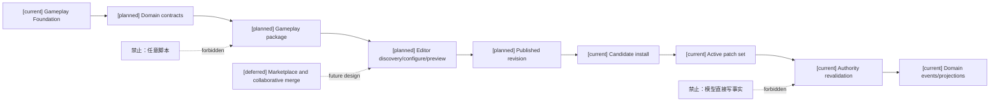
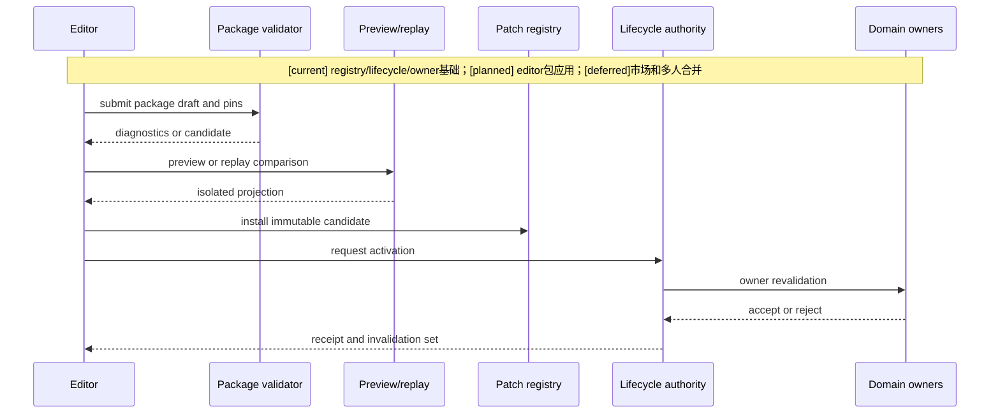
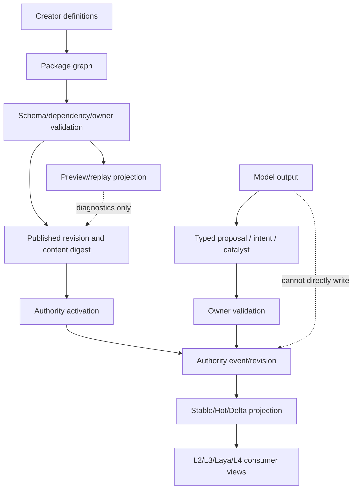

# 十月分析：玩法包与编辑器应用治理

状态：`architecture analysis; planned and non-authorizing`

本目录补充编辑器目录和战斗目录之间缺失的“玩法包层”。玩法包不是任意脚本，也不是第二套世界事实库，而是基于通用 Gameplay Foundation，通过配置、绑定、策略、适配器和内容定义，对某种玩法进行调整与补充的可版本化内容单元。

## 文档目录

| 文档 | 范围 |
|---|---|
| [01-玩法包现有实现审计与差距矩阵](01-玩法包现有实现审计与差距矩阵.md) | `patch_runtime`、lifecycle、settlement、production registry 和缺口 |
| [02-玩法包分层、组合与通用底座复用设计](02-玩法包分层、组合与通用底座复用设计.md) | Foundation、Domain、World、Mode、Scenario、Content、Verification |
| [03-编辑器中的玩法包发现、调用与应用设计](03-编辑器中的玩法包发现、调用与应用设计.md) | discover、configure、preview、apply 和 activation boundary |
| [04-玩法包调整、补充、覆盖与冲突治理设计](04-玩法包调整、补充、覆盖与冲突治理设计.md) | 调整/补充/覆盖边界、依赖、冲突、迁移和安全 |
| [05-玩法包与各领域接入矩阵](05-玩法包与各领域接入矩阵.md) | Combat、Character、Resource、Status、Equipment、Tag、Time、Environment |
| [06-玩法包发布、激活、迁移与缓存同步设计](06-玩法包发布、激活、迁移与缓存同步设计.md) | revision、active set、authority、Stable/Hot/Delta |
| [07-玩法包示例：常规世界、修仙魔法、自走棋](07-玩法包示例：常规世界、修仙魔法、自走棋.md) | 三类内容包的复用和差异 |
| [08-玩法包目标架构、差距与后续路线](08-玩法包目标架构、差距与后续路线.md) | 总差距、spec/plan 顺序和验收标准 |

## 核心关系

```text
Gameplay Foundation
  + Domain contracts
  + World rules
  + Game mode policies
  + Content definitions
  + Adapters
  = Gameplay Package
```

编辑器负责创建和治理 package revision；package runtime 负责注册、组合和提供 proposal；领域 authority 负责最终事实。

“调用包”包含编辑期的配置、验证和模拟，以及正式环境的安装/应用请求。高频战斗不逐帧调用编辑器：运行时消费已激活包中的固定定义、绑定和政策。包所引用的代码 adapter 属于底座中已审核实现，不随内容导入执行任意代码。

## 职责与术语

| 对象 | 职责 | 权限边界 |
|---|---|---|
| Gameplay Foundation | 已注册资源、状态、能力、动作、效果、事件和 owner 接入基础 | 不替包决定所有玩法政策 |
| Gameplay package | 通用底座上的调整、补充、组合和内容 | 不创建事实 owner |
| Creator editor | 内容编辑、包管理、依赖检查、预览、发布和应用请求 | 不改当前角色状态 |
| Package lifecycle authority | 管理获准 candidate/active set 变化 | 不拥有所有领域事实 |
| Domain authority | 依据包输入校验并提交自己拥有的事实 | 不接受包自报权限 |

现有 `GameplayPatchManifest` 是优先复用的包承载合同，`PlatformExtension.package_identity` 已把 package identity 与 patch identity 对齐。分析中的 PackageRevision、PackageCatalog 等是用户语义或待设计投影，不要求另建与 patch registry 并列的注册器。文中的角色 L2/L3/Laya/L4 是角色认知/执行消费者，不是包分层编号。

定义、实例、assignment、runtime state、projection、authority event 必须分开。装备定义可发布；装备当前耐久要由 owner 结算；给编辑器看的实例投影不能反向充当可写定义。

## 包类型与完整度是两条轴

现有 Foundation/Domain/World/Mode/Scenario/Content/Verification 是**架构层次**，不是创作者在编辑器中选择的唯一包类型。包还需要声明 `primary_kind`、`provided_modules`、`dependencies`、`application_scopes` 和 `entrypoints`。其中 `primary_kind` 表达内容性质，`completeness` 表达交付到什么程度；不能用“完整”代替类型，也不能用类型名称假设包可以独立运行。

| 包类型 `primary_kind` | 主要职责 | 示例 | 典型应用范围 |
|---|---|---|---|
| `setting` 设定包 | 背景、文化、组织、术语、角色原型、语义标签和表现引用 | 宗门、赛博城市、神话体系 | 项目、世界、阵营、区域 |
| `world_rules` 世界规则包 | 资源、能力通道、生命/精神/灵魂模型、环境和规则门禁 | 无魔世界、内力世界、元素魔法 | 世界、模式、区域 |
| `mechanic` 机制包 | 可复用的局部机制、政策、binding 和内容接口 | 炼丹、枪械、元素反应、技能学习、装备合成 | 世界、模式、场景 |
| `game_mode` 玩法模式包 | 核心循环、阶段、参与者、胜负、奖励、空间和调度政策 | 自走棋、战棋、FPS、卡牌对战 | 玩法实例、赛季、对局 |
| `scenario` 场景/遭遇包 | 具体区域、关卡、Boss、剧本事件和局部配置 | 秘境、竞技场、Boss 战 | 场景、遭遇、任务 |
| `content` 内容包 | 具体技能、装备、药品、角色、标签、配方和数值 | 武器集、法术集、角色集 | 依赖包声明的 scope |
| `verification` 验证包 | fixture、回放 pin、期望 receipt、验收 profile | replay fixture、包兼容性报告 | 项目、CI、发布流程 |
| `suite` 玩法套件/组合包 | 把多个包、默认配置和启动入口组合成可运行交付物 | 完整自走棋套件 | 新建玩法实例或世界模板 |

完整度建议固定为：

```text
content_module       提供定义，依赖宿主使用
composable_mechanic  提供可组合机制和政策
playable_mode        依赖齐备后可创建玩法实例
complete_suite       包含启动所需模块、配置和验证资料
```

完整度必须由依赖闭包、entrypoint、底座能力和 verification profile 推导，不能只由作者自报。设定包可以是 `content_module`；自走棋可以是 `complete_suite`，但其内部仍由 game_mode、mechanic、content、scenario 和 verification 模块组成。

设定包描述“这个世界/组织是什么”，世界规则包描述“什么能力和事实模型在世界中合法”。例如“人人可以御剑”属于设定或规则声明，不能直接生成角色掌握技能、法力余额或攻击力；仍需 Ability/Learning/Resource authority 结算。

## 架构图



## 主流程时序图



## 数据流图



数据流中发布取用已验证 draft 和验证报告，不把预览结果转成世界事实；预览只有诊断作用。图中 Foundation 和 owner 基础标为 current，不表示计划中的完整 Combat、Equipment 或统一时间系统已完成。

数据流为 `[planned]` 完整闭环；其中 authority event/revision 复用 `[current]` 基础，市场和协作合并为 `[deferred]`，不进入该闭环。

## 统一状态

- `[current]`：patch manifest、依赖和摘要校验、candidate registry、active set、lifecycle authority、有限 rule settlement、固定 production package registry。
- `[planned]`：创作者 package workspace、package catalog、编辑器调用 API、通用 package authoring、领域 adapter、预览/回放、完整缓存同步。
- `[deferred]`：开放市场、自动平衡、复杂多人合并、签名基础设施与跨部署分发。
- 始终禁止：任意包脚本、模型直接写事实、未经准入的新 owner、静默历史事实重写。它们不属于 deferred 功能。

## 关联 owner

- [编辑器控制面](../编辑器与能力权限治理/00-README.md)：继续拥有草稿、权限、预览和发布治理。
- [跨领域编辑器矩阵](../编辑器与能力权限治理/04-十月分析领域接入与编辑器同步矩阵.md)：登记领域编辑入口。
- [战斗领域入口](../战斗系统与角色技能，状态和资源/00-README.md)：玩法包消费领域合同。
- [标签与元标签](../战斗系统与角色技能，状态和资源/08-对象标签、编辑与版本治理设计.md)：标签治理唯一 owner。
- [通用时间模型](../16-通用玩法时序模型与编辑器设计.md)：时间合同唯一 owner。
- [当前主线正式入口](../../superpowers/specs/world-character-siming-authority-mainline/README.md)：本分析不取代正式准入与执行范围。
