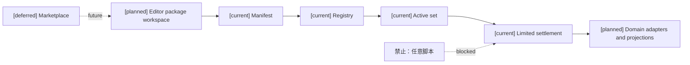
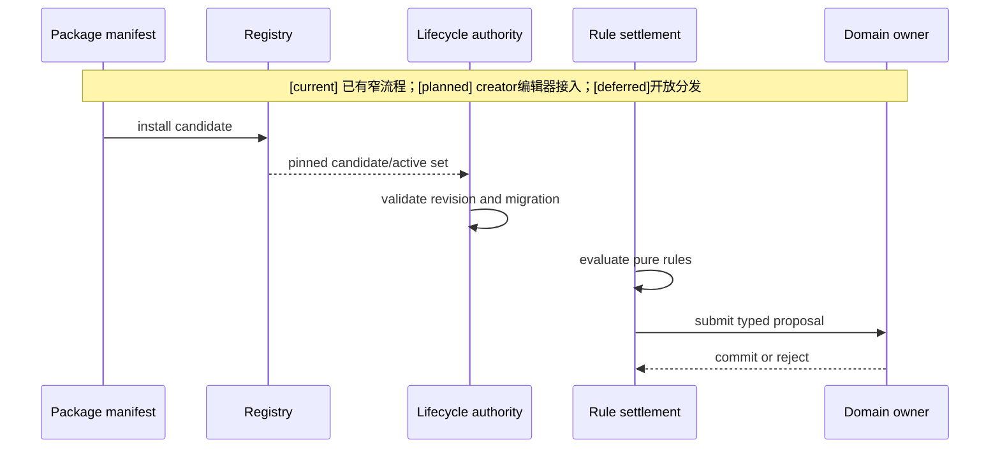
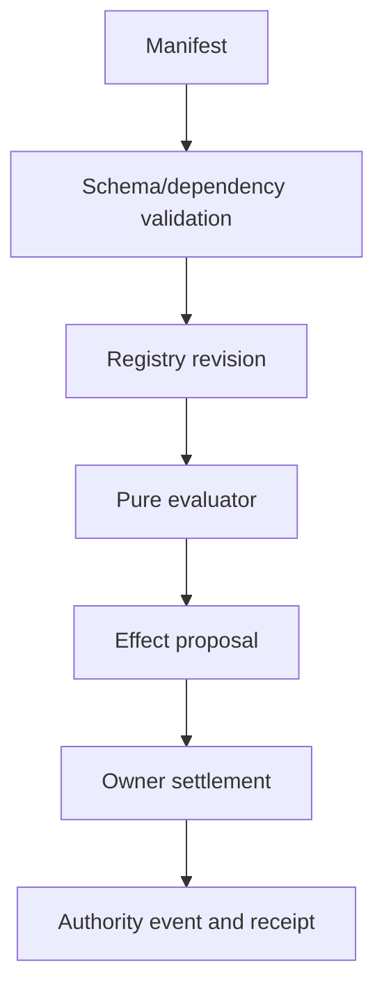

# 01 玩法包现有实现审计与差距矩阵

## 已实现基础 `[current]`

### `patch_runtime.py`

- `GameplayPatchManifest` 支持版本、revision、content digest、依赖、事件 schema、规则、能力请求、状态组迁移和平台扩展。
- `PlatformExtension` 支持 package identity、typed package definitions、outcome declarations、capability binding requests、dependency/conflict refs、replay reader refs 和 verification profile refs。
- Pydantic `extra=forbid`、frozen 模型、字段级校验、canonical digest、依赖/循环/schema collision 和 trusted author 校验已经存在；不能把 frozen 声明误认为全部嵌套容器深度不可变或所有值绝无类型转换。
- platform typed content 会递归拒绝指定 authority-shaped payload key，包括 `script`、`executable`、`arbitrary_code`。这不是对全部 JSON 字符串的代码分析，安全依靠封闭 schema/descriptor/handler 准入，不能因此开放任意执行面。
- `CapabilityRegistry.register` 检查 deterministic、side-effect-free、无网络/文件访问声明；冻结评估输入和 proposal 输出合同可复用。这不等于对任意第三方 Python handler 提供进程沙盒。
- manifest v1/v2/v3 与 platform schema 配对、package/patch identity、source revision 和 declaration digest 有明确校验，后续编辑器导出应保留这些合同。

### registry 和 lifecycle `[current]`

- `GameplayPatchRegistry` 已有 candidate install、install-many、active set compose、activate、replace、snapshot save/load/restore。
- `GameplayPatchLifecycleAuthorityService` 已有 candidate install、enable/disable、upgrade、rollback、幂等、revision 校验、事件追加、receipt、projection refresh hint 和 owner-bound state migration。
- lifecycle projector 只从已提交事件重建控制面状态。

已提交生命周期事件先于 registry 切换。不能使用低层 `registry.activate()` 当作面向创作者的正式写入口；固定生产启动装配与在线编辑器应用是不同路径。当前资源 bounds migration 使用已注册 migrator、schema/code digest，并有 full/checkpoint-tail shadow replay 检查；不能推导出装备/学习/时间线的通用迁移已实现。

### settlement `[current]`

- `GameplayPatchRuleSettlementService` 的流程是 pinned registry/active set → pure rule evaluation → effect proposal → owner validation/commit。
- 当前明确只接纳有限 `resource.consume` effect；它不是完整 Combat settlement。

### production package `[current]`

- `production_package_registry.py` 只加载固定批准 manifest，trusted author 为 `author:repo`，安装后激活一个精确 active patch set。
- 这是封闭的生产内容集合，不是开放创作者生态，也不是完整 package editor。

当前固定批准集合包括 production-output-certification、production-output-custody 和 population-materialization 内容。仓库其他 manifests、closed families 和测试证明更多声明/绑定路径存在，不代表都已进入此 production registry。`scripted_mystery` 是封闭内容家族名称，不表示允许任意脚本。

## 代码与证据索引

| 核对入口 | 可审查内容 |
|---|---|
| [patch_runtime.py](../../../backend/app/gameplay/patch_runtime.py) | manifest、platform extension、registry、descriptor binding、evaluator |
| [patch_lifecycle_authority.py](../../../backend/app/gameplay/patch_lifecycle_authority.py) | lifecycle command、event、cutover、迁移和回放 |
| [patch_rule_settlement.py](../../../backend/app/gameplay/patch_rule_settlement.py) | 仅 `resource.consume` 的规则结算 adapter |
| [production_package_registry.py](../../../backend/app/gameplay/production_package_registry.py) | 固定批准生产包集合 |
| [test_gameplay_patch_runtime.py](../../../backend/tests/test_gameplay_patch_runtime.py) | registry/evaluator 验证入口 |
| [test_gameplay_patch_lifecycle_authority.py](../../../backend/tests/test_gameplay_patch_lifecycle_authority.py) | lifecycle/迁移/回放验证入口 |
| [test_gameplay_patch_rule_settlement.py](../../../backend/tests/test_gameplay_patch_rule_settlement.py) | stale revision、不足资源、非法效果验证入口 |
| [test_production_package_registry_runtime.py](../../../backend/tests/test_production_package_registry_runtime.py) | 生产 registry 验证入口 |

本轮是静态代码审计，以上测试是已有验证入口，未在本轮运行；不能据此声称完整创作者流程或新包运行时已通过验收。

## 先前玩法包设计与当前实现的对应关系

| 先前材料/实现 | 正确归类 | `[current]` / `[planned]` 结论 |
|---|---|---|
| `11-通用装备系统设计.md` | `mechanic` 领域机制包的设计合同；定义/实例/assignment、栏位、触发器、目标选择、效果和配方接口 | `[planned]`；复用已有资源、状态、标签和 authority 基础，不表示通用装备 runtime 已完整实现 |
| `12-自走棋装备玩法包设计.md` | 自走棋 `game_mode` 的装备机制模块，不是完整自走棋套件 | `[planned]`；棋盘、羁绊、回合、随机池和二合一配方仍是包目标 |
| `编辑器与能力权限治理/05-装备系统编辑器接入设计.md` | `mechanic`/`game_mode` 内容在编辑器中的控制面接入 | `[planned]`；编辑器可编辑 definition/binding/policy，不直接改实例事实 |
| `backend/app/gameplay/patch_runtime.py` | Foundation 的 package/patch 承载、typed definitions、binding admission、纯规则 evaluator | `[current]`；不是完整玩法包 authoring 或完整 Combat runtime |
| `patch_lifecycle_authority.py` | package candidate/active-set 生命周期和 state-group migration 的 authority 基础 | `[current]`；编辑器应用 API 和各领域迁移仍需补齐 |
| `patch_rule_settlement.py` | Foundation 到 Resource owner 的窄领域结算 adapter | `[current]`；当前明确只接纳 `resource.consume`，不是完整战斗效果结算 |
| `production_package_registry.py` | 封闭的 production package/signed-by-policy 装配入口 | `[current]`；固定批准 manifest 集合，不是开放包市场或完整 suite launcher |
| closed-generic manifests/families | 已批准领域家族的内容声明与 descriptor binding | `[current]`（按各 family 的现有测试范围）；不自动代表 Combat/自走棋/创作者编辑器完成 |

因此，当前仓库已有的是“受治理的 Foundation 包承载和若干封闭领域包”，不是“已经实现完整自走棋”或“已经实现通用创作者玩法包平台”。

## 完整玩法与模块的判断

完整自走棋至少需要 `game_mode` 核心循环、棋盘/阵容 adapter、装备机制、羁绊机制、回合/阶段事件、奖励/商店/经济机制、单位/技能内容、场景配置和 verification profile。当前 `12` 只设计其中的装备玩法包模块；当前 production registry 也没有把它们作为完整 suite 激活。

## 差距矩阵

| 能力 | `[current]` | `[planned]` | `[deferred]` |
|---|---|---|---|
| 包身份和摘要 | manifest、revision、digest、可信作者白名单 | package catalog 和发布工作区 | 密码学签名/开放市场身份体系 |
| 包依赖和组合 | patch dependency、active set | foundation/domain/world/mode 组合器 | 任意动态组合 |
| 编辑器发现 | 固定生产集合 | discover API、适用范围和能力预览 | 自动推荐外部包 |
| 编辑器调用 | lifecycle authority 基础 | configure/preview/apply API | 批量协作编排 |
| 规则执行 | 纯规则 evaluator | 更多已注册 capability adapter | 大规模性能优化 |
| 领域结算 | 本 rule adapter 为 resource.consume；其他已有领域路径独立存在 | Combat/Equipment/Character/Status 接入 | 大规模跨域工作流优化 |
| 迁移和回滚 | 部分 state-group migration | 通用 migration policy 和 activation boundary | 复杂存档升级工具 |
| 投影和缓存 | event/revision 基础 | Stable/Hot/Delta package invalidation | 跨版本自动推理 |
| 包类型 catalog | 无统一类型字段；manifest/extension 有 package identity 和 typed definitions | `primary_kind`、`provided_modules`、`application_scopes`、`entrypoints` | 开放市场推荐 |
| 完整度判定 | 固定 production 集合可装配 | 依赖闭包、入口和 verification 推导 `completeness` | 自动跨世界补齐依赖 |
| 玩法套件启动 | 没有通用 suite launcher | game_mode + dependencies + defaults + verification 的应用合同 | 任意模式自动生成 |

## 架构图

## 主流程时序图

## 数据流图

`[current]` 已有受限规则提案/资源结算路径；`[planned]` 编辑器和更多领域 adapter 扩展；`[deferred]` 开放分发。

## 本批规格与计划回写（2026-10-10）

执行范围补记（D15/RW-16）：用户要求第7项编辑器暂不处理，其对应共用计划05当前整体暂不启动；本文件映射的玩法包任务也不在本轮待决项1–6中单独启动。设计与任务依赖保留至用户恢复，不作为当前角色/通用领域/B/C完成条件，不影响既有注册合同的合法消费。自走棋仍按D14关闭并延期。见 [执行决策D15](../审查/03-实施待决收敛与验证闸门.md)与 [回写RW-16](../回写/README.md)。

本批将本文的实现审计作为当前边界，不把固定 production manifest/patch lifecycle 扩写为开放 catalog、generic editor 或完整 package runtime。规格13先做只读 projection 和 owner admission；缺字段、入口或验证证据时保持 not-ready，不修改事实 manifest。

映射：规格13；计划05 Task1。分类 projection、scope application 和完整性 resolver 仍待准入。

状态：`architecture analysis; current audit and planned gaps`
