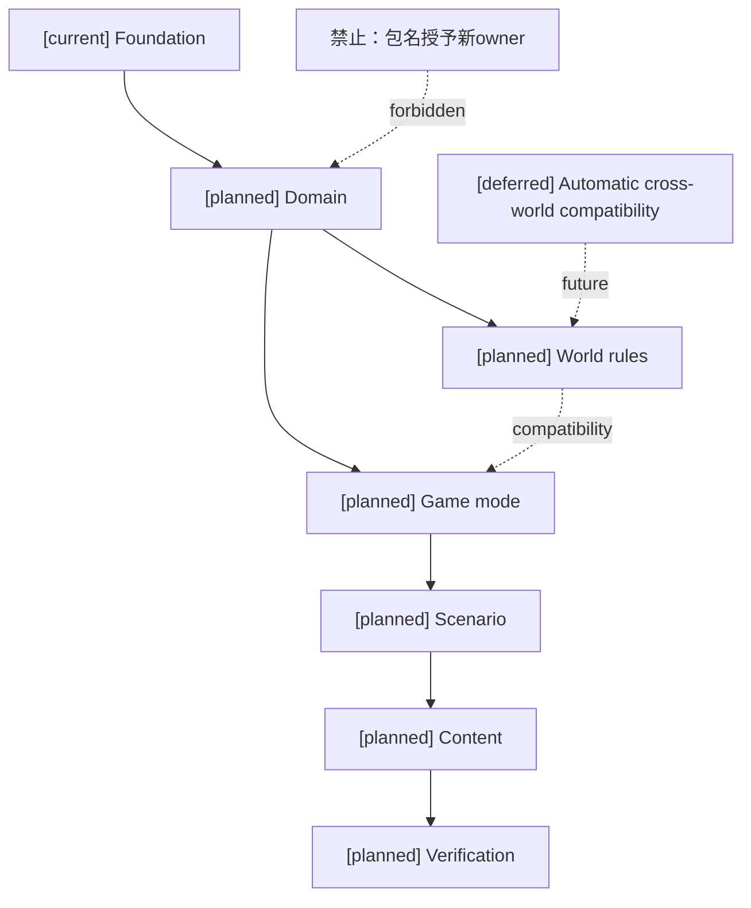
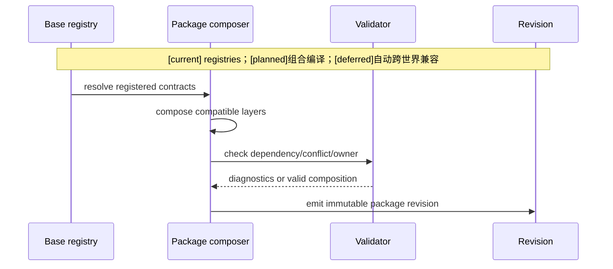
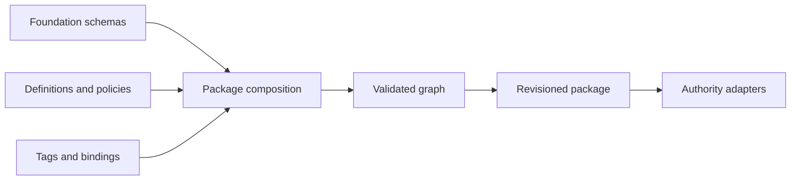

# 02 玩法包分层、组合与通用底座复用设计

状态：`architecture analysis; planned and non-authorizing`

## 分层

| 层 | 作用 | 例子 |
|---|---|---|
| Foundation | schema、事件、权限、effect、selector、时间和 revision 合同 | Gameplay Foundation |
| Domain | 领域语义和 owner contract | Combat、Equipment、Character、Status |
| World rules | 世界观能力白名单和政策 | physical、mana、qi、mental、soul gate |
| Game mode | 玩法模式规则 | 自走棋、FPS、战棋、卡牌 |
| Scenario | 区域、关卡、Boss、遭遇 | 棋盘区域、秘境、竞技场 |
| Content | 具体技能、装备、药品、角色、标签和数值 | 火球、铁剑、日月同辉 |
| Verification | fixture、replay pin、期望 receipt | package verification profile |

这些是逻辑层，不强制拆成七个物理包；部署时可以签名组合，但依赖和 owner 必须可追踪。

其中签名分发为 `[deferred]`，当前依赖内容 digest 和 trusted author admission。Foundation/Domain 是能力提供和准入面，World/Mode/Scenario/Content 是消费和配置面；层次不是统一写权限的继承链。

## 创作者包类型与架构层次的映射

架构层次允许组合，包类型负责编辑器体验和验证入口：

| 创作者包类型 | 通常包含的架构层 | 可否独立运行 |
|---|---|---|
| `setting` | Content + Semantic/Presentation references | 通常不可；作为设定依赖被引用 |
| `world_rules` | World rules + Domain policies | 需要 Foundation 和领域 owner |
| `mechanic` | Domain + Content + Adapter bindings | 需要宿主 world/mode |
| `game_mode` | Game mode + Domain + Time/Space adapters | 可以创建模式，但仍需内容和世界依赖 |
| `scenario` | Scenario + Content + local policies | 依赖 world/mode |
| `content` | Content + definitions | 不独立运行 |
| `suite` | 多层组合 + defaults + entrypoint + verification | 依赖闭包齐备时可创建玩法实例 |

因此“世界观包”不应和“完整玩法”使用同一个字段表达。`primary_kind=world_rules` 可以被 `primary_kind=game_mode` 依赖；`suite` 是交付组合，不是另一个事实 owner。

## 底座复用原则

玩法包优先复用：resource body、ability runtime、action graph/window、semantic effects、status lifecycle、effective stats、tag registry、event/revision、time contract、physics evidence 和 owner settlement。

前述资源/能力/动作/状态等已有基础为 `[current]`；统一 time contract、通用 physics evidence 和完整战斗包接入仍为 `[planned]`。复用目标不等于这些扩展已经完成。

玩法包只增加：定义、参数、标签绑定、事件绑定、规则政策、目标选择器、领域 adapter 和验证资料。若需要新事实类型或新 owner，必须单独准入，不能由包名取得写入权。

## 组合规则

```text
Foundation
  -> Domain
  -> World rules
  -> Game mode
  -> Scenario
  -> Content
  -> Verification
```

下层不能启用上层未注册能力；同一事实不能由两个 package 同时声明 owner；冲突需要显式 policy 或拒绝组合。

World 和 Mode 并非在所有项目中必须线性继承：一个魔法世界可以同时运行战棋和实时区域，Mode 必须明确支持哪个 World profile，Scenario 选择合法组合。编译为有向无环依赖图，最终 resolve 为一套固定 pins；不能以安装先后决定政策优先级。

## 包承载对象 `[planned]`

优先沿用当前 manifest 和 platform extension，通过已有字段或获准 schema 版本承载新增引用；以下是分析视图，不是假定当前 API。

```text
PackageRevisionView {
  package_identity, patch_revision_id, content_digest
  dependency_pins, definition_refs, declaration_refs
  binding_requests, policy_refs, adapter_contract_refs
  verification_refs, replay_refs, migration_refs
}

PackageApplication {
  application_id, scope_ref, package_revision_pins
  primary_kind, completeness, provided_modules, application_scopes
  entrypoints, dependency_closure_digest
  parameter_revision, profile_revision, grant_revision
  resolved_composition_digest, activation_policy_ref
}
```

包 revision 描述可复用发布物；application 描述“哪个 scope 以什么获准配置使用它”。同一包可以应用到多个场景，但配置、owner scope、运行时计数和冷却必须隔离。编辑器 catalog 是 registry/声明的只读投影，不是第二事实库。

## 调整和补充的接入级别

1. 只改已注册参数：走 schema/config revision，不新增 handler。
2. 增加已接纳家族内的内容：走 typed definition 和 descriptor binding。
3. 当前底座缺少新机制：先单独设计/准入底座 adapter 或领域合同，再由包引用；导入包不自动安装新逻辑。

复用已有 ability graph、resource runtime、action graph、semantic effects、status tags 和 effective stats 的数据与事件；包装为编辑器 view 不复制一份学习、资源或属性真值。

## 架构图



## 主流程时序图



## 数据流图

`[planned]` 组合编译消费 `[current]` 注册合同；`[deferred]` 自动跨世界兼容不参与组合决定。



## 本批规格与计划回写（2026-10-10）

执行范围补记（D15/RW-16）：用户要求第7项编辑器暂不处理，其对应共用计划05当前整体暂不启动；本文件映射的玩法包任务也不在本轮待决项1–6中单独启动。设计与任务依赖保留至用户恢复，不作为当前角色/通用领域/B/C完成条件，不影响既有注册合同的合法消费。自走棋仍按D14关闭并延期。见 [执行决策D15](../审查/03-实施待决收敛与验证闸门.md)与 [回写RW-16](../回写/README.md)。

本批保留七个逻辑层、creator `primary_kind`、completeness/readiness 和依赖组合语义，但不把七层物理化，也不让层次继承写权限。规格13将其作为解析投影，依赖、owner、verification 和 scope 必须在现有 registry/lifecycle 边界内求值；作者声明不能直接成为 active/ready。

映射：规格13 §3–5；计划05 Task1–2。creator catalog、resolver 和 application owner 仍为 planned/blocked。
