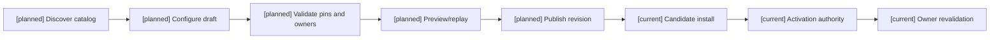
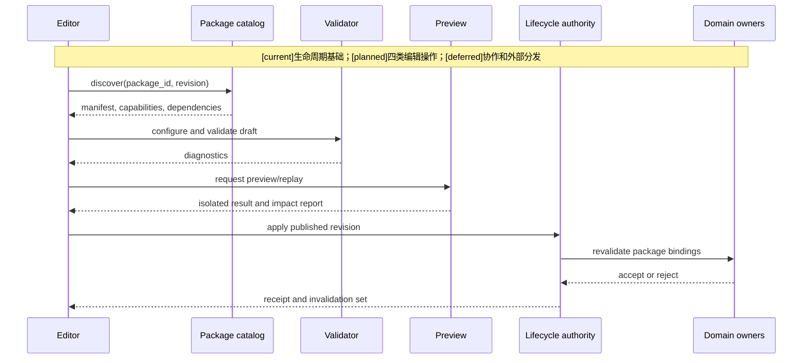
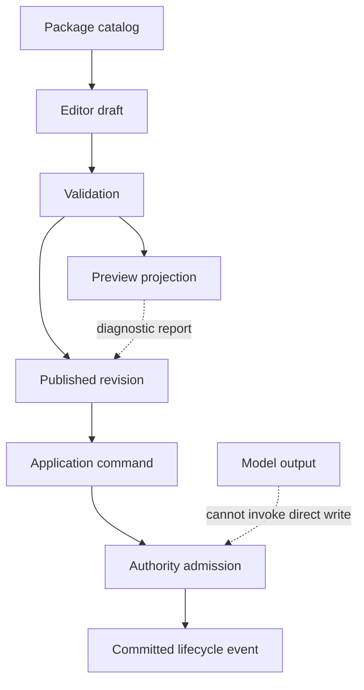

# 03 编辑器中的玩法包发现、调用与应用设计

状态：`architecture analysis; planned and non-authorizing`

## 四种编辑器操作

| 操作 | 语义 | 结果 |
|---|---|---|
| `discover` | 查看包身份、版本、依赖、能力和适用范围 | 只读 catalog |
| `configure` | 为项目、世界、模式、区域配置包参数 | draft，不写事实 |
| `preview` | 静态、投影、回放或沙盒运行 | 隔离 projection，不写事实 |
| `apply` | 安装 candidate 或请求 active revision | authority 重新校验后才可能生效 |

`apply` 不是直接调用伤害、扣蓝、装备或状态写入命令，而是提交带 package revision、scope、activation boundary、migration policy、expected registry revision 和 idempotency key 的 lifecycle command。

## 编辑器侧对象

```text
PackageCatalogEntry
PackageDraft
PackageInvocation
PackagePreviewRequest
PackageApplicationRequest
PackageImpactReport
```

编辑器可以展示包提供的能力和参数 schema，但不能把隐藏运行时事实当作可编辑字段。

## 编辑器中的类型和完整度显示 `[planned]`

包 catalog 至少显示：

```text
primary_kind       setting / world_rules / mechanic / game_mode / scenario / content / verification / suite
provided_modules   实际提供的模块和 descriptor
dependencies       必须存在的 package/patch/capability/schema revision
application_scopes 可应用到 project/world/mode/region/scenario/actor 等范围
entrypoints        discover/configure/preview/apply/create_instance 等获准入口
completeness       content_module / composable_mechanic / playable_mode / complete_suite
readiness          missing_dependencies / unsupported_capabilities / ready / active
```

`completeness` 和 `readiness` 由编辑器根据依赖闭包、底座能力、入口和 verification profile 计算；作者填写的声明只能作为候选元数据。`complete_suite` 仍需在目标 world/mode scope 下重新验证，不代表任何角色全能或所有内容自动 materialize。

## 设定包与完整玩法包的差异

设定包通常只有导入/引用入口，不生成玩法实例；世界规则包可改变资源/效果/生命模型的允许集合，但不直接生成角色状态；机制包提供可复用局部机制；玩法模式包提供回合/阶段/胜负/奖励和空间循环；玩法套件把这些依赖组合，并提供创建玩法实例的入口。

“自走棋装备包”是 `mechanic` 模块；“完整自走棋”应是 `suite`，至少组合自走棋 `game_mode`、装备机制、羁绊机制、棋盘/阵容 adapter、阶段事件、经济/奖励、单位/技能 content 和 verification。编辑器要显示缺少的模块，而不是把一个装备包伪装成完整模式。

## 编辑器使用流程与显示内容 `[planned]`

创作者选择项目和目标 scope，浏览获准 catalog，查看包功能、底座要求、依赖、冲突、参数范围、权限需求、可编辑字段和验证状态；加入项目后修改的是应用草稿，不改原包不可变 revision。

参数变化可以生成引用原包的 application configuration revision；定义变化生成派生包 revision，保留来源/许可证引用和差异。具体许可体系为 `[deferred]`。编辑器显示“发布”“安装”“请求应用”“已激活”等不同状态，不能把一键应用显示为已发生世界结果。

四条轴持续独立：capability 是否支持/启用、角色 eligibility、authority grant、实际 settlement。编辑器有管理包的权限，不意味着当前角色已学会包中技能；司命催化和角色世界内改变仍是单独的 owner-bound intent/catalyst。

## 应用请求合同 `[planned]`

```text
PackageApplicationRequest {
  command_id, application_id, target_scope_ref
  requested_revision_pins, configuration_revision
  activation_boundary_ref, migration_policy_ref
  expected_registry_revision, expected_active_set_revision
  authority_grant_ref, idempotency_key, payload_digest
}
```

以上不是当前 `PatchActiveSetCommand` 原样字段；后续正式设计需映射现有 lifecycle command，增字段需准入。请求不带任意 owner/stream 坐标；authority 从获准 descriptor 推导实际路由。

## 失败与取消

| 条件 | 编辑器结果 |
|---|---|
| 依赖缺失或底座不支持 | 显示能力缺口，拒绝应用，不静默降级 |
| policy/profile/grant 越界 | 显示字段和规则来源，保留可修正 draft |
| preview 与目标 scope 权限不匹配 | 拒绝隐私读取，不把创作者权限泄漏给角色 |
| 提交时 revision 已变化 | 返回 stale conflict，重新校验，不覆盖当前 active set |
| 请求重复 | 显示原 receipt，不重复消耗或注册 |
| 激活边界尚未到达 | 显示 scheduled/pending，不显示 active |
| 激活前取消 | 取消待执行请求，不撤销已提交事实 |

正式应用需管理员/创作者权限和迁移合同；当前固定生产 registry 不自动接受外部包。高频运行时只消费已激活内容，编辑器不进入每次攻击/回复/tick 的关键路径。

## 包应用流程



## 主流程时序图



`create_instance`（仅对通过完整度和依赖验证的 `playable_mode`/`complete_suite` 开放）与 `apply` 分开：前者请求创建玩法实例，后者请求把包 revision 应用到已有 scope；两者都由 authority admission 决定，不是编辑器直接创建世界事实。

## 数据流图

`[planned]` 编辑器应用闭环复用 `[current]` lifecycle/event 基础；`[deferred]` 协作和外部包分发不参与事实提交。


