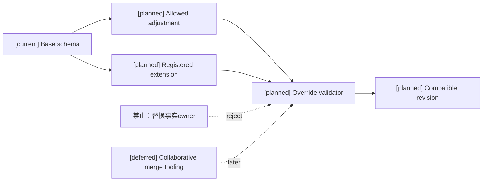
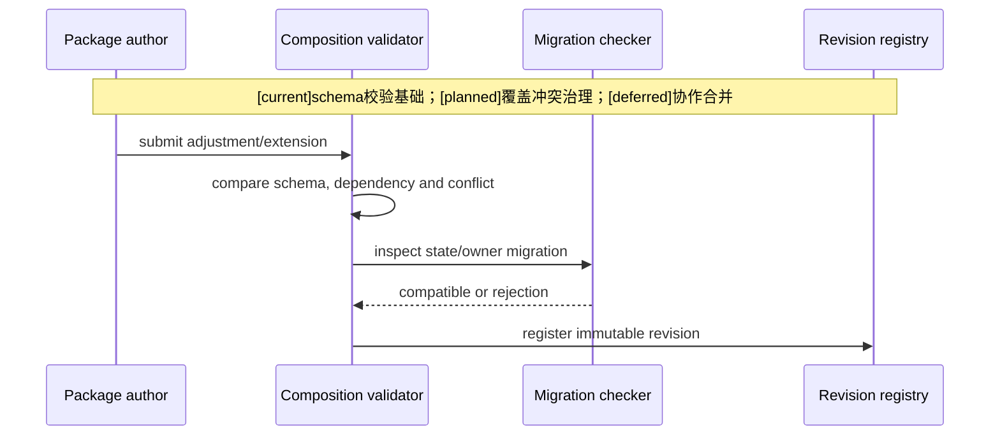
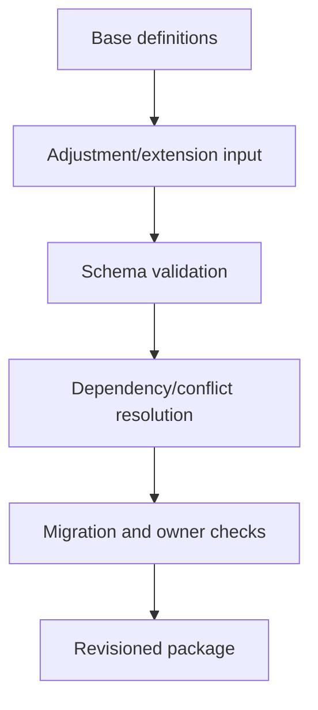

# 04 玩法包调整、补充、覆盖与冲突治理设计

状态：`architecture analysis; planned and non-authorizing`

## 调整、补充和禁止覆盖

### 调整

对已注册能力做 schema 允许的政策配置，例如资源上限、回复策略、装备栏容量、控制时长上限、伤害通道开关和时间结算窗口。

### 补充

使用已接纳扩展点增加技能、装备、药品、状态、效果绑定、目标选择器、配方、标签、事件和验证资料。

### 禁止覆盖

包不能替换 authority event store、resource ledger、status lifecycle owner、inventory owner、current timeline、tag registry 或 character learning truth。

## 冲突类型

| 冲突 | 处理 |
|---|---|
| 同一 `definition_ref` 不同 digest | 拒绝组合 |
| 同一能力政策重复设置 | 需要显式优先级和兼容范围 |
| 两包要求相同领域 owner | 不必冲突；多个内容可消费同一 owner，检查具体绑定/目标/政策是否冲突 |
| 包要求替换事实 owner 或声明新 owner | 拒绝；owner 准入独立于内容包导入 |
| 依赖版本不满足 | candidate 不可安装 |
| 标签绑定与能力 profile 不一致 | 绑定无效或等待迁移 |
| 状态/资源 schema 改变 | 必须声明 migration policy |

## 安全边界

继承和 override 只能覆盖 schema 声明的字段；标签名称不能自动创建能力；包内容不能带 `owner`、`writer`、`event store`、`script` 或 `arbitrary_code` 等 authority-shaped payload。

这里的 owner 限制指自由 typed content 不能注入写入坐标；当前已获准的专用合同可能包含受固定校验的 owner reference。禁止把现有专用字段误推广为所有包可自选 owner，也不以禁词列表替代 typed schema 和 descriptor admission。

## 覆盖解析 `[planned]`

```text
注册底座参数范围
  -> world profile
  -> compatible mode profile
  -> scenario override
  -> per-application configuration
```

只有 schema 声明的 overrideable 字段参与合并；输出保留最终值、来源 revision、被覆盖值和冲突诊断。数值采用 replace/add/multiply/min/max 哪种运算要逐字段声明，不能由模型或导入顺序决定。

例如 world 允许控制上限 5 秒，mode 将该上限收紧为 3 秒，scenario 可以选择 2 秒；能否再次放宽到 5 秒由继承合同决定。不能覆盖成 8 秒。恐惧是否允许 hard control 是独立能力政策，不由持续秒数或标签名推导。

## 去重、触发链与循环

- 同一 effect/trigger binding 经装备、标签、职业多个入口引用时，按规范 binding identity + source instance + causal event 去重；合法多个来源是否叠加由 stacking policy 决定。
- `resource_spent -> mana_restore -> resource_changed` 不能无限触发。配置必须声明 causal chain policy、递归限制和允许阶段；违反循环预算拒绝并返回诊断，不静默截断成不可回放结果。
- “吸血再触发伤害”“羁绊变化再赋予羁绊”需显式抑制再入或分阶段评估；标签不执行触发器。

## 标签和元标签

包可以声明注册标签定义/引用/selector/effect binding；挂载资格、可见性、编辑策略、合并和冲突由 08 元标签治理合同规定。生命周期、语义类别、effect binding、activation 四轴独立。元标签不能扩大 grant，也不能给包新 owner 或绕过角色能力/隐私上限。

## 架构图



## 主流程时序图



## 数据流图

`[planned]` 覆盖/冲突解析复用 `[current]` schema基础；`[deferred]` 协作合并工具不改变准入规则。


