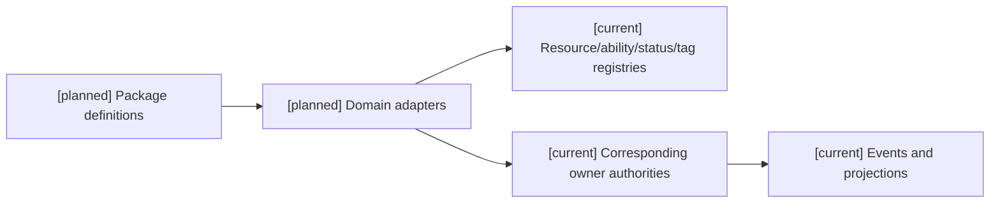
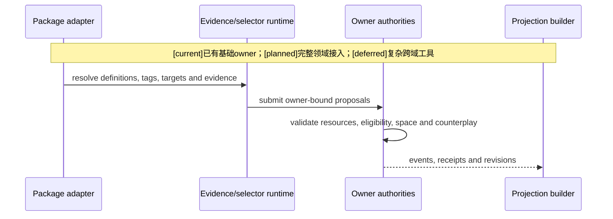
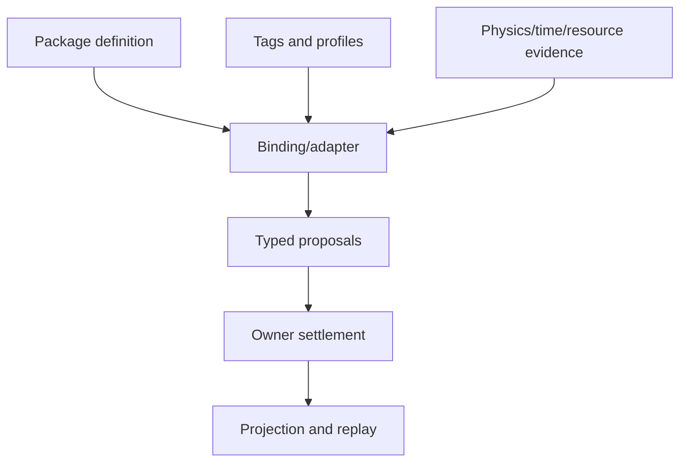

# 05 玩法包与各领域接入矩阵

状态：`architecture analysis; planned and non-authorizing`

| 领域 | 包提供 | 运行时 owner | 主要投影 |
|---|---|---|---|
| Combat | 技能、动作、目标、伤害/治疗/控制参数 | Combat、Resource、Status、Target owners | CombatStable/Hot/Delta |
| Character | 能力图谱、学习方法、复杂度上限 | Ability/Character owner | affordance、学习证据 |
| Resource | 资源定义、上限、回复和转换政策 | Resource/Body owner | 当前值、可用量 |
| Status | 状态定义、层数、持续时间和标签 | Status/Effect owner | status lifecycle |
| Equipment | 定义、栏位、触发器、配方、变体 | Inventory/Equipment owner | loadout、耐久、冷却 |
| Tag | 标签引用、选择器、binding | 08规定的registry和相应assignment事实owner | SemanticSnapshot |
| Time | TemporalProfile、映射和 settlement window | 16拟定的时间服务及各领域提交owner | current time、scheduled work |
| Environment | 环境场、范围、持续和衰减政策 | Environment owner | field、exposure、spatial delta |

领域包提供定义和规则输入，不自动取得事实写入权。跨 owner 变化必须声明 owner vector、幂等键、提交顺序和部分失败策略。

## 接入合同 `[planned]`

```text
DomainBindingView {
  definition_schema_ref, registered_descriptor_ref
  accepted_read_requirements, proposal_effect_types
  owner_contract_ref, event_schema_pins, visibility_policy_ref
  prerequisite_refs, migration_policy_ref, replay_reader_ref
  stable_dependencies, hot_dependencies, invalidation_contract_ref
}
```

编辑器可展示这些只读准入合同；作者提交的是 binding request，实际 owner/descriptor binding 由 registry admission 推导，不能自填 owner vector 绕过准入。

## 角色技能与学习

包可以提供 `Method`、`InnerMethod`、`Technique`、`ActionPattern`、`TechniqueVariant` 及学习方法/证据 schema。它不保存角色当前熟练度、模仿结果或技能掌握事实。观察、模仿、指导、练习、实战、复盘、研究、师承和迁移分别进入学习证据；升级、分支、突变、融合和进化按 14 的合同接受裁定，不能全部折算为经验值。

包对认知包络、候选上限、动作稳定性和学习难度只提供获准参数。更高模型 token/思考预算不能越过能力上限；大五人格影响行为偏好，不直接授予攻击、免疫或新技能。

## 资源、状态、外物和装备

- `resource.mana` 没有注册/启用时，角色无隐形蓝条；已激活资源是否 materialize 仍需 Resource owner 事件。
- 回蓝可以来自技能、职业标签 binding、装备、内服药效或阵法，统一提交 Resource proposal；来源归属、计数、叠加、停止和去重必须可回放。
- 装备是外物，definition/instance/assignment/trigger state 分开；耐久、数量、次数、充能、冷却分开。药品是一次性内服物，消耗与持续药效分别归 Inventory 和 Status/Resource owner。
- 状态标签不能替代伤势、增减益、封印、诅咒的生命周期。职业和身份是标签，不是自动生效的万能能力。

## 空间和物理协作

通用底座和战斗包与物理引擎协作。物理适配器提供命中、碰撞、轨迹、视线和接触证据；包声明范围/距离/形状/高度/目标数量/投射物政策；领域 authority 解释并结算。前摇、后摇、蓄力、打断、tick、持续时间和冷却消费 16 的时间合同，不另建包时钟。环境输出由环境场/暴露/伤害提案实现，包不能直接改 Godot 节点后宣称成功。

## 战斗示例

`日月同辉` 包定义可以同时声明物理、魔法、环境和精神效果；实际伤害、暴露、范围、资源消耗、抗性、打断和状态生命周期仍由相应 owner 结算。

## 架构图



## 主流程时序图



## 数据流图

`[planned]` 完整领域绑定路径复用 `[current]` 有限runtime/owner基础；`[deferred]` 复杂跨域工具不能隐式扩大owner vector。



## 本批规格与计划回写（2026-10-10）

执行范围补记（D15/RW-16）：用户要求第7项编辑器暂不处理，其对应共用计划05当前整体暂不启动；本文件映射的玩法包任务也不在本轮待决项1–6中单独启动。设计与任务依赖保留至用户恢复，不作为当前角色/通用领域/B/C完成条件，不影响既有注册合同的合法消费。自走棋仍按D14关闭并延期。见 [执行决策D15](../审查/03-实施待决收敛与验证闸门.md)与 [回写RW-16](../回写/README.md)。

本批把本文的领域接入矩阵作为 owner/admission 清单，而不是已存在的通用 package router。规格13消费各领域稳定合同；缺失 owner 时 package capability 保持 not-ready，不能通过 manifest、编辑器或角色模型补造事实。

映射：规格09–14；计划04 Task3–5、计划05 Task1–2。跨 owner receipt、迁移和 scope application 仍待准入。

矩阵整体是 `[planned]` 接入目标：已有 Resource/Ability/Status/Tag 基础不代表完整装备、环境场、目标/死亡或统一时间 owner 已获准。本目录不创建新的 Combat 总写入器，也不新增通用 Tag/Time authority 服务。
