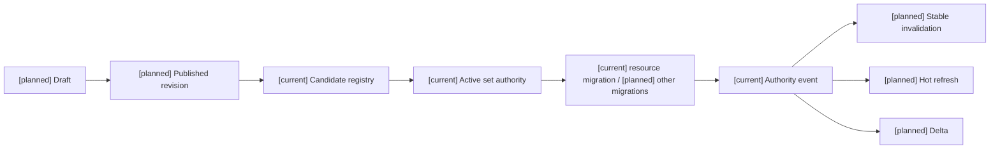
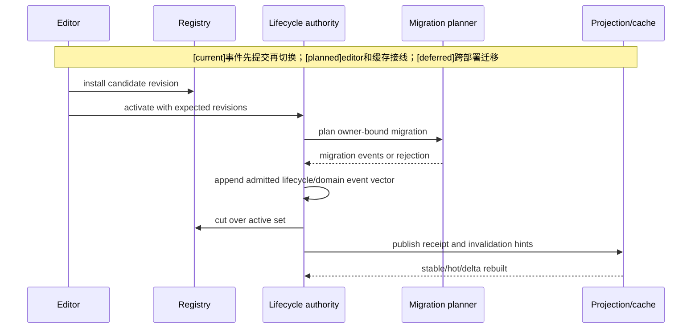
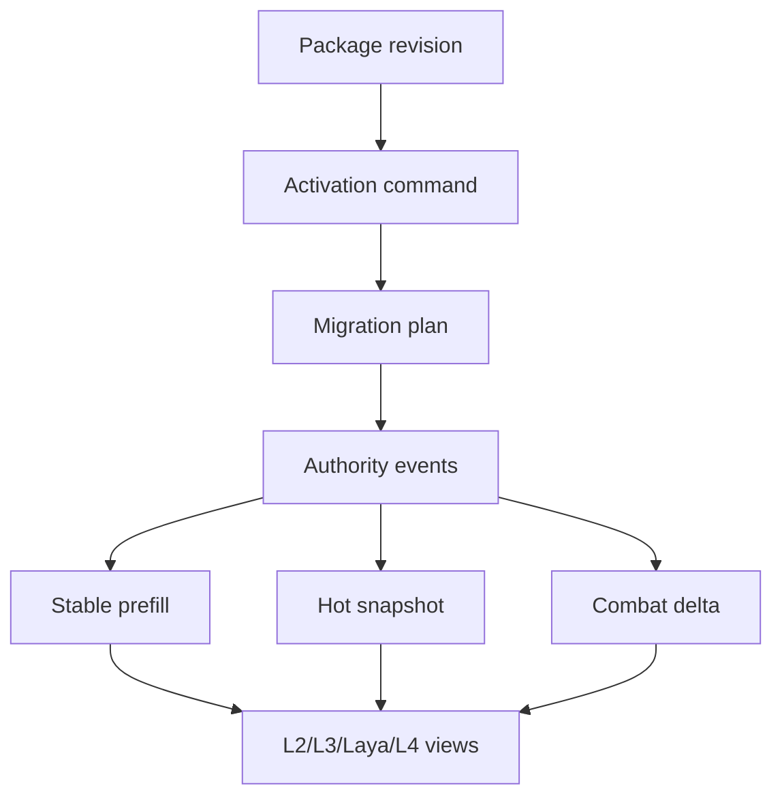

# 06 玩法包发布、激活、迁移与缓存同步设计

状态：`architecture analysis; current lifecycle with planned editor integration`

## 生命周期

```text
draft -> validate -> preview -> publish immutable revision
      -> candidate install -> activation boundary
      -> owner revalidation -> active patch set
      -> projection refresh and cache invalidation
```

`patch_runtime` 和 `patch_lifecycle_authority` 已经提供 candidate、active set、revision、幂等、事件追加和部分迁移基础 `[current]`。编辑器 draft、preview、impact report、通用 migration policy 和 package-specific cache invalidation 仍是 `[planned]`。

## 迁移原则

- 新包不能静默重解释已经确认的 authority event。
- 资源、状态、装备、技能掌握和时间线必须分别声明迁移策略。
- rollback 只能回到包声明允许的 revision，不能撤销已确认事实。
- activation 需要 scope、旧 revision、新 revision、迁移 digest、幂等键和预期 registry revision。

## 生命周期状态必须分开 `[planned]`

```text
draft / validated / published        内容状态
installed / admitted                 registry状态
pending / scheduled / active         application状态
disabled / superseded                当前应用状态
```

`published` 不等于 `installed`；`installed` 不等于 `active`；新包 `active` 不等于包中所有技能已掌握或所有装备实例已生成。validation 的 revision 改变后旧报告失效。当前 registry install 与 lifecycle event 的职责不能并行建立第二登记系统。

## 激活、在途工作与卸载 `[planned]`

1. 固定目标 registry/active-set revision 和 scope，生成所有参与 owner 的迁移计划。
2. 选择场景进入、回合边界、结算窗口或其他已支持 activation boundary。
3. 在途动作可以继续 pinned old revision、排空后切换、或按明确合同取消；不以新伤害参数重结算旧命中。
4. 对持续状态、定时回复、召唤物、环境场、装备 binding 和 learning evidence 分别选择 grandfather/expire/migrate/block-disable。
5. 先提交获准 lifecycle/domain events，再切换 registry 和可读投影；追加失败时不切换，事件成功但缓存落后时按事件恢复，不补造重复事实。
6. disable 停止后续新调用；不删除历史事件、不把生命/蓝量无声清零、不默认收回已结算技能或道具。卸载受依赖/活跃实例/回放保留合同限制。

当前资源 bounds clamp 属于 `forward_fix_only`，不能倒放数据迁移恢复旧资源值。回到旧内容 revision 是一次新的合法应用，不是撤销全部历史。

## 预览与正式环境隔离

静态和投影预览不提交事件；回放只消费获准 pinned events；沙盒如需模拟提交，应使用隔离的临时 ledger 和 preview 标记，不触达正式 append spine。预览报告保存输入 revision/seed/evidence pins 与差异，不将预测伤害、模拟库存、预测学习结果提升为事实。角色视图仍经 L1/visibility 过滤，编辑器管理员视图不能流入角色上下文。

## 缓存层级

| 层 | 包变化示例 | 处理 |
|---|---|---|
| StablePrefill | 能力、技能定义、资源 schema、装备 binding、世界政策 | 重建/失效 |
| HotSnapshot | 当前包 active set、战斗参与者、目标、状态、冷却 | 按 revision 刷新 |
| CombatDelta | 激活 receipt、效果、资源和状态变化 | 追加 delta |

包配置通常属 Stable 输入；active set 变化需要重建相关 Stable，而不只是 Hot。definition、policy、profile、grant、binding、visibility revision 要分别固定；Hot 只放当前资源、动作阶段、状态、冷却、目标和实例计数。高频 tick 不重建整个 Stable prefix。

撤销 grant、关闭 profile、移除 binding 要失效候选集、待处理请求与角色缓存。旧 cache 不能授予新调用权限，authority 每次结算都检查最新准入。Delta 带 base/next revision 和 causal receipt；丢失或乱序需补拉 Hot，不能由模型猜恢复。L2/L3/Laya/L4 分别消费授权的策略、规划、快循环和执行视图，不获得隐藏事实。

## 架构图



## 主流程时序图



## 数据流图

`[planned]` 编辑器和缓存接入，authority/event使用 `[current]` 主干；`[deferred]` 跨部署迁移不属于此路径。



## 本批规格与计划回写（2026-10-10）

执行范围补记（D15/RW-16）：用户要求第7项编辑器暂不处理，其对应共用计划05当前整体暂不启动；本文件映射的玩法包任务也不在本轮待决项1–6中单独启动。设计与任务依赖保留至用户恢复，不作为当前角色/通用领域/B/C完成条件，不影响既有注册合同的合法消费。自走棋仍按D14关闭并延期。见 [执行决策D15](../审查/03-实施待决收敛与验证闸门.md)与 [回写RW-16](../回写/README.md)。

本批复用现有 candidate/active-set lifecycle、revision、event 和 receipt 主干，但将 draft/preview、通用 migration、scope activation 和 cache invalidation 明确保留为 planned。事件先于 cutover、rollback 产生新 revision、预览正式 append 为零等原文边界不变；缺 control-plane owner 时不声称已实现。

映射：规格13、14；计划05 Task4–5。通用发布控制面和跨 owner 迁移仍为 planned/blocked。

`[deferred]`：复杂跨部署迁移、多人发布冲突合并、长期存档升级工具。本文只细化包应用的生命周期映射；通用发布/激活控制面仍归编辑器目录 03，时间激活边界语义仍归 16。
