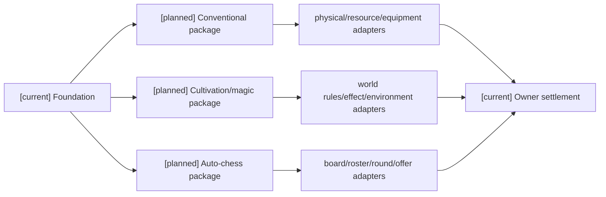
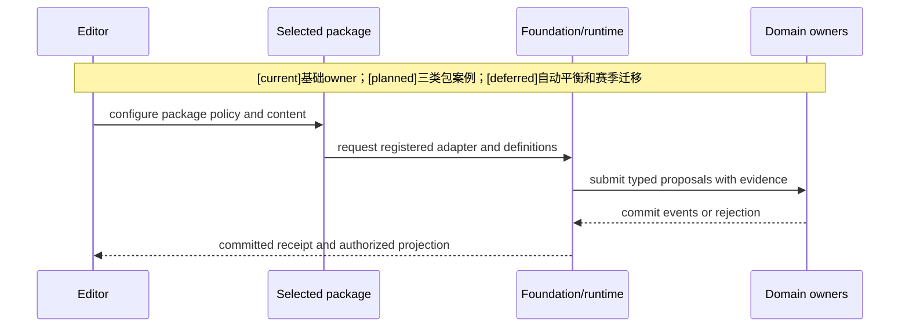
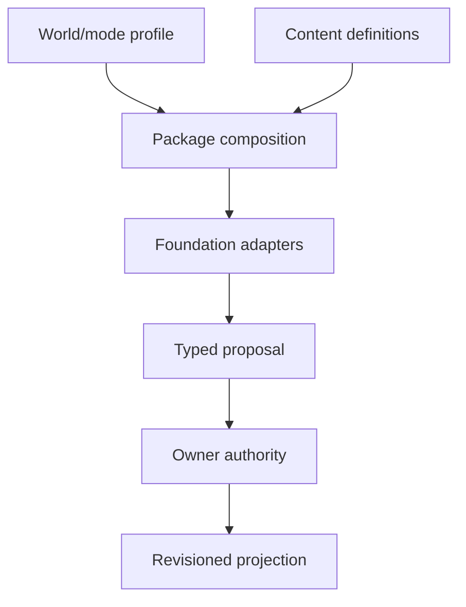

# 07 玩法包示例：常规世界、修仙魔法、自走棋

状态：`architecture analysis; planned examples and non-authorizing`

`[current]` 是下述案例共享的资源/能力/状态/标签/事件基础；三种完整玩法包应用为 `[planned]`，不能把案例数值当成现有游戏默认值。`[deferred]` 是完整商店经济、跨世界平衡和赛季迁移。这些案例不穷尽非常世界观；还可以增加科技异能、怪谈、概念/契约能力等包，只要符合已准入合同。

## 常规世界玩法包

复用物理攻击、体力、生命、护甲、伤势、武器、医疗、掩体、视线和战术协同。包只需启用所需通道，不生成法力、灵魂或元素系统。

```text
Foundation + Combat/Resource/Equipment domain
  + physical_attack
  + stamina
  + injury/medical
  + weapon durability
  = conventional combat package
```

## 修仙/魔法玩法包

在同一底座上补充 mana/qi/spiritual power、法术、功法、护盾、领域、封印、召唤、元素环境和精神/灵魂 gate。生命与精神可以由 world rule 选择 fused、coupled 或 independent；灵魂通常是规则存在，不直接套普通伤害公式。

`日月同辉` 可以声明 physical、spell、environmental、mental 多通道效果，但最终由 Combat、Resource、Status、Environment 和 Target owners 结算。

示例应用草稿可以配置法力上限 120、常驻回复 2/秒、技能法力消耗 30、前摇 0.6 秒、范围半径 6 米、环境场持续 8 秒、每秒 tick。实际角色的上限/回复取 effective stats 和获准 modifier，时空参数消费 TemporalProfile 和 physics evidence。

回蓝可以来自心法、职业标签 binding、法器命中触发、内服药品持续药效或阵法覆盖。五类来源都要有 source/binding revision、叠加政策和停止条件；离开阵法、卸下法器、药效过期时只停止对应来源。

`Technique` 是跨维度组合，不是与 physical/spell 并列的单一伤害抗性。物理伤害取攻击力和物理抗性；法术取法强和获准抗性；环境取暴露、范围和场持续；精神取世界选择的生命/精神模型。若 spiritual 是灵魂规则存在，只有生命或精神达到相对攻击强度的虚弱 gate 才允许触及，且仍需规则许可，不生成灵魂血条。

## 自走棋玩法包

复用通用装备、标签、触发器、效果、目标选择和 authority，增加棋盘、阵容、栏位政策、二合一配方、羁绊统计、回合/阶段事件、确定性 offer 和掉落池。自走棋包关闭时，不应产生棋盘或三件装备限制。

详细装备案例继续由 [12-自走棋装备玩法包设计](../战斗系统与角色技能，状态和资源/12-自走棋装备玩法包设计.md) 拥有；这里解释如何作为 package application 消费它。例如应用草稿选择每单位三件装备、同排空间 adapter、战斗开始 phase event 和固定 revision 的装备池；“法师纹章”挂载标签，`RosterTraitProjection` 统计，`BreakpointRule` 激活效果，不能由装备直接写全队属性。

## 三例对照

| 维度 | 常规世界 | 修仙/魔法 | 自走棋 |
|---|---|---|---|
| 资源 | 生命、体力、弹药 | 生命、精神模型、法力/内力 | 单位生命、法力；经济资源独立 owner |
| 时空 | 米、实时动作和命中证据 | 米、场范围、维持和 tick | 格/同排 adapter、回合阶段 |
| 主动操作 | 普攻、武技、射击、治疗 | 跨维度技法、护盾、净化、环境控制 | 自动选择动作、阶段装备分配 |
| 被动操作 | 护甲、格挡、装备触发 | 心法、领域、反制、回蓝 | 装备触发、羁绊档位 |
| 不启用能力 | 无法力或灵魂时不 materialize | 可分别关闭精神或灵魂 | 无包时无棋盘/羁绊/三件限制 |

攻击/防御/治疗/控制、主动/被动、普通/技能都是正交参数，不由包名称硬编码。吸血、免伤、闪避、护盾、控制韧性、元素克制和连击消费已注册效果/动作/状态合同，不新建三套计算引擎。

## 编辑器走通一个案例

创作者选择“常规战术”包应用到竞技场，预览体力回复、医疗消耗和掩体目标规则。添加“魔法环境”补充包前，编辑器检查法力、环境场和状态能力是否获准：底座缺少场 adapter 就拒绝并报告缺口，不自动生成 owner。预览通过后发布 application revision、安装候选并在场景边界请求应用；收到 accepted receipt 后才显示 active。

## 架构图



## 主流程时序图



上述时序是正式应用后的领域运行路径；preview 走隔离模拟，不能复用正式 owner 提交作为预览。

## 数据流图

`[planned]` 三例共用的运行数据流；owner事件基础为 `[current]`，跨世界自动平衡为 `[deferred]`。


