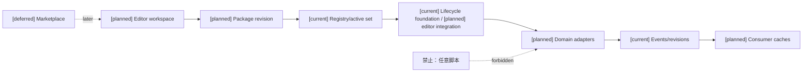
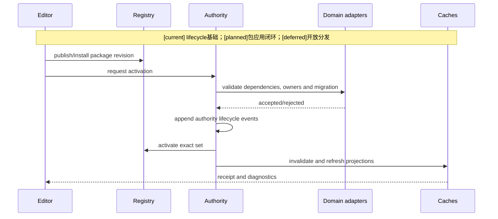
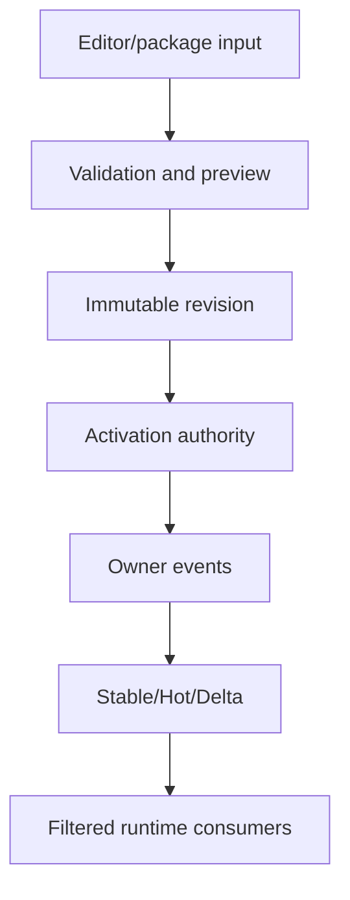

# 08 玩法包目标架构、差距与后续路线

状态：`architecture analysis; planned and non-authorizing`

## 目标架构

玩法包应达到以下状态：创作者可以在编辑器中发现包、配置包、预览包、发布 revision，并请求应用到世界/模式/区域；运行时由 package registry 和 authority lifecycle 管理 candidate/active set；领域 owner 按事实类型重新校验并提交事件；L2/L3/Laya/L4 只读取过滤后的投影。

## 路线

1. 固化 `PackageManifest`、`PackageRevision`、`PackageDependency`、`DomainBinding`、`AdapterBinding` 和 `ActivationPolicy`。
2. 增加 `primary_kind`、`provided_modules`、`application_scopes`、`entrypoints` 和由验证推导的 `completeness/readiness`。
3. 将现有 production package registry 抽象成可查询的 package catalog，但保留 trusted/approved admission。
4. 增加 editor `discover/configure/preview/apply` 合同，先接一个 resource 或 equipment package。
5. 接入 package dependency、owner conflict、migration 和 replay validation。
6. 接入 Combat、Equipment、Character、Status、Time 和 Tag 的 adapter 矩阵。
7. 建立 Stable/Hot/Delta 的 package revision 和 invalidation 测试。
8. 最后再扩展自走棋、修仙/魔法和其他世界观内容包。

## 差距矩阵

| 目标 | 当前 | 下一阶段 | 暂缓 |
|---|---|---|---|
| package manifest/registry | 已有 patch manifest/registry | package catalog 和标准对象名 | 开放市场 |
| editor package invocation | 无完整 editor API | discover/configure/preview/apply | 协作发布编排 |
| package composition | active patch set | 分层组合器和冲突诊断 | 动态自适应组合 |
| domain adapters | 本 rule adapter 为 resource.consume；已有其他领域绑定路径 | 装备/战斗包的首个编辑器应用闭环 | 大规模跨域工具 |
| migration | 资源 bounds 等局部迁移 | 通用迁移合同和回放验证 | 长期存档升级工具 |
| cache sync | revision/event 基础 | Stable/Hot/Delta package invalidation | 跨世界自动平衡 |
| 包类型/完整度 | 无统一 catalog 字段 | kind/modules/scopes/entrypoints/completeness/readiness | 开放市场自动推荐 |
| 完整玩法套件 | `12` 仅为自走棋装备机制设计；无完整 suite launcher | 自走棋等模式的依赖闭包、create_instance 和 verification | 任意模式自动补齐 |

三列分别为 `[current]`、`[planned]`、`[deferred]`。任意脚本、自动生成事实 owner、模型直接写世界和静默历史重写始终禁止，不属于暂缓项。

## 后续正式 spec 拆分建议

| 顺序 | spec 候选 | 设计收敛问题 | 验收输出 |
|---|---|---|---|
| 1 | Package 承载与应用合同 | 沿用 manifest 的字段映射、application scope 和 composition pins | 同一输入编译出相同 digest；坏依赖/冲突拒绝 |
| 2 | Editor 包工作流 | discover/configure/preview/apply 和权限分离 | 预览无正式写；应用只走 lifecycle authority |
| 3 | 首个领域包应用纵切 | 选择已有获准家族，确定读集/效果/owner vector | 真实 intent→owner 事件→receipt→投影闭环 |
| 4 | 激活迁移与缓存 | in-flight/持续状态/disable/rollback/visibility | stale 拒绝、重复幂等、迁移可回放、撤权失效 |
| 5 | 装备/Combat 包扩展 | 通用 trigger、selector、物理/时序证据与学习门禁 | 多来源去重、资源不足拒绝、能力上限不越界 |

这只是 analysis 层建议，不生成正式 spec 或 implementation plan，不以本文授权代码开发。每份 spec 另行审核，再拆实现 plan。第一个纵切优先选可复用的已获准家族，不能因为希望做装备/战斗样例就假定相关 owner 已完成。

## 玩法包类型的验收标准

1. `setting` 包只能提供设定/语义/引用，不能因文本或标签自动开启能力。
2. `world_rules` 包只能启用已注册能力和规则政策，不能把角色当前资源或技能掌握写成事实。
3. `mechanic` 包必须声明依赖的 domain、owner contract、参数范围和触发/结算入口。
4. `game_mode` 包必须声明阶段、参与者、胜负、空间、调度和奖励依赖；不能假设内容包已齐备。
5. `suite` 只能在依赖闭包、entrypoint 和 verification profile 全部通过后显示可创建实例。
6. 编辑器必须区分 `apply` 已有 scope 和 `create_instance` 新建玩法实例；两者都走 authority admission。

## 静态设计与运行验收分开

- 静态：目录 owner 分工、实现映射、三图、状态标记、链接、禁止边界和测试入口。
- 运行：真实包应用命令、真实 authority event、receipt、恢复/回放、拒绝路径和消费者可见结果。
- 客户端表现：需要真实 Godot/物理证据和可见结果；纯 JSON 预览不能证明命中、施法或装备表现成功。
- 本目录创建只完成静态分析材料，未运行后端测试、未构建编辑器、未激活新玩法包。

## 验收标准

1. 玩法包只能引用已注册 schema、能力、标签、效果和 owner contract。
2. 编辑器可以 discover、configure、preview 和 apply，但 preview 不产生正式事实。
3. `apply` 必须进入 candidate install/activation authority，不能直接写领域状态。
4. 同一事实 owner、definition digest、标签 binding 和资源/状态 schema 冲突可被拒绝。
5. package revision、active set revision、migration digest 和 receipt 可重放。
6. 常规世界不会隐式启用法力、灵魂、棋盘或羁绊；特殊世界也不会绕过通用资源、状态和 authority 边界。
7. package 变化能准确失效 Stable、刷新 Hot、追加 Delta，并使 L2/L3/Laya/L4 读取到正确 revision。
8. 模型输出只可作为待验证draft、typed proposal、intent或catalyst；不能未经内容准入成为已发布package，不能未经owner结算成为世界事实。

## 架构图

## 主流程时序图

## 数据流图

`[planned]` 包应用目标闭环，复用 `[current]` 事件主干；`[deferred]` 市场分发不授予事实写权限。

