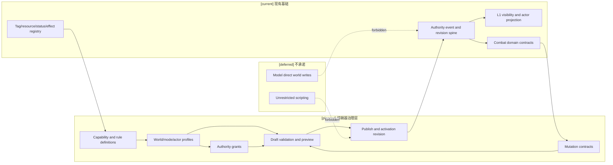
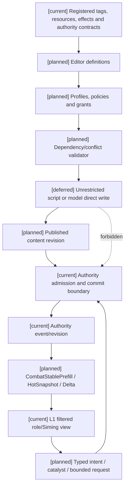

# 十月分析：编辑器与能力权限治理

状态：`architecture analysis; planned and non-authorizing`

本目录把编辑器从战斗运行时和领域结算中独立出来。编辑器负责能力开关、世界规则配置、角色/司命权限授予、草稿预览、版本发布和运行时同步；战斗目录继续负责技能、资源、状态、效果、动作、空间和 authority settlement 的领域合同。

玩法包的分层、组合、通用底座复用以及编辑器如何发现/配置/预览/应用玩法包，统一见 [玩法包与编辑器应用治理](../玩法包与编辑器应用治理/00-README.md)。本目录仍是编辑器控制面 owner，不在此重复定义玩法包内容模型。

编辑器可以配置世界支持什么、谁可以提出什么变化、变化需要哪些条件，但不直接拥有运行时世界事实。只有已注册的领域 authority 才能提交资源、状态、效果、库存、环境和技能事实。

## 目录

| 文档 | 范围 |
|---|---|
| [01-编辑器能力开关与世界规则配置设计](01-编辑器能力开关与世界规则配置设计.md) | 能力、资源、通道、效果、状态、规则政策、依赖、冲突和切换迁移 |
| [02-编辑器权限授予、角色与司命变更设计](02-编辑器权限授予、角色与司命变更设计.md) | 角色、司命、装备、阵法和环境的直接/间接变更权限 |
| [03-编辑器版本发布、预览与运行时同步设计](03-编辑器版本发布、预览与运行时同步设计.md) | 草稿、校验、预览、发布、回滚、激活边界、prefill 和 delta 同步 |
| [04-十月分析领域接入与编辑器同步矩阵](04-十月分析领域接入与编辑器同步矩阵.md) | 对齐 01–16、标签/元标签、角色能力/学习、时间模型、战斗与生命领域的编辑器接入、owner、权限和缓存边界 |
| [05-装备系统编辑器接入设计](05-装备系统编辑器接入设计.md) | 通用装备、触发器、配方、变体、自走棋玩法包的编辑、预览、发布、激活和缓存同步 |

## 与战斗目录的 owner 边界

```text
编辑器目录
  CapabilityDefinition / CapabilityProfile
  RulePolicy / AuthorityGrant / MutationContract
  Draft / Preview / ContentRevision / ActivationPolicy

战斗系统与角色技能、状态和资源目录
  Method / InnerMethod / Technique / ActionPattern
  Resource / Condition / Effect / Status / Action
  Combat settlement / targeting / timing / physical evidence

08 对象标签、编辑与版本治理
  TagDefinition / TagAssignment / SemanticSnapshot / MetaRuleDefinition
  标签唯一 owner；编辑器只消费其注册合同

领域 authority
  读取配置和权限，重新校验来源、资源、空间、反制和 revision
  提交事件、事实、回执和投影
```

编辑器中的“直接权限”表示可以调用限定的领域命令，不表示可以写任意字段。角色和司命的模型输出始终是 proposal、typed intent 或 catalyst；authority 决定是否提交。

十月分析各领域的编辑器接入不在本目录重复定义领域对象。跨领域引用、owner、profile 合并、时间/标签/能力门禁和同步验收统一见 [04-十月分析领域接入与编辑器同步矩阵](04-十月分析领域接入与编辑器同步矩阵.md)。

## 统一状态标记

- `[current]`：已有标签 registry、资源/状态/效果 runtime、authority event/revision、角色目标与 L1 过滤，以及 08 中的编辑路径和版本边界。
- `[planned]`：编辑器能力 profile、权限矩阵、依赖检查、预览投影、发布/激活、权限同步、editor-specific cache invalidation，以及 04 中登记的跨领域 profile/grant/time/tag/owner 同步。
- `[deferred]`：无约束脚本化世界规则、模型直接提交事实、跨世界观自动平衡、未经审核的多人协作合并。

## 编辑器的四层配置

```text
CapabilityDefinition  能力是什么、依赖什么、与什么冲突
CapabilityProfile     世界/模式/区域/角色当前启用什么
AuthorityGrant        谁可以以什么方式提出或调用什么变化
MutationContract      变化由哪个 owner 如何校验、结算和记录
```

能力开关、角色资格、权力授予和最终结算必须分开。关闭 `resource.mana` 不等于把所有角色的蓝量设为零；撤销角色的 `effect.heal` 权限也不等于删除已经结算的治疗状态。已有运行时实例必须按显式迁移政策处理。

## 架构图



## 主流程时序图

```mermaid
sequenceDiagram
  participant C as Creator/editor
  participant V as Config validator
  participant P as Preview projector
  participant R as Revision publisher
  participant A as Domain authority
  participant H as Combat prefill/hot projection
  Note over C,H: [current] registry/authority spine; [planned] editor control plane; [deferred] unrestricted scripting
  C->>C: edit capability, rule or grant draft
  C->>V: submit draft with dependency pins
  V-->>C: diagnostics or valid candidate
  C->>P: request creator preview
  P-->>C: isolated projection and affected affordances
  C->>R: approve and publish revision
  R->>A: register active configuration at boundary
  A->>A: revalidate owner, scope and migration policy
  A-->>H: committed revision and invalidation set
  H-->>A: stable/hot/delta projections
```

## 数据流图



预览数据不能回流成正式事实；角色可见投影不能反向充当编辑器真值；缓存构建器不能成为隐藏事实查询通道。

## 验收标准

1. 编辑器能开关已注册的能力、资源、效果、状态、通道和规则政策，并显示依赖、冲突和关闭后的迁移策略。
2. 编辑器能为世界、模式、区域、阵营、角色、装备和阵法配置受限能力 profile，但下层不能打开上层未注册能力。
3. 编辑器能为角色和司命授予 `observe`、`suggest`、`request`、`catalyze`、`invoke` 或受限 `direct` 权限；权限包含目标、范围、额度、资源、频率、证据和撤销条件。
4. 预览、草稿和失败校验不产生 authority 事实；发布后才在 activation boundary 进入运行时。
5. 运行时仍由领域 authority 重新校验并提交；模型不能用高预算、标签名称或旧缓存绕过权限。
6. profile、grant、binding 和 visibility revision 能使受影响的 Stable/Hot/Delta 投影准确失效，并可回放。

## 关联文档

- [战斗系统与角色技能、状态和资源目录](../战斗系统与角色技能，状态和资源/00-README.md)
- [08-对象标签、编辑与版本治理设计](../战斗系统与角色技能，状态和资源/08-对象标签、编辑与版本治理设计.md)
- [04-战斗状态、CombatPrefill 与高频读取计划](../战斗系统与角色技能，状态和资源/04-战斗状态、CombatPrefill与高频读取计划.md)
- [13-角色能力图谱、认知包络与动态算力设计](../13-角色能力图谱、认知包络与动态算力设计.md)
- [14-角色学习系统、模仿与技能进化设计计划](../14-角色学习系统、模仿与技能进化设计计划.md)
- [16-通用玩法时序模型与编辑器设计](../16-通用玩法时序模型与编辑器设计.md)
