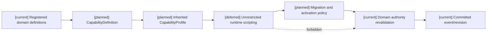
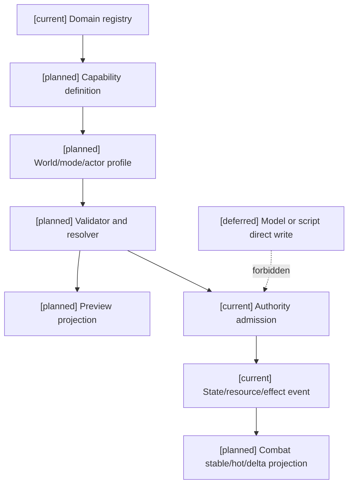

# 01 编辑器能力开关与世界规则配置设计

状态：`architecture analysis; planned and non-authorizing`

`[current]` 复用已有 registry、资源/状态/效果 runtime 和 authority event/revision；`[planned]` 编辑器能力定义、profile、规则政策、继承解析和迁移；`[deferred]` 无约束脚本化规则和自动跨世界平衡。

本文定义编辑器如何把战斗目录已有的资源、状态、效果、通道、环境和规则政策配置成不同世界观的能力集合。本文不重新定义战斗结算；具体伤害、治疗、控制、资源和空间结算分别由战斗目录的领域文档负责。

跨领域接入、标签/元标签、角色能力与学习、时间 profile、生命/灵魂和缓存同步的统一登记见 [04-十月分析领域接入与编辑器同步矩阵](04-十月分析领域接入与编辑器同步矩阵.md)。本文件只拥有能力定义/profile、规则政策、继承解析和能力切换迁移。

## 1. 能力开关的语义

能力不能只用一个布尔值表示。编辑器至少要分别保存：

```text
supported    内容包是否注册该能力
enabled      当前世界/模式是否打开
eligible     当前对象是否具备资格
active       当前实例是否已经生效
visible      当前观察者是否可以知道
```

示例：世界可以支持恐惧但只允许软修正：

```text
condition.fear:
  supported: true
  enabled: true
  hard_control: false
  soft_modifier: true
```

没有法力系统的世界应使用 `supported=false` 或未注册，而不是生成一个值为零的隐形蓝条。

## 2. 编辑器对象

### `CapabilityDefinition`

```text
CapabilityDefinition {
  capability_id
  namespace
  category                 channel/resource/effect/status/rule/relation/context
  dependencies
  conflicts
  default_state
  supported_scopes
  parameter_schema
  migration_policy_ref
  definition_revision
}
```

### `CapabilityProfile`

```text
CapabilityProfile {
  profile_ref
  owner_scope              world/mode/region/faction/actor/item/technique
  enabled_capabilities
  disabled_capabilities
  policy_overrides
  inherited_profile_refs
  profile_revision
}
```

### `RulePolicy`

规则政策决定能力启用后如何运作，例如：

```text
vitality_model       fused / coupled / independent
fear_response        soft_only / hard_control_allowed
damage_model         channel_split / unified_resistance
environment_field    damage_only / damage_and_control
soul_access          disabled / gated / rule_authorized
resource_debt        forbidden / bounded / allowed
```

规则政策不能扩大未注册的能力，也不能绕过 authority 的结算和审计。

## 3. 支持的能力范围

编辑器可以从注册表中配置：

| 类别 | 示例 |
|---|---|
| 输出通道 | `physical`、`spell`、`technique`、`mental`、`environmental`、`spiritual_rule` |
| 防御通道 | 物理、魔法、精神、环境暴露、规则 gate |
| 资源 | 生命、体力、法力、内力、专注、弹药、社会资源、环境资源 |
| 效果 | 伤害、治疗、护盾、控制、净化、召唤、资源转换、环境场 |
| 条件 | 伤势、恐惧、压制、封印、诅咒、增益、减益、疲劳 |
| 关系/群体 | 仇恨、目标偏好、战意、士气、协同、区域控制 |
| 规则 | 生命/精神耦合、灵魂触达、元素共鸣、天气、空间和因果 gate |

这些能力的运行时 owner 仍是战斗目录的 resource/status/effect/relation authority。编辑器只管理注册定义、配置、依赖和发布版本。

## 4. 层级解析和限制

```text
平台基础
  -> 世界观内容包
    -> 游戏模式
      -> 场景/区域
        -> 阵营/队伍
          -> 角色
            -> 装备/技能/状态实例
```

解析规则：

1. 下层不能打开上层未注册的能力。
2. 下层可以关闭、限制或细化上层已注册能力。
3. 下层不能扩大目标范围、数值上限、频率或 authority 范围。
4. 冲突必须显式拒绝、取交集或使用已注册优先级，不能按最后写入覆盖。
5. profile 解析结果必须带继承链、来源 revision 和最终 digest。

## 5. 开关与运行时迁移

能力切换只能在定义的边界发生：

```text
immediate          提交后下一次读取生效
next_action        当前动作沿用旧定义，下一个动作使用新定义
next_stable        下一稳定能力 revision 才改变候选
scheduled          到指定 tick 或条件才生效
```

关闭已有能力时必须声明：

```text
reject_new         拒绝新动作
finish_existing    已开始动作按旧定义完成
freeze             暂停消耗/恢复并等待迁移
convert            转换为另一个已注册资源或状态
detach             移除活动 binding，按生命周期处理实例
defer              推迟到战斗/场景边界
```

关闭 `resource.mana` 不能默默把蓝量改为零；关闭 `effect.control` 不能直接删除所有控制实例。迁移结果必须由 owner authority 提交事件。

## 6. 编辑器操作和诊断

编辑器应提供：

- 能力树和命名空间筛选；
- 依赖、冲突、缺失 owner 和循环引用诊断；
- profile 继承链和最终解析结果；
- 受影响技能、资源、状态、标签、权限和缓存的反向查询；
- 关闭能力后的迁移预览；
- 规则政策的单位、范围、软上限和舍入检查。

编辑器不接受任意脚本作为“能力定义”。参数必须符合注册 schema，复杂规则通过 `RulePolicy`、`EffectBinding` 或 `MutationContract` 引用已接纳合同。

## 架构图



## 主流程时序图

```mermaid
sequenceDiagram
  participant E as Editor
  participant V as Validator
  participant P as Profile resolver
  participant A as Authority
  Note over E,A: [current] registry and owner spine; [planned] profile governance; [deferred] unrestricted scripting
  E->>V: edit capability/profile/policy
  V-->>E: dependency and conflict diagnostics
  E->>P: resolve inherited profile
  P-->>E: supported/enabled/eligible/visible result
  E->>A: publish revision at activation boundary
  A->>A: revalidate owner, migration and current instances
  A-->>E: receipt, rejection or migration plan
```

## 数据流图



## 验收标准

1. 内容包可以声明无蓝条、无精神资源、无灵魂数值或仅允许环境输出。
2. 同一能力可以在世界、模式、区域和角色层分别关闭或限制，但不能越权启用。
3. 编辑器能显示一个能力关闭会影响哪些技能、资源、状态、效果、权限和缓存。
4. 切换已有能力时，迁移策略、边界和 authority event 可追溯。
5. 规则政策不能被标签名称、模型输出或编辑器任意脚本绕过。
