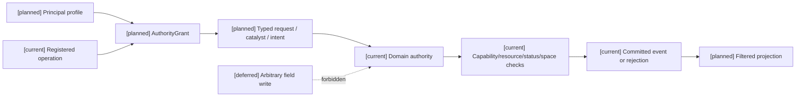
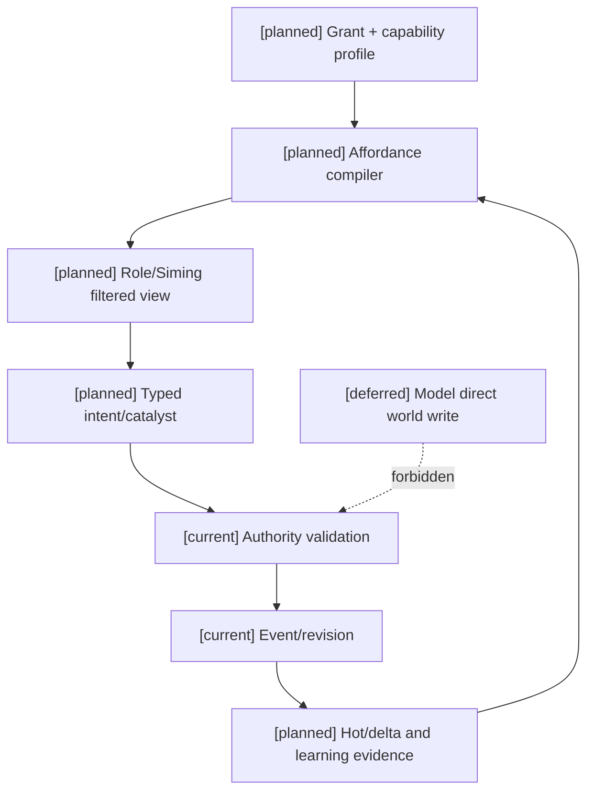

# 02 编辑器权限授予、角色与司命变更设计

状态：`architecture analysis; planned and non-authorizing`

`[current]` 复用已有 typed intent、L1 过滤、角色目标和 authority event/revision 基础；`[planned]` AuthorityGrant、MutationContract、权限编译和角色/司命变更路由；`[deferred]` 任意主体直接写世界字段和无约束权限脚本。

本文定义编辑器如何把部分世界内变更权力授予角色、司命、装备、阵法或其他受注册主体。权限授予不是能力开关，也不是 authority 的替代品；它只决定谁可以在什么范围内提出、调用或催化已注册的变化。

权限 grant 与角色能力、学习证据、标签治理、时间 profile 和领域 owner 的交叉约束见 [04-十月分析领域接入与编辑器同步矩阵](04-十月分析领域接入与编辑器同步矩阵.md)。grant 不降低能力图、认知包络或学习门禁，也不把编辑器变成任何领域的事实 owner。

## 1. 权限等级

```text
none       不可读取或提出该变化
observe    可读取权限过滤后的结果
suggest    可提出意图或构筑建议
request    可请求已注册动作
catalyze   可触发间接规则链或提交催化
invoke     可调用已注册领域命令
direct     可直接调用限定范围内的领域命令
```

`direct` 的含义是“直接调用命令”，不是“直接写字段”。例如角色可以 `direct:consume_own_mana`，但不能直接写 `mana.current=0`；命令仍由资源 authority 校验并提交。

## 2. `AuthorityGrant`

```text
AuthorityGrant {
  grant_ref
  principal_ref             role/siming/system/item/formation
  principal_kind
  operation                 registered mutation command
  mode                      observe/suggest/request/catalyze/invoke/direct
  domain_owner_ref
  target_scope
  spatial_scope
  temporal_scope
  magnitude_limits
  resource_limits
  frequency_and_cooldown
  required_capabilities
  required_evidence
  visibility_policy
  revocation_policy
  grant_revision
}
```

权限授予必须绑定到已注册的 `operation`，不能把任意字段路径作为操作名。

## 3. 直接、间接和提案变化

### 直接调用

角色调用一个已经注册的领域命令：

```text
role -> activate_equipped_technique
role -> consume_own_resource
role -> use_medicine
role -> establish_formation_link
role -> open_authorized_gate
```

authority 仍检查能力、资格、前置、资源、距离、动作阶段、反制、幂等和 revision。

### 间接变化

角色改变一个会被规则链解释的事实：

```text
角色制造火场
  -> 环境 authority 计算燃烧边界和 tick
  -> 状态 authority 应用暴露和伤害
  -> 资源 authority 提交生命/体力变化
```

间接变化不能让角色选择任意后果。后果来自已注册的 `EffectBinding`、环境规则和 `MutationContract`。

### 角色提案

角色可以提出：

```text
TechniqueCompositionProposal
SkillVariantProposal
LearnOrImitateProposal
ResourceConversionProposal
EnvironmentChangeProposal
```

提案携带证据、上下文 revision、期望代价和可接受风险，但不产生事实。司命可以解释、组合或催化，最终由技能、资源、环境或状态 authority 接纳。

## 4. 司命权限

司命适合被授予：

```text
observe      查看经过授权的规则和事件投影
suggest      提出世界规则或剧情变化
catalyze     触发已注册的环境、关系、任务或规则链
request      请求领域 authority 进行结算
```

司命默认不拥有任意 `direct` 写权限。即使编辑器授予司命某个限定的 `direct` 命令，该命令也必须是已注册、范围受限、可审计的领域接口，而不是通用世界写入接口。

## 5. 权限范围

每条 grant 至少限制以下维度：

```text
what       可以改变什么
who        可以作用于谁
where      空间范围和边界
when       生效窗口和持续时间
how_much   数值、层数、目标数和资源上限
how_often  冷却、频率和次数
why        所需能力、材料、证据和前置
visible_to 结果对谁可见
revocable  谁可以撤销、何时撤销
```

权限授予不改变角色的技能掌握、动作稳定性、认知复杂度上限或资源容量；它只提供一个经过门禁的可用路径。

## 6. 变更 owner 路由

| 变化 | 默认 owner | 角色/司命接入方式 |
|---|---|---|
| 生命、体力、法力、内力 | Resource/Body authority | 消耗、恢复、转换 request/direct |
| 伤势、增益、减益、恐惧 | Status/Effect authority | 应用、驱散、提案或催化 |
| 技能、变式、学习结果 | Skill/Learning authority | 学习、模仿、构筑 proposal |
| 装备、药品、弹药 | Inventory/Equipment authority | 使用、装备、锻造 request |
| 环境场、天气、地形 | Environment authority | 技能触发、阵法、司命 catalyst |
| 仇恨、士气、战意 | Combat dynamic authority | 事件信号、目标请求、群体催化 |
| 灵魂规则、契约、真名 | Soul/Rule authority | 受 gate 限制的规则提案 |

表格是 owner 路由设计，不代表这些完整 authority 已经实现。

## 7. 编辑器中的权限工作流

```text
选择主体
  -> 选择已注册 operation
  -> 选择权限等级
  -> 设置目标/空间/数值/资源/时间边界
  -> 设置证据、可见性和撤销策略
  -> 检查能力依赖和 owner
  -> 预览允许的 typed intent 与反制
  -> 发布 grant revision
```

编辑器应显示“授予权限后角色能提出什么”，而不是把角色伪装成全能角色。能力 profile 关闭后，依赖它的 grant 自动变为无效或待迁移，不得继续生效。

## 8. 例子：日月同辉和天气催化

```text
世界 profile:
  channel.physical = enabled
  channel.spell = enabled
  channel.environmental = enabled
  weather.control = enabled

角色 A:
  invoke technique:day_moon_radiance
  target = line_of_sight
  resource = magic:mana
  environment_field = local_only

角色 A:
  weather.change = none

司命:
  catalyze weather:solar_eclipse
  scope = region:valley
  requires = season + celestial_event + environment_authority
```

角色的技能可以造成物理、法术、环境和精神模块；是否产生环境场、范围多大、持续多久和如何被驱散仍由 authority 结算。司命只能催化已注册天气规则，不能直接把世界时间改成日蚀。

## 架构图



## 主流程时序图

```mermaid
sequenceDiagram
  participant E as Editor
  participant R as Role or Siming
  participant A as Domain authority
  participant P as Projection/L1
  Note over E,P: [current] typed intent and authority spine; [planned] grant compiler; [deferred] arbitrary direct writes
  E->>E: define grant and limits
  E->>A: publish grant revision
  R->>P: read permitted affordance
  R->>A: typed request/catalyst with expected revision
  A->>A: check grant, capability, resources, target and counterplay
  alt accepted
    A-->>R: execution contract
    A->>A: commit owner events
    A-->>P: result and new revision
  else rejected
    A-->>R: rejection and zero-write diagnostic
  end
```

## 数据流图



## 验收标准

1. 没有 grant 的主体不能调用 operation；有 grant 但能力关闭、资格不足或超过范围时必须拒绝。
2. `direct` 只能调用限定命令，不能写任意资源、状态、效果、世界规则或标签字段。
3. 角色间接触发的后果必须来自已注册规则链；模型不能自行选择未声明后果。
4. 司命的催化、建议和请求都经过对应 owner authority，不能绕过提交边界。
5. grant 撤销、过期和 profile 关闭会使 affordance、缓存和后续请求同步失效。
6. 权限授予不会突破角色的技能、认知、动作稳定性、资源容量或规划上限。

## 本批规格与计划回写（2026-10-10）

执行范围补记（D15/RW-16）：用户于2026-10-10要求第7项通用编辑器控制面暂不处理，规格14及共用计划05为 `paused-by-user`、暂不启动。本文件设计目标和验收要求保留至用户恢复，当前不开展专项调查、实现或验收，不作为待决项1–6的前置或完成条件；角色/领域必要权限校验及authority边界继续适用。见 [执行决策D15](../审查/03-实施待决收敛与验证闸门.md)与 [回写RW-16](../回写/README.md)。

本批保留 AuthorityGrant、MutationContract、observe/suggest/request/catalyze/invoke/direct 六类受限路径的语义，但先以 owner admission 和只读 projection 为准。规格14不把 grant 当作能力、掌握、资源容量或任意 direct 写权；缺 operation、scope、权限事件和撤销证据时不落 runtime。

映射：规格14；计划05 Task3。grant compiler、变更路由和撤权失效仍为 planned/blocked。
