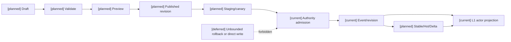
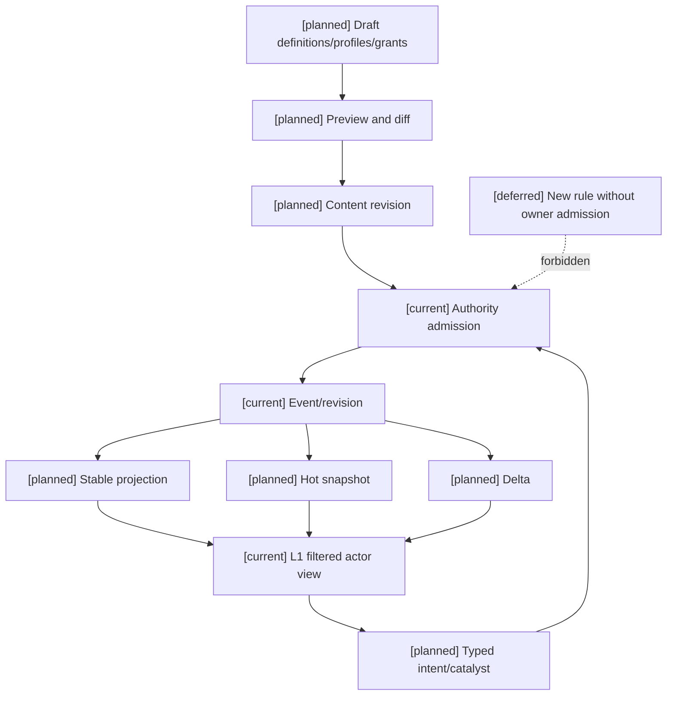

# 03 编辑器版本发布、预览与运行时同步设计

状态：`architecture analysis; planned and non-authorizing`

`[current]` 复用已有 revision、事件、标签快照和 actor cache namespace；`[planned]` 草稿、预览、发布、激活、回滚和编辑器配置同步；`[deferred]` 未审核的多人协作合并和跨世界观自动迁移。

本文定义编辑器配置如何从草稿进入运行时，以及如何与 CombatStablePrefill、CombatHotSnapshot、CombatDelta 同步。编辑器预览不是世界事实，发布 revision 也不等于跳过 authority 的运行时校验。

跨领域 revision envelope、标签/元标签 revision、能力与学习门禁、`TemporalProfile`、生命/灵魂规则和 owner/admission 反查见 [04-十月分析领域接入与编辑器同步矩阵](04-十月分析领域接入与编辑器同步矩阵.md)。本文件只定义通用发布、预览、激活、回滚和同步机制。

## 1. 配置生命周期

```text
draft
  -> schema/dependency/conflict validation
  -> isolated preview
  -> review and signed content revision
  -> staging/canary
  -> activation boundary
  -> authority admission
  -> runtime projection
  -> stable/hot/delta consumption
```

每一个能力 profile、权限 grant、规则 binding 和标签治理集合都需要独立 revision，并在激活时生成组合 digest。

## 2. 编辑器预览类型

### 静态预览

检查依赖、冲突、参数范围、owner、命名空间、能力上限和缺失引用，不运行世界状态。

### 投影预览

使用选定世界、模式、角色和装备输入，展示：

- 支持/启用/资格/可见状态；
- 可用资源、技能、效果和控制；
- 角色和司命可提出的 typed intent；
- grant 的目标、范围、成本和反制；
- 受影响的 CombatStablePrefill、HotSnapshot 和 Delta 字段。

投影预览必须隔离在 `creator_debug_view`，不能被角色或模型读取。

### 回放预览

使用历史 authority event 和固定 revision 重建变化，验证新配置是否会改变已有战斗的解释。旧 revision 必须保留，不能用新定义改写历史。

### 沙盒预览

允许在非正式 world branch 中执行有限模拟，输出诊断、候选和差异。沙盒事件不能进入正式 event store，除非经过正式发布和 authority admission。

## 3. 发布和激活

编辑器发布必须检查：

```text
definition schema
dependency closure
conflict closure
owner contract
capability upper bounds
permission scope
migration policy
visibility policy
cache impact
replay compatibility
```

激活时机：

```text
immediate       只适合不影响当前动作定义的公开配置
next_action     当前动作保持旧 pins
next_stable     技能、能力和权限下一稳定 revision 生效
scheduled       指定 tick、阶段或剧情条件
```

缺少迁移策略、owner 或 replay pins 时，发布必须拒绝或要求延迟激活，不得静默替换定义。

## 4. 回滚和撤销

回滚是发布新的反向 revision，不是删除历史 revision。已有提交事件仍保留；运行时按新 revision 的迁移政策处理活动实例。

权限撤销需要同时处理：

```text
new affordance generation
pending intent
active binding
private actor cache
creator preview projection
```

撤销不能向角色泄露已经被撤销的秘密标签或权限内容。相关 StablePrefill 立即失效，HotSnapshot/Delta 发布可见的权限变化。

## 5. 运行时同步

### StablePrefill

携带：

```text
world_rules_revision
content_package_revision
capability_profile_digest
authority_grant_digest
semantic_registry_revision
effect_binding_revision
visibility_policy_revision
```

能力定义、规则政策、稳定资格、权限 grant 和标签治理版本变化会使相关 stable projection 失效。

### HotSnapshot

携带：

- 当前激活的能力和权限；
- 当前有效的资源、状态、冷却和空间；
- 当前可用 affordance 及拒绝原因；
- 当前迁移阶段和待生效 revision；
- 角色/司命可见的授权投影。

### CombatDelta

携带：

```text
capability_enabled / capability_disabled
grant_added / grant_revoked
rule_policy_changed
affordance_added / affordance_removed
migration_started / migration_completed
from_revision / to_revision
authority_event_refs
```

delta 丢失或乱序时，消费方请求完整 snapshot。权限撤销优先于缓存命中，不能继续使用旧 grant。

## 6. 预览和 authority 的边界

```text
creator_debug_view          编辑器完整预览，可包含诊断和不可见依赖
authority_evaluation_view   authority 重新读取正式来源并结算
actor_perception_view       经 L1 过滤的角色/司命投影
```

三种视图不能互换。编辑器预览中的“可用”只是配置层结果；运行时仍需检查当前资源、空间、动作阶段、反制和 revision。

## 架构图



## 主流程时序图

```mermaid
sequenceDiagram
  participant C as Creator/editor
  participant P as Preview branch
  participant R as Revision publisher
  participant A as Authority
  participant H as Combat projection
  Note over C,H: [current] revision/authority spine; [planned] preview and sync; [deferred] unbounded rollback
  C->>P: validate and simulate draft
  P-->>C: diagnostics and affected-object diff
  C->>R: publish signed content revision
  R->>A: request activation at boundary
  A->>A: validate current source, owner and migration pins
  alt admitted
    A->>A: commit activation/migration event
    A-->>H: stable invalidation and hot/delta update
  else rejected
    A-->>C: rejection, no runtime write
  end
```

## 数据流图



## 验收标准

1. 草稿、静态预览、投影预览、回放预览和沙盒预览都不会写入正式 authority event store。
2. 发布内容拥有稳定 revision、依赖闭包、owner、迁移策略和 replay pins。
3. 回滚保留历史事件，并以新的 revision 处理运行时迁移。
4. 能力、规则或权限变化能准确区分 StablePrefill、HotSnapshot 和 CombatDelta 的失效范围。
5. 权限撤销后旧缓存不能继续生成 affordance 或提交成功请求。
6. 同一 content revision 在相同输入、规则和 seed 下可重放，预览差异可解释。
