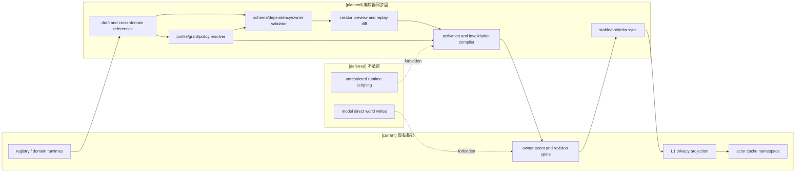
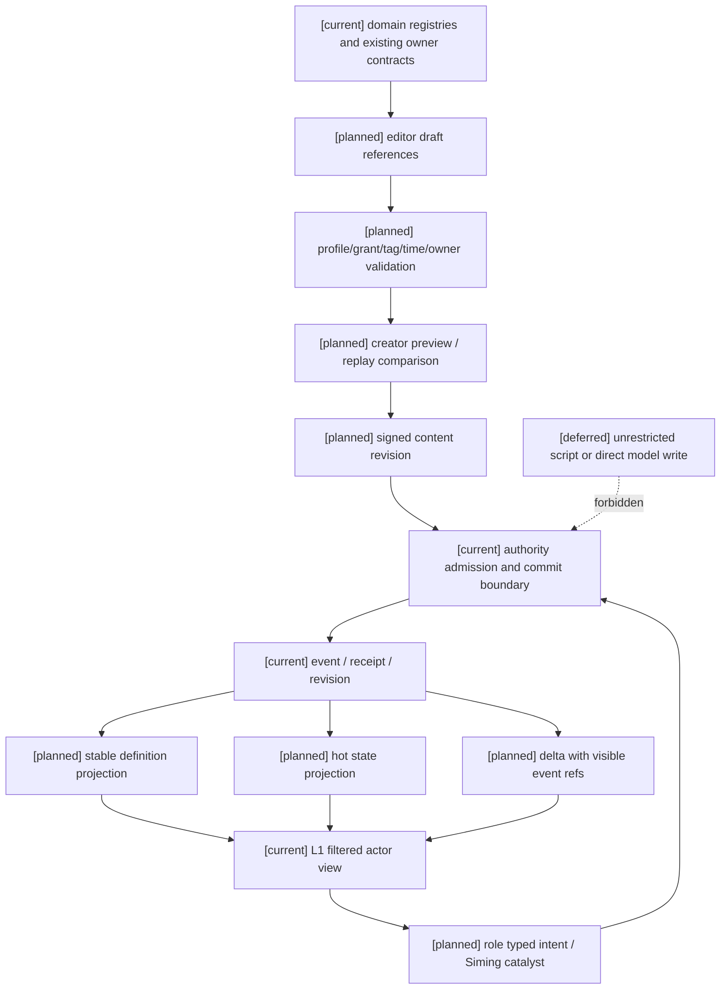

# 04 十月分析领域接入与编辑器同步矩阵

状态：`architecture analysis; planned and non-authorizing`

本文件是编辑器子目录与十月分析其他设计之间的同步层。它不复制技能、资源、状态、时间、标签、角色心智或灵魂规则的领域定义，而是登记：编辑器可以编辑什么、哪个文档拥有定义、哪个 authority 拥有运行时事实、哪些内容进入 preview/revision/prefill，以及哪些内容明确不能由编辑器、模型或司命直接写入。玩法包分层、类型、完整度和应用生命周期的唯一分析 owner 是 [玩法包与编辑器应用治理](../玩法包与编辑器应用治理/00-README.md)。

编辑器控制面唯一 owner 仍是本目录的 `CapabilityDefinition`、`CapabilityProfile`、`RulePolicy`、`AuthorityGrant`、`MutationContract`、Draft、Preview、ContentRevision、ActivationPolicy 和 cache invalidation 合同。时间语义由 [16-通用玩法时序模型与编辑器设计](../16-通用玩法时序模型与编辑器设计.md) 负责；标签与元标签由 [08-对象标签、编辑与版本治理设计](../战斗系统与角色技能，状态和资源/08-对象标签、编辑与版本治理设计.md) 负责；角色能力与学习门禁由 [13](../13-角色能力图谱、认知包络与动态算力设计.md) 和 [14](../14-角色学习系统、模仿与技能进化设计计划.md) 负责。

## 1. 同步原则

### 1.1 编辑器编辑定义，不编辑事实

编辑器可以创建、修改、校验和发布未来 revision：

```text
definition / profile / policy / grant / binding / migration
  -> draft
  -> static validation
  -> isolated preview or replay comparison
  -> signed content revision
  -> activation boundary
  -> domain authority revalidation
  -> committed event and projection
```

编辑器不能直接写入生命、法力、体力、伤势、冷却、技能掌握、恐惧、仇恨、士气、时间线 current step、库存、装备耐久、环境场或灵魂事实。预览中的“可用”只是配置投影；运行时仍以当前来源、空间、资源、动作阶段、抗性、权限和 revision 重新校验。

### 1.2 四条独立轴

编辑器必须分别显示并校验：

```text
capability       世界/模式是否注册并启用能力
eligibility      对象是否满足资格、技能和认知包络
authority_grant  主体可以 observe/suggest/request/catalyze/invoke/direct 什么
settlement       哪个领域 owner 如何结算并提交事实
```

不能用 `enabled=true` 推导角色已经学会技能、装备已经生效、资源已经存在或司命拥有写权限。`direct` 只表示调用受限的已注册命令，不表示任意字段写入。

## 2. 十月分析 owner 与编辑器接点

| 领域设计 | 定义 owner | 编辑器可编辑/配置 | 运行时事实 owner | 主要投影与失效 |
|---|---|---|---|---|
| 01 技法构筑与学习 | Skill/Learning authority | `Method`、`Technique`、`ActionPattern`、变式边、前置、学习证据 schema、构筑 binding | Skill/Learning/Combat authority | 技能和 binding revision 改 Stable；实战进度与当前 affordance 改 Hot/Delta |
| 02 资源与转换 | Resource/Body authority | 资源定义、白名单、容量/恢复政策、转换和迁移策略 | Resource authority | 规则定义改 Stable；current/reserved/regen/cooldown 改 Hot/Delta |
| 03 动作与效果 | Action/Effect/Combat authority | 动作图、效果模块、目标 selector、时空参数 schema、控制/免伤/闪避政策 | Combat/Effect/Physics adapter | 动作定义改 Stable；阶段、距离、命中证据和打断改 Hot/Delta |
| 04 Combat prefill | Projection/cache owner | stable 字段、hot 字段、delta schema、可见性和缓存失效政策 | Runtime projector + L1 filter | policy/binding/visibility 改 Stable；状态和空间只改 Hot/Delta |
| 05 通道/环境/灵魂 | World rules/Environment/Soul authority | 通道开关、环境场 policy、生命/精神模型、`SoulAccessGate` 条件 schema | 各领域 authority | rules revision 改 Stable；暴露、gate 结果和场边界改 Hot/Delta |
| 06 外物/药品 | Inventory/Equipment/Consumable authority | 物品定义、耐久/次数、药效模板、媒介和阵法组件约束 | Inventory/Equipment/Status/Resource authority | 定义与 binding 改 Stable；库存、耐久、药效和使用次数改 Hot/Delta |
| 07 影响源 | Semantic/Effect/Combat authority | 标签/装备/药品/技能 binding、条件、叠加、去重和撤销政策 | 对应 domain authority | binding 改 Stable；激活条件与效果实例改 Hot/Delta |
| 08 标签治理 | Semantic registry/control plane | 标签定义、元标签、赋予政策、编辑权限、版本和冲突 schema | 标签 assignment 与对应对象 owner | registry/binding/visibility 改 Stable；derived/runtime tag 改 Hot/Delta |
| 09 战斗动态 | Relation/Status/Group/Character Core adapter | Threat/Fear/Morale policy、信号 schema、群体聚合和投影字段 | relation/status/group authority；Disposition 为派生视图 | 政策改 Stable；pressure/fear/士气/估计改 Hot/Delta |
| 10 生命与死亡 | Resource/Body/Lifecycle/Soul authority | LifeState、伤势、疾病、复活和灵魂连续性 schema | 各生命/伤势/灵魂 owner | 生命周期定义改 Stable；伤势、阶段和 gate 结果改 Hot/Delta |
| 11 通用装备核心 | Equipment/Inventory/Trigger/Combat authority | 装备定义、栏位抽象、assignment、触发器、目标选择、效果、合成/变体接口 | Equipment/Inventory、Resource、Status/Effect、Combat 等参与 owner | 定义、binding、触发器和栏位政策改 Stable；归属、耐久、次数、充能、冷却和触发计数改 Hot/Delta |
| 12 自走棋装备玩法包 | AutoChess package owners | 棋盘栏位、二合一配方、TraitGrant、羁绊阈值、回合事件、随机池 | Roster/Trait、Reward/Offer、Equipment 和 Combat owners | 玩法政策和池 revision 改 Stable；棋盘、阵容、回合、羁绊计数和候选结果改 Hot/Delta |
| 13 能力图谱与认知包络 | Character Core/profile authority | 能力节点、认知上限、候选/规划/表达预算和门禁策略 | Character Core projection | profile/包络改 Stable；动态预算和当前候选改 Hot |
| 14 学习、模仿与进化 | Skill/Learning/Character Core authority | 学习方法、证据 schema、难度、模仿规则、演化边和失败策略 | Learning/Skill authority | 学习定义改 Stable；episode、证据和待审提案改 Hot/Delta |
| 15 角色表达与精神边界 | Character Core/Expression/Soul authority | 表达策略、精神资源是否启用、泄漏/失控政策和 gate 投影 schema | Character Core、Expression、Soul authority | policy 改 Stable；当前理智/精神状态和表达计划改 Hot/Delta |
| 16 通用时序模型 | Gameplay Foundation/time owner | `TemporalProfile`、timeline profile、`ClockMapping`、窗口、确定性和迁移政策 | 时间/调度 owner，领域 authority 仍提交事实 | profile/mapping 改 Stable；current step/window/late input 改 Hot/Delta |

编辑器同步时只保存领域引用、revision、digest、参数 schema 和 owner contract ref；不在编辑器目录另建一份领域真值数据库。领域文档的 `[current]`、`[planned]`、`[deferred]` 状态必须在接入矩阵中如实显示，不能因为出现编辑器表单就把 `[planned]` 变为实现完成。

## 2.1 玩法包应用接点

| 玩法包维度 | 编辑器字段 | 运行时含义 | 事实边界 |
|---|---|---|---|
| 类型 | `primary_kind`：设定、世界规则、机制、玩法模式、场景、内容、验证、套件 | 决定可用的 authoring view 和验证器 | 类型不自动取得 owner |
| 提供模块 | `provided_modules` | 包实际提供的 definitions、bindings、policies 和 adapters | 不等于角色已拥有实例 |
| 依赖 | package/patch/capability/schema pins | 组合和 active set 的固定输入 | 缺失依赖不得静默降级 |
| 应用范围 | `application_scopes` | project/world/mode/region/scenario 等合法 scope | scope 不等于当前事实写入权 |
| 入口 | `entrypoints`：discover/configure/preview/apply/create_instance | 编辑器可调用的受限操作 | 仍经 registry/lifecycle authority |
| 完整度 | `completeness` 和验证派生 `readiness` | module、mechanic、playable mode、complete suite | 不能由作者自报直接认定可运行 |

`11-通用装备系统设计` 是 `[planned]` mechanic 领域合同；`12-自走棋装备玩法包设计` 是 `[planned]` 自走棋装备机制模块，不是完整自走棋 suite。完整自走棋需要另有 game_mode、棋盘/阵容、阶段、经济/奖励、单位/技能内容和 verification 依赖闭包。`patch_runtime`、lifecycle authority 和 fixed production registry 是 `[current]` 的通用包承载基础，但没有完成通用 creator editor、Combat package runtime 或 suite launcher。

## 3. 两种编辑路径

### 3.1 创作者编辑

创作者编辑的是内容包、世界 profile、规则 policy、标签/绑定、权限 grant、动作/时间 schema 和迁移策略。编辑器应同时提供属性面板和语义图面板，但两者编辑同一份 draft，不得各建事实库。

```text
属性面板：数值、单位、范围、持续、成本、权限和迁移字段
语义图面板：对象、组件、标签、binding、前置、冲突、owner 和 revision 引用
```

预览必须显示依赖闭包、反向影响、当前世界 profile、角色能力门禁、权限范围、反制路径、缓存失效范围和缺失 owner。复杂效果引用 `EffectBinding`、`RulePolicy` 或 `MutationContract`，不接受任意脚本作为运行时规则。

### 3.2 世界内角色与司命改变

角色改变和司命改变是运行时提案路径，不是创作者编辑权限的别名：

```text
角色 typed intent / 学习提案
司命 catalyst / 规则提案
  -> owner-bound operation
  -> 当前能力、资源、空间、时间、证据和权限校验
  -> domain authority commit 或拒绝
  -> event/receipt/revision
  -> L1 actor projection
```

角色不能通过标签编辑器给自己增加 `capability`、技能复杂度或权限；司命不能用 creator preview 或高预算模型直接写世界事实。编辑器授予的是准入路径和边界，不能替代角色学习、技能掌握、动作稳定性或世界规则。

## 4. 预览、发布和同步合同

每一份草稿至少携带：

```text
content_package_ref / draft_ref / parent_revision
definition_refs / semantic_registry_revision
capability_profile_digest / authority_grant_digest
world_rules_revision / temporal_profile_revision
owner_contract_refs / migration_policy_ref
visibility_policy_revision / replay_pins
diagnostic_digest / activation_policy
```

预览视图必须分开：

| 视图 | 允许内容 | 禁止用途 |
|---|---|---|
| `creator_debug_view` | 完整依赖、诊断、不可见 binding、受控沙盒结果 | 直接回流角色上下文或正式事件 |
| `authority_evaluation_view` | authority 重新读取并结算所需正式来源 | 由模型或编辑器伪造提交 |
| `actor_perception_view` | 按角色权限、L1、隐私和能力包络过滤后的事实 | 反向充当编辑器真值 |

发布前必须通过 schema、单位、依赖、冲突、owner、能力上限、权限 scope、迁移和回放检查。激活只能在 `immediate`、`next_action`、`next_stable` 或 `scheduled` 边界发生。回滚发布新的反向 revision，保留旧事件和旧 pins。

同步规则：

```text
stable: capability/profile/rule/tag/binding/grant/temporal revision
hot: current resource/status/space/action/dynamic/lifecycle values
delta: from_revision -> to_revision visible changes and event refs
```

三个运行时投影名称固定为 `CombatStablePrefill`、`CombatHotSnapshot` 和 `CombatDelta`；编辑器只配置它们的字段 schema、可见性和失效政策，不保存当前战斗数值。

权限撤销和可见性变更优先于缓存命中；相关私有 stable prefix 必须立即失效，delta 不得泄露被撤销的旧秘密值。丢失或乱序 delta 必须请求完整 snapshot。

## 5. 能力、人格和世界观门禁

编辑器的 profile 合并只能扩大内容包已注册的选择范围以内，且必须保留角色差异：

- 世界没有 `magic:mana` 时，不能通过技能、标签或权限自动生成蓝条；
- 角色拥有 `invoke` 权限不等于掌握复杂技法；能力图、学习证据和认知包络仍生效；
- 大五人格只改变学习路线、风险偏好、通信和候选排序，不直接提供攻击力、法强或免疫；
- `spiritual_rule` 和 `SoulAccessGate` 不是普通数值属性，灵魂事实仍由 Soul/identity owner 保存；
- 低能力角色可以看到更少候选和更短上下文，但增加预算不能越过能力上限、隐私或权限；
- 世界包可启用 physical、spell、technique、mental、environmental 或其他注册通道，但 Technique 仍是跨通道构筑对象。

profile resolver 必须输出来源链、冲突诊断、最终 digest 和每个下层 override 的字段范围；不能用最后写入覆盖、隐式继承或名称匹配绕过这些门禁。

## 6. 当前、计划和暂缓

- `[current]`：已有 semantic registry、资源/状态/效果 runtime、owner event/revision、L1 过滤、角色目标与局部 cache namespace；16 的 SimulationClock/action window/status lifecycle 仍是局部基础。
- `[planned]`：本同步矩阵、编辑器控制面、跨领域 profile resolver、权限/能力/时间/标签联合预览、发布/激活、领域 adapters、Combat prefill 与角色能力/学习接入。
- `[deferred]`：无约束运行时脚本、模型直接写事实、任意跨世界自动平衡、未审查的多人协作合并、无限回滚和跨平台 bitwise physics rewind。

### 架构图



### 主流程时序图

```mermaid
sequenceDiagram
  participant C as Creator/editor
  participant V as Cross-domain validator
  participant P as Preview/replay branch
  participant R as Revision publisher
  participant A as Domain authority
  participant H as Stable/hot/delta projector
  participant L as L1 actor projection
  Note over C,L: [current] registry, event spine and L1; [planned] sync layer; [deferred] unrestricted scripting
  C->>V: submit draft with owner, profile and revision pins
  V->>V: resolve dependencies, conflicts, limits and adapters
  V->>P: create isolated preview and replay diff
  P-->>C: diagnostics, affordance diff and cache impact
  C->>R: publish signed content revision
  R->>A: request activation at declared boundary
  A->>A: re-read formal sources and validate current revisions
  alt accepted
    A->>A: commit activation/migration event
    A-->>H: revision and invalidation set
    H-->>L: filtered stable/hot/delta projection
  else rejected
    A-->>C: rejection receipt; no runtime fact write
  end
```

### 数据流图



## 7. 同步验收矩阵

| 验收项 | 必须证明 |
|---|---|
| owner 唯一性 | 编辑器目录不保存技能、资源、状态、标签、时间线或灵魂真值；每个领域能反查定义 owner 与提交 owner |
| profile 合并 | 上层未注册能力不能被下层打开；冲突、循环、越权 override 和缺 owner fail closed |
| 标签同步 | 08 的 definition/instance/derived/runtime 生命周期、元标签治理和 binding revision 可在编辑器预览中消费，但不重新定义 |
| 时间同步 | 16 的 `TemporalProfile`、`ClockMapping`、`SettlementWindow` 只由时间 owner 定义；编辑器只编辑 profile，不写 current timeline |
| 角色差异 | 能力图、人格、学习证据、动作稳定性和认知包络在 profile/grant 之后仍是硬门禁；预算不能越权 |
| 创作者预览 | 静态、投影、回放和沙盒结果与正式 event store 隔离，诊断可解释且带 revision pins |
| 世界内变化 | 角色和司命只有 proposal/typed intent/catalyst；领域 authority 重新读取来源并原子提交或零写入拒绝 |
| 缓存同步 | stable/hot/delta 失效范围明确；撤权清理私有 cache；乱序 delta 回退完整 snapshot |
| 世界兼容 | 无蓝条/无精神资源/无灵魂数值的内容包不会产生隐形字段；常规物理世界和非常世界只启用已注册能力 |
| 回放与迁移 | 发布、激活、回滚、能力关闭和时间 profile 切换都有迁移政策、旧 revision 和 replay pins |

## 8. 后续正式 spec 顺序

1. 固定编辑器控制面的最小 schema：`CapabilityDefinition/Profile`、`RulePolicy`、`AuthorityGrant`、`MutationContract` 和统一 draft envelope。
2. 接入 08 标签治理与 16 时间 profile，验证 dependency/owner/conflict/visibility/revision 解析，不接入完整战斗写入。
3. 选一个常规世界战斗内容包和一个非常世界内容包，分别验证能力开关、资源白名单、标签 binding、动作参数和预览差异。
4. 接入 13/14 的能力与学习门禁，验证角色可以提出但不能凭权限或预算直接获得技能。
5. 接入 03/04/09/10 的 Combat authority、动态状态和 stable/hot/delta，验证动作、资源、状态、空间和死亡结果的回放与撤权失效。
6. 最后实现创作者编辑器 UX、沙盒 fixture、发布/回滚和多作者协作；多人合并和无约束脚本保持 deferred。

本文件只描述同步与验收边界，不授权正式 spec、implementation plan 或代码实现。
