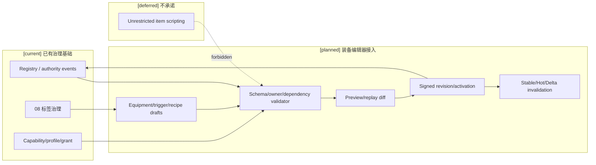
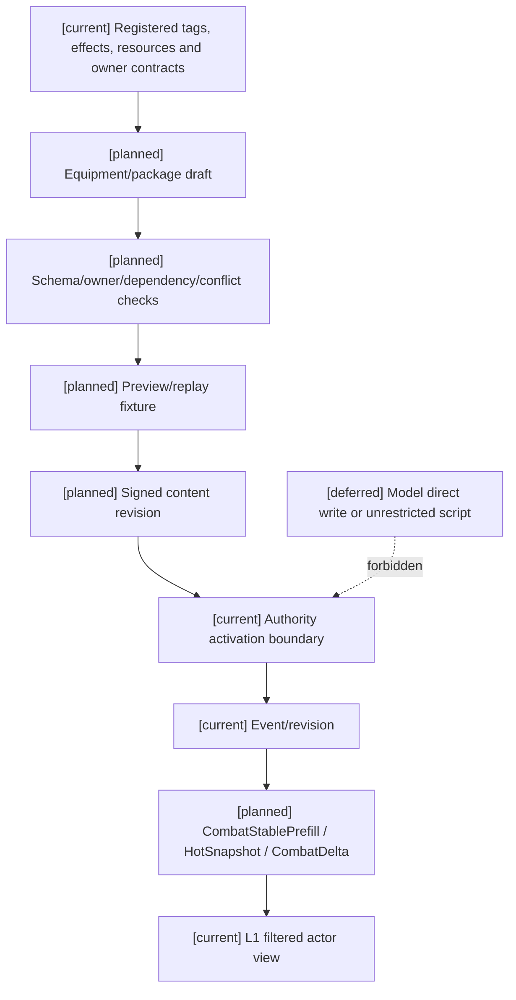

# 05 装备系统编辑器接入设计

状态：`architecture analysis; planned and non-authorizing`

本文件定义装备核心和自走棋玩法包如何接入编辑器。装备领域由 [11-通用装备系统设计](../战斗系统与角色技能，状态和资源/11-通用装备系统设计.md) 与 [12-自走棋装备玩法包设计](../战斗系统与角色技能，状态和资源/12-自走棋装备玩法包设计.md) 负责；标签/元标签由 08 负责；本文件只负责编辑器控制面、草稿、预览、权限、发布、激活和缓存同步。

## 1. 编辑器可编辑的对象

### 通用装备对象

```text
EquipmentDefinitionDraft
EquipmentSlotPolicyDraft
TriggerDefinitionDraft
TargetSelectorDraft
EffectBundleDraft
CompositionRecipeDraft
EquipmentVariantDraft
```

编辑器可以编辑：

- 装备分类、稀有度和定义标签引用；
- 可装备栏位、资格、唯一组和冲突政策；
- 属性 modifier、资源效果、状态效果和规则 binding 引用；
- 触发事件、条件、阶段、目标选择、计数、冷却和叠层政策；
- 耐久、充能、次数和失败消耗政策；
- 合成配方、变体继承/替换/新增 binding；
- 预览夹具、依赖、解释文本和内容包引用。

编辑器不能直接编辑运行时实例的当前耐久、装备归属、触发计数、冷却、库存数量、护盾值或随机结果。

### 自走棋玩法包对象

```text
AutoChessLoadoutPolicyDraft
BinaryCombinationRecipeDraft
TraitGrantDraft
TraitBreakpointRuleDraft
AutoChessPhaseEventDraft
AutoChessOfferPoolDraft
```

它们可以配置三件装备限制、二合一配方、羁绊阈值、战斗阶段事件和随机池，但不能改变通用 authority 的事实所有权。

## 2. 编辑器字段与领域 owner

| 编辑器字段 | 定义 owner | 运行时事实 owner |
|---|---|---|
| 装备属性/效果/binding 引用 | 11、07、08 | Resource/Status/Effect/Combat owner |
| 装备栏位和 assignment policy | 11 | Inventory/Equipment owner |
| 触发器定义 | 11 | Trigger/Combat owner |
| 标签和元标签 | 08 | Semantic registry 与对应对象 owner |
| 合成配方和装备变体 | 11 / 玩法包 | Inventory/Equipment owner |
| 羁绊和阵容阈值 | 12 | Roster/Trait owner |
| 选秀、掉落、商店、随机池 | 12 | Reward/Economy/Offer owner |
| 当前耐久、次数、冷却、随机结果 | 不可由定义草稿直接编辑 | 对应运行时 owner |

编辑器只保存 definition、policy、binding、profile、grant 和 migration 引用，不复制装备实例账本。

## 3. 预览与校验

装备编辑器至少提供三类视图：

```text
creator_debug_view       完整依赖、binding、候选和诊断
authority_evaluation_view 运行时重新校验所需的正式来源
actor_perception_view     按角色权限过滤后的可见装备摘要
```

预览必须检查：

- 事件和时间 profile 是否已注册；
- 标签是否存在且挂载对象合法；
- EffectBinding 是否有 owner contract；
- 资源、状态、控制和空间单位是否完整；
- 触发器是否存在循环、无界递归或重复 binding；
- 目标选择是否有合法性、免疫和 tie-break；
- 配方输入是否冲突、输出是否可解析；
- 自走棋羁绊是否有明确 roster 和 breakpoint owner；
- 随机池是否固定 pool revision、seed 和重复政策；
- 低能力角色是否会因装备权限绕过能力上限；
- stable/hot/delta 哪些字段会失效。

预览和沙盒只能产生诊断、候选和 replay diff，不产生正式 authority event。

## 4. 发布、激活和运行时同步

装备内容 revision 至少固定：

```text
content_package_ref
equipment_definition_revision
semantic_registry_revision
effect_binding_revision
trigger_registry_revision
recipe_revision
target_selector_revision
capability_profile_digest
authority_grant_digest
world_rules_revision
temporal_profile_revision
activation_policy
replay_pins
```

生效边界可以是：

```text
immediate
next_action
next_stable
round_start        自走棋玩法包
combat_start       自走棋装备触发
scheduled
```

编辑器发布只激活定义和政策。运行时仍重新读取装备实例、持有者、空间、资源、状态、触发器 runtime 和 revision，再由对应 authority 提交事实。

缓存同步规则：

- 定义、binding、配方、触发器、栏位政策和玩法包 profile 改变，通常使 `CombatStablePrefill` 失效；
- 当前装备归属、耐久、次数、充能、触发计数、冷却、羁绊计数和随机候选进入 `CombatHotSnapshot`/`CombatDelta`；
- 权限撤销和可见性变化必须先清理私有缓存；
- 旧定义保留用于回放，不能静默替换当前动作 pins。

## 5. 两种编辑路径

### 创作者编辑

```text
draft
-> schema/dependency/owner validation
-> isolated preview and replay diff
-> signed content revision
-> activation boundary
-> runtime authority revalidation
```

### 世界内角色/司命改变

角色可以提出装备、合成、转职、修理、激活或卸下意图；司命可以提出玩法事件或内容催化。二者都不能直接改动编辑器定义或运行时实例事实：

```text
typed intent / catalyst
-> grant and capability check
-> current source and revision check
-> owner authority settlement
-> event/receipt/projection
```

## 6. 当前、计划与暂缓

- `[current]`：编辑器目录已有 capability/profile/grant/mutation、draft/preview/publish/activation 的治理框架；08 已有标签编辑边界；06/07 已有外物和影响源合同草案。
- `[planned]`：装备编辑器表单/语义图、触发器预览、配方校验、自走棋玩法包编辑器、装备 replay fixture、装备特有 cache invalidation 和跨 owner diagnostics。
- `[deferred]`：无约束装备脚本、模型自动生成并发布装备、多人实时协作合并、自动平衡和跨赛季迁移。

## 7. 架构图



## 8. 主流程时序图

```mermaid
sequenceDiagram
  participant C as Creator/editor
  participant V as Validator
  participant P as Preview/replay
  participant R as Publisher
  participant A as Domain authority
  participant H as Combat projection
  Note over C,H: [current] registry/event/grant foundations; [planned] equipment editor; [deferred] unrestricted scripting
  C->>V: submit equipment or package draft with pins
  V->>V: validate tags, triggers, recipes, owners, limits and conflicts
  V->>P: build isolated preview and replay diff
  P-->>C: diagnostics and cache impact
  C->>R: publish signed revision
  R->>A: request activation at declared boundary
  A->>A: re-read instances, owners, current revisions and migration policy
  alt accepted
    A-->>H: activation revision and invalidation set
    H-->>C: filtered stable/hot/delta projection
  else rejected
    A-->>C: rejection receipt; no runtime fact write
  end
```

## 9. 数据流图



## 10. 验收标准

1. 装备定义、触发器、配方和自走棋政策可以在一个 draft 中编辑，但仍引用各自领域 owner，不创建第二套真值库。
2. 标签和元标签复用 08，编辑器不重新定义标签生命周期或直接赋予效果。
3. 预览能显示触发路径、目标、效果、资源、状态、权限、反制、owner、revision 和缓存失效范围。
4. 发布/激活不修改当前装备实例账本；运行时事实必须由对应 authority 提交。
5. 自走棋玩法包可以编辑三件装备限制、二合一配方、羁绊阈值、回合事件和随机池，而普通世界 profile 不会隐式启用它们。
6. 旧 revision 可回放；撤权、可见性变化和定义变更能正确清理 Stable/Hot/Delta 投影。
