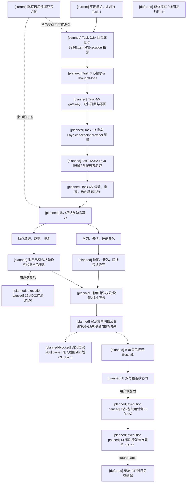
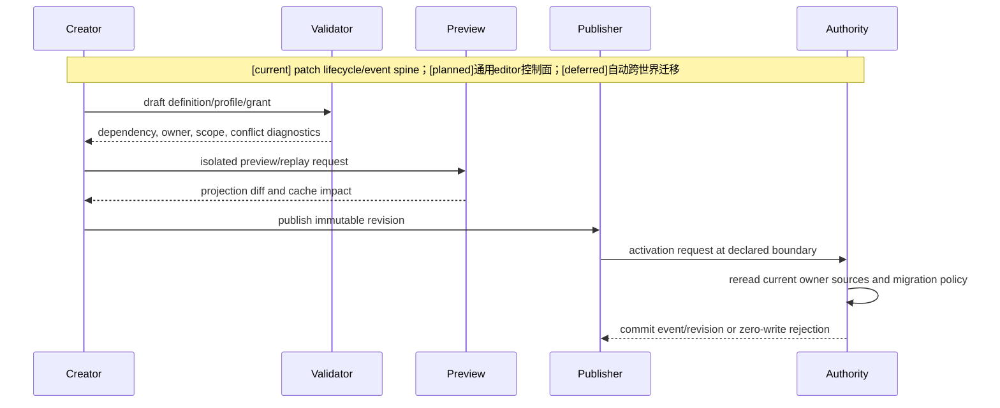
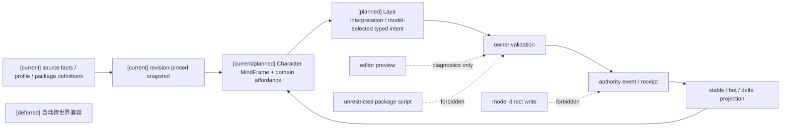

# 四域统一架构与执行顺序总规格

状态：`analysis/planned/non-authorizing`

当前执行范围（2026-10-10）：按 [D15](../审查/03-实施待决收敛与验证闸门.md)，规格14/16和计划05/07为 `paused-by-user`、暂不启动。当前讨论待决项1–6；正文保留全批次设计边界，暂停项不是当前开工或完成条件。角色/B/C消费已有合格动作并验证实际表现，不启动AD专项；领域权限校验继续适用，不扩展通用编辑器控制面。

## 1. 目的与范围

本规格把十月分析的四个目标目录收敛为一条可执行的架构路线：`角色`、`战斗系统与角色技能，状态和资源`、`玩法包与编辑器应用治理`、`编辑器与能力权限治理`。它以仓库当前 `backend/app/character_agent/`、`backend/app/gameplay/`、`backend/app/world_runtime/`、现有 authority event/revision、L1 过滤和 Harness profile 为事实基线。

本规格优先推进角色智能体心智模型。Laya 是角色模型驱动的高频决策核心：模型承担主观解释、目标权衡与当前 intent 的最终选择，本地代码承担 schema、权限、能力、时限和硬约束。角色先完成回合身份、心智帧、分层记忆、认知包络、模型路由、技能学习和动作承诺的连续闭环，领域服务、玩法包和编辑器随后作为角色可消费的稳定来源。本批只服务开放世界运行时；自走棋及其单局回合、羁绊、奖励适配按 D14 关闭并延期到未来独立批次。

## 2. 当前实现基线

### `[current]` 已有能力

- `CharacterTurnContext` 已统一 `turn_id`、actor、causation/correlation、revision vector、stage refs、幂等键、生命周期和 recovery transition。
- `CharacterMindFrameBuilder` 已把 enduring truth、memory evidence、runtime state、affordances 和 provenance 组装成角色私有心智帧。
- `backend/app/character_agent/reasoning/l1_perception.py`、`l2_reasoner.py`、`planning/l3_planner.py` 和 `execution/l4_executor.py` 已形成分层运行路径。
- `CharacterModelGateway`、provider/router、prompt policy、output validator 和 memory recall 已是模型调用的受控入口。
- 现有 router 的 `local_only/hybrid_ready/online_default` 不等于 Laya 快慢路由；现有 L3 的本地选择也不证明本轮 model-led 最终选择已经实现。
- 事件、观察、知识、社交、高阶和 working memory 已有模型、store、recall 和写回测试。
- skill registry/service/learning/settlement、affordance、dynamic state、needs/affect、behavior policy 和 embodied episode 已存在局部实现。
- `CharacterExecutionContract` 明确禁止 body pose、world mutation、raw animation 和 authority result 等字段；L4 只产生语义动作和表现提示。

### `[planned]` 本轮要冻结的增量

1. 以 MindFrame 作为 L1→L2 的单一输入包，统一 turn snapshot、memory bundle、affordance、dynamic state、能力包络和 provenance。
2. 把注册、可组合、多模式并行的 `ThoughtMode`、主动感知、快慢循环和角色自主度编译为回合策略。Laya 选择一个当前 intent，未胜出目标保留；慢思考可取消、可过期，迟到结果不得覆盖新回合。
3. 把一般认知能力、稳定技能、当前状态和计算预算编译为硬上限 `CapabilityEnvelope`；预算不能越过角色能力、隐私或 authority。
4. 把学习/模仿/技能进化限制为有证据的 owner-bound proposal，不能由模型输出直接写入技能状态。
5. 把 L4 的 semantic execution plan、actor ingress、settlement feedback、EmbodiedEpisode 和失败恢复连接为可重放链路。
6. 让资源、状态、效果、装备、生命、关系和时间等领域服务使用通用命名，角色只消费 `affordance`、`constraint`、`outcome` 和 `evidence`，不把它们强行命名为战斗专用。
7. 让玩法包和编辑器只管理 definition/profile/grant/draft/revision/activation，不取得世界事实写权限。

### 始终禁止

- 角色模型直接写世界事实、技能、标签、资源或库存。
- 任意脚本化玩法包、第二套 event store/clock/scheduler/tag registry。
- 用自走棋规则反向定义通用装备、时间、角色回合或资源接口。
- 未经 authority settlement 的 Godot 表现成功、raw pose 驱动或 VLA 结果写入。
- 以单个模型供应商、全局 thinking token 或单一“战斗 AI”命名锁死角色心智。

### `[deferred]` 暂缓能力

按原设计暂缓大规模群体模拟、长期政治士气、完全自动跨世界兼容和运行时通用 IK；这些不作为本轮基础门禁。

## 3. 四域 owner 与边界

| 域 | 唯一 owner | 消费的上游 | 产出 | 禁止 |
|---|---|---|---|---|
| 角色 | Character Core、Memory、Skill/Learning、Actor runtime | L1 私有投影、profile、领域 affordance | interpretation、intent proposal、execution contract、memory/cognition delta | 写世界事实、绕过技能/权限、把领域真值复制进角色脑 |
| 通用领域服务 | Gameplay Foundation 与各 domain authority | content revision、typed intent、owner policy | accepted/rejected receipt、状态/资源/关系/生命事实 | 用战斗名词包装所有对象、让角色成为 authority |
| 玩法包 | Package registry/lifecycle/apply governance | 已注册 schema、适配器和 profile | immutable package revision、candidate install/activation request | 任意脚本、第二套 runtime、静默覆盖 owner |
| 编辑器 | Capability/Grant/Mutation control plane | definition、profile、draft、preview | diagnostics、preview、published revision、activation request | 预览转事实、直接改 current state、模型越权 |

统一边界：`proposal / preview / model output -> owner validation -> authority commit -> event/revision -> projection`。角色和司命的输出是提案或催化；编辑器的 apply 是 activation request；Godot 只负责输入、具身执行和表现。

## 4. 依赖与执行顺序

### 4.1 架构图与依赖图



执行阶段固定为：

1. 角色心智基础：01–04，先形成现有skill/affordance/validator硬门槛下可重放的回合与Laya编排基线；完整CapabilityEnvelope/Policy由下一阶段计划02 Task1–3提供后回验快循环，不将planned包络声称为本阶段已实现。
2. 角色能力与行动：05–08，形成能力限制、学习证据、动作反馈和表达边界，消费已有合格动作并验证Actor表现。16保留稳定编号和原设计依赖，但规格16/计划07按D15暂不启动；不做AD基线核对或Mapping/Blender/GLB专项取证，不要求该专项完成才能推进通用领域和B/C。灵魂消费暂以拒绝/无数据边界验收。
3. 通用领域接入：09–12，复用现有资源/状态/效果/关系基础；LifeState、EntityPresence、SoulAccessGate 和动态关系完整链按原文仍为 planned。角色阶段先验收已有 owner 的消费与缺 owner 的拒绝；计划04准入新 owner 后再回到计划03 Task 5验收真实灵魂结果，不能要求该项先完成才能启动计划04。
4. 玩法包与编辑器：13–14的设计闭环保留；共用计划05和编辑器规格14按D15暂不启动。
5. 当前讨论与准备范围截至1–6所需的角色/通用领域/B/C；05/07由用户后续明确恢复。15仍为未来单局运行时归档，不进入当前执行或完成门禁。

### 4.1 已收敛部署、验证与回验次序

已收敛的 D01–D16 实施选择见 [决策登记](../审查/03-实施待决收敛与验证闸门.md)；具体模型协议/质量见规格01 §3.1，候选规模见规格05 §4.2，`char_d` 评估档案边界见规格05 §2.1，资源集中迁移见规格10 §3，缺 owner 的角色前置策略见规格12 §2，开放世界范围与自走棋延期见 D14，编辑器与AD暂不启动见 D15。

D16 将基础选择质量和角色表现分两轨，两轨均保留角色能力上限；完整候选 U 与受控候选 P、来源审核、结构化可接受动作集合及轨迹隔离合同见规格05 §4.2.1–4.2.3。正式候选预算、质量/延迟阈值与必要微调证据在开发实测后、最终留出验收前冻结，不由本规格给出猜测数字。

2026-10-11用户确认：对应plan执行时允许按证据逐项解锁真实接入、生产候选预算、阈值、按需微调及最终质量门；不要求这些实施/验收结果先共同通过才启动角色基础。任务执行不等于门通过，缺证据只限制相应能力，A/B/C仍独立验收。

A/B/C 是三组角色运行验证，不是规格编号或可任选的实现范围：先在既有硬门槛下形成 A 单角色跨情境闭环，计划02完整包络接入后回验 A；随后完成角色学习/行动/表达和适用动作资格的基础。通用阶段集中迁移资源并准入场景所需的时间、结果/空间、生命与关系 owner，再完成 B 单角色连续 Boss 战，最后 C 双角色连续协同。B/C 需要的领域增量可以进入其验证前置，不要求角色先通过尚无领域支持的场景才允许建设这些领域。

角色阶段的协同合同、SpeechLease 和既有资源消费可先验证接口和拒绝边界；该证据不等于 C。完整 Life/Presence/Soul owner 不前置阻断 A；缺 owner 不伪造 gate/资源/生命结果，按实际 readiness/diagnostic 私有投影明确不可用。owner 准入后回验真实角色消费，planned 交付不减少。普通 Boss/协同场景不强制启用所有灵魂能力，缺灵魂专项证据仍独立列出，不阻塞无依赖场景。

B/C 的 Godot 载体采用隔离新场景，不复用 `StreetCombatDemo` 的场景语义。动作底座只引用已在 `StreetCombatActorDemo` 验证的 Actor、动作库、Motor、authority 和资格化证据；新场景负责 Laya Boss/协同的独立 actor admission、阶段、通信、回合和模型/receipt/可见结果关联。

Laya 正式路径固定 multilingual、一轮选择完整候选，候选预算先实测再冻结；typed-decisions 独立对照。质量不达标须返回输入/题目/必要微调路径，慢模型回退不能替代 A/B/C 的 Laya 质量验收。正式证据改变 checkpoint、候选 policy 或领域合同 revision 后，回跑受影响的 A/B/C。自走棋不属于本批 active scope。

## 5. 三条跨域主流程

### 5.1 角色回合时序图

```mermaid
sequenceDiagram
  participant W as World/System L1
  participant T as CharacterTurnCoordinator
  participant M as MindFrameBuilder
  participant R as Recall/Memory
  participant G as ModelGateway
  participant Fast as Laya / slow model
  participant L3 as L3 Planner
  participant L4 as L4 Executor
  participant A as Domain Authority
  Note over W,A: [current] turn/frame/gateway/L1-L4/authority；[planned] Laya与快慢编排；[deferred]大规模群体模拟
  W->>T: source event + revision vectors
  T->>T: begin immutable CharacterTurnContext
  T->>M: profile + private snapshot + dynamic state + affordances
  M->>R: bounded evidence query
  R-->>M: typed memory bundle + provenance
  M-->>G: frozen MindFrame + CapabilityEnvelope
  G->>Fast: authorized frozen frame / model request
  Fast-->>G: interpretation + model-selected current typed intent
  G-->>T: validated model result / cognition delta
  T->>L3: selected intent + goals + lawful affordances; enforce hard gates
  L3->>L4: semantic action proposal
  L4-->>A: owner-bound execution request
  A-->>T: settlement receipt or rejection
  T->>R: evidence, outcome, bounded writeback
```

### 5.2 编辑器发布时序图



### 5.3 数据流图



## 6. 统一合同

### 6.1 回合身份

所有角色回合必须复用 `CharacterTurnContext`；新增字段只能通过兼容扩展或显式 revision 迁移加入。`turn_id`、`source_event_ref`、causation/correlation、branch、input/memory revision vector、policy revision 和 snapshot revision 一起冻结。阶段顺序必须保持现有 `BEHAVIOR_TURN_STAGE_ORDER`；恢复、拒绝和失败使用已有 terminal transition 语义。

### 6.2 心智与能力

```text
MindFrame = enduring_truth + memory_evidence + runtime_state + affordances + provenance
CapabilityEnvelope = authored cognitive ceiling + stable skills + current state + lawful affordances
CognitionPolicy = envelope-clamped memory/LLM/planning budget
```

`MindFrame` 不保存 world truth owner 的可变真值副本；它只保存该角色在本回合可见、可引用和可执行的投影。`CapabilityEnvelope` 是硬限制；`CognitionPolicy` 只决定本回合资源投入。

### 6.3 领域结果

角色只产生 `typed intent`、`semantic execution contract`、`cognition delta`、`memory writeback proposal` 或 `catalyst`。领域 authority 读取正式来源、重算资格、资源、空间、时间、反制和权限；在单 owner 的已准入原子操作内提交或零写入拒绝。跨 owner 使用 `BatchSettlementPlan`、依赖 receipt 和恢复 cursor，已提交部分保留，超时先查询原 operation，不能把整条链宣称为全局 zero-write。角色不得根据本地“动作成功”更新资源、生命、库存、关系或时间。

## 7. 验收门

每个阶段必须同时满足：

1. 静态 owner/命名边界检查通过。
2. 现有相关 `backend/tests/test_character_*` 或领域测试通过。
3. 同一输入、revision、seed、已记录模型结果和 owner receipt 能重放角色阶段输出；单 owner 拒绝零写入，跨 owner partial commit 保留并恢复。真实模型再次调用不承诺逐字相同。
4. 角色可见投影不包含超出权限、隐私和能力包络的数据。
5. `python -m pytest -v` 与对应 Harness profile 有新鲜证据；广泛变更再运行 `python scripts/verification/harness.py --profile all`。
6. Godot 相关声明必须有场景/编辑器证据；仅静态文档不宣称完整运行时闭环。

## 8. 规格到计划映射

| 规格 | 计划 |
|---|---|
| 01–04 | [01-角色心智运行时基础实施计划](../计划/01-角色心智运行时基础实施计划.md) |
| 05–07 | [02-角色能力、学习与动作实施计划](../计划/02-角色能力学习与动作实施计划.md) |
| 08 | [03-角色协同、表达与精神边界实施计划](../计划/03-角色协同表达与精神边界实施计划.md) |
| 16（角色阶段） | [07-角色动作工作流接入实施计划](../计划/07-角色动作工作流接入实施计划.md) |
| 09–12 | [04-通用合同与领域服务实施计划](../计划/04-通用合同与领域服务实施计划.md) |
| 13–14 | [05-玩法包与编辑器治理实施计划](../计划/05-玩法包与编辑器治理实施计划.md) |
| 15 | [06-自走棋装备未来单局适配实施计划（延期归档）](../计划/06-自走棋装备未来单局适配实施计划.md)（deferred） |

本批次的文件路径按用户要求保持在规格/计划专用目录。分析状态不授权运行时实现；正式实施由仓库工作流与明确实施请求决定，不要求再次复制文档或恢复旧路径。

## 9. 原设计来源与总体验收映射

| 原设计（唯一语义来源） | 本文覆盖 | 计划与门禁 |
|---|---|---|
| [角色01](../角色/01-角色心智模型与模型驱动运行时设计.md) §2–3、§8；[角色02](../角色/02-Laya快循环与快慢思考战斗设计.md) §2–7 | §1–2、§5–6：模型主导解释/选择、Laya连续决策与快慢升级 | 计划01；角色主验收必须包含连续失败、取消、迟到结果和模型不可用 |
| [角色08](../角色/08-游戏AI启发下L1-L4架构增强设计.md)、[角色09](../角色/09-L1多源感知与信息入口设计.md)、[角色10](../角色/10-主动感知与记忆边界设计.md) | §2、§6：私有输入、证据、主动感知与记忆边界 | 计划01；不同角色的可见数据与重放 |
| [角色13](../角色/13-角色能力图谱、认知包络与动态算力设计.md)、[角色14](../角色/14-角色学习系统、模仿与技能进化设计计划.md) | §2、§6.2：能力硬上限、学习证据 | 计划02；高预算低技能与重复学习证据 |
| [角色03](../角色/03-协同作战与信息通信设计.md)、[角色04](../角色/04-角色语音与多模态表达设计.md)、[角色15](../角色/15-角色设定、言行表达、理智调节与灵魂规则边界设计.md) | §3–5：独立角色表达与协同 | 计划03；各自L1/选择、SpeechLease取消、隐私 |
| [角色16](../角色/16-通用玩法时序模型与编辑器设计.md) §2.4、§7.3；[战斗09](../战斗系统与角色技能，状态和资源/09-战斗动态原语、关系状态与战斗倾向设计.md)、[战斗10](../战斗系统与角色技能，状态和资源/10-生命状态、伤势与死亡连续性设计.md) | §3、§6.3、§7：owner、批次与部分提交 | 计划04；receipt恢复与合法目标失效 |
| [玩法包02](../玩法包与编辑器应用治理/02-玩法包分层、组合与通用底座复用设计.md)、[玩法包06](../玩法包与编辑器应用治理/06-玩法包发布、激活、迁移与缓存同步设计.md)、[编辑器03](../编辑器与能力权限治理/03-编辑器版本发布、预览与运行时同步设计.md) | §3–5：逻辑分层、发布/激活与事实隔离 | 计划05；依赖闭包、撤权失效、隔离preview |
| [动作工作流01](../角色动作工作流/01-AD骨架动作参考与重定向工作流设计.md) §6–11、§13 | §4：角色阶段接入、资产资格与表现边界 | 计划07；预览/烘焙/复载分开，不替换已有actor |
| [战斗12](../战斗系统与角色技能，状态和资源/12-自走棋装备玩法包设计.md) | 15号延期归档；未来单局运行时 consumer，不改开放世界通用合同 | 当前批次不执行；未来另立 spec/plan |

完整逐文件覆盖与待决项见 [审查矩阵](../审查/01-设计来源与规格计划覆盖矩阵.md)。

## 10. 第六项回写（D19/RW-20，2026-10-11）

B 单角色连续 Boss 与 C 双角色连续协同均必须在新的隔离 Godot 场景中取得真实边界证据。`StreetCombatActorDemo` 只作为已查证的 Actor、动作库、Motor、authority 和资格化底座；`StreetCombatDemo` 的街战控制器和场景语义不作为 B/C 验收依据。模型只产生选择或提案，已准入 domain owner 提交世界结果，Godot 只负责本地具身与表现；动画完成、A 通过、动作底座静态测试或单题模型响应均不能替代 B/C。

映射与证据矩阵见 [审查08](../审查/08-第六项B-C隔离Godot场景与真实边界证据.md)。计划00 Task 6A、计划03 Task 6A 仍是后续实施入口；新场景、actor admission、Boss/协同 owner、真实 Laya→gateway/admission、owner/authority receipt、replay/checkpoint 和 Godot editor/runtime 证据仍为 planned/unverified。缺失只阻断 B/C，不反向阻断角色基础或 A 的准备。
