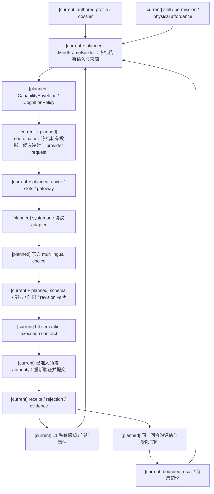
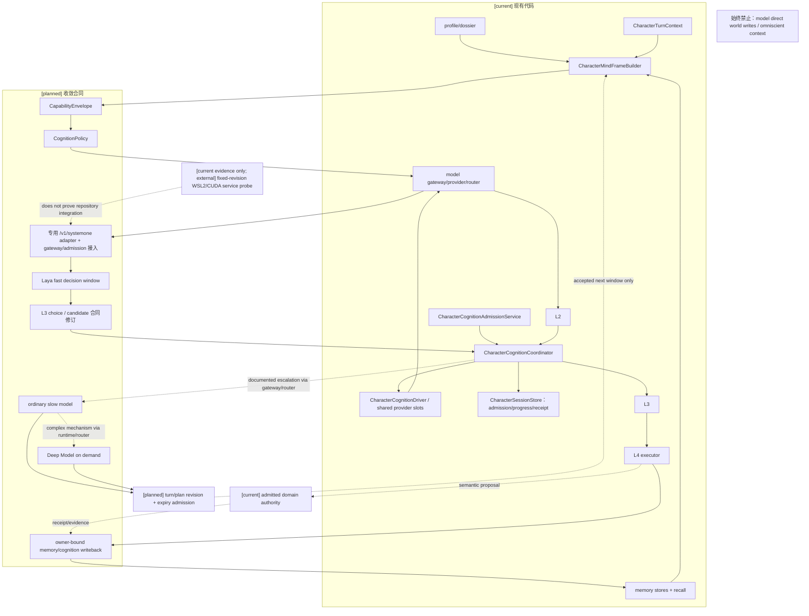
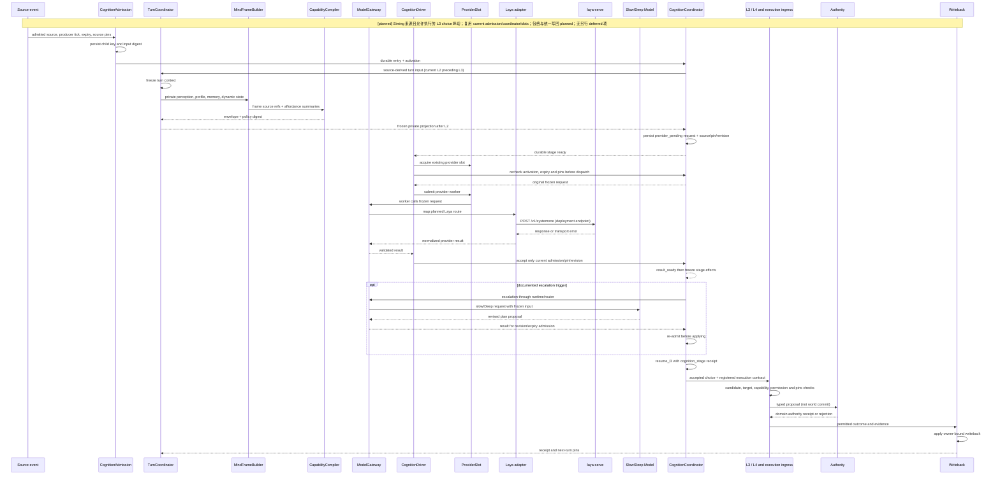

# 角色智能体心智运行时重构总规格

状态：`analysis/planned/non-authorizing`

状态覆盖：`[current]` 现有 CharacterAgent 基础；`[planned]` 本规格的心智编排与合同收敛；`[deferred]` 本主题无另行延期项。模型直写事实、全知上下文、任意脚本规则和第二套角色大脑始终禁止；原分析中将这些列为暂缓的文字不改变根 AGENTS 的运行时边界。

## 1. 目标

本规格定义角色智能体心智模型的一次大改动。改动对象是现有 `backend/app/character_agent/` 的编排、心智帧、记忆、模型 gateway、技能/能力、目标和 L4 执行链，而不是新增一个与现有 runtime 平行的“AI 运行时”。目标是让每个角色回合都能回答：角色看到了什么、记住了什么、此刻受什么状态影响、能做什么、为什么提出这个意图、执行结果如何改变后续心智。

## 2. 现状映射

| 现有实现 | 规格中的职责 | 处理方式 |
|---|---|---|
| `CharacterTurnContext` / `CharacterTurnCoordinator` | 回合身份、revision、阶段、恢复 | 保留并扩展 payload，不替换生命周期 |
| `CharacterMindFrameBuilder` | 心智输入编译器 | 升级为唯一 MindFrame 构建入口 |
| `l1_perception.py` | 私有感知和候选信息 | 只提供 evidence，不拥有 world truth |
| `l2_reasoner.py` | interpretation / cognition update | 受 MindFrame 与 CapabilityEnvelope 约束 |
| `l3_planner.py` | goal/intent/action plan | 只选择 lawful affordance |
| `l4_executor.py` | execution semantics | 产出 `CharacterExecutionContract` |
| `CharacterModelGateway` | 结构化模型调用、验证和 evidence | 统一 L2/L3/dialogue 入口 |
| `CharacterCognitionAdmissionService` / `CharacterCognitionCoordinator` / `CharacterCognitionDriver` | 持久入站、阶段请求/效应、worker 调度 | 复用 owner 和 session store；Laya route/choice 接线 planned，见 §3.1.2 |
| memory stores/recall | 分层记忆存取 | 用 bounded recall 与 owner-bound writeback 统一 |
| skill service / affordance | 稳定能力和当前可用行动 | 编译进 `StableAbilitySnapshot` / `CapabilityEnvelope` |

## 3. 心智模型

```text
Authored profile/dossier
  -> enduring truth + personality + needs/affect baseline
Memory and graph projections
  -> evidence, beliefs, relationships, higher-order beliefs
Current event and private perception
  -> runtime state + attention + active tensions
Skills, permissions, physical feasibility, domain adapters
  -> lawful affordances
Compiler
  -> MindFrame + CapabilityEnvelope + CognitionPolicy
L2 -> L3 -> L4
  -> typed proposal / execution contract
Owner authority
  -> outcome/evidence -> bounded cognition and memory writeback
```

心智模型保留人格、需求、情绪、长期设定、技能、记忆和当前状态的分层；任何一次模型输出都不能把推断提升为长期事实。模型负责主观解释、目标权衡和意图选择；角色 runtime 负责 schema、权限、能力、可执行性、时限、回合、版本、证据和写回。现有 L3 仍有本地候选过滤、回退和评分逻辑，不能把这些实现细节误写成“模型已经拥有全部语义裁决”；迁移目标是把主观策略最终选择收回模型，同时保留本地硬约束。

### 3.1 Laya、普通模型与 Deep Model

Laya 是角色智能体的高频决策核心，不是战斗专用模块。它在冻结的 `CharacterMindFrame`、注册的 `ThoughtMode`、`SelfStateSnapshot`、局部外界感知、短期失败记录和 lawful affordances 上，于动作承诺的决策窗口内选择当前唯一 typed intent，并支持取消、短期协同和连续自保。战斗只是一个 consumer；经济、社交、探索和协同也复用同一心智帧。

普通慢模型负责战术/目标重组、复杂解释和表达草案；Deep Model 按原文触发条件处理复杂机制。可局部解决的信息缺口由 Laya 选择观察、询问或低风险试探；复杂、高风险或持续无法解释时升级，保留连续失败、上下文冲突、新阶段、目标冲突和重复失败动作等触发。等待期间可用的 Laya 继续选择合法当前动作；模型不可用时复用现有 runtime/coordinator 的 continuity floor。取消或过期 turn 不能使用旧 frame 偷交 floor，新动作仍需当前上下文准入。

本轮收敛为独立本地 `laya-serve`，backend 经 Laya 专用 adapter 和现有 gateway/admission 调用回环地址上的 `/v1/systemone`，端口由部署配置确定。现有生成式 `chat/completions` provider 不能只替换 endpoint 冒充接入。A 阶段固定官方 `laya-multilingual`；之后独立对照 `typed-decisions`，不能混入同一基线。慢思考/Deep Model 优先检查本地 LLM；截至本次环境探测未发现已安装权重或运行服务，暂按 API 路线规划，不视为永久结论。

**2026-10-10 provider 证据分层**：上游源码 `NandhaKishorM/laya` `v0.4.2` commit `68804629e8ccd9d616d48a40e87de9fabbeae069` 和 multilingual 权重 revision `1720e3e3357cfe1e281542e223f8273b0890ca34` 已静态固定；权重 SHA-256 与 WSL2/CUDA `/health`、真实 `/v1/systemone` 中文请求见 [实施闸门 §4.3](../审查/03-实施待决收敛与验证闸门.md#43-laya-本机探针证据2026-10-10)。单机探针证明该配置可调用，不证明仓库 adapter、gateway/admission、正式输入/候选合同或模型质量已经完成。仓库当前 `CharacterModelGateway` 仍走通用生成式 provider；专用 Laya adapter 与真实 admission 调用仍是 planned。该单题从五个候选中选出攻击蓄力 Boss 的 `attack_boss`；其结构化可接受动作集合须经人工审查后才可能作为开发集诊断题，不能单题定阈值，也不能进入校准/最终留出。端口、设备、context 上限和并发仍须按正式部署配置及实际服务逐次记录。

上游核对已确认 `choice` 是候选选择及概率分布，`score` 是有序等级期望值，`noul` 是 P(true)；不得把 score 四舍五入冒充 argmax，或把 noul 当布尔。choice/score 的 `confidence` 是归一化熵口径，`answer_confidence` 是最大选项概率，均不自动代表正确率。实际服务的返回字段、错误和取消行为仍需计划01 Task1B验证；本规格不增加未知 wire 字段。上游版本与资料见 [实施决策登记](../审查/03-实施待决收敛与验证闸门.md)。

首版由 Laya 一次选择完整“动作＋目标”候选，选中项映射到注册动作和 [跨玩法动作承诺协议](../角色/11-跨玩法动作承诺协议设计.md) 的承诺、停止、回退及版本信息。Laya 是非生成式 typed decision 模型，不能假定会生成任意文本、长计划或完整动作参数。候选规模策略见规格05 §4.2；候选覆盖与选择质量独立验收。

### 3.1.1 官方基线、质量与模型训练

先固定心智输入、题目、候选并物化有来源的四角色夹具，保留官方权重的独立留出集结果。按 D16 分两轨：关闭受控失误的基础选择质量轨与开启固定 seed 失误的角色表现轨；两轨均保留角色能力上限。输入/题目错误先修正；置信度校准不能替代决策正确率。关键决策在输入/题目/候选确认正确后仍不达标时，本批须完成必要领域微调并重新验证，不能以慢模型回退、合法 schema 或单次成功宣称 Laya 完成。训练、开发、校准与最终测试按场景轨迹划分，允许多种合理动作；教师答案和旧 L3 结果不自动成为真值。详细题型、U/P覆盖、指标分母、来源审核、冻结流程和必要微调合同见 [规格05 §4.2.2–4.2.3](05-角色能力图谱、认知包络与动态算力规格.md#422-评估合同划分校准与微调)。正式数字由开发实测审定，最终留出前冻结；本轮文档收敛不表示质量通过。

工程模型微调不等于角色学习。训练不能直接改变角色 skill、一般认知上限、profile 或世界事实；角色学习仍由规格06的证据和 skill owner 结算。本机训练是否可行、采用哪种训练策略和实际预算必须实测；上游其他设备案例不构成本机完整微调证明。

### 3.1.2 Laya 与现有 gateway/admission 的接入合同

这里的“接入”是让 Laya 的动作选择复用现有 L3 provider stage 的冻结、派发、接纳和恢复边界；不把 L2 的解释/认知更新字段伪造为 Laya choice 输出。当前 `CharacterCognitionAdmissionService` 只接受 `ingest_siming_output` 与 `run_background_cognition_tick` 两种持久入站来源；`runtime_loop.prepare_cognition_job` 另已支持感知事件、自身事件、Siming 和后台四种来源，但它的 `PreparedCognitionJob` 接纳链不能冒充上述持久 progress。gateway 当前 task kind 只有 `l2_reasoning`、`l3_planning`、`dialogue_generation`。这些是不同合同，不能把一个未经修订的新 task kind 或 source kind 直接送进去。

首版完整“动作＋目标”choice 在现有 L3 请求边界接入，显式修订 gateway/router、output validator、L3 completion 映射和 coordinator/driver 的相关合同；保持 canonical `intent` stage 与现有 progress `l3` 的区别。当前 validator 的生成式 L3 输出不等同于官方 choice 响应，不能补造 goal、belief 或认知字段使校验通过。具体内部请求字段和 adapter 方法在 Task1B/Task2A 的实际协议/候选映射中冻结。L2 快决策的其他用法只在有独立 typed 合同后接入，不由本次动作 choice 自动获得。

计划中的边界顺序如下，名称只使用已存在的 owner；新增 adapter 只负责官方 `/v1/systemone` 协议映射，不复制编排、权限、能力过滤、写回或 authority：

1. `CharacterCognitionAdmissionService` 持久保存 `child_key`、`delivery_id`、`source_pins`、`expires_at`、`producer_ts` 与 `input_digest`；coordinator 在 L2 之后通过 `prepare_l3` 持久冻结 frame/候选映射、provider pin 和请求为 `provider_pending`，再允许派发。当前两种持久来源用于第一条接入纵切；连续快循环若由感知/自身事件触发，须在同一 admission owner 扩展并验证 source validation、producer tick、expiry、幂等和 replay，不创建第二套入站，不能用空后台唤醒 payload 偷注入感知。
2. `CharacterCognitionDriver` 通过现有 provider slot 取得该 stage 的冻结 request；在派发前复核 activation、admission expiry 和 provider pin。gateway 的 planned Laya route 将这个冻结请求的已准入角色投影映射到 `/v1/systemone`，并保存足以把响应关联回原 stage 的本地上下文；不得把隐藏 authority、未知动作参数或未登记候选放进 wire 请求。
3. 响应回到 gateway 后先校验实际 choice 协议，再按冻结候选映射恢复唯一动作＋目标；adapter 不生成承诺、停止或回退参数。driver 的 owner 回调进入 `accept_l3`，coordinator 重新检查来源、activation、expiry、actor pin、stage 与 progress revision，只有通过后才能进入 `result_ready`，随后由 `freeze_l3` 生成 decision/effect plan。L3/L4 还须复核候选成员、目标、权限、能力、可执行性和注册执行合同；返回已给 label 不能代替这些检查。
4. `freeze_l3`/`resume_l3` 的 `cognition_stage` receipt 证明角色阶段效应已提交；它不是领域 authority receipt。L4 及执行 ingress 向已准入领域 owner 提交提案，领域 owner 才提交世界结果并返回自己的 receipt/rejection；角色只从已许可反馈更新私有投影。Laya 响应本身永远不是世界结果。失败使用已有 provider error/continuity floor 路径，不能以慢模型或本地假结果填充 Laya 正确率。

取消和迟到结果分开验收：当前实现有 expiry、activation、provider pin/revision 和 stale 拒绝基础；非流式 `_run_provider`/`complete_prepared_request` 没有向 HTTP provider 传递取消 `Event`。`CharacterCognitionDriver.close` 释放 activation、丢弃本轮 future 引用，但持久 progress 可仍是 `provider_pending`；`DialogueProviderSlots` 直到真实 worker 结束才释放槽位。这不证明服务停止计算，也不等于“永久取消该持久请求”。计划中的合同是：显式取消使原请求终止并留下可恢复的 stale/diagnostic；停机则按持久状态重新准入/恢复，不接纳旧 worker 返回。过期、取消或 pin 失效之后不得产生新的 cognition effect、执行提案、领域提交或 memory/cognition writeback，既有 receipt 和允许的拒绝/释放诊断保留；是否能提前终止服务端计算另取真实证据。重试复用原冻结请求和 expiry，不能靠重试延长合法窗口；恢复读取原 request/receipt，不能重排候选或重新解释已消费结果。

实施前必须确认输入投影、官方 wire shape、候选引用与现有签名的映射；本节已解决接入责任与顺序的设计缺口。adapter、显式取消、所需持久来源扩展和全量 envelope 接线在实施中产生；真实调用、迟到零写入、重试/关闭/恢复和 receipt/replay 在验收时取证。缺这些证据阻断 Laya 接入通过与连续快循环能力，角色基础仍可按计划01先推进；质量、B/C和Soul最终验收保持各自门禁。

第一条动作执行纵切选用已准入的 `ingest_siming_output`；仍按角色 control mode 决定执行或建议，不借测试取得 active-control。`run_background_cognition_tick` 可验证 choice 与阶段恢复，但现有 `freeze_l3` 为后台设置 `background_result`、`commands=[]`，`resume_l3` 将其完成，不进入执行链。后台选择成功不能计作动作执行通过；本轮不改变其后台语义来绕过控制模式。

本节依据角色01 §3–7、角色02 §3/§5–7和角色11的动作承诺边界。静态证据映射如下；现有测试只说明应复用的回归合同，不构成 Laya 实证：

| 责任 | 当前代码/测试 | planned 修订边界 |
|---|---|---|
| 冻结与持久入站 | `services/cognition_admission.py`、`test_character_cognition_admission.py` | 同一 owner 扩展所需感知/自身来源；保留 expiry、幂等和来源复核 |
| 阶段请求/接纳/效应 | `services/cognition_coordinator.py`、`storage/session_store.py`、`test_character_cognition_coordinator.py` | 在 L3 请求/效应合同增加 choice 映射；角色 receipt 不升级为世界事实 |
| provider 派发/槽位 | `services/cognition_driver.py`、`backend/app/services/dialogue_continuation.py`、`test_character_cognition_driver.py` | 非流式取消传递与显式终止；停机恢复另行验证，槽位随真实 worker 完成释放 |
| 模型协议与校验 | `gateway/model_gateway.py`、`gateway/model_router.py`、`gateway/output_validator.py` | 专用 systemone adapter 与 choice 校验；保留其他生成式消费者 |
| staged job 边界 | `runtime/runtime_loop.py`、`test_cognition_completion_revision.py` | 将已有四来源与持久 admission 对齐，不把 generation 拒旧结果等同于持久 replay |

代码路径除注明外均相对 `backend/app/character_agent/`，测试均相对 `backend/tests/`。本次是 D07 接入责任与顺序的细化，回写见 RW-01；请求字段、候选映射和实施实证仍按 Task1B/Task2A/Task1A 分阶段取得。

### 3.2 数据流图



本图对应角色01 §5–7、角色08 §7–8及角色10 §5；未观察事实不进入输入，模型输出在 authority 边界前保持提案。`[deferred]` 无另行延期项，禁止模型直写与全知输入。

## 4. 架构图



## 5. 主流程时序图



## 6. 关键不变量

1. 一个 `turn_id` 只使用一套冻结的输入、记忆、策略和能力 revision。
2. 任何 L2/L3/L4 输出都携带 source refs、policy revision、validator result 和 fallback reason。
3. 不可见事实不能进入 MindFrame；高预算不能扩大可见范围。
4. 角色意图不等于领域事实；只有 owner authority receipt 才能进入正式 outcome。
5. 失败时回退到 `observe`、`ask_probe`、`defer`、`self_protect` 或显式 no-op，不能伪造成功。
6. writeback 只允许事件、观察、知识、社交、高阶记忆和 cognition delta 的已声明字段；长期 profile、一般认知基线和权限必须走专门 owner。

## 7. 迁移分层

实施门分两次：计划01先使用现有skill/affordance、gateway budget、privacy和execution validator完成冻结输入、真实provider合同和快慢编排基线；不能宣称此时完整 `CapabilityEnvelope`/`CognitionPolicy` 已实现。计划02 Task1–3编译完整包络/策略并接入同一gateway/Laya/recall/表达入口后，必须回跑计划01 Task1A/6A/6的连续性与恢复测试，才能释放总计划Gate2。顺序来自角色08 §8的先建投影再接快循环及角色13 §14/§23的包络消费验收；不得为通过前置门临时造另一份envelope，也不得等待计划02完成而阻止计划01的现有硬门槛基线。

- 第一层：在现有 coordinator 和 `CharacterMindFrameBuilder` 上增加 envelope/policy/provenance，不改变 L4 contract。
- 第二层：让 L2/L3/model gateway 全部消费冻结 frame，并将 legacy context 适配限制在边界。
- 第三层：让 L4 execution、settlement feedback、episode 和 writeback 使用同一 turn receipt。
- 第四层：把技能学习、协同表达、编辑器 profile 和通用领域 projection 接入同一组 revision pins。

## 8. 验收

- 同一 fixture 能从 turn begin 重建到 L4，并在中途失败后恢复而不重复提交 authority。
- 角色 A/B 只因 profile、memory、affordance 或 policy 不同而产生可解释差异。
- 模型不可用时 local fallback 仍产生合法 schema、明确降级原因和同一边界检查。
- 记忆写回可追踪到 turn、source event、owner receipt 和 revision。
- 相关测试至少覆盖 `test_character_turn_*`、`test_character_mind_*`、`test_character_agent_l1/l2/l3/l4*`、`test_character_model_*`、`test_character_memory_*`。

## 9. 来源追踪与验收映射

| 原设计来源 | 本规格落点 | 计划任务 |
|---|---|---|
| [角色/01 设计 §2–4](../角色/01-角色心智模型与模型驱动运行时设计.md) | §3、§3.1、§6、§7；模型主观解释/目标权衡/意图选择与本地硬约束边界 | [计划01 Task 1、4、6A](../计划/01-角色心智运行时基础实施计划.md) |
| [角色/01 说明·接入顺序/验证入口](../角色/01-角色心智模型与模型驱动运行时说明.md) | §3.1、§8；Laya 接入顺序、真实 checkpoint 证据门槛 | [计划01 Task 1、1A、6A、7](../计划/01-角色心智运行时基础实施计划.md) |
| [角色/02 设计 §1、§3、§5](../角色/02-Laya快循环与快慢思考战斗设计.md) | §3.1、§4、§6；跨玩法快循环、升级/降级和 authority 边界 | [计划01 Task 1A、6A](../计划/01-角色心智运行时基础实施计划.md) |
| [角色/08 设计 §8](../角色/08-游戏AI启发下L1-L4架构增强设计.md) | §7；先做自身/外界/执行投影，再接 Laya | [计划01 Task 1–3](../计划/01-角色心智运行时基础实施计划.md) |

关联计划：[01-角色心智运行时基础实施计划](../计划/01-角色心智运行时基础实施计划.md)。


### A-Cognition development 输入边界修复回写（2026-10-13，RW-26）

本轮定位到两处实际丢失边界：评估准备器把角色投影保存在旁路记录，`laya_state` 只取 scenario event；正式 provider serializer 又未消费请求已有的角色上下文。因此修复准备器及实际 provider 边界，复用 `CharacterMindFrameBuilder`、gateway 的冻结 prepared request，以及共享 `build_wire_request`。冻结审核和真实调用使用同一 serializer，对照完整 `state`、`criteria`、choice labels 与内部 U/P 映射，不仅比较 state 字符串。

`[current]` 修复后的 state 复用 `CharacterPromptPolicy._profile_summary(effective_profile)` 的既有角色摘要，并携带注册的 envelope/policy 字段；不建立评估专属人格 prompt，不把原始 dossier、完整私有档案、gold、acceptable actions 或 reviewer rationale 送入 provider。char_a/b/c 使用当前 authored profile 来源，经 MindFrame 编译及获准 L3 输入投影；char_d 只解析隔离 authored metadata，缺失人格、认知、能力与算力保持 unknown/unavailable，仅评估已有来源的诊断边界，不创建正式角色或默认值。

`[planned]` development readiness 必须由来源、schema/隔离、冻结输入和最终 wire 一致性检查产生；外部手改 v2 不是可复现生成器证据。准备包由修正入口重新生成，保留 source revisions/digests、转换路径及逐题 frozen request；本轮真实运行结果另登记审查03、审查05，证据导出根目录为 `D:/Temp/paralls-acognition-development-20261013-inputfix/`。本节记录输入实现差异，不预先声明真实调用、正确率、延迟或验收通过。

`[deferred]` 本轮 calibration、final/holdout、微调、具身动作和 owner 改造均不执行。已暴露的原 calibration 版本保留污染事实及历史证据，不能通过重命名、洗牌或复用相同题目恢复盲性，必须由独立来源重建；final/holdout 继续封存。`action_target_quality_denominator=0`，observe/ask_probe/defer 不计完整动作＋目标质量；共同安全题不能证明角色条件差异，unknown/unavailable 造成的能力缺口另列。16 条 development 不能冻结正式阈值或释放四角色整体心智、完整 A 或 A-Embodied。

本次为既有输入链的最小修复；架构、主时序及数据流仍以本文件现有三图和规格01/03/05为准。对应计划01 Task1B/1C、审查03 §4.19、审查05 §7.5及回写登记 RW-26；B/C、玩法包、编辑器、自走棋、AD/Blender 保持关闭。
