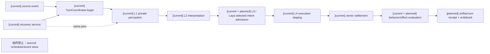
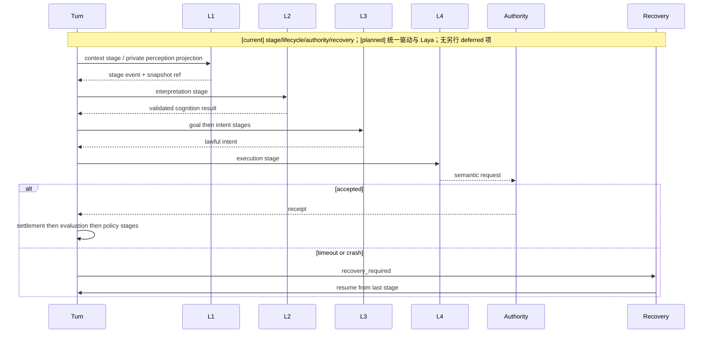
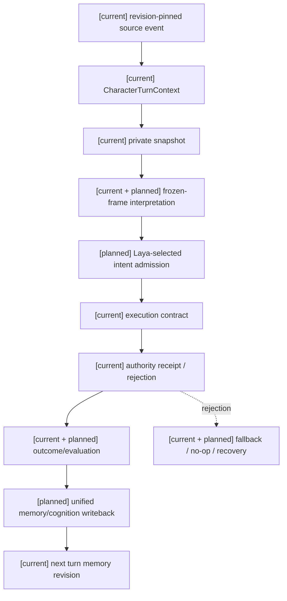

# 角色回合编排与 L1-L4 生命周期规格

状态：`analysis/planned/non-authorizing`

状态覆盖：`[current]` `CharacterTurnContext`、coordinator 和 recovery；`[planned]` 统一 stage driver 与证据；`[deferred]` 本主题无另行延期项。第二套 scheduler/event store 与未经 authority 的事实推进始终禁止。

## 1. 范围与现状

当前 `CharacterTurnContext` 已实现不可变身份、阶段顺序、生命周期、idempotency、revision vectors 和 recovery transitions；`CharacterTurnCoordinator`、`cognition_coordinator.py`、`runtime_loop.py`、`character_turn_recovery.py` 已分别承担创建、推进、持久化和恢复。本规格把它们收敛为一个显式 stage driver，不另建 scheduler 或 event store。

## 2. 阶段合同

阶段直接沿用 `backend/app/models/behavior_turn.py` 的现有 `BEHAVIOR_TURN_STAGE_ORDER`，不得另行命名：

```text
context -> interpretation -> goal -> intent
        -> execution -> settlement -> evaluation -> policy
```

现有 lifecycle 转移为：`context: prepared -> running`；`interpretation/goal/intent: running -> running`；`execution: running -> awaiting_settlement`；`settlement: awaiting_settlement -> settled`；`evaluation: settled -> evaluated`；`policy: evaluated -> committed`。`CharacterTurnLifecycle` 还含 `rejected`、`recovery_required`、`abandoned`、`failed` 等非正常终态/恢复态。失败、拒绝和恢复使用已有 lifecycle transition，不发明 `planned` 或 `execution_staged` stage。每个阶段必须写入 stage ref、idempotency key、producer timestamp、source refs、revision pins 和 outcome。阶段 payload 不能包含未验证的 world mutation。

## 3. Laya 在角色回合中的核心位置

Laya 是本次角色智能体心智模型重构的高频决策核心，而不是只服务战斗的适配器。原始分析要求它在不等待慢思考的情况下连续完成观察、试探、闪避、攻击、资源管理、失败修正、阶段切换和撤退；因此 Laya 必须运行在冻结的 `CharacterMindFrame`、ThoughtMode、当前能力/动作可用性和自身状态反馈之上，仍然经过 L4 承诺和领域 authority。

一次 Laya 决策只消费角色已获准的输入：冻结心智帧、自身/外界/执行状态投影、短期失败记录、当前注册模式和 lawful affordances；仅当战斗 adapter 存在时才包含 `CombatHotSnapshot`/`CombatDelta`。它不读取隐藏 Boss 状态，不把物理接触当作伤害，不直接结算资源、命中、控制或环境场。Laya 的动作输出沿用跨玩法动作承诺协议，至少保留 `intent`、目标、`commitment_ms`、`preconditions`、`abort_conditions`、`fallback`、`context_revision`；精确承诺结构以 [角色/11](../角色/11-跨玩法动作承诺协议设计.md) 为准。连续位移和动画由执行层承接，不逐 render frame 调用模型。

### 3.1 Laya 快循环、升级与降级

| 回合内输入/阶段 | Laya 可做的事 | 不由 Laya 拥有的事实 |
|---|---|---|
| 观察与试探 | 选择 `observe`、`probe`、保持距离、试探性动作 | 隐藏招式表、未观察到的命中/伤害事实 |
| 闪避与攻击 | 选择 `dodge`、`block`、`attack`、`punish`、`focus_target` | 命中、伤害、控制、资源扣除 |
| 资源与生存 | 选择 `heal`、`disengage`、`hold_position`、`retreat`、`protect_ally` | 真实资源余额、药效、生命状态迁移 |
| 失败修正 | 依据 `CombatDelta`、动作阶段和身体反馈调整下一次承诺 | 把失败解释成已成功 |
| 阶段切换 | 在 L1 提供阶段/姿态/音效/范围变化时切换 ThoughtMode 偏好 | 直接宣告 Boss 阶段或世界规则变化 |

升级触发必须来自原分析列出的条件：连续失败、上下文冲突、新阶段、目标组合冲突、信息不足，或快循环重复同一失败动作。慢思考负责短期重规划，Deep Model 只处理快循环无法解释的新机制、高风险冲突或连续无法解释的模式；升级期间 Laya 仍保持防御、保持距离、自保和撤退等连续性动作。降级顺序是取消动态语音/复杂表达，慢思考回落到 Laya，模型不可用时进入 continuity floor，仅允许观察、保持距离、自保、撤退和沉默。

这些是需评估的触发条件，不表示所有信息不足都立即调用慢模型。可局部解决时由 Laya 选择主动观察、询问或低风险试探，再由 L1 回收真实证据；复杂、高风险、持续无法解释或已注册升级策略要求介入时才异步重规划。首版一次选择完整候选，不自动拆成动作族和目标两个回合。具体部署、checkpoint 和质量策略见规格01 §3.1及 [决策登记 D01–D10](../审查/03-实施待决收敛与验证闸门.md)。

### 3.2 Laya 与回合阶段的固定关系

Laya 的 typed intent 属于现有 `intent` stage；提交执行进入 `execution`，随后由 `settlement` 等待/记录 owner 结果，再由 `evaluation`、`policy` 完成评估和提交。Laya 不得把 `planned`/`execution_staged` 当作独立 canonical stage，不得在结果尚未结算时读取能力变化，也不得把 Actor 表现完成当作结算成功。

### 3.3 架构图



## 4. 并发与恢复

同一 actor 的同一 `turn_id` 只能有一个活动执行分支；重试使用相同 stage idempotency key，payload 不一致即拒绝。模型长任务通过已有 cognition admission/progress/continuation 设施分段，但每段仍写入同一 turn 的阶段事实。停机恢复先读取 turn receipt、stage refs、memory revision 和 policy revision，再从最后已确认阶段继续；不得从未提交的模型文本推断成功。

快慢并行只允许模型计算异步，结果经同一 coordinator/admission 接纳，不创建第二个 actor 写入分支或第二把认知锁。旧结果、已取消 turn、过期输入和错误 revision 均不得写回；continuity floor 同样必须满足当前 turn/context 准入，不能绕过失败的 admission。

Laya 动作 choice 的接入合同见 [规格01 §3.1.2](01-角色智能体心智运行时重构总规格.md#312-laya-与现有-gatewayadmission-的接入合同)：复用 `prepare_l3` → durable `provider_pending` → driver/provider slot → gateway 专用 adapter → `accept_l3` → `freeze_l3`，再经 L3/L4 合同与领域 owner。内部 progress `l3` 不等于新增 canonical stage；choice 响应也不等于现有生成式 L3 output，gateway/output validator/L3 completion 必须显式映射，不能补造认知或目标字段。

持久 admission 目前只有 Siming/后台来源；`PreparedCognitionJob` 的感知/自身事件接纳已有实现，但不能由此声称相同来源已具有持久 progress/replay。连续快循环所需来源在同一 owner 扩展并回验，禁止伪造后台 payload 或 producer tick。显式取消须终止原持久请求；driver 停机目前可能保留 `provider_pending`，恢复须重新准入并复用原冻结 request/receipt。旧 worker 返回不得触发新效应、执行提案、领域提交或写回，拒绝/释放诊断可以保留；取消 `Event` 和槽位释放均不证明服务端已停止计算。

## 5. L1-L4 边界

| 层 | 输入 | 允许输出 | 不拥有 |
|---|---|---|---|
| L1 | System L1 facts、provider/PQF、actor-private filter、主动感知结果 | private snapshot、attention、evidence refs | 世界真值、记忆事实、authority |
| L2 | MindFrame、能力包络、记忆证据、ThoughtMode | interpretation、belief/cognition delta、uncertainty | 目标选择、动作成功、长期能力 |
| L3 | interpretation、goals、needs/affect、lawful affordances | intent candidates、goal transition、execution proposal | 资源扣除、状态提交、身体控制 |
| L4 | semantic intent、physical feasibility、execution policy | `CharacterExecutionContract`、presentation plan、request bundle | world mutation、raw pose、settlement receipt |

## 6. 时序图



## 7. 数据流图



## 8. 验收

覆盖顺序错误、重复 stage、payload mismatch、duplicate settlement、模型超时、断点恢复、旧 revision、branch mismatch 和 authority rejection。任何错误路径都证明没有重复事实提交。

## 9. 来源追踪与验收映射

| 原设计来源 | 本规格落点 | 计划任务 |
|---|---|---|
| [backend behavior_turn.py](../../../backend/app/models/behavior_turn.py) `BEHAVIOR_TURN_STAGE_ORDER` 与 `BEHAVIOR_TURN_STAGE_TRANSITIONS` | §2 精确 stage/lifecycle 合同 | [计划01 Task 1、2、6](../计划/01-角色心智运行时基础实施计划.md) |
| [backend turn_context.py](../../../backend/app/character_agent/models/turn_context.py) lifecycle | §1–2 当前实现映射 | [计划01 Task 1、2、6](../计划/01-角色心智运行时基础实施计划.md) |
| [角色/01 设计 §3–8](../角色/01-角色心智模型与模型驱动运行时设计.md) | §3、§3.2；Laya 决策核心、模型/本地职责及事实边界 | [计划01 Task 1、1A、4、6A](../计划/01-角色心智运行时基础实施计划.md) |
| [角色/02 设计 §3–6 与说明·调度接口/验证重点](../角色/02-Laya快循环与快慢思考战斗设计.md) | §3.1–3.2；连续决策、升级降级、commitment 边界和非逐帧约束 | [计划01 Task 1A、6A、7](../计划/01-角色心智运行时基础实施计划.md) |
| [角色/11 设计 §3–4](../角色/11-跨玩法动作承诺协议设计.md) | §3 commitment 引用、§5 L4 边界 | [计划02 Task 5](../计划/02-角色能力学习与动作实施计划.md) |

关联：[01-角色智能体心智运行时重构总规格](01-角色智能体心智运行时重构总规格.md)。

