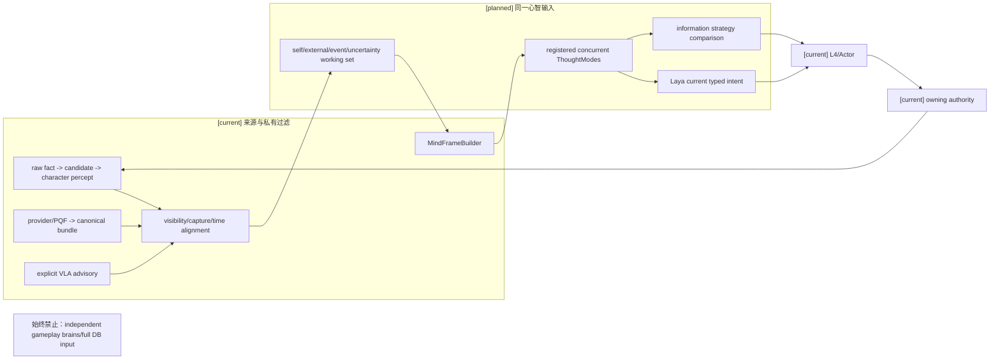
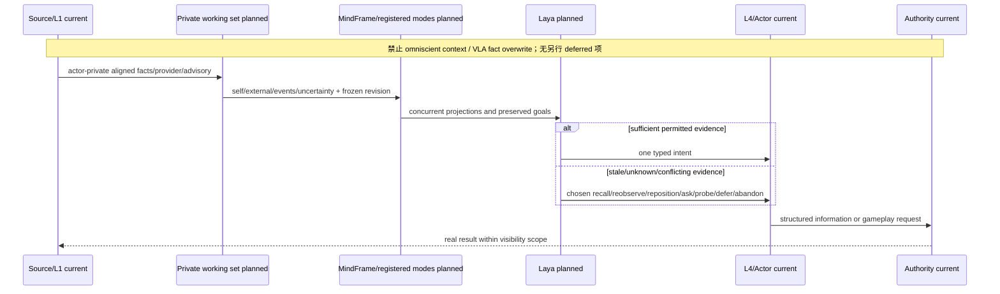
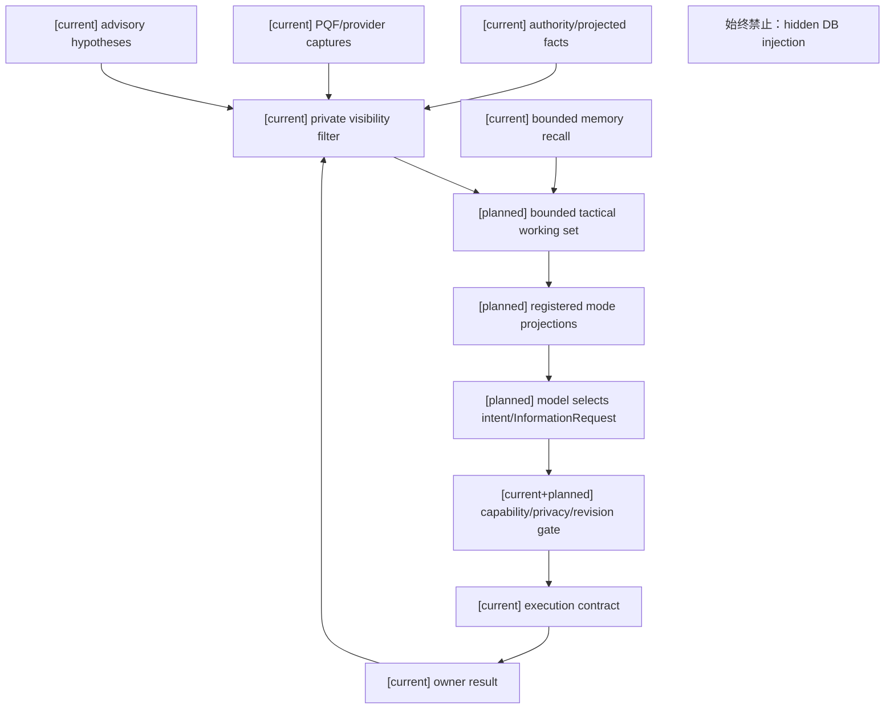

# 角色心智帧、感知边界与 ThoughtMode 规格

状态：`analysis/planned/non-authorizing`

状态覆盖：`[current]` L1 事实主链、PQF/provider、显式 VLA advisory、主动感知和 MindFrameBuilder；`[planned]` 统一 L1 tactical working set、可注册 ThoughtMode、多模式输入和信息策略；`[deferred]` 本主题无另行延期项。全知上下文、VLA 覆盖事实、独立玩法大脑始终禁止。

## 1. 目标与实现基线

本规格按角色/05、08、09、10、12设计统一角色输入。`CharacterMindFrameBuilder` 保持心智输入编译入口；L1 是外部信息唯一入口。模式、短期工作区和主动感知只是同一心智模型的输入投影与行动需求，不能创建第二套脑状态。

| 当前实现入口 | 当前行为 | 本轮规划缺口 |
|---|---|---|
| `scripts/l1/facts/RawFactEmitter.gd`、`backend/app/main.py` | `raw_fact_event` 进入 L1 foundation、candidate compile、actor filter、`CharacterPerceivedEvent` | 保留事实主链及可见性规则 |
| `backend/app/world_runtime/l1_runtime_perception_bridge.py` | 隔离 `PerceptionInputFrame`、PQF、`CanonicalPerceptBundle` 并 ingest | 与事实主链共享 capture identity、时空对齐 |
| `backend/app/character_agent/reasoning/l1_perception.py` | 私有快照、provider refs 和质量链 | 编译 self/external/event/uncertainty 工作区 |
| `backend/app/character_agent/reasoning/active_perception.py` | 已有陈旧、冲突、目标消失、可达性失败触发 | 比较多种信息策略及成本 |
| `backend/app/character_agent/mind/frame_builder.py` | 档案、记忆、状态、affordance 心智帧 | 冻结模式/工作区与来源版本 |

VLA 当前是可显式调用的 advisory 支路，主应用未自动编排，默认 provider blocked；`world_hypotheses` 和 `uncertainty.vla_advisory` 不覆盖 `l1_projected_fact`。没有 live proof 时不能宣称每轮 VLA 或真实 provider 已接入。

## 2. L1 私有工作区与心智帧

按角色/08 §8，先定义 `SelfStateSnapshot`、`ExternalPerceptSnapshot`、`ActionExecutionState` 和统一 revision，再连接已有身体事件、Embodied providers 与 Actor 状态，最后进入 Laya 决策窗口。`SelfStateSnapshot` 细节见 [规格07](07-角色动作承诺具身反馈与失败恢复规格.md)。

按角色/09，工作区统一四组：`self_state`、`external_state`、`event_inbox`、`uncertainty`。短期工作区维护当前事件、资源/动作阶段、局部威胁、失败和信息缺口；长期记忆仍走 bounded recall。工作区不承诺未观察到的敌人属性、掉落表、市场全量价格或世界数据库。

`CharacterMindFrame` 保留现有 enduring truth、memory evidence、runtime state、affordances 和 cognition process 分层。模式帧与目标组合映射到现有模型前，先核对已存在字段和序列化合同；原文的 `MindFrame`、`ThoughtModeFrame`、`GoalPortfolio` 是设计语义，不以示意 YAML 代替真实 Pydantic 模型。每项输入保留 `source`、`confidence`、`context_version/revision`，感知还保留 capture、freshness、visibility 和 uncertainty。

## 3. ThoughtMode 注册合同

ThoughtMode 是可注册 descriptor，不冻结为没有来源的五种固定模式。设计/说明共同规定：

| 设计字段 | 语义 |
|---|---|
| `mode_id` | 稳定模式标识 |
| `activation_conditions` / activation、suspension rules | 目标、身体风险、环境事件、失败和信息缺口触发 |
| `input_projection`、`domain` | 获准私有输入的领域视角 |
| `question_schema` | 本轮需整理的问题维度 |
| `output_intent_types` / `allowed_intents` | 已注册 intent 范围，仍受权限和能力 gate |
| `priority_bias` | 模式偏好，不直接替模型选择主观目标 |
| `resource_horizon` | 当前可见资源与规划跨度 |
| `information_needs` / `information_request_types` | 可提出的信息需求 |
| `exit_conditions` | 退出/暂缓条件 |

这些字段来自原文两个视图；实现前在计划01 Task 3冻结字段对应、owner 和兼容方式，不能擅自把相近字段合并成任意字典。

多个模式可同时激活。战斗与材料/经济目标并存时，各模式提供输入视角，Laya 选择当前唯一 intent；未胜出目标保留为 preserved/background goal。模式管理器可提升、降低、保留或暂缓模式，不写最终 belief、goal 或 world truth；慢思考负责模式重组和长跨度取舍。

角色/12 推荐首组注册示例是 `combat_probe`、`combat_punish`、`survival_priority`、`protect_ally`、`investigate_pattern`、`retreat_and_recover`。它们是战斗 consumer 的模式名，不应成为通用心智 runtime 的命名；经济、社交、探索适配按角色/05提供自己的 descriptor。

## 4. 信息需求与主动感知

角色/05说明的 `InformationRequest` 包含 `requested_observation`、`reason`、`urgency`、`target_scope`、`expires_at`；`PerceptionResult` 包含 `observed_facts`、`uncertainty`、`source`、`context_revision`。底层字段范围和现有事件映射由计划01 Task 3先验验证后冻结。

按角色/10，未知、陈旧或冲突信息进入模型的价值/时间/风险/资源比较，允许选择：

| 策略 | 实际含义 | 结果边界 |
|---|---|---|
| `RecallStrategy` | 先检查记忆与当前上下文 | 过去证据不升级成当前真值 |
| `LocalReobserveStrategy` | 原地重新观察 | 重新经过 L1 |
| `RepositionAndObserve` | 移动到更好观察位置 | 经 L4/Actor，不能直接改位置 |
| `AskOtherActor` | 询问队友/NPC | 对方回答保留来源与可信度 |
| `ProbeAction` | 低风险试探 | 仅真实结果形成新证据 |
| `DeferStrategy` | 暂缓并保持安全 | 明确信息未补齐 |
| `AbandonStrategy` | 信息价值低于成本时放弃 | 不伪造调查结论 |

不要求探索只输出 probe/observe，也不自动返回原地点。经济模式可 `inspect_price/negotiate/buy/sell/reserve/wait/ask`，所有库存、支付、产权结果由经济 owner结算；未知价格通过信息行动获得。

## 5. 架构图

## 6. 主流程时序图

## 7. 数据流图

## 8. 验收

- 事实主链、provider/PQF 和显式 VLA 使用一致 capture identity/时空对齐；VLA 迟到或低置信度不能覆盖已确认事实。
- 角色 A/B 只获得各自私有投影；debug/creator 数据不进入模型；缺少或过期来源保持 unknown/conflict。
- 战斗与经济模式同时存在，只有一个当前 intent，其他目标可回放地保留/暂缓。
- 同一信息缺口分别触发 recall、原地观察、移动观察、询问、试探、暂缓或放弃，选择受信息收益/时间/风险/资源约束。
- 信息结果重新经过 L1，长期记忆不能冒充当前外界状态；无 receipt 不形成成功事实。
- 真实 VLA provider 声明需单独 live proof；本规格不宣称 Laya 或自动 VLA 已实现。

## 9. 来源追踪

| 原设计来源 | 本规格/验收 | Plan task |
|---|---|---|
| [角色/05 设计 §3、§3.1、§4–9及说明·推荐适配器契约](../角色/05-玩法思考模式适配与L1信息获取设计.md) | §3–4、验收2–5；注册字段、并发模式、经济信息边界 | [计划01 Task 3、4](../计划/01-角色心智运行时基础实施计划.md) |
| [角色/05 说明·当前真实链路](../角色/05-玩法思考模式适配与L1信息获取说明.md) | §1 当前事实/PQF/VLA映射 | [计划01 Task 1、2A](../计划/01-角色心智运行时基础实施计划.md) |
| [角色/08 设计 §8](../角色/08-游戏AI启发下L1-L4架构增强设计.md) | §2；自身/外界/执行投影优先于 Laya | [计划01 Task 2A、3、1A](../计划/01-角色心智运行时基础实施计划.md) |
| [角色/09 设计 §1、§5](../角色/09-L1多源感知与信息入口设计.md) | §1–2、验收1–2；三来源、工作区、capture 对齐 | [计划01 Task 2A、3](../计划/01-角色心智运行时基础实施计划.md) |
| [角色/10 设计 §2、§5](../角色/10-主动感知与记忆边界设计.md) | §4、验收4–5；七策略、记忆新鲜度 | [计划01 Task 3、5](../计划/01-角色心智运行时基础实施计划.md) |
| [角色/12 设计 §2、§6](../角色/12-传统游戏AI与ThoughtMode设计.md) | §2–3；Blackboard映射和推荐模式 | [计划01 Task 3](../计划/01-角色心智运行时基础实施计划.md) |

### A-Cognition development 输入边界修复回写（2026-10-13，RW-26）

本轮定位到两处实际丢失边界：评估准备器把角色投影保存在旁路记录，`laya_state` 只取 scenario event；正式 provider serializer 又未消费请求已有的角色上下文。因此修复准备器及实际 provider 边界，复用 `CharacterMindFrameBuilder`、gateway 的冻结 prepared request，以及共享 `build_wire_request`。冻结审核和真实调用使用同一 serializer，对照完整 `state`、`criteria`、choice labels 与内部 U/P 映射，不仅比较 state 字符串。

`[current]` 修复后的 state 复用 `CharacterPromptPolicy._profile_summary(effective_profile)` 的既有角色摘要，并携带注册的 envelope/policy 字段；不建立评估专属人格 prompt，不把原始 dossier、完整私有档案、gold、acceptable actions 或 reviewer rationale 送入 provider。char_a/b/c 使用当前 authored profile 来源，经 MindFrame 编译及获准 L3 输入投影；char_d 只解析隔离 authored metadata，缺失人格、认知、能力与算力保持 unknown/unavailable，仅评估已有来源的诊断边界，不创建正式角色或默认值。

`[planned]` development readiness 必须由来源、schema/隔离、冻结输入和最终 wire 一致性检查产生；外部手改 v2 不是可复现生成器证据。准备包由修正入口重新生成，保留 source revisions/digests、转换路径及逐题 frozen request；本轮真实运行结果另登记审查03、审查05，证据导出根目录为 `D:/Temp/paralls-acognition-development-20261013-inputfix/`。本节记录输入实现差异，不预先声明真实调用、正确率、延迟或验收通过。

`[deferred]` 本轮 calibration、final/holdout、微调、具身动作和 owner 改造均不执行。已暴露的原 calibration 版本保留污染事实及历史证据，不能通过重命名、洗牌或复用相同题目恢复盲性，必须由独立来源重建；final/holdout 继续封存。`action_target_quality_denominator=0`，observe/ask_probe/defer 不计完整动作＋目标质量；共同安全题不能证明角色条件差异，unknown/unavailable 造成的能力缺口另列。16 条 development 不能冻结正式阈值或释放四角色整体心智、完整 A 或 A-Embodied。

本次为既有输入链的最小修复；架构、主时序及数据流仍以本文件现有三图和规格01/03/05为准。对应计划01 Task1B/1C、审查03 §4.19、审查05 §7.5及回写登记 RW-26；B/C、玩法包、编辑器、自走棋、AD/Blender 保持关闭。
