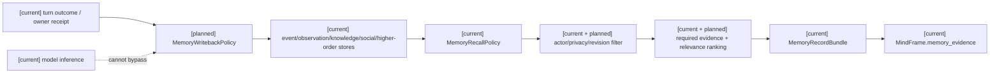
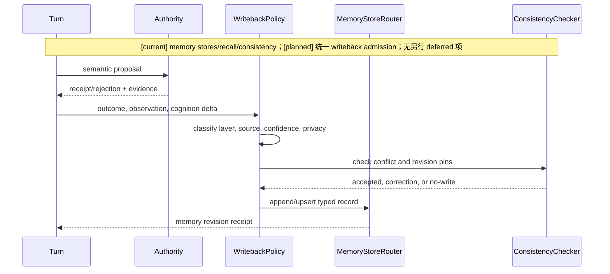
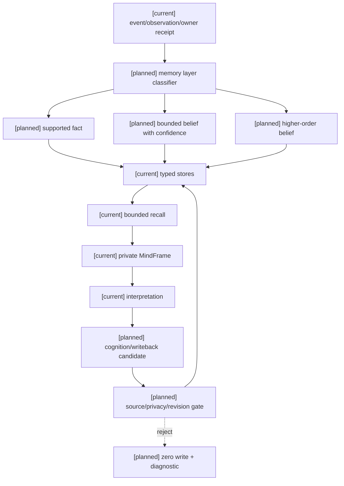

# 角色记忆分层、召回与写回规格

状态：`analysis/planned/non-authorizing`

状态覆盖：`[current]` 五池 memory、recall policy、stores 和 consistency tests；`[planned]` bounded recall/writeback 统一合同；`[deferred]` 本主题无另行延期项。无授权的全局共享角色记忆和模型任意事实写入始终禁止。

## 1. 现状与目标

当前已有 event、observation、knowledge、social、higher-order、working memory 模型、store、recall policy、graph continuity 和 consistency 测试。本规格把它们组织成“事实来源不同、读策略统一、写回受 owner 约束”的记忆系统，避免将所有内容压成一段摘要，也避免让模型输出直接升级为知识事实。

## 2. 记忆层级与语义

| 层 | 记录 | 允许来源 | 典型用途 |
|---|---|---|---|
| event | 已发生的角色相关事件 | authority receipt、turn outcome | 时间线与因果回放 |
| observation | 角色观察到的证据 | L1/private perception | 感知复核 |
| knowledge | 经 owner/证据支持的命题 | authored knowledge、validated inference | 解释与计划 |
| social | 对他者的关系/互动记录 | social owner、角色经验 | 协同与表达 |
| higher-order | 对他者信念/意图的判断 | bounded inference + evidence | 社会推理 |
| working | 当前回合临时激活项 | recall/compiler | L2/L3 输入 |

higher-order 不是世界真理；没有足够证据时状态必须是 suspected/uncertain，不能写成 confirmed knowledge。working memory 有明确 token/item 预算，回合结束后只保留符合写回策略的记录。

## 3. 召回与主动信息合同

`CharacterMemoryRecallPolicy` 是唯一召回入口。输入包括 actor、turn context、query terms、required refs、visibility scope、policy budget 和 source revision；输出是按层分组的 `MemoryRecallResult`，附 metadata、missing_required_refs、ranking reason、token estimate 和 digest。

召回顺序：先 required evidence，再当前事件与观察，再目标相关知识，再社交/高阶，最后才是弱相关历史。召回不能绕过 actor-private scope；debug、creator、其他角色的隐私数据不能进入角色 frame。

召回发现缺失、过期或冲突时，不得用模型猜测填补。它把信息缺口交给心智/L3，由其比较 `RecallStrategy`、`LocalReobserveStrategy`、`RepositionAndObserve`、`AskOtherActor`、`ProbeAction`、`DeferStrategy`、`AbandonStrategy` 的信息收益、时间、风险和资源成本；结果必须再经 L1 形成新 evidence。每条记忆保留 `source`、`captured_at`、`freshness`、`confidence`、`attention`、`conflict`、`revision`，使主动感知不会把旧记录当当前真值。

## 4. 架构图

## 5. 写回时序图

## 6. 数据流图

## 7. 一致性与修正

相同 `proposition_key` 的知识/社交记录必须通过 `memory_claim_key` 或等效 canonical key 去重。发现新证据时使用 correction/upsert，并保留 source refs；删除或覆盖历史事实必须由 owner correction event 完成。记忆 revision 参与 `CharacterTurnContext.memory_revision_vector`，旧 bundle 不能提交到新 turn。

## 8. 验收

- required evidence 缺失会得到 `MissingRequiredMemoryEvidence` 或等效结构化结果，不会悄悄用模型猜测补齐。
- actor A 不能召回 actor B 的私有 memory；creator/debug 只在显式 debug projection 中可见。
- 相同 turn/revision/seed 的排序、截断、token 估算和写回结果可重放。
- outcome、observation、belief、higher-order belief 的写回类型和 source refs 可审计。
- memory hot path 的 recall budget 不得被 LLM 输出长度或高 thinking effort 绕过。

## 9. 来源追踪

| 原设计来源 | 本规格落点 | 计划任务 |
|---|---|---|
| [角色/10 §1–5](../角色/10-主动感知与记忆边界设计.md) | §2–3、§7；记忆证据边界、七种主动感知策略及字段 | [计划01 Task 5](../计划/01-角色心智运行时基础实施计划.md) |
| [角色/09 §1、§5](../角色/09-L1多源感知与信息入口设计.md) | §3；L1 私有投影、freshness/uncertainty 和重入 | [计划01 Task 3、5](../计划/01-角色心智运行时基础实施计划.md) |
| [角色/01 说明·接入顺序](../角色/01-角色心智模型与模型驱动运行时说明.md) | §1、§5；结果回写同一心智状态，不造隐藏脑 | [计划01 Task 3、5、6](../计划/01-角色心智运行时基础实施计划.md) |

关联：现有 `backend/app/character_agent/gateway/memory_recall.py`、`memory/*`、`storage/*` 与 [角色/10-主动感知与记忆边界设计](../角色/10-主动感知与记忆边界设计.md)。
