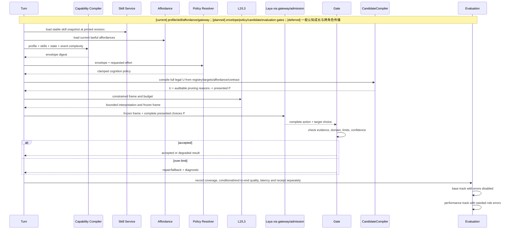
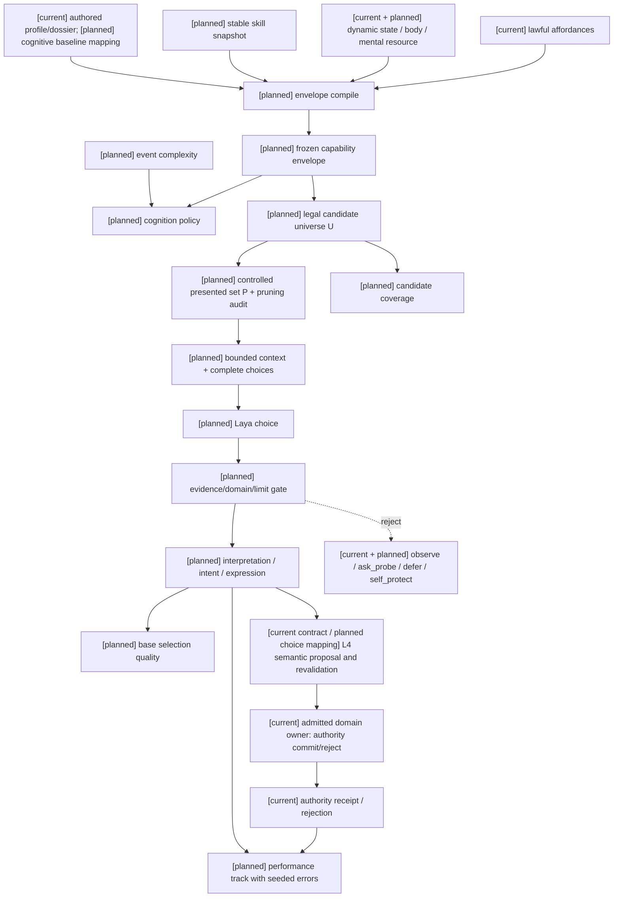

# 角色能力图谱、认知包络与动态算力规格

状态：`analysis/planned/non-authorizing`

状态覆盖：`[current]` profile、skill registry/service、affordance 和 gateway budget；`[planned]` CapabilityEnvelope/CognitionPolicy/gates；`[deferred]` 角色13 §14列出的事件驱动一般认知成长、跨角色能力传播与通用能力图平台，本批不实现。新的平行图数据库和模型直接创建正式技能/认知能力始终禁止。

## 1. 现状与问题

当前仓库已有 `CharacterProfile`、`CharacterDossier`、`CapabilitySeedProfile`、`SkillDefinition`、`SkillActionBinding`、`CharacterSkillState`、`CharacterSkillService`、affordance projection、`PersonalityProjectionResolver`、memory budget 和 model gateway。缺口是这些输入还没有编译成一个同时被 L2、L3、dialogue 和 recall 消费的硬边界。

本规格定义三层：

```text
一般认知基线： authored profile 的长期上限
稳定领域能力：现有 skill/ability graph 的可审计能力
当前回合包络：基线 + 稳定技能 + affordance + dynamic state 的冻结结果
```

人格影响选择偏好、风险偏好、关系策略和表达方式，不伪装成智力分数；技能掌握不自动提升一般认知上限；装备、标签和精神资源只通过领域 affordance 或状态投影影响当前可用性。

## 2. 数据对象

以下两段按角色13 §5.1/§5.4原文示例列出；数值仅为该原文夹具，不是产品默认阈值或重新设计的角色。`cognitive_capability_layer` 是档案字段，`CognitiveCapabilityProfile` 是目标合同名；实施需映射现有profile，不能以此示例另建wire格式。

```yaml
cognitive_capability_layer:
  general_facets:
    working_memory: 0.74
    evidence_discrimination: 0.86
    causal_reasoning: 0.67
    abstraction: 0.55
    social_inference: 0.82
    spatial_reasoning: 0.36
    numerical_reasoning: 0.42
    metacognition: 0.79
  hard_limits:
    max_context_items: 8
    max_active_hypotheses: 3
    max_reasoning_hops: 2
    max_candidate_intents: 3
    max_concurrent_goals: 2
    planning_horizon: short
    confidence_ceiling_without_evidence: 0.68
  compute_defaults:
    preferred_effort: balanced
    maximum_effort: deep
    memory_recall_limit: 8
    l2_max_tokens: 550
    l3_max_tokens: 900
    dialogue_max_tokens: 160
  expression_constraints:
    vocabulary_band: plain
    explanation_depth: concrete
    uncertainty_style: qualified
```

```yaml
capability_envelope:
  actor_id: char_b
  turn_id: turn:char_b:204
  capability_revision: capability:char_b:17
  envelope_revision: envelope:char_b:204
  cognitive_limits:
    max_context_items: 6
    max_active_hypotheses: 2
    max_reasoning_hops: 1
    max_candidate_intents: 3
    max_concurrent_goals: 2
    planning_horizon: immediate
    confidence_ceiling_without_evidence: 0.55
  active_domains:
    security_protocol:
      effective_proficiency: 0.81
      confidence: 0.76
  allowed_action_families: [safety_assessment, access_control]
  blocked_action_families: [complex_motive_analysis]
  degradation_reasons: [ambiguity_pressure]
  source_refs: [capability:char_b:17, affordance:char_b:204, dynamic_state:char_b:204]
```

`CognitionPolicy` 决定 memory recall limit、L2/L3/dialogue token budget、provider effort、候选数量和采样策略；它必须先经过 envelope clamp。`max_tokens` 只限制输出长度，不能单独代表思考能力。

### 2.1 四角色评估档案与 `char_d` admission 边界

四角色比较必须使用有来源的 authored profile/dossier，而不是因为评估需要就假定仓库已有四个可运行角色。现有 `char_a`、`char_b`、`char_c` 的运行时身份继续按当前 profile/roster/控制模式处理；阿博采用新增的 authored `char_d` 评估档案（决策登记 D13）。

`char_d` 在本批的身份是评估输入：它必须映射现有 `CharacterDossier`/`CharacterProfile` schema，具备独立的 profile/dossier revision、来源引用、能力包络字段和固定评估夹具。它不自动加入 `backend/assets/population/default_roster.json`，不自动创建 Godot 场景 Actor，不替换现有 actor，也不因 profile 存在而取得 active-control。动作库、资产、SkeletonProfile、场景绑定和 backend identity binding 均需各自通过 admission 后才能进入对应运行时路径。

在 `char_d` 的字段来源、schema 映射和评估夹具未取得证据前，允许静态 profile/dossier 映射与模型评估数据准备；禁止把缺失字段用产品默认值填充，禁止用 `char_d` 的 authored 存在证明场景或 authority 已接入。四角色 Harness 只有在四个 profile 都带可追踪 revision、同一事件输入和隔离留出集时，才能报告角色差异。

逐字段审查、现有资料路径、正式 loader 的目录自动发现风险、最低评估资料和四角色夹具见 [审查05：第三项阿博评估档案与四角色夹具](../审查/05-第三项阿博评估档案与四角色夹具.md)。当前 `CharacterProfile` 可承载身份、价值、人格表达和约束；`CharacterDossier` 可承载身份、具身、关系/能力种子、authority 与 private truth 投影。工作记忆、证据辨识、因果推理、元认知、hard limits 和 fast/balanced/deep compute 没有现有字段或 owner，只能在隔离评估夹具登记为待验证断言，不能伪装成 profile 数值或 runtime defaults。该夹具不能进入正式 profile/dossier 目录，不能加入默认 roster，也不能创建 Actor 或 active-control。

## 3. 编译规则

```text
effective_capability = min(authored_ceiling,
                           authored_ceiling × domain_match × dynamic_state_modifier × memory_modifier)
actual_effort = clamp(requested_effort, minimum_effort, maximum_effort)
```

domain match 第一版固定为 `direct=1.0`、`adjacent=0.75`、`weak=0.45`、`unknown=0.20`。任何 unknown skill reference 在 authoring 可保存诊断，在 runtime activation fail-closed，不能静默忽略。

动态状态分别影响 working memory、evidence discrimination、causal reasoning、social inference 和 goal continuity；不使用一个全局“压力系数”覆盖全部能力。`StableAbilitySnapshot` 的 `skills` 至少保留 `skill_id/source/rank/proficiency/confidence/domains`、`actor/capability_revision/registry_revision` 和 allowed/blocked action families；`CapabilityEnvelope` 至少保留 `envelope_revision`、`cognitive_limits`、`max_concurrent_goals`、`active_domains(effective_proficiency, confidence)`。

正式 `CognitionPolicy` 必须带 `policy_id/actor/turn/tier/provider_thinking_effort`、memory(recall_limit/token_budget)、reasoning(l2/l3/max_active_hypotheses/max_reasoning_hops)、dialogue(max_tokens/explanation_depth)、reasons/source_refs。`GateResult` 必须带 gate/actor/turn/stage/status/checks/capped_fields/pruned_items/reasons/source_refs，状态只能是 `accepted`、`accepted_with_degradation`、`repaired`、`rejected_fallback`。

## 4. Laya 的能力包络与快慢模型路由

`CapabilityEnvelope` 是 Laya、慢思考、Deep Model、L2、L3 和表达通道共同消费的硬上限。它控制当前可保留的上下文数量、假设数量、推理跳数、候选 intent 数量、规划跨度、可用 action family、可见 domain 和无证据置信度上限。增加模型 token 或 provider effort 只能改变在包络内的尝试深度，不能越过能力、权限、隐私、身体可行性或已注册动作边界。

Laya 使用短上下文、低延迟和 typed decision，承担当前动作、取消和短期协同；普通模型承担慢思考、目标重组和复杂解释；Deep Model 只在连续失败、上下文冲突、新机制或需要长链重规划时调用。模型不可用时，统一 gate 产生合法 schema 和 continuity floor，而不是伪造成功。

每次升级和降级都必须写入 `degradation_reasons`/fallback reason、source refs、policy revision 和 turn revision。受控失误只能影响工作记忆保留、候选排序、行动选择或表达置信度，不能制造命中、伤害、资源、技能和世界状态。

事件复杂度使用原设计的加权项：`0.20×ambiguity + 0.20×risk + 0.15×goal_conflict + 0.15×actor_count + 0.15×domain_crossing + 0.15×causal_distance`，再映射 `fast/balanced/deep`。Provider usage 至少记录 recall card/input tokens、L2/L3/dialogue input/output/calls、requested/actual thinking effort、provider support status 和 fallback reason；不支持 thinking effort 时显式记录 `unsupported` 或 `disabled`。

### 4.1 模型质量边界

按 [规格01 §3.1](01-角色智能体心智运行时重构总规格.md) 固定 multilingual 基线，慢思考/Deep Model 不能扩大包络或替代 Laya 决策质量验收。四角色题目同时检查人格偏好和认知限制；动作一致性、动作合理性与真实执行成功分别评估。输入修正后关键决策仍不达标时，本批执行必要领域微调；置信度校准单独报告。

### 4.2 动作族、完整候选与规模验证

原角色13定义的 `allowed_action_families` 是语义分类和能力限制，不是新执行层，也不限定为战斗域。具体 canonical 分类先映射现有 skill/action bindings、affordance 和注册动作，不把脑暴中的“信息获取/移动/防护”等解释性名称直接注册为新 API。

首版一个候选对应一个完整动作＋目标组合；承诺、停止、失败回退和上下文版本从已注册合同构造。Laya 一次选择其中一项，不能先选动作族再自动补目标，也不生成任意参数。不同 ThoughtMode 的合法候选可共同比较，未胜出目标按角色05保留背景状态。

用户收敛采用“受控候选集为正式路径，包络内全部候选先做实测”。角色能力上限和模型适用规模分开：`max_candidate_intents` 等包络硬限制始终生效，模型预算由 multilingual 的规模、选项顺序置换、输入 token、延迟和选择质量实验确定。上游约20选项的经验建议不作为产品上限，也不覆盖角色档案限制。

候选宇宙和模型呈现预算必须分开。`CapabilityEnvelope` 先定义角色在本回合依法可见、能力允许且可执行条件已知的完整候选宇宙；`max_candidate_intents` 是发送给 provider 的呈现/计算上限，不得把超过该上限的合法候选静默当成不存在。若完整宇宙超过呈现上限，先在离线覆盖审计中保留全集，再按可见性、权限、能力、注册模式、目标和执行条件做可审计裁剪；被裁掉的候选、原因、候选顺序、来源 revision 和覆盖结果必须记录。裁剪不能由本地规则替 Laya 选择唯一主观最优策略，也不能把关键策略裁掉后计入模型正确率。上游“约20项”只是一项待测规模，不是产品上限；不能突破角色包络或 provider 输入上限。

候选生成的事实链固定为：

1. 从现有 `ActionDefinition`、`SkillActionBinding` 和 registry 取得注册动作及允许的 target types；registry 中存在动作不等于 L4 或 authority 已端到端可执行。`CharacterSkillRegistry` 当前没有统一 revision 字段；Task1–3须映射现有投影 pins/content digest 的来源，不能虚构已存在的 `registry_revision` API。
2. 从角色当前 MindFrame、L1 私有感知和已登记 scene/embodied affordance 取得可见目标引用；不得从隐藏全局世界状态补目标。
3. 按动作实际所属注册层使用 `SkillAffordanceSummary`、`AbilityAffordanceProjection` 或适用身体/资源投影，不能要求所有动作在每层均注册，也不能把一层的 family available 等同于全部执行条件满足。生产候选必须具备该动作必需条件的肯定证据；`blocked` 单列原因，必需条件 `unknown` 保留诊断或 unavailable 投影，不能当作可执行。观察/询问可在自身条件满足时用来解决其他动作的信息缺口。
4. 用 `CapabilityEnvelope` 的 allowed/blocked action families、隐私/权限和 ThoughtMode 约束形成完整动作＋目标组合。动作族只做生成、包络和门禁分类，不是第二执行层。
5. 将候选映射到现有 `CharacterExecutionContract` 能表达的 `semantic_action_id`、`semantic_intent_id` 和 `target_refs`；承诺时长、停止、回退和版本由已注册 L4 合同构造，候选本身不携带世界结果。

以上第3–5步是目标的 planned compiler，不宣称当前已有统一实现。当前 L3 的字符串候选、`attention_target` 拼接、生成式 `candidate_intents` validator 和本地评分只能作为现状兼容/诊断；它们不能作为完整候选覆盖或评估真值。评估夹具可以保存 `candidate_id/action_id/target_refs/source_refs/availability/reason` 等结构化记录，但这只是 planned test fixture contract，不新增未经代码映射的生产 wire 字段。

受控候选集只从上述合法全集裁剪，不改变动作语义；同一语义的重复候选先去重，顺序实验使用固定 seed 的置换并保留原始位置映射。无合法候选时沿用已有合同允许的 observe、ask_probe、defer 或 self-protect 回退，并再次经过自身能力、权限和执行资格检查。

“动作族→目标”分步选择保留为后备研究路线。只有一次完整选择的 A/B 实测证明仍不可行，且新的版本/取消/一致性合同经评审后才能启用；它不是静默溢出 fallback。

### 4.2.1 现有实现映射与完整/受控实验边界

| 已查事实（代码相对仓库根） | 能复用什么 | 还缺什么 |
|---|---|---|
| `backend/app/character_agent/skills/models.py`、`registry.py`、`catalog.py`：动作、target types、bindings、primitive templates；core有survey_scene等六个composite | 枚举与路径资格来源；测试 `test_character_skill_catalog.py` / `test_character_skill_service.py` | composite id、semantic action id、执行器和领域合同需逐项对应；family examples不是目标组合 |
| `skills/service.py`：summary按domains/绑定动作汇总；evaluate_action检查技能rank并选路径 | 技能可用/阻断路径；`test_character_skill_runtime_shadow.py` | 不检查目标可见性或所有资源/空间条件；当前authored skill默认0.5/0.5且unknown被跳过，不能代用正式档案与unknown gate |
| `backend/app/gameplay/ability_runtime.py`：grant/restriction、body、resource路径投影；source_revision_vector/digest | 适用ability动作的当前可用性及版本 | 不为全部角色动作提供统一候选；缺必需body/空间资料需在适用合同补核，不能以available推断未检查条件 |
| `backend/app/models/embodied_interaction.py`、`backend/app/services/scene_affordance_registry.py`；`mind/affordances.py`的五类summary cards | 场景绑定/健康和私有affordance投影；`test_scene_affordance_registry.py` / `test_character_mind_affordances.py` | summary目前使用通用source ref且有固定confidence；必须沿实际source/revision追踪，不能靠card标current证明新鲜 |
| `planning/l3_planner.py`、`gateway/output_validator.py` | 已有生成式候选/selected校验与冻结回合入口；`test_character_agent_l3_planning.py` | 当前最终选择沿模型selected/recommended中合法项，不是简单本地最高分；本地gain/loss评分仍非gold，字符串不承载动作目标组合 |
| `execution/l4_executor.py`、`models/character_execution.py` | semantic_intent_id/action_id、target_refs、revision/privacy/authority合同；`test_character_execution_contract.py` | 当前L4从attention_target/请求重建目标，planned choice必须直接保留所选目标，不可重新自动补目标或变更动作 |

全集记为 U：通过内容能力、可见性及执行硬条件的所有组合（无target动作只在注册合同允许时用空target）；数量上限施加于一次呈现给模型的集合 F。`max_candidate_intents` 不自动表示U已被穷举。只有 `|U|` 不超过角色呈现上限与模型协议输入上限，才能运行完整U的真实模型实验；超过时保留U的离线覆盖审计并显式记“本题全集未送模”。规模实验使用来源支持的较大包络题目，不能临时抬高阿博等角色上限，也不能分页拼接成未经批准的第二选择协议。

正式受控集合 P 是U的子集且服从呈现上限。开发阶段在可送全量的同题上配对比较U/P，保存相同frame/checkpoint/pins以及所有裁剪记录，单独计算覆盖损失、选择质量和延迟。生产预算取角色上限和开发实测确定的模型预算交集；不因预算不足静默裁成唯一“最优”策略。关键策略缺失则该受控policy门未通过。

### 4.2.2 评估合同、划分、校准与微调

正式评估使用两条互不混算的轨道：

- **基础选择质量轨**：关闭原设计的受控概率性失误，但保留每个 authored profile 的能力上限、affordance、权限和候选包络。它回答“题目和输入正确时，Laya 是否能在合法候选中选择结构化可接受动作＋目标”。
- **角色表现轨**：从相同失误前冻结输入、候选来源和 checkpoint 出发，按 `scenario_seed + turn_id + actor_id + capability_revision + policy_revision` 开启 `working_memory_omission`、`evidence_confusion` 或 `confidence_overreach`，保存注入前后输入与候选差异、选择变化、表达变化和世界结果。失误导致证据遗漏时不能假称两轨实际 provider 输入完全相同；它回答“角色能力差异与受控失误如何改变表现”，不回写基础模型选择质量。

每道题的真值是经来源审查的结构化可接受动作集合：每个成员至少有完整 `action_id + target_refs`、适用条件、可见证据、来源引用和审查理由；允许多个集合或多个成员，不把教师、旧 L3 或单一专家选择自动升格为 gold。题目夹具还必须保存 `scenario_id`、`trajectory_group`、`input_revision`、`candidate_revision`、profile/envelope/policy pins、风险等级和审查记录；它们是评估资料，不是新的生产 wire 字段。候选覆盖与选择质量分母分开：

| 归因 | 判定 | 单独统计 |
|---|---|---|
| 输入/题目错误 | 关键事实、目标可见性、题目版本或映射不正确 | 题目剔除/修订数；不计入模型分母 |
| 候选缺陷 | 可接受动作未生成、目标错配、被错误裁剪或状态误标 | 全集覆盖、关键策略漏裁、unknown/blocked 比例 |
| 模型选错 | 输入与候选正确，选择不在可接受集合或违反角色包络 | conditional choice、可接受集合命中、顺序敏感性；基础轨与表现轨分别记 |
| 执行失败 | 选择合法，但 L4/Actor/authority 拒绝、过期、被打断或无 receipt | admission、execution、settlement、feedback 分段结果 |

至少分别报告 `candidate_coverage`、`conditional_selection_quality`、`end_to_end_selection_quality`、`constraint_safety`、`execution_receipt_outcome` 和 `confidence_calibration`；精确口径见 §4.2.3。输入/题目错误修订并单列，不计入模型质量分母；候选缺失不能算模型答对，schema 通过也不能算选择正确。置信度同时保留 provider 原始 probability/entropy、最大选项概率和 acceptable-set mass；set mass 从保存的完整分布离线求和，不新增未知 wire 字段。校准只说明置信度与正确性的一致程度，不能替代决策正确率。指标按角色、领域、风险、语言、候选规模、顺序置换、label/negation、token 截断、cold/warm、queue/http/model/admission 分段，保留样本量、不确定区间、超时分母和每条轨迹唯一分组；正式数值阈值、切片和统计方法在查看最终留出结果前冻结，不在规格中填猜测值。

训练、开发、校准、最终留出按**场景轨迹**隔离。相同事件的改写、候选重排、同一 authority 轨迹和四角色版本必须落在同一分组；随机种子、角色版本和候选置换不能把一条轨迹拆成伪独立样本。校准集只能在模型/checkpoint 与题型固定后拟合；最终留出只用于一次冻结后的验收。若最终题目或候选策略已经暴露并用于调参，必须换新的最终留出集。

微调顺序为：先修复输入/题目和候选编译缺陷，再在开发集比较官方基线；只有基础选择质量轨在输入和候选均确认正确后仍未达到已冻结标准，才触发本批必要领域微调。固定上游 `train.py.target_from_gold` 已静态确认接受 `gold.probabilities` 并按选项顺序归一化，训练支持 `soft-ce`/`rlcd`；因此可接受集合可转换为只在已审核成员上分配概率的训练目标。集合表达“允许”，本身不表示成员的偏好权重；具体分配规则、loss、选项置换和多解训练收益须在开发集核定，不能未经验证压成教师 one-hot 或把训练概率标签替换评估集合真值。训练 recipe、数据来源、checkpoint revision、硬件与资源测量、更新步数和校准配置必须留证；官方基线始终保留。官方 CLI 已静态核对 `--data`、`--eval`、`--base`、`--out`、`--micro-batch`、`--grad-accum`、`--freeze-encoder`、`--dry-run` 等参数，但本机资源、实际训练和最终收益尚未验证；不得把 CLI 存在当作训练可行性证据。慢思考/Deep 回退、增加预算和置信度校准均不能替代 Laya 通过。最终留出阶段只验收，不继续调参。

### 4.2.3 题型来源、审核、测量与冻结门

用户于2026-10-11确认本节门禁允许在执行对应plan时按证据分阶段解锁：真实接入在计划01 Task1A/1B实施后验证；候选预算、质量/延迟标准、校准与微调触发在Task1C开发实测和计划02包络回验中确定，final前冻结；必要微调条件满足才实施，最终质量由独立final验收。上述结果是相应任务的产物，不构成角色基础开工前必须共同通过的条件；本次仍为设计修订。

| 题型 | 十月原设计依据 | 当前可复用实现/测试 | 正式题目限制 |
|---|---|---|---|
| 门锁异常、授权和责任判断的四角色差异 | 角色13 §12/§22、§18–20 | profile/dossier、skill catalog/service、`test_character_skill_catalog.py`、`test_character_skill_runtime_shadow.py` | 原文“查记录/封锁/询问/清单/通知”必须逐项映射注册动作＋真实目标；文字例子不等于已实现动作，char_d 资料缺口由第3项补齐 |
| 多模式、目标冲突、社交/经济不确定性、局部 Boss 风险 | 角色05 §3–6；角色02 §3/§5–7 | ThoughtMode/MindFrame、L3 规划、`test_character_agent_l3_planning.py` | 只有现有准入 owner/执行合同支持的动作进入 live 题；缺 owner 的情节只作 planned 材料或 unavailable 诊断，不造接口 |
| 缺失、过期、冲突证据；回想/重新观察/询问/低风险试探 | 角色10 的主动感知和记忆边界 | memory/recall、`mind/affordances.py`、`test_character_mind_affordances.py` | 私有证据经过 L1，候选本身仍须注册、权限和可执行性检查；不以隐藏事实制作模型输入 |
| 动作承诺、中断、取消、旧目标和失效反馈 | 角色11 §3–7 | execution contract/L4、`test_character_execution_contract.py`、场景 affordance registry 测试 | 可接受选择与 expected execution outcome 分开；动画完成不能作为 authority 成功，恢复动作重新准入 |

审核流程固定为：记录原章/可见事实 → 映射 action、target、适用注册层及执行合同 → 审核全部可接受成员与禁止项理由 → 检查角色上限、隐私和来源新鲜度 → 保存实际审核者/日期/理由/修订记录。审核者是评估记录中的实际人员或执行主体，不预设新的 runtime owner。候选集合必须独立于 gold 编译；gold 只供离线评分，不参与生产裁剪。教师/旧 L3 只能提出待审答案；来源不足或主代理无法判定的关键歧义提交用户一次取舍，其他多解保留为集合。当前裸服务 Boss 探针暴露过，只可审核后作开发诊断题。

设审核后输入/题目正确的题集为 V，每题可接受动作集合为 A，真实生成全集为 U，模型呈现集合为 F（完整实验为 U，生产为 P）。以下名字是评估指标，不是新增 runtime 字段：

| 指标 | 分子/分母或测量口径 |
|---|---|
| 全集内容覆盖 | 用独立枚举/审核参考全集逐动作＋目标比对 U，报告缺项、错项；不能用生成器自身输出当参考真值 |
| 题目可接受覆盖 | `A∩F` 非空的题数 / V 题数；同时报 `A∩U` 与 `A∩P`，有合法回退题按已审核集合计；A 为空题先修订 |
| 可接受成员/关键策略保留 | 每题 `|A∩F|/|A|` 及逐已审核关键策略的保留情况；保留一个答案不自动证明其余关键策略可以裁掉 |
| 条件选择质量 | 未 fallback 的 Laya 选择命中 `A∩F` 的题数 / 输入及候选经检查正确、`A∩F` 非空的题数；超时/无效 choice/拒绝仍留在分母，修复的最终动作不算模型原始命中 |
| 端到端选择质量 | 未 fallback 的 Laya 命中题数 / V 题数；候选缺陷、裁剪漏答、超时、拒绝均算未命中并单列归因 |
| 约束安全 | 非法候选产生、模型非法选择、gate 拒绝、越权实际提交分别计数和对应尝试分母；被 gate 挡住仍记原始违规 |
| 执行结果 | 合法已准入提案中 receipt/rejection/expiry/interruption/missing-feedback 分别统计；领域 receipt 与 Godot 可见结果独立关联，不改写选择分数 |
| 延迟与稳定性 | U/P 同题配对；记录实际候选数、state/head token 和截断、原位置及 label 映射、cold/warm、排队/HTTP/模型/准入分段；未可测分段写 unavailable；报告超时率及按轨迹统计的区间 |
| 校准 | 原始概率/归一化熵/max probability 和 acceptable-set mass 分别保存；在独立校准集拟合正确性校准并报告可靠性分桶、Brier/ECE 与样本数；熵不能替代正确概率 |

开发规模实验根据真实 U 的分布及有来源的角色包络选档，不预设20项或提高角色上限；同题候选顺序/label置换、语义等价改写、否定条件和无关合法候选增加分别测试。记录每次变体、选择是否仍命中集合以及概率变化，不能只看 choice id 是否相同；置换数量、误差区间与目标样本量按开发阶段观察的效应审定，变体不增加独立轨迹数。token 截断导致关键证据丢失先归输入缺陷；完整 U 不可送模题明确标记并保留离线审计。

实施前确认的是本节题型/来源审核、候选编译与评分合同、轨迹隔离和冻结流程；实施中产生正式夹具、实际 compiler、开发实测、数字门槛及必要训练资源证据。开发阶段冻结候选 policy/预算、关键切片、选择/覆盖/安全/延迟标准、微调触发标准和校准方案的 revision 与理由；未冻结不进入 final。训练如需要，先 dry-run 验证数据转换，再测实际本机最小更新的显存/内存/耗时及导出/复载，随后执行审定预算并用独立校准集校准；固定上游 `train.py.split_calibration` 在训练前按 item 随机切分，CLI 的 `--eval` 是评估输入，不能充当指定独立校准集参数。本项目先按轨迹分好 train/dev/calibration/final；实施训练 recipe 时在上游 Python API 的 `TrainConfig.calib_frac=0` 路径验证停用随机校准切片，再以 `calibration_records`/`fit_temperature_map`/`fit_abstention_thresholds` 等既有功能对独立校准集拟合并导出/复载。精确调用与空切片行为须 dry-run/最小更新证实；若有不兼容，回到 recipe 修订，不引入训练服务。上游随机 item 切片不证明项目轨迹隔离。验收时只使用封存的 final 判断是否通过；失败返回开发并更换已暴露留出。以上缺口限制生产预算/模型质量冻结及四角色验收，不反向阻断角色基础投影和合同工作。

上游静态来源固定为 [v0.4.2 pyproject](https://github.com/NandhaKishorM/laya/blob/68804629e8ccd9d616d48a40e87de9fabbeae069/pyproject.toml)、[train_cli](https://github.com/NandhaKishorM/laya/blob/68804629e8ccd9d616d48a40e87de9fabbeae069/laya/train_cli.py) 、[train.py](https://github.com/NandhaKishorM/laya/blob/68804629e8ccd9d616d48a40e87de9fabbeae069/laya/train.py) 与 [README Fine-Tuning](https://github.com/NandhaKishorM/laya/blob/68804629e8ccd9d616d48a40e87de9fabbeae069/README.md)。上游 benchmark、MPS/2×T4 recipe 是参考；multilingual 的本机训练资源、数据转换与质量收益仍待实际验证。

### 4.3 架构图

```mermaid
flowchart LR
  P["[current] CharacterProfile / Dossier"] --> C["[planned] Cognitive baseline compiler"]
  S["[current] Skill registry + CharacterSkillState"] --> A["[planned] StableAbilitySnapshot"]
  F["[current] Current affordance + physical feasibility"] --> E["[planned] CapabilityEnvelope compiler"]
  D["[current + planned] Dynamic state + event complexity"] --> E
  C --> E
  A --> E
  E --> CE["[planned] CapabilityEnvelope"]
  CE --> CP["[planned] CognitionPolicy"]
  CE --> U["[planned] full legal candidate universe U"]
  U --> PSET["[planned] controlled presented set P"]
  CE --> L2["[planned] L2 gate"]
  CE --> L3["[planned] L3 gate"]
  CE --> DG["[planned] Dialogue/Expression gate"]
  PSET --> M["[planned] Laya choice: complete action + target"]
  M --> G["[planned] Output admission"]
  G -. exceeds ceiling .-> R["[planned] repair/fallback"]
  G --> W["[planned] bounded result"]
  W --> X["[current contract / planned choice mapping] L4 semantic proposal"]
  X --> O["[current admitted domains] backend owner commit/reject"]
  O --> RC["[current admitted domains] authority receipt / replay"]
  RC --> V["[current presentation boundary] Godot embodiment / visible result"]
  U -. coverage audit .-> EV["[planned] evaluation contract"]
  PSET -. quality/latency .-> EV
  EV --> Q0["[planned] base choice-quality track"]
  EV --> Q1["[planned] character-performance track"]
  Future["[deferred] cross-role/general cognition growth"]
```



## 5. 时序图



## 6. 数据流图



## 7. 受控失误

第一版只允许 `working_memory_omission`、`evidence_confusion`、`confidence_overreach`。它们只能改变证据保留、候选排序、行动选择或表达置信度，不能伪造公共世界事实。seed 使用 `scenario_seed + turn_id + actor_id + capability_revision + policy_revision`，保证回放稳定。

## 8. 验收

- 高预算不能突破 `max_reasoning_hops`、allowed domains、权限、隐私和动作 family。
- 四个 profile 在同一事件中产生不同且可解释的 context、候选数、表达和回退。
- unknown skill、过期 capability revision、撤销 grant、动态状态恶化均 fail-closed 或明确降级。
- L2、L3、dialogue 和 memory recall 的预算来自同一 policy digest。
- U/P覆盖、候选来源/裁剪和两轨分母按§4.2.1–4.2.3验收；关键策略漏裁、超时或慢回退不能算Laya原始正确选择。
- 正式题目、四角色档案和数字门槛有审查及冻结revision，独立final前无泄漏；条件正确率、端到端选择、校准、执行receipt与Godot表现分别判定。

## 9. 来源追踪

| 原设计来源 | 本规格落点 | 计划任务 |
|---|---|---|
| [角色/13 §5.1–5.6](../角色/13-角色能力图谱、认知包络与动态算力设计.md) | §2–3；general facets、expression/compute defaults、StableAbilitySnapshot、Envelope、Policy、GateResult | [计划02 Task 1–3](../计划/02-角色能力学习与动作实施计划.md) |
| [角色/13 §6–9](../角色/13-角色能力图谱、认知包络与动态算力设计.md) | §3–4；effective capability、domain match、动态算力、Laya/慢/Deep 路由和受控失误 | [计划02 Task 2–3](../计划/02-角色能力学习与动作实施计划.md) |
| [角色/13 §18–23](../角色/13-角色能力图谱、认知包络与动态算力设计.md) | §3、§4.2.2、§8；来源优先级、门禁状态、ProviderUsage、四角色 fixture | [计划02 Task 3、6](../计划/02-角色能力学习与动作实施计划.md) |
| [角色/05 §3–6、角色/10、角色/11 §3–7](../角色/05-玩法思考模式适配与L1信息获取设计.md) | §4.2.3；跨情境题型、可见证据与动作/receipt边界，详细各来源见该节 | [计划01 Task1C](../计划/01-角色心智运行时基础实施计划.md) |
| [角色/01 §3–4](../角色/01-角色心智模型与模型驱动运行时设计.md) | §4；模型主观决策与本地硬边界 | [计划01 Task 1、4、6A](../计划/01-角色心智运行时基础实施计划.md) |

关联：[docs/superpowers/specs/world-character-siming-authority-mainline/2026-10-06-character-capability-envelope-and-cognition-policy-design.md](../../superpowers/specs/world-character-siming-authority-mainline/2026-10-06-character-capability-envelope-and-cognition-policy-design.md)。


### A-Cognition development 输入边界修复回写（2026-10-13，RW-26）

本轮定位到两处实际丢失边界：评估准备器把角色投影保存在旁路记录，`laya_state` 只取 scenario event；正式 provider serializer 又未消费请求已有的角色上下文。因此修复准备器及实际 provider 边界，复用 `CharacterMindFrameBuilder`、gateway 的冻结 prepared request，以及共享 `build_wire_request`。冻结审核和真实调用使用同一 serializer，对照完整 `state`、`criteria`、choice labels 与内部 U/P 映射，不仅比较 state 字符串。

`[current]` 修复后的 state 复用 `CharacterPromptPolicy._profile_summary(effective_profile)` 的既有角色摘要，并携带注册的 envelope/policy 字段；不建立评估专属人格 prompt，不把原始 dossier、完整私有档案、gold、acceptable actions 或 reviewer rationale 送入 provider。char_a/b/c 使用当前 authored profile 来源，经 MindFrame 编译及获准 L3 输入投影；char_d 只解析隔离 authored metadata，缺失人格、认知、能力与算力保持 unknown/unavailable，仅评估已有来源的诊断边界，不创建正式角色或默认值。

`[planned]` development readiness 必须由来源、schema/隔离、冻结输入和最终 wire 一致性检查产生；外部手改 v2 不是可复现生成器证据。准备包由修正入口重新生成，保留 source revisions/digests、转换路径及逐题 frozen request；本轮真实运行结果另登记审查03、审查05，证据导出根目录为 `D:/Temp/paralls-acognition-development-20261013-inputfix/`。本节记录输入实现差异，不预先声明真实调用、正确率、延迟或验收通过。

`[deferred]` 本轮 calibration、final/holdout、微调、具身动作和 owner 改造均不执行。已暴露的原 calibration 版本保留污染事实及历史证据，不能通过重命名、洗牌或复用相同题目恢复盲性，必须由独立来源重建；final/holdout 继续封存。`action_target_quality_denominator=0`，observe/ask_probe/defer 不计完整动作＋目标质量；共同安全题不能证明角色条件差异，unknown/unavailable 造成的能力缺口另列。16 条 development 不能冻结正式阈值或释放四角色整体心智、完整 A 或 A-Embodied。

本次为既有输入链的最小修复；架构、主时序及数据流仍以本文件现有三图和规格01/03/05为准。对应计划01 Task1B/1C、审查03 §4.19、审查05 §7.5及回写登记 RW-26；B/C、玩法包、编辑器、自走棋、AD/Blender 保持关闭。

### Development 真值审查和候选表达合同（2026-10-13，RW-27）

审查10 固化 fixture candidate 合法与 runtime legal/action-target 已验证的分界；没有 owner receipt 时后者分母为 0。acceptable set 先由独立事实、任务、权限和安全约束确定，再比较模型；不因模型选择扩大集合，不把未命中作者偏好统一记为安全失败。`char_d` 缺失字段继续 unknown/unavailable。criteria 的 `label -> description` 是官方合同，描述和顺序参与输入；实现保留 label、candidate mapping、target refs 和冻结 digest，description 对照不得删除候选或进入 calibration/final。认知选择、runtime legality、执行 receipt 与 Godot 表现分别判定。


### Development v4 当前回写（2026-10-13，RW-28）

[current] 候选语义合同 `candidate-semantics:v4:1` 由 CandidateCompiler 生成并可复现，label/候选/target/description/顺序/mapping/digest一起冻结。旧盲审SHA `db910db888e0b4a5c88100b0db29dbcd9378dccb586e67b90499d423f7dccc20` 永久retired/non-independent。全新r2隔离审查只读净化包，实际3次read命令与accidental_exposure=[]核验后批准 `independent_review_approved=true`，调用前冻结48行真值。

48次真实调用完成：原16条明确指令诊断独立正式分母16、命中4；新增8题×4角色中autonomous16/explicit16分轨，正式分母均0，因为没有来源要求必然角色差异、三个候选都可接受。不得把相同选择判为失败。动作＋目标分母仍0；A/B/C缺认知、hard limits、compute、authority；D另缺人格，均不补默认值。provider error/mapping rejection=0，CPU p50=793.945ms、p95=910.455ms。原v3→v4选择变化6/16，历史description→v4变化11/16，有输入与设备混杂，不能写成质量提升；旧7/16不是正式正确率。

48条完整追溯与wire一致；state无截断，18种label+description中3种被48token上限截去末尾句号，语义完整。候选合同和新审查已通过，但role-sensitive题仍不能区分质量，calibration blocked，不触发微调。A-Cognition仅development证据；A-Embodied未运行/blocked；Godot本批禁止且历史环境blocked；Harness all未运行且不能称通过。backend-contract/change-lifecycle通过并cleanup passed；全量pytest最终重跑结果见后续工程验证记录。

完整来源、逐题覆盖、三张边界图与证据索引见 [审查11](../审查/11-development-v4真值审查与候选语义冻结.md)。本批偏离原设计的部分为先冻结认知fixture语义、分轨审查，不把fixture别名升级为动作注册/owner执行；新增题的来源条件仍不足以要求不同答案。[planned] 先改善有来源可区分development题，满足门禁后才独立新calibration；[deferred] 无新增延期能力。


### RW-28 最终工程验证与清理（2026-10-13）

新鲜全量 `python -m pytest -v`：**7920 passed、2 skipped、1 failed、106 warnings，1464.29s，exit1**。唯一失败为 `test_main_cold_start.py::test_independent_population_fixture_and_verification_cold_entry[seed]`，population offline dialogue fixture 查找 activation_active 事件时 StopIteration。独立复跑 **1 passed、22.09s、exit0**，根因未证实，不能用复跑覆盖全量失败；pytest full gate **not clean**。该模块本批未修改，未扩展到population/owner/B-C修复。

相关focused76项与v4 runner20项通过；backend-contract、change-lifecycle、docs Harness均exit0、cleanup passed。Harness all本批未运行（用户禁止Godot且历史环境blocked），不称通过。本轮自有临时目录已在导出退休preparation及SHA后删除；未创建自有provider/helper，已有用户Laya服务与系统wslrelay保留，git status --short -- .harness无本批改动，已有资料保留。

日志与机器可读状态见外部证据根 `D:/Users/User/Documents/paralls-evidence/october-development-v4-20261013/` 的 pytest-full-final.log、pytest-cold-start-rerun.log、verification-summary.json、repeatability.json和cleanup.json。本记录替代此前“最终pytest正在执行”的状态，不替换历史证据。calibration仍blocked，A-Cognition未正式接受、A-Embodied/Godot未验收。


### Calibration 前置合同补充（2026-10-13，RW-29）

本节替代RW-28中“r2独立批准”的结论，保留原件与历史结果。`reviewer-truth-r2.json` 的reviewer未批准，`approved-independent-truth.json` 是lead日志复核批准；历史纠正字段为 `reviewer_independent_approval=false`、`lead_audit_approval=true`、`formal_truth_usable=false`。旧reviewer误见acceptable_paths的污染记录永久保留。历史16条诊断4命中不作为角色质量；v4新32条角色质量正式分母0；48次CPU请求事实和冻结v4 digest保留，不混入历史CUDA对照。

[current] v2新输入为24条/6个新trajectory/三条独立轨道；全新reviewer在未读v1结论、旧答案和模型结果时亲自批准，fixture选择正式可计算分母为autonomous 8/8、explicit diagnostic 6/8、role-sensitive 8/8，共22；explicit两条因目标convenor不可用且无fallback排除。v1仅6条diagnostic的部分审查原件保留。role-sensitive依据是各参与者authored当前/过时可见证据，不能解释成人格能力验证；char_d原profile缺口保持unknown。新v2实际verifier通过，reviewer_independent_approval=true、lead_audit_approval=true、formal_truth_usable=true，严格仅适用于这22条fixture选择；原truth与lead审计truth分别保留。全部24题实际option token门通过，max46 <48；历史v4 48条input/wire/mapping digest精确重建。runtime完整动作＋目标、legality、owner、话语及执行receipt分母均0。

[current] 实际MindFrame/U/P/wire追溯和24题token审计已取得；tokenizer SHA `609d8f4c067cd3950f88594c5a802616cea245823836ef5848ee4fc40aab5b6f`，中性C1 label与可逆T1 target catalog保留映射。CPU health已核验，Hub离线分支的live revision与固定checkpoint一致，artifact SHA `9d628fd971b700382ac6f65920a86f149777b2e748e0c955fb3b19695aa8f204`；同实例正式calibration已执行并三轨未达阈值。checkpoint temperature=[1,1,1]、argmax eval，seed不是sampling字段，不编造配置。docs/backend-contract/change-lifecycle Harness分别exit0、cleanup passed。

[current] checkpoint与阈值门已满足本轮调用条件；正式calibration已执行并失败（autonomous 0/8、explicit diagnostic 0/6、role-sensitive 1/8），不触发微调。A-Cognition正式质量未通过，A-Embodied、Godot与Harness all分别保留独立状态。

[deferred] 无新增延期能力；本轮禁止事项不改写既有规划。来源、三个边界图、分轨分母、批准语义、验证与待决详情见[审查12](../审查/12-calibration前置收口与独立题集门禁.md)；变更登记见[RW-29](../回写/README.md)。外部证据根为 `D:/Users/User/Documents/paralls-evidence/october-calibration-preclosure-20261013/`。

[current 2026-10-14] 本地snapshot路径不会赋值官方Agent.revision；使用固定Hub repo ID、`HF_HUB_OFFLINE=1`与官方缓存时，snapshot_download local_files_only解析固定revision，health revisions.multilingual与checkpoint revision一致，CPU、loaded及真实systemone 200均在同一实例核验。阈值审批文件仍为calibration_allowed=false，故本轮不产生质量结果；见审查12及RW-30。

### 2026-10-14 封存后核对与归因限制

本轮正式calibration实例为PID 6110，启动时间 `Wed Oct 14 15:46:02 2026`、端口18765；前序身份探针PID 5802与正式实例分开记录，两者均已回收。正式实例的前后health记录loaded仅multilingual、固定checkpoint revision、实际checkpoint device CPU。身份attestation与准入记录分别位于仓库外 `D:/laya-probe-cache/checkpoint-live-attestation-20261014.json`、`D:/laya-probe-cache/october-admission.json`，逐题archive/score位于 `D:/laya-probe-cache/october-calibration-run-20261014/`。

封存响应的usage显示21/22条 `truncated=true`，同21条含 `truncated_questions=[choice]`；state丢弃55–1067 token。冻结评分仍为autonomous 0/8、explicit diagnostic 0/6、role-sensitive 1/8，有效样本字段仍为8/6/8，分母、标签、阈值与逐题记录不改。候选option token审计不能证明完整state进入模型；现有输入截断限制将失败全部归因于模型选择能力，必要领域微调触发条件尚未成立。本轮不训练，不修改同批输入后重测，不以慢模型替代质量结论。外部 `post-archive-token-audit.json` 保留逐题usage。

封存完整性复核：score以去除自身digest字段后的canonical JSON（UTF-8、sort_keys、ensure_ascii=false、紧凑分隔符）重算，与登记 `sha256:2113662a7d64ec26dcc3ab78c5abddd78e2e4a97f04fe2dab1a4a66d8a2cd109` 一致。archive采用同口径重算为 `sha256:a9169483075a17220ccd75ea845d507d94327c88fec75cd5e1444e87c639dbb8`，与登记 `sha256:28156259028341ea03b67de11f5b8a97f3daa624808de497b3427edab2caf5b1` 不一致；原封存前image/生成口径尚未恢复，不能称archive digest完整性已验证，也不据此推断篡改。保留原文件及登记值，此证据缺口需关闭后才能接受正式证据链。

A-Cognition保留本轮失败，仍缺完整输入/token门及archive完整性收口、后续独立final/holdout和runtime完整动作＋目标/legality/owner/receipt验收；22条fixture不能证明完整人格、认知上限、算力或具身质量。final/holdout未读取、未运行，A-Embodied独立blocked；Godot及其他关闭范围不启动。


### 2026-10-14 本批规格与计划回写：RW-31 calibration 只读取证

[current] 本轮原证据未重写；新只读诊断与三图见 [仓库外取证报告](D:/laya-probe-cache/calibration-audit-20261014-root/report.md)，逐题/清单/验证见同目录 per-question.json、inventory-expanded.json、verification.json。此项修正前文“archive原口径未恢复”的现状：历史发送命令明确 archive=canonical(records数组)，UTF-8、对象键排序、数组原序、ensure_ascii=false、compact、无末尾换行，185143字节，重算281562…一致。旧审计错误套用全对象去自身digest口径；score211366…与22题request/response digest也一致。records封存不覆盖顶层health/process，原HTTP抓包及服务端token IDs未保存，均unknown，不声称全链verified。

[current] 冻结prepared context state、wire与发送record逐题相同；正式发送直接取冻结wire，绕过runtime backend/provider.complete。固定tokenizer与Laya纯sequence代码离线复现全部22题usage：max_len1024/head_max_len256，题头195/152加SEP后state room828/871；21条在common.build_sequence取state_ids[:room]丢尾55–1067，唯一muted_bell participant04无截断。不是仅审计记录截断。原评分0/8、0/6、1/8及valid_samples8/6/8保持，不删除题、不缩小正式22分母；总观察命中1/22，不称0/22。历史评分漏检usage.truncated，与冻结invalid_handling.truncated合同冲突；calibration完整输入验收blocked，微调触发条件不可评估。另发现发送脚本封存前已加载含标签truth以筛正式ID，“封存后才读取标签”不能证明完整隔离；是否泄漏到模型unknown，不能擅自断言。已暴露calibration不是盲集或holdout。

[planned] 仅提出完整state+head预算门与足够max_len传输方案、truncated评分拒绝、无truth的ID-only准入及明确archive范围测试要求，均未实施；保留fixture/source/truth/U/P/阈值。扩大预算也会使模型看到原未见尾部，必须重新冻结transport/model-input digest、保留原digest，并由fresh独立reviewer复核合同及暴露边界；任何语义/候选/来源改变另冻结对应输入，不能覆盖原证据。细节与对应测试要求见外部报告，不授权下一轮调用。

[deferred] final/independent holdout继续封存未读未跑；A-Cognition质量未验收，A-Embodied/Godot/B/C/玩法包/编辑器/自走棋/AD/Blender保持关闭。阈值 manifest digest 重算一致且锁定 `sha256:a4bb6f41bc165ed1a645550ee54a7e1830ff5f5dbd8843bb73ecfbf6b6517ba1`。本轮provider/训练调用0，无运行时代码变更，不跑全量pytest；本条为取证回写，不是修复或运行时验收。

[2026-10-14 RW-32修复合同] 完整序列预算 admission 已落在共享 provider，冻结 max_len=2091/head_max_len=256；缺失、不可验证、超限或截断 fail-closed。新 runner 仅读取 prepared inputs 与 metadata-only manifest，archive 后 scorer 才读取 truth；新 envelope 记录输入/provider/tokenizer/device、预算、前后 attestation、records digest 和执行身份，旧 records-only digest 保持不变。当前质量评分仍须当前 digest 的独立 truth approval，不能继承旧批准。

[current, RW-32后续] 预算门在显式max_len或input_budget_required时启用，不覆盖未启用的普通运行时。旧2081估算漏算官方head逐项编码及特殊token；新逐题计数最大2091，与22题usage一致。独立签署绑定v3来源、输入/request/candidate映射、truth、22题8/6/8分母及固定threshold；评分准入拒绝缺批准、拒绝批准和版本不符。已暴露calibration原archive诊断0/8、0/6、1/8，Policy A未通过；v2缺绑定执行身份/读日志，不以新envelope合同追认。见[RW-32后续](../回写/calibration-repair-20261014.md)。

2026-10-15局部合同证据：计划02 Task6新增三个现有authored角色经L2 local gateway→L3 envelope/policy/冻结候选→L4合同；与四路线及char_d拒绝共8例通过。char_d正式profile与四角色认知作者化字段缺失；L2未消费本轮L3编译envelope，不宣称四角色成本差异或完整envelope→L2验收。实际Laya backend choice接线另存同turn证据，不能据本测试改变Policy A或Godot状态。实现边界见[角色13回写](../角色/13-角色能力图谱、认知包络与动态算力设计.md)。
