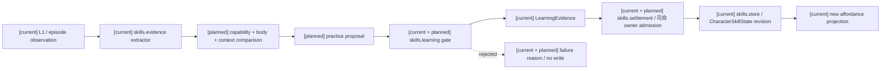
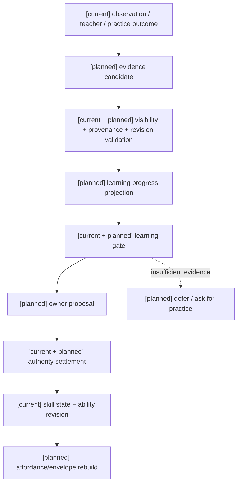

# 角色学习、模仿与技能演化规格

状态：`analysis/planned/non-authorizing`

状态覆盖：`[current]` skills catalog/registry/evidence/learning/settlement；`[planned]` 证据驱动的模仿和学习闭环；`[deferred]` 本主题无另行延期项。无证据的自动技能增长和模型直接升级能力始终禁止。

## 1. 现状基线

现有 `backend/app/character_agent/skills/` 已包含 catalog、registry、models、evidence、learning、settlement、store、visibility 和 service；测试覆盖 skill catalog、evidence extractor、learning gate、learned overlay、runtime shadow 和 settlement integration。学习系统必须建立在这些 owner 上，不能由角色模型直接修改 `CharacterSkillState`。

## 2. 学习对象

学习对象拆开保存：

```text
skill definition      注册的能力语义与前置
skill evidence        观察、练习、指导、失败和 authority receipt
skill progress        待审核的学习进度
skill state           owner 已确认的掌握、熟练度、信心和 action binding
capability envelope   当前回合是否能稳定调用
```

一次成功行动只能产生 evidence 或 progress candidate；必须满足学习方法、前置、权限、时间窗口、导师/模仿来源和证据质量，才能由 learning authority settlement 成为 skill state。

## 3. 学习 episode 与模仿合同

原始学习设计要求把 `LearningEpisode` 和 `ImitationEpisode` 作为一等对象。`ImitationEpisode` 至少引用观察到的来源、可见上下文、模仿模式、动作误差、资源误差、压力/中断、反馈、authority 是否接受和后续复盘引用；它不复制教师的数值，也不把动作外形相似当作技能掌握。

学习阶段沿用角色/14的非线性状态机：

```text
available -> noticed -> observed -> imitated -> structured
          -> practiced -> operational -> stable -> integrated
          -> personalized -> complete -> evolved
```

阶段不是线性强制流程；可以停留、退化，或在迁移时重新进入 `practiced`。每次迁移产生带 provenance 的 evidence/progress；只有 learning authority settlement 才能把 progress 投影为 `CharacterSkillState`、新的 action binding 或进化边。`evolved` 只能由司命依据规则产生。失败可以进入复盘和下一次学习策略，但不能未经明确失败事件政策修改 profile、人格、权限或技能事实。

### 3.1 学习对象、方式与多维掌握

学习对象分为知识、概念、动作、策略、技法、功法/心法和构筑方法；每个对象至少有 `object_id/version/source/prerequisites/difficulty/evidence_types/world_refs`。学习方式沿用观察、模仿、指导、练习、实战、复盘、研究、师承和迁移。

掌握状态固定使用原分析八维：`familiarity`、`conceptual_understanding`、`procedural_fluency`、`motor_precision`、`pressure_stability`、`transfer_capacity`、`insight`、`personalization`。每个维度保存 `value`、`confidence`、`evidence_refs`、`last_validated_at` 和 `decay_policy`；技能等级只是这些维度的投影。

学习难度固定拆为 `complexity`、`novelty`、`precision`、`pressure`、`resource_load`、`world_binding`、`transfer_gap`。角色认知包络决定最大步骤、假设数、规划跨度和可同时保持的学习上下文；技能、身体状态和资源决定能否执行。

人格只改变学习路线、风险偏好、反馈回应、协作意愿和练习成本，不改变硬能力上限。动作学习、技法升级、分支、融合和进化都必须带 evidence、failure、confidence、progress、settlement 和 revision。

### 3.2 学习架构图与所有权



## 4. 时序图

```mermaid
sequenceDiagram
  participant R as Character runtime
  participant E as Evidence extractor
  participant L as Learning service
  participant A as Learning authority
  participant S as Skill store
  Note over R,S: [current] skill evidence/learning/settlement/store；[planned] episode、多维掌握和司命演化接入；无另行 deferred 项
  R->>E: observation/episode + source refs
  E-->>R: typed evidence candidate
  R->>L: candidate + current envelope + prerequisites
  L->>L: check method, confidence, privacy, fatigue and revision
  L->>A: owner-bound learning proposal
  alt accepted
    A->>S: append/settle skill state revision
    S-->>R: skill receipt + affordance invalidation
  else rejected
    A-->>R: rejection reason; no skill state write
  end
```

## 5. 升级、分支、突变、融合与进化

- 技能 rank/proficiency/confidence 可以由学习 authority 事件改变；升级、分支、突变、融合、进化是不同结果，不得合并成“升级”。
- 角色只能提交 `LearningOutcomeProposal` 或 `TechniqueEvolutionProposal`，司命返回 `accepted_evidence`、`mastery_delta`、`new_or_updated_node`、`new_edges`、`resource_cost_or_refund`、`risk_and_counterplay`、`world_rule_refs`、`rejection_reason`、`authority_event_id`。
- 一般认知基线、人格、灵魂事实和权限不因一次模仿自动改变。
- 复杂技能可由已注册的 prerequisite graph、action family 和 evidence type 组成，但不能携带任意代码或动态表达式。
- 失败 evidence 可以用于调整下次学习策略；学习是低频循环，快循环只读冻结能力，失败证据在边界处入队。普通拒绝只返回 settlement result/audit trace。

## 6. 数据流图



## 7. 验收

覆盖未知 skill、缺失 prerequisite、无权限模仿、跨 privacy scope、过期 revision、身体/精神资源不足、重复 evidence、成功与失败练习、撤销 grant 和 full/checkpoint replay。每个拒绝路径必须证明 skill state 零写入。

固定四条学习路线夹具：纪律剑士（模仿→分解→重复→稳定升级）、好奇术士（研究→跨域融合→风险受控变式）、紧张医者（指导→低风险练习→协作实战）、直觉猎手（观察→快速模仿→实战反馈）。相同示范下，路线和失败复盘必须可解释不同；新技法只有在司命 authority event 后才能进入 affordance。

## 8. 来源追踪

| 原设计来源 | 本规格落点 | 计划任务 |
|---|---|---|
| [角色/14 §4–6](../角色/14-角色学习系统、模仿与技能进化设计计划.md) | §3–3.1；对象、九种学习方式、非线性阶段、八维掌握、七维难度 | [计划02 Task 4](../计划/02-角色能力学习与动作实施计划.md) |
| [角色/14 §8–10](../角色/14-角色学习系统、模仿与技能进化设计计划.md) | §5、架构图；提案、司命裁定、低频学习/快循环边界 | [计划02 Task 4–6](../计划/02-角色能力学习与动作实施计划.md) |
| [角色/13 §5–9、§18–23](../角色/13-角色能力图谱、认知包络与动态算力设计.md) | §2、§3.1、验收；能力包络、provider gate、四角色成本和回放 | [计划02 Task 1–3、6](../计划/02-角色能力学习与动作实施计划.md) |

关联：[角色/14-角色学习系统、模仿与技能进化设计计划](../角色/14-角色学习系统、模仿与技能进化设计计划.md) 与 [通用 skill/ability graph 规格](../../superpowers/specs/world-character-siming-authority-mainline/character-gameplay-foundation/2026-07-23-skill-ability-graph-and-affordance-design.md)。

2026-10-15计划02 Task6局部证据：四原文学习路线以方法/阶段fixture进入现有LearningEpisode、SkillLearningGate、SkillEvidenceExtractor、SkillCandidateStore与SkillLearningSettlement；保留source/context revision与失败证据，缺owner回执拒绝且profile/stable ability不变。此处复用现有char_a隔离合同，不创建四个场景角色、不注册新的技能或owner。路线自动策略选择、正式对象注册、真实owner结算及低频成本尚待对应准入，不把四个fixture label当作四条完整生产路线通过。原架构/时序/数据流沿本规格三图。
