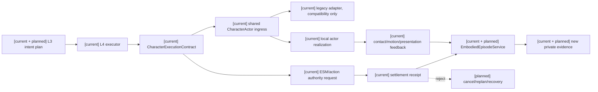
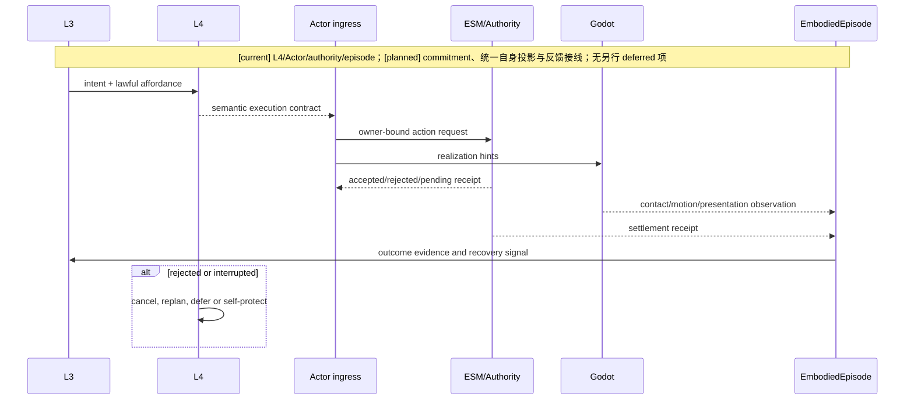
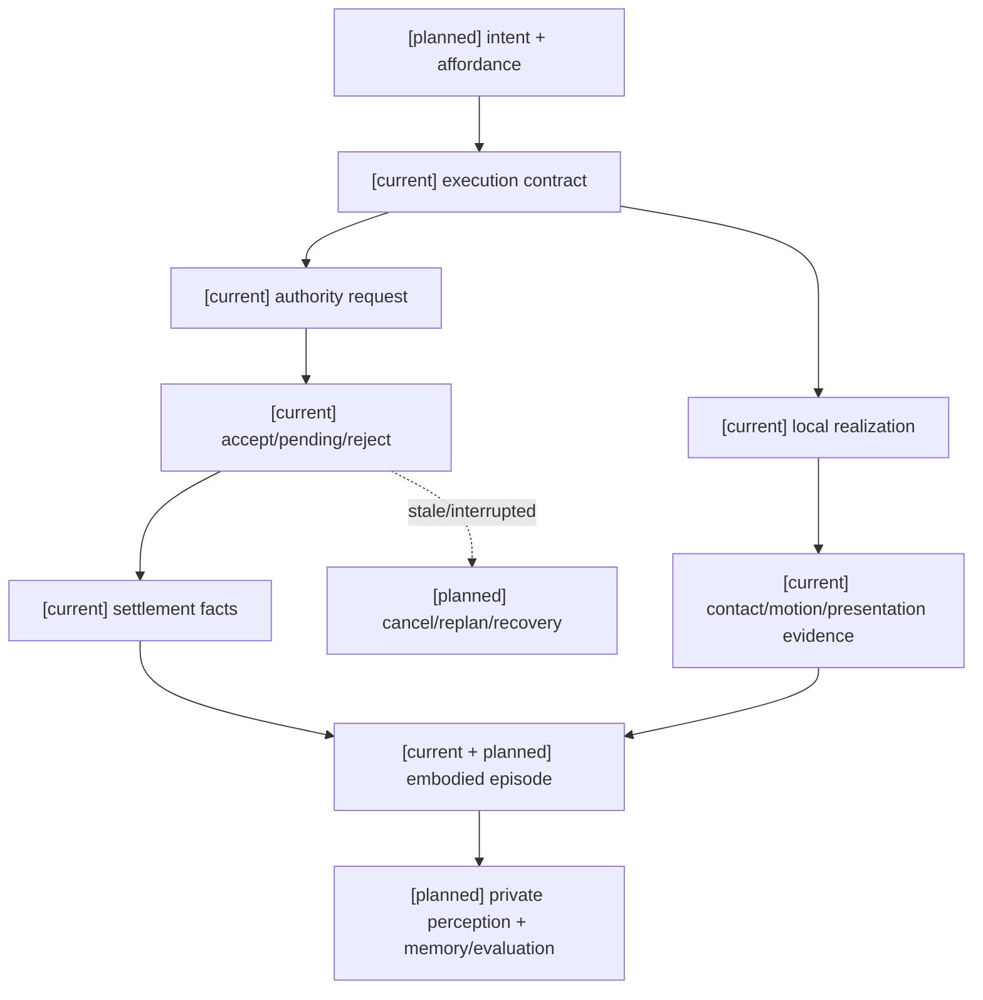

# 角色动作承诺、具身反馈与失败恢复规格

状态：`analysis/planned/non-authorizing`

状态覆盖：`[current]` L4 executor/adapter、CharacterExecutionContract、actor ingress 和 episode；`[planned]` 统一 commitment/feedback/recovery；`[deferred]` 本主题无另行延期项。最终单一路径尚待本规格 planned 接线与验收；raw pose/VLA 直接驱动始终禁止。

## 1. 现状基线

仓库已有 `CharacterExecutionContract`、`CharacterAgentL4Executor`、`CharacterAgentL4Adapter`、shared actor ingress、action request routing、connected action protocol、actor boundary tests、motion/locomotion/contact contracts 和 embodied episode service。现状仍保留兼容 adapter，不能宣称最终单一路径 L4→CharacterActor 已完成。本规格定义收敛步骤和不变量。

## 2. 动作承诺语义

角色动作承诺回答“角色准备尝试什么、需要哪些条件、如何观察结果”，不宣称世界已成功：

原设计的抽象承诺字段是：`intent`、`target`、`commitment_ms`、`preconditions`、`abort_conditions`、`fallback`、`context_revision`。正式实现必须先映射它们到当前 `CharacterExecutionContract`，不能把示意 JSON 当作已存在的后端 schema。

当前真实 `CharacterExecutionContract` 字段包括 `turn_id`、`actor_ref`、`source_ref`、`producer_ts`、`target_refs/target_ref`、`semantic_intent_id`、`semantic_action_id`、`source_id`、`intent_tags`、`context_tags`、`claims`、`locomotion_relation`、`allowed_realization_hints`、`expected_revision_vector`、`expected_memory_revision_vector`、`expected_snapshot_revision`、`idempotency_key`、`causation_id`、`correlation_id`、`privacy_scope`、`authority_scope` 和 `expected_observation`。它禁止 body/position/pose/raw_animation/world mutation/damage/inventory/authority result/result 等字段。自身状态结果必须作为独立 feedback envelope，不嵌入 execution contract。

动作 lifecycle 沿用角色/11：`queued → accepted → startup → active → recovery → completed`，并允许 `interrupted`、`failed`、`blocked`。必须区分 `intent`、`request`、`execution`、`result`；本地表现完成不能代替 authority result。Godot/Actor 只接收语义和安全表现提示。

## 3. 自身状态快照与归一化

原始自身状态设计要求补齐 `SelfStateSnapshot` 和 `SelfStateNormalizer`。当前 `SelfBodyPerceivedEvent`、`EmbodiedStateProvider`、`EmbodiedSkeletalStateProvider`、CharacterActor 运行态和 L1 provider refs 只能作为输入来源；它们不证明统一自身状态读模型已实现。

`SelfStateNormalizer` 只做来源合并、时间/revision/freshness 保留和角色可用投影，不成为新的认知层或 authority。`SelfStateSnapshot` 至少覆盖：

- identity：actor、capture、producer time、source revision、freshness；
- resources：生命、体力、已注册资源和负载；
- combat_influences：职业/身份/能力 effect bindings、装备可用性与 condition、medicine effects、field exposure、formation membership；该投影不把“combat”变成角色域 owner。
- physiology：疼痛、疲劳、伤势和异常；
- spatial：位置、朝向、速度、角速度、是否着地和支撑面；
- pose：姿态、步态、平衡、手部可用性；
- action_execution：intent、request、action id、实际动作、阶段、进度、可打断性和结果；
- affordances：能否移动、攻击、格挡、说话和交互；
- quality：confidence、stale、conflicting 和 unknown 字段。

未知值必须显式为 `unknown`，不能静默复用旧值；旧值若进入记忆必须带 producer time 和 freshness。Laya 只能把 `SelfStateSnapshot` 当作当前自身约束和反馈，不得把“发出 dodge”当成“已经闪避成功”。

动作反馈仍要区分 intent、request、execution、result；authority 真值投影和角色主观体感可以不一致，偏差进入 L2 风险解释，不被 normalizer 自动抹平。

### 3.1 架构图

## 4. 主流程时序图

## 5. 失败与恢复

失败分类必须区分：

- `admission_rejected`：权限、目标、资源、技能或 revision 不满足；不产生成功事实。
- `settlement_rejected`：authority 重新结算失败；可产生明确拒绝 receipt。
- `actor_interrupted`：本地具身执行被打断；需回传 episode 状态。
- `feedback_missing`：没有足够的 contact/presentation evidence；不能猜测成功。
- `stale_commitment`：目标或 profile revision 已变化；取消旧承诺并重建。

恢复优先级：保护生命/空间安全 → 读取最新 receipt → 取消过期承诺 → 更新 private evidence → 重新进入 L3。动作表现完成不能单独触发资源、状态、库存或关系变化。

## 6. 数据流图

## 7. 验收

覆盖 forbidden field rejection、重复 action request、exact/changed duplicate、目标 revision 变化、authority reject、Godot feedback 缺失、contact mismatch、恢复后重复提交和 L4 adapter 兼容路径。Godot 运行时声明必须有编辑器/场景证据，后端测试不能代替可见表现验证。

## 8. 来源追踪

| 原设计来源 | 本规格落点 | 计划任务 |
|---|---|---|
| [角色/11 §3–4](../角色/11-跨玩法动作承诺协议设计.md) | §2、§4；抽象承诺字段、生命周期和 intent/request/execution/result 分离 | [计划02 Task 5](../计划/02-角色能力学习与动作实施计划.md) |
| [backend CharacterExecutionContract](../../../backend/app/character_agent/models/character_execution.py) | §2；当前真实字段和禁止字段 | [计划02 Task 5](../计划/02-角色能力学习与动作实施计划.md) |
| [角色/06 §4–6](../角色/06-自身状态感知与具身反馈设计.md) | §3；自身状态来源、quality 和真值/体感分离 | [计划02 Task 4A、5](../计划/02-角色能力学习与动作实施计划.md) |
| [角色/02 §3、§5](../角色/02-Laya快循环与快慢思考战斗设计.md) | §5；连续动作、升级/降级及 continuity floor | [计划01 Task 1A、6A](../计划/01-角色心智运行时基础实施计划.md) |

关联：[角色/11-跨玩法动作承诺协议设计](../角色/11-跨玩法动作承诺协议设计.md)、[角色/06-自身状态感知与具身反馈设计](../角色/06-自身状态感知与具身反馈设计.md)、[角色 agent runtime 现状](../../character/character-agent-runtime-architecture.md)。

## 9. 候选到承诺的评估边界（2026-10-10）

候选评估使用规格05定义的完整动作＋目标集合。候选记录只证明“该组合在冻结输入下可被提出/选择”，不证明 L4 已接受、Actor 已完成或 authority 已结算。生产选择前必须再次核对 `CharacterExecutionContract` 的 `semantic_action_id`、`semantic_intent_id`、`target_refs`、revision/pin、privacy_scope 和 authority_scope；承诺时长、停止条件、失败回退和预期观察由已注册执行合同构造，不能由模型任意补参。

评估结果分别归因为候选缺陷、模型选错、admission/执行失败和 authority/feedback 缺失。Godot 的本地表现、Actor 阶段或 L4 proposal 不能替代 owner receipt；因此候选覆盖和 conditional selection 可以在无真实场景时先做静态/离线验证，`execution_receipt_outcome` 必须等真实 owner/Actor 证据取得后再验收。

## 10. 第六项回写（D19/RW-20，2026-10-11）

B/C 场景只复用 `StreetCombatActorDemo` 已验证的 Actor、动作库、Motor、authority 和资格证据；新建隔离场景的 Boss/协同语义、actor admission、真实模型轨迹和 owner receipt 必须另行登记。`StreetCombatDemo` 的街战场景语义、Godot 动画完成或本地 Actor 阶段不能替代 authority settlement。B 单角色连续 Boss 通过后才进入 C 双角色连续协同；C 还必须证明两个 Actor 的独立 identity、局部输入、协同信号可达性和各自 receipt。缺少 editor/runtime evidence 时仅记录 static-only/editor-unverified。

对应映射与证据矩阵见 [审查08](../审查/08-第六项B-C隔离Godot场景与真实边界证据.md)，实施入口为总计划 Task 6A 与计划03 Task 6A。

## 11. 本批规格与计划回写（第二阶段资产审计 RW-23，2026-10-12）

动作承诺语义与角色身份独立于具体表现资产。`actor_id`、角色档案、backend identity、`semantic_action_id`、目标合同和 owner route 在资产替换后保持稳定；GLB、skeleton、motion library、clip 与 marker 由可替换 package binding 承载。binding 有独立 revision，动作开始时固定 revision；替换仅在完成、取消、失败或已有安全边界提交。新 package 必须经过 skeleton/retarget、动作/marker/root/slot、physics/contact evidence、qualification 和 runtime admission；失败继续使用旧 binding。不得增加第二套 registry、authority 或 patch owner。

当前 manifest 有正式拳击/剑击 ID，但没有完整 `target_refs`、本轮 owner receipt 或实际 contact evidence；因此登记不代表动作可执行。backend `action:melee.short_punch` 仅保留兼容映射，不自动 alias 到 `action:melee.unarmed_punch`。本批 Laya live 请求只涉及 `ingest_siming_output + env_lamp`，没有使用 Godot Actor/GLB/clip/contact marker/领域 owner；静态动作底座不是 live 执行证据。

逐场景、Actor、GLB digest、profile、motion library、动作字段和阻断项见 [审查09](../审查/09-资产复用与动作可替换准入矩阵.md)。AD、编辑器、自走棋及 B/C 场景执行仍按已确认范围 deferred；本节仅回写静态合同边界。
