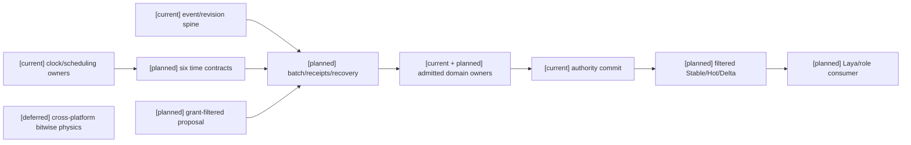
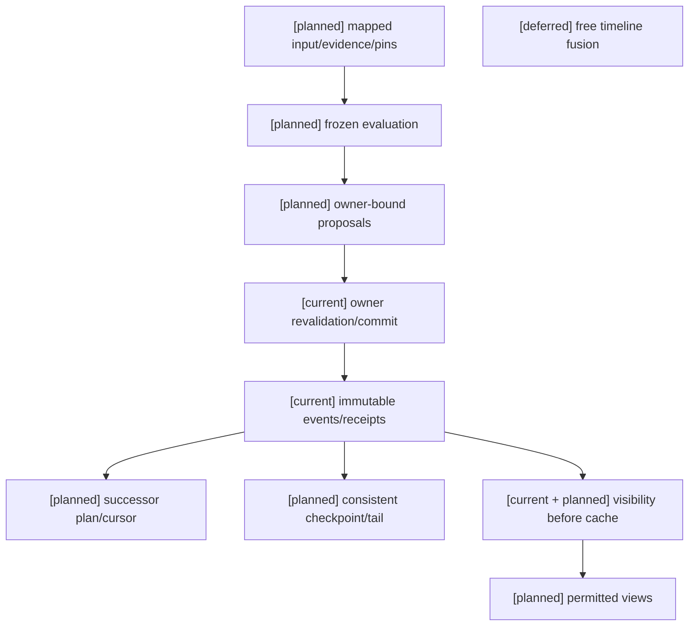
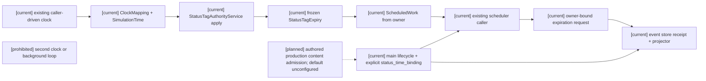
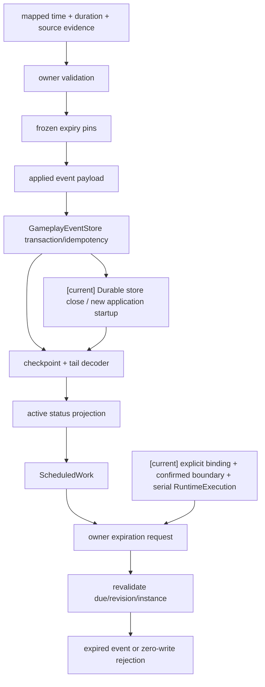
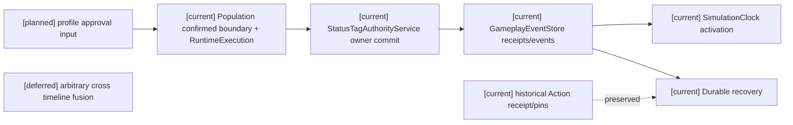
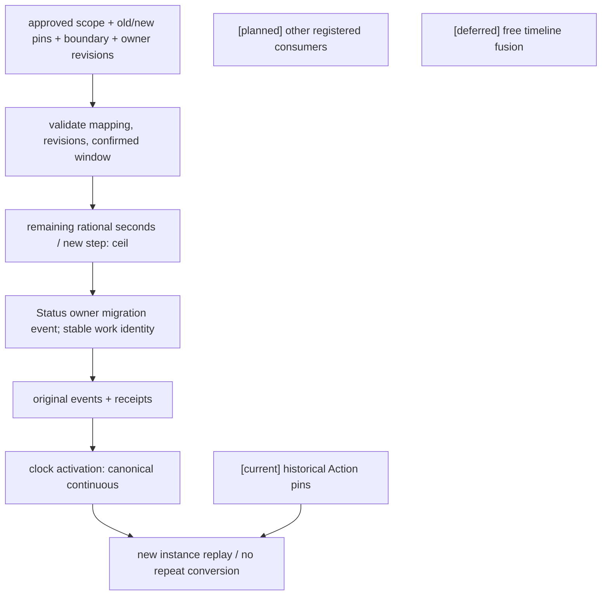
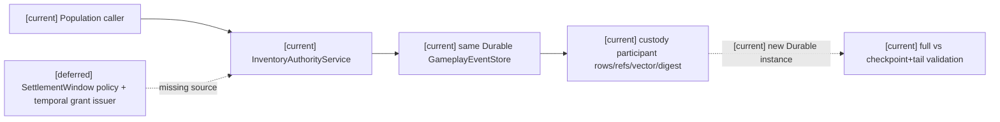
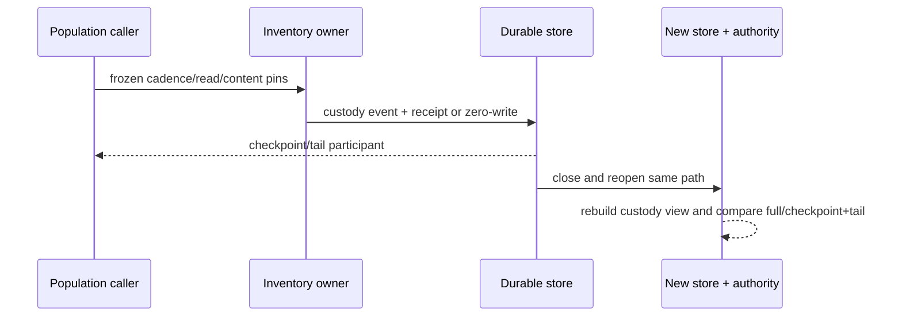
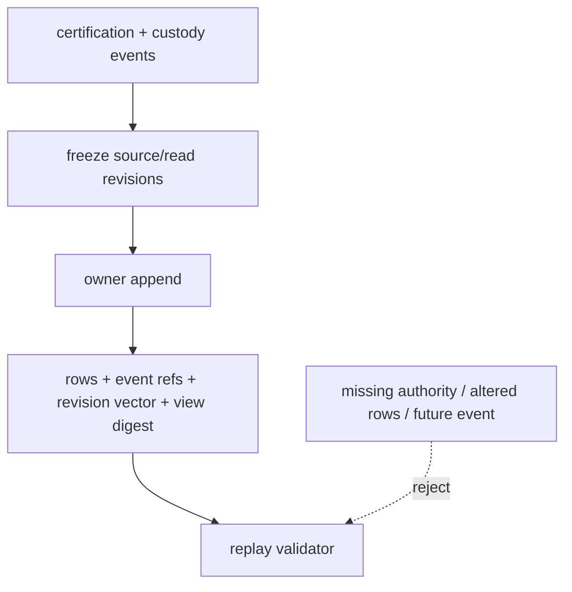

# 通用时间、权限、投影与领域服务接入规格

状态：`analysis/planned/non-authorizing`。时间不是 Combat 专属能力；本文不表示统一时间合同已经实现。

2026-10-15局部实施：用户授权按consumer依赖进入规格09–12／计划04阶段三。下表区分已实现合同与目标；当前切片的架构、时序、数据流、测试和局部阻断见 [Task1–2实施回写](../回写/stage3-task1-task2-20261015.md)。本文后续完整目标图仍表示目标范围，不将局部测试扩张为完整时间、回放或领域验收。

执行边界补记（2026-10-10）：[D15](../审查/03-实施待决收敛与验证闸门.md)暂停通用编辑器控制面与AD专项，不暂停本规格的领域时间、权限校验和投影合同。编辑器原文仍是语义来源；当前只映射角色/领域所需的真实owner与注册合同，不据此启动规格14/计划05的草稿、预览、发布和通用控制面，也不等待计划07。

## 1. 来源与执行位置

角色心智与 Laya 主线先按规格 01–08 完成；本文提供领域时间与投影接入。时间定义唯一来自角色/16，权限来自编辑器/01–04，投影来自战斗/04。实施见 [计划04](../计划/04-通用合同与领域服务实施计划.md)。

| 原设计文件与章节 | 本文落实 | 验收 | 计划任务 |
|---|---|---|---|
| [角色16](../角色/16-通用玩法时序模型与编辑器设计.md) §1、§2.1–2.3、§3–6 | §3 六对象、时钟映射；§5 激活迁移 | T01–T03（迁移为 T02） | 04/Task1 |
| [角色16](../角色/16-通用玩法时序模型与编辑器设计.md) §2.4、§7.3 | §4 批次、receipt、恢复 | T04–T06 | 04/Task2 |
| [角色16](../角色/16-通用玩法时序模型与编辑器设计.md) §7.1–7.2 | §5 随机、顺序确定性、预测 | T07–T09 | 04/Task2 |
| [角色16](../角色/16-通用玩法时序模型与编辑器设计.md) §7.4–7.5、§12 | §6 consistent cut、回放、adapter admission | T10–T12 | 04/Task2 |
| [战斗04](../战斗系统与角色技能，状态和资源/04-战斗状态、CombatPrefill与高频读取计划.md) 全文 | §7 Stable/Hot/Delta | V01–V03 | 04/Task3 |
| [编辑器01](../编辑器与能力权限治理/01-编辑器能力开关与世界规则配置设计.md) §1–5、[编辑器02](../编辑器与能力权限治理/02-编辑器权限授予、角色与司命变更设计.md) §1–6 | §7 四轴门禁 | V04 | 05/Task3 |
| [编辑器03](../编辑器与能力权限治理/03-编辑器版本发布、预览与运行时同步设计.md) §5–6、[编辑器04](../编辑器与能力权限治理/04-十月分析领域接入与编辑器同步矩阵.md) §2、§4、§7 | §7 视图、撤权、同步 | V01–V04 | 04/Task3、05/Task5 |

## 2. 当前实现与增量边界

| 状态 | 已核对代码 | 责任 |
|---|---|---|
| `[current]` | `backend/app/world_runtime/simulation_clock.py`、`scheduling.py`、`population_driver.py` | 现有调用方推进与调度；先登记 timeline 的实际推进 owner |
| `[current]` | `backend/app/gameplay/action_window_runtime.py`、`action_graph_content.py` | 局部动作窗口；不是完整通用时间合同 |
| `[current]` | `backend/app/gameplay/shared_contracts.py`、`event_store.py` | revision、command/evidence/event/receipt spine |
| `[current]` | `backend/app/world_runtime/projection.py`、`l1_fact_projection.py`、`backend/app/character_agent/reasoning/l1_perception.py` | 结果 delta 和授权过滤；不是完整 Stable/Hot/Delta |
| `[current]` | `backend/app/world_runtime/temporal_contracts.py`、`simulation_clock.py`、`scheduling.py` | 六时间对象、精确有理数与显式source mapping、可选profile/timeline pins、到期排序；owner检查与缺consumer迁移的激活拒绝 |
| `[current]` | `backend/app/world_runtime/batch_settlement.py` | 冻结DAG、actual receipt查询、有界恢复；只准入既有Organization营业窗口、Economy工资义务两个操作；非跨owner事务 |
| `[current]` | `backend/app/world_runtime/replay_checkpoint.py`、`adapter_admission.py` | event-projection一致切面/尾部检查；显式descriptor能力交集、fault/恢复和batch确认门；不代表引擎已发布能力 |
| `[current]` | `backend/app/main.py`、`gameplay/status_temporal_consumer.py`、`phase3_mirror_source.py` | 既有配置加载 Status registry/service，与应用共享 store；仅显式 time binding 接入既有 population confirmed boundary；测试配置取得应用重启证据，默认真实内容未配置，见 §7.1 与阶段三回写 |
| `[planned]` | 本文 §3–7及实施回写的局部缺口 | 生产consumer pins/持久化与迁移、随机/隔离预测、完整owner/physics/work快照、更多owner恢复政策、引擎descriptor发布、Stable/Hot/Delta |
| `[deferred]` | 角色16 §8 | 跨平台 bitwise physics、任意长 rewind、跨 timeline 自由融合 |

永久禁止第二 clock/scheduler/event store/projection truth owner；模型输出、Godot 表现和 preview 不成为推进或事实提交点。

## 3. 六个通用时间对象

| 对象 | 原文合同 |
|---|---|
| `TemporalProfile` | profile/revision/package；advancement、resolution、scheduling、settlement、time control、determinism、rewind 七轴；canonical unit、带分子/分母的 step duration；mapping、rounding、activation、compatibility |
| `SimulationTimeline` | timeline/parent、scope、advancement owner、profile pins、epoch、current step/phase、authority revision、status；单推进 owner |
| `SimulationTime` | timeline、step/substep、可选 phase、canonical time；裸跨 timeline step 不比较 |
| `ClockMapping` | source clock/unit、target timeline/profile、source/target origin、ratio、rounding、有效 interval、max lateness、evidence policy、revision |
| `ScheduledWork` | work/domain、due time、trigger、ordering key、expected revision vector、owner contract |
| `SettlementWindow` | from/to、scope/phase、input cutoff、late policy、confirmation boundary、frozen read-set、evidence、ordering、expected revisions、idempotency key |

物理 step、输入、网络、render、角色唤醒经获准 mapping 进入世界时间；render 掉帧不推进世界，客户端时间戳不决定权威结算。无 turn-to-time 映射时，“三回合”不等于“三秒”。到期工作只生成 owner-bound 请求，调度成功不等于结算成功。预算不足保留 cursor，不丢 tick。

局部时间效果由领域提交，消费 profile 允许的 scope/缩放合同；编辑全局 profile 属于发布/迁移。网络 timeout、UI clock、安全租约是 operational clock，不能被角色时间减速影响。

## 4. 跨 owner 编排与恢复

```text
BatchSettlementPlan:
  batch_ref / timeline_ref / window_ref / plan_revision / input_digest
  frozen_read_set_ref / evidence_refs / definition_and_rule_pins
  participant_owner_contracts / proposal_refs / dependency_edges
  ordering_policy_ref / consistency_scope / idempotency_keys
  failure_policy_ref / confirmation_boundary / recovery_cursor
OwnerCommitReceipt:
  batch_ref / plan_revision / owner_ref / operation_ref / input_digest
  accepted_event_refs / rejected_proposal_refs / conflict_refs
  owner_revision_before / owner_revision_after
  status = committed | rejected | partial | deferred
```

`collected/evaluated → validated → committing → completed/pending_recovery` 是 batch 编排阶段，不是原文未定义的 ScheduledWork 生命周期。收集、求值、校验不写事实；validated 不是锁。

原子性仅在获准 owner/event vector 内成立；要求原子的 owner 操作只有完整提交或零写入失败。partial 只用于 owner 明确允许分项成功的合同。A 成功、B 冲突时保留 A 的事实与 receipt，对 B 有界恢复或显式补偿，不伪装全局事务。后序操作引用前序实际 receipt/revision。

timeout 先按 owner+operation 查询原 receipt；exact duplicate 返回原结果，changed duplicate 拒绝。部分成功后重算使用 successor plan 引用旧 batch/事件，不能修改原幂等键再扣费。预留/释放仍是 Resource owner 正式操作。DAG 循环拆有界阶段或使用已有原子 owner 合同。

投影及时发布实际可见变化并标 batch completeness；必要依赖未闭合采用获准受限资格策略。预算耗尽不推进确认游标。不可补偿伤害保留，恢复后续 lifecycle/status，不撤回历史伤害。

## 5. 精度、随机、预测与迁移

权威时间用有理数或固定精度；版本化政策固定精度、溢出、负数、取整、集合排序、随机算法与 evidence admission。随机键至少 `timeline/window/operation_ref/effect_ref/target_ref/draw_index`，并固定算法/seed policy revision；无关目标、线程重排不改变抽样，私有 seed 不进角色快照。

`best_effort/replay_deterministic/rollback_deterministic` 保证不同。physics 无法确定重演时用已记录权威 PhysicsEvidence 重建领域结果，不宣称重新模拟物理。证据/版本缺失或 digest 不符返回 unreplayable/divergent，不重新调用模型补历史。

`PredictionWindow` 固定分支、base confirmed revisions、step/cutoff、profile/rule pins、参与者/快照/输入/证据、随机上下文、speculative digest、confirmation policy。预测状态隔离且 provisional；正式 append 不写可撤回事件。快照覆盖资源预留、动作/冷却、状态/到期任务、弹体/presence、目标/威胁、局部时间和随机上下文。

迟到输入只改 horizon 内未确认窗口。改轨迹且缺可恢复 physics/新受信证据时拒绝或同步，不复用不相容碰撞。重算固定历史已接纳决定，不让模型重选。确认仍需实际 owner 校验，部分提交进入 §4。不可逆消费、学习与通知等正式事件后发生。

profile 在明确 activation boundary 切换。在途 action 保留 pins；状态/冷却/任务按剩余世界时长或回合转换、明确舍入、周期触发去重。缺迁移拒绝；历史 receipt/replay 保留旧版本。

## 6. 检查点、回放尾部与 adapter admission

`ReplayCheckpoint` 固定 timeline/time/profile、included scope、owner/adapter vectors、snapshots、work cursors、open windows、evidence/random refs、serialization revision、digest、consistent/incomplete。建立 cut：冻结窗口/cutoff → receipt 游标 → 未闭合 batch/任务/预测边界 → 状态快照 → digest。过程中继续提交须进入新 cut 或 incomplete，不能拼不同时间最新值。

`ReplayTail` 固定 checkpoint、from/to vectors、events/receipts/dependencies、definitions/rules/evidence、result digest、visibility revision、verified/incomplete/divergent。稳定顺序应用；重复幂等；缺段、decoder 不支持、依赖缺失、digest 不符立即停止。full replay 与 checkpoint+tail 一致；actor 过滤回放只证明可见片段。

adapter descriptor 声明 mapping、evidence、snapshot scope、determinism、max lateness、replay、entity binding、rollback horizon、revision/失效政策。激活求能力交集；缺能力拒绝或显式降级。运行中能力丢失停止相关确认、记录 fault；恢复使用新 revision/mapping，旧画面或模型判断不代替物理证据。

## 7. 四轴与投影

capability、eligibility、authority、settlement 分别是注册/启用、当前可行、主体准入、owner 结算。不得混成 enabled。

| 投影 | 内容 | 规则 |
|---|---|---|
| Stable | definitions、profile/grants、tag/binding、时间/能力/表达 policy revisions | 不混 current 值；精确版本失效 |
| Hot | 当前资源/状态/冷却/伤势/空间/动作/目标/关系/window | owner revision、freshness、visibility；不代替提交时重新读取 |
| Delta | from/to、可见变化、event refs、invalidation、migration/receipt/replay pins | 缺段/乱序 full snapshot；不带撤权私有值 |

历史 CombatStablePrefill/CombatHotSnapshot/CombatDelta 保留兼容；通用 consumer 不强制 Combat 命名。creator_debug、authority_evaluation、actor_perception 独立许可与 composition digest；预算不扩大能力/权限。撤权使 cache/affordance/pending intent/active binding 失效，外部事实经 L1。

## 8. 架构图



## 9. 主流程时序图

```mermaid
sequenceDiagram
  participant C as planned role/editor proposal
  participant T as current scheduling plus planned window
  participant B as planned batch orchestration
  participant A as admitted owner A
  participant D as admitted owner B
  participant V as planned filtered projection
  Note over C,V: current owner commit spine; planned contracts; deferred arbitrary-long rewind
  C->>T: typed input and pinned revisions
  T->>B: frozen window/read-set
  B->>A: operation and idempotency
  A-->>B: committed receipt/event refs
  B->>D: dependent operation with A receipt
  alt conflict or lost receipt
    D-->>B: rejected or unknown
    B->>D: query then retry/compensate
    B->>V: actual events plus incompleteness
  else required operations closed
    D-->>B: committed receipt
    B->>V: completed result and confirmed cursor
  end
```

## 10. 数据流图



## 11. 验收

| ID | 输入/故障 | 必须结果 |
|---|---|---|
| T01 | physics/render/network/role clock；无 turn mapping | 单位/revision 映射；render 不推进；拒绝裸跨时间比较 |
| T02 | profile 切换有在途任务 | 保留 pins，转换/舍入/去重；缺迁移拒绝 |
| T03 | catch-up 预算耗尽 | 保留 cursor，不确认、不丢 tick |
| T04 | A 已提交、B 冲突 | A 保留；B 恢复/补偿；非整体零写入 |
| T05 | commit 后 timeout；exact/changed duplicate | 查询 receipt，一次扣费；changed 拒绝 |
| T06 | successor、循环依赖、原子 owner 失败 | 已提交不重做；无界环拒绝；原子 owner 零写入 |
| T07 | 网络顺序重排、无关随机目标 | 顺序/抽样/digest 一致；seed 私有。2026-10-16：blocked / not_verified；无真实随机 owner + 恢复证据，不能用 seed 字段或确定输入 replay 代验 |
| T08 | late input 改轨迹、无恢复 physics；已确认 | 拒绝/同步，不改正式历史、不再模型重选 |
| T09 | prediction 撤销、确认冲突 | 只恢复 provisional；重对齐 actual owner |
| T10 | full vs checkpoint-tail；缺段/decoder/digest | 一致；incomplete/divergent 停止，不补史 |
| T11 | cut 中 owner 继续提交 | 新 cut 或 incomplete，禁止假快照 |
| T12 | adapter 缺能力/运行中丢失 | 拒绝/明确降级、停止确认、新 revision 恢复 |
| V01 | current 放入 Stable | 分类拒绝 |
| V02 | Delta 乱序/缺段 | 授权 full snapshot |
| V03 | revoke 与旧 cache/intent/binding | 清理私有值、旧请求拒绝 |
| V04 | creator/authority/actor 查询、大预算 | 独立 view/digest；不扩能力/权限 |

pytest 验证合同与 fault injection，Harness/Godot 验证真实 adapter。本文是静态设计；缺运行证据不能宣称 rollback 或跨平台确定性已完成。


## 7.1 Status consumer 时间接入（2026-10-16，局部 current）

Status 的事实 owner 是 `backend/app/gameplay/status_tags.py::StatusTagAuthorityService`；本节把原设计的时间合同落实到该 owner，不创建新的 clock、scheduler、event store 或 status writer。

- 时间引用与冻结：`StatusTagTemporalContext` 接收既有 `SimulationTime`、`ClockMapping`、profile revision、source revision 与 evidence freshness；`expires_after_steps` 只在接纳时计算并冻结 `StatusTagExpiry`（timeline、profile/mapping revision、due step/value、source clock/revision、freshness）。来源 freshness 是证据有效性检查，和 lifecycle expiry 独立。
- 生命周期：未提供 expiry 的状态保持永久/显式 remove 合同；仅显式带期限的状态自动进入到期路径。expire 是 owner 事件，remove 是显式移除，调度选择只产生 owner-bound request，成功选择不表示状态已过期。
- owner 重验：`expiration_work` 复用 `ScheduledWork` 与 `select_temporal_work`；`submit_expiration_request` 由 Status owner 重验 owner contract、实例身份、due time、timeline/mapping/profile/source revision、stream revision 和幂等 receipt，再调用原 `apply` 写入 expired event。
- 恢复与兼容：`GameplayEventStore` 保存 applied/expired 事件和 idempotency receipt；`StatusTagProjector` full 与 checkpoint+tail 复用同一 decoder。旧 applied 事件没有 expiry 时解码为永久状态，不回填虚构时间；缺 temporal evidence 不进入新自动到期路径。
- 应用装配：`main._assemble_status_runtime` 加载既有 `Phase3MirrorActorConfiguration.status_tag_definitions`，将 `StatusTagRegistry`、`StatusTagAuthorityService` 与薄 `StatusTemporalConsumer` 绑定同一 `gameplay_event_store`；`status_time_binding` 显式固定 world、timeline、profile、mapping、source、单位/步长与窗口 pins。未绑定的永久状态仍走原 owner；带期限状态缺绑定拒绝，不把所有状态自动挂在 population clock 上。
- 实际 caller：现有 `PopulationCadenceDriver.run_forever → tick` 的 confirmed-time boundary 经既有 `RuntimeExecution` 串行调用 consumer，再交原 Status owner；逐项重建投影并重新生成/验证 work，避免同 actor 前次提交后旧 revision 导致后续到期丢失。原 driver 没有新窗口时可重试当前确认边界，不新建轮询、clock 或后台循环。
- 生命周期：startup 重放状态并验证时间 binding，重建未完成 work；reset/shutdown 关闭旧 consumer 并解除旧 service/store 引用，沿现有资源 owner 顺序关闭，停止后拒绝新请求。durable 重启验证使用全新 store/service/runtime 实例。
- profile 激活/迁移：沿角色16 §4 的 activation boundary、profile/timeline revision、剩余时长转换与周期去重原则；本实现不新增名为 `activation_revision` 的字段。当前只接受同 timeline/profile/mapping 的冻结 pin；单位/步长或 profile revision 变化没有合法迁移合同时拒绝。

应用接入验收须分列 owner 局部合同、应用生命周期、Durable store 重启、实际配置范围和未实施能力。必须经实际应用 startup、合法 apply、未到期推进、正常 shutdown、新 store/service/runtime 启动恢复、实际 caller 到期派发、owner expired event/receipt，以及再次重启重复派发不再 expire；仅在测试中串联 owner 的 work/select/submit API 不构成应用接线证据。实际配置未注册时保持未配置，不为演示添加状态或默认期限；population clock 只适用于显式准入该 world/timeline/source 的 consumer。

到期工作不得在选择成功时确认。预算不足、暂停或调用失败须可恢复；同 actor 多状态同时到期时，前次提交引起的 revision 变化必须交回 owner 重新验证，不能只改 expected revision 消除冲突。exact duplicate 返回原 receipt，changed duplicate 必须比较实际冻结输入及期限输入；remove/expired 终态恢复不得重新激活。reset 须重建绑定当前 store 的 service/caller，shutdown 沿既有 owner 顺序停止接纳和关闭。



```mermaid
sequenceDiagram
  participant I as main.submit_status_tag_command ingress
  participant D as Existing population confirmed-time caller
  participant R as RuntimeExecution serial write path
  participant O as StatusTagAuthorityService
  participant T as SimulationClock/Mapping
  participant S as GameplayEventStore
  I->>R: submit configured apply with explicit duration
  R->>O: apply(apply, temporal, expires_after_steps)
  O->>T: validate and freeze timeline/mapping/profile pins
  O->>S: append applied event + receipt
  D->>R: confirmed time boundary
  R->>O: rebuild projection and select owner work, one at a time
  R->>O: submit_expiration_request(work, temporal)
  O->>O: revalidate due/instance/permission/revision/idempotency
  O->>S: append expired event + receipt
  S-->>O: actual owner receipt and replayable projection
  Note over R,S: normal shutdown; new store/service/runtime startup replays committed events and pending work
```



[角色16 §2.1–2.3、§2.4、§4.1、§7.4；规格10 §4；战斗04 §3、§4.2；战斗08 §2；实际入口见 `backend/app/gameplay/status_tags.py`、`backend/app/world_runtime/temporal_contracts.py`、`backend/app/world_runtime/scheduling.py` 与 `backend/app/gameplay/event_store.py`。]


## Action consumer 接口决定（2026-10-16，计划04 Task1）

本轮授权补设计并实施此最小接口；最终状态与三图见[阶段三回写](../回写/stage3-task1-task2-20261015.md#action-consumer-时间接入2026-10-16)。

1. 真实入口为 `main._handle_envelope(stormnight_player_intent)` → 既有 `RuntimeExecution` → `StormnightRealtimeSessionService`。服务端显式注入已有 `SimulationClock`、获准 `ClockMapping`、source identity/revision、同源采样/接收坐标及截止/迟到/排序政策。客户端 choice 不得覆盖 authority 字段。无合法来源的生产内容保持未配置；不能用 action_count、固定日期或客户端 tick 补齐。
2. `ActionWindowIntent.time_binding` 保存冻结时间输入。`ActionTemporalContext` 提供可信 clock/mapping/source/采样与接收时间；`freeze_action_time_binding` 将原局部窗口及独立采样映射到 timeline，以 `SettlementWindow` 固定起止、cutoff、confirmation boundary、participant、read-set、evidence、authority revisions、排序/迟到政策及幂等身份。保存精确有理数、profile/mapping/source 历史 pins。action_count 仅选择原内容节点。
3. 原 `InvestigationConflictAuthority.resolve_action_window` 在 append 前重验可信时间 context 和领域权限：缺绑定、跨 timeline、stale profile/mapping/source、采样/接收过期或超 cutoff、principal/actor/role、空间/read-set/write revision 冲突均零写拒绝。通用时间合同不携带领域结果语义；该 owner 继续只拥有既有调查冲突事实，case_death/终局事件不是其他动作的通用结果。
4. 原事件保存冻结 intent/command/role、caller request digest 及时间 pins，原 store 写入实际事件与 receipt。exact duplicate 在当前时间校验前匹配历史请求并复用原 receipt；改变窗口、时间输入或请求内容复用身份则拒绝。Durable 关闭后新实例读取原事件与 receipt，不以当前时间或 action_count 重算。当前是即时原子提交，不虚构 pending work 或恢复游标。
5. owner 保留显式 legacy caller/旧无绑定事件兼容，缺字段不得补写历史时间证据；新的应用路径缺合法绑定失败关闭。旧事件可读不等于统一时间验收。测试显式配置通过不代表真实生产内容已启用。
6. 在途动作保留旧 pins；提交与激活由 RuntimeExecution 串行化。现有即时原子操作没有跨调用未完成工作；更长生命周期仍为 planned。激活只能发生在原 clock 的合法 boundary；更换与 consumer 不兼容的 profile/mapping/source 时，没有迁移合同则拒绝切换，不改写旧窗口/receipt。重试先恢复历史请求，不消耗新采样。

[current] 复用既有 caller/owner/store；上述接口正按本轮授权实施，验收前不宣称通过。[planned] 其他 consumer、内容来源准入与迁移；[deferred] 引擎/物理及完整 Laya→领域链。永久禁止新增 clock、scheduler、store、authority、后台循环，以及模型/动画直接写结果。

2026-10-16 Action 验证回写：现有 Stormnight caller 已经 RuntimeExecution/真实 envelope 接线至原 conflict owner/store；147 项允许列表 focused 通过，最后 caller 幂等修正后三文件21项通过，backend-contract 仅静态通过。完整事件/receipt/Durable新实例证据、兼容/激活边界、生产未配置与剩余 Task1 缺口见[阶段三 Action 最终结果](../回写/stage3-task1-task2-20261015.md)。准入 fingerprint 从历史事件恢复；配置变化无迁移即拒绝，旧 retry 保留 pins；不扩展原调查冲突终局语义。历史 Status pytest cleanup 与本轮 Action pytest cleanup 均 incomplete，Harness cleanup 单列 passed；历史 HTTP503 审查仍 incomplete。

## Task1 T02 最小激活迁移接口决定（2026-10-16）

本节只准入单配置 actor/world/timeline、同一 canonical `second` 单位下改变 `step_duration` 的正例；设计来源为[角色16 §2.1–2.3、§4.1–4.2](../角色/16-通用玩法时序模型与编辑器设计.md)。已授权的服务端配置批准 scope、旧新 profile/mapping 与 boundary，现有 Population cadence 推进 caller 在已确认窗口通过 `RuntimeExecution` 串行请求；先由原 Status owner 提交迁移事件/receipt，再由 `SimulationClock` 验证原推进 owner 并提交激活。不让 editor draft、普通角色或 Action 自行改世界时间。原 clock 的 `SimulationTime.canonical_time_value` 在切换瞬间保持连续，按新步长确定新格点；旧裸 step 不作为新 step 复制。未授权的多 actor 范围拒绝，不将此正例外推为全 world 多 owner 迁移。

冻结输入包含 world/timeline/scope、old/new profile 与 mapping 完整 pins、source identity/revision、activation boundary 的 old/new canonical 坐标、clock authoritative revision、Status stream revisions、待迁移实例与 `ScheduledWork.work_ref`/trigger、幂等身份及输入 digest。验证同维度/合法映射、受准入 source、old pins 与实际 current 一致、窗口已经确认、没有并行推进；无迁移合同、跨维度缺映射或任一预期 revision 冲突均拒绝新提交。历史 Action 窗口与 receipt 保留旧 pins；现有 Action 是即时原子提交，不假设跨边界 pending action。

Status owner 以切换瞬间 `remaining = max(0, old_due_canonical - boundary_canonical)` 转换未过期实例，按新 step_duration **向上取整至新格点**，使期限不早于原世界时刻；精确整除时不加一格，已到期工作继续交原 owner 到期路径，不靠迁移补造第二次 expire。事件记录原/new expiry、精确剩余有理秒、舍入诊断、旧新 pins、稳定 work/trigger 身份和 owner revision；投影/checkpoint+tail 与 Durable 新实例从原 `GameplayEventStore` 恢复已提交迁移及实际 receipt，不从当前 profile 再算一次。相同幂等身份与相同冻结输入返回原 receipt，changed duplicate 拒绝。

跨 Status/clock owner 没有全局事务。顺序依赖实际 receipt：Status 原子拒绝或未知提交时不激活 clock；先查询原 Status receipt，确认成功后才激活。Status 成功而 clock 激活异常时保留 Status 事件/receipt，新实例从该 receipt/event 恢复原定激活，不重复换算，也不宣称原 Status 事实已回滚。任一 owner 的原子提交失败保持该 owner 原事实；未完成 scope 不对外宣称迁移完成。恢复必须辨别尚无 Status receipt、已有 Status receipt 但 clock 未激活、二者均完成三种状态。此接口不新增通用编辑器控制面、第二 clock/store 或状态事实 owner。多 actor、更多 world/timeline 同步协调与其他 consumer 的迁移仍是逐项 planned 缺口。状态为本轮实施中；验收以[阶段三矩阵](../回写/stage3-task1-task2-20261015.md#task1-有限验收矩阵2026-10-16)和后续真实 owner/重启证据为准。



```mermaid
sequenceDiagram
  participant P as approved profile input
  participant D as Population caller / RuntimeExecution
  participant C as SimulationClock
  participant S as Status owner
  participant E as original event store
  P->>D: scoped old/new pins and approved boundary
  D->>S: frozen remaining duration + expected revisions
  S->>E: atomic migration event and idempotency receipt
  E-->>D: actual Status owner receipt
  D->>C: verify Status receipt; activate at confirmed canonical time
  C-->>D: activation result or recovery-needed
  Note over D,E: [planned] production profile publishing; [deferred] global rollback
```




### Task2 冻结窗口与 Durable 新实例恢复（2026-10-16）

`[current]` 本轮仅推进角色16 §2.3–2.4、§7.4 / 规格09 T04–T06 的 Organization/Economy 切片。实际入口为 `main.submit_settlement_batch → RuntimeExecution → BatchSettlementCoordinator → OrganizationAuthority.open_operating_window / econ1_economy_runtime.EconomyAuthority.open_wage_obligation`。后者 principal 为 `actor_gameplay.econ1_economy_domain`，合同分别为 `inf:organization-operating-window@1`、`inf:economy-wage-accrual-obligation@1`；不等于 `economy_runtime.EconomyAuthorityService` 已接入。没有新增 authority/store/scheduler 或外部写路由。默认生产内容没有新增批次来源，当前通过范围是显式测试配置下的可信内部调用入口。

输入身份固定完整 `SettlementWindow`、timeline/world/advancement owner/revision、profile 与 mapping 全量版本、范围/cutoff/confirmation boundary、read-set/evidence、原 owner command/request/revisions、规则 pins、依赖、排序和幂等键。窗口只能在现有 population 已确认边界接纳，长度与原 caller 窗口一致；canonical second 与 profile step 精确转换。当前接纳 cutoff=to=confirmation、reject_after_cutoff、owner_atomic 和 query_then_bounded_retry。旧窗口仅恢复原 pins；迁移后新接纳窗口不得跨回 activation 边界。原 Organization tick 范围和 Economy due_tick 保持 canonical second，不以新 step 重解释。cursor 和执行预算是恢复进度/执行控制，不进入命令输入 digest。相同 batch 身份改变窗口、规则、版本、载荷或依赖会拒绝；owner/key 也不能借新 batch 绑定另一窗口。

冻结输入在首次 owner 提交前原子保存于同一个 `GameplayEventStore` 的既有 checkpoint 容器，`world_runtime.batch_input@1` 保存完整输入和 digest，`world_runtime.batch_operation@1` 约束 owner/key 的窗口身份。这些是恢复输入记录，不是 event-projection cut 或完整 ReplayCheckpoint。正常关闭 Durable 后，新 store/owner/RuntimeExecution 实例按 batch ref 读取冻结输入，先从两个原 owner 的实际 idempotency record/result 查询 receipt，再重建 cursor；不相信调用方 cursor，也不依赖内存 plan 或当前 mapping 重算历史。owner 事件仍仅由两个原 owner 提交。检查点容器丢失或输入 digest 损坏时拒绝恢复，不能仅靠投影重放推断未完成批次。

A 已提交、B 真实 revision 冲突时保留 A，窗口 pending；无批准的替换/补偿政策时 B 保留原 revision/key，禁止静默改 key 再收费。commit 后响应丢失先查 receipt；未知则保留 pending，后续按原输入有界重试；预算不足和依赖未闭合不确认。当前 successor 只携带未变原操作，不授权替换失败操作或补偿。批次完成只返回自身 confirmation boundary，不替代 population 确认游标，也不是跨 owner 全局事务。

测试允许列表在执行前冻结为 `backend/tests/test_world_batch_settlement_recovery.py`、`test_world_batch_settlement_application.py`、`test_temporal_profile_migration.py`、`test_temporal_mapping_contract.py`、`test_population_runtime_driver.py`、`test_runtime_execution.py`（后五项同目录）。覆盖真实内部 caller、两个 owner、Durable 正常关闭和新实例、部分成功/冲突/响应丢失/未知 receipt/预算/依赖/重复/旧新窗口版本；Task1 只回归受影响的迁移、映射、population 和 RuntimeExecution。证据及当前/计划架构、时序、数据流边界见[阶段三本轮回写](../回写/stage3-task1-task2-20261015.md#task2-冻结窗口与-durable-恢复验收2026-10-16)。

`[planned]` Task1 整体仍开放：跨 actor/world/timeline 协调；EconomyAuthorityService 的 deadline/cadence、Inventory、Ecology、Character wake/deadline、Social delivery/expiry、Physics/presentation mapping、其他 Combat 技能/冷却 consumer；生产 profile 发布与来源启用。已接受的单配置 actor/world/timeline 时间/迁移工程合同及测试闭环被本轮消费，不重新宣称 Task1 整项完成。Task2 的 T07 随机/顺序确定性、完整参与者 snapshot、prediction 隔离和其他 owner admission 仍 planned。

**2026-10-18 产品政策责任修订（本次授权）**：本规格中的“需用户决定”只适用于事实来源或外部权限尚未存在的情况，不表示必须等待用户再次授权产品政策。用户已授权本代理作出产品政策判断；针对 Character world wake/deadline，来源审计未找到真实业务 caller、participant/window/grant issuer 或内容来源，因此本次决定为“仅保留 actor-private cognition admission expiry，不新增 world-time deadline 语义”。这不会把 `wake_up_requested`、`deadline_monotonic`、Population operational tick 或队列顺序升级为世界事实，也不创建 synthetic owner/caller。Character world deadline 继续 `deferred/not_verified`；若未来真实业务来源出现，必须先补世界时间单位、scope、grant/revoke、事件/revision、receipt、Durable 与 replay 证据后再实施。

`[deferred]` 跨平台 bitwise physics 按原设计继续延期；本轮不启动 prediction、Task3–6、Godot、calibration/evaluation、final/holdout 或训练。Laya 仅 choice，未调用 provider。历史 fixture pins、threshold、label、archive 均不改。历史清理拒绝与 HTTP503 独立审查 incomplete 继续保留，不重试被拒绝删除。


### Task2 T10–T11 限定参与切面接口决定（2026-10-16）

本轮授权仅 Organization operating-window / Economy wage-obligation 已准入批次。`ReplayCheckpoint@1` 是原 checkpoint 容器中的重建依据，非事实 owner。可信内部入口 `main.submit_replay_checkpoint` / `submit_replay_tail` 在原 `RuntimeExecution` 上执行并核对 advancement owner；不增加 HTTP、creator 或角色读取权限。

接口责任：`capture_scoped_checkpoint(store, checkpoint_ref, batch_refs, participants)` 以 participant 只读回调采集完整冻结输入、operation claims、原 owner 实际 receipt/revision、Population confirmed cursor/pins、Status bindings/work、迁移 prepared/committed 边界。使用原 store 锁串行保护持久化，比较采集前后事件与非事件状态的版本化 digest；读间变化返回 incomplete。必需参与者缺失不能删依赖降级通过。事件投影复用 `GameplayProjectionReplay`，非事件输入保存完整原版记录。checkpoint 持久化在相同 store，供新 Durable 实例读取。

`ReplayTail@1` 绑定 checkpoint digest、原 cut/目标 cut、按序事件与目标 participant 状态及结果 digest；先检查 prefix、段完整性、exact/changed duplicate、schema/decoder、receipt 和冻结输入，再按原 decoder重建。只读回放不调用 `execute` / owner commit / migration recovery 的补交分支。full 与 checkpoint+tail 对比同时包含事件投影与参与者状态，不能只比较 event global_sequence。原版本冻结输入保留历史 profile/mapping；当前 mapping 不能补历史。外部领域只保留可验证 stream revision/event digest 引用及既有重建 API，不被自动纳入快照。

随机上下文在这两个确定输入的 owner 路径没有 draw/模型调用，登记不适用；不接受 T07。Task1整体、Task2整体、阶段三整体保持独立未完成。测试文件允许列表及三图见本轮阶段三回写。


本轮执行结果：175项筛选测试与 backend-contract 静态合同通过，接受结论仅“声明参与范围内的checkpoint/replay通过”。本接口的参与者代码/API/版本表、一致cut及回放责任、允许测试列表与架构/主流程时序/数据流三图为显式配套：[阶段三限定回写](../回写/stage3-task1-task2-20261015.md#task2-限定参与范围-checkpoint-与-replay2026-10-16)。仓库外证据与清理、历史HTTP503审查未完成见同节。Task1/Task2/阶段三整体及T07不随本轮结论改变。


### Task2 T07 盘点结论（2026-10-16）

`[current]` 已盘点真实 owner/caller/算法/排序/事件与测试配置，未发现同时具备真实随机消费和可恢复证据的具名 owner；**T07 blocked / not_verified**，不创建 synthetic consumer。Action seed 仅存入 intent/event，Population SHA256 seed 仅为派生标识；Economy/Inventory/Ecology/Status 为固定输入或公式。随机 owner 范围为空，algorithm/seed-policy revision、随机 result digest 和随机 receipt 不存在，不能凭现有确定输入 replay 声称随机确定性通过。

## Task1 Inventory 生产输出时间 consumer 审查（2026-10-16）

本节是对真实 Inventory consumer 的专项门禁，引用[阶段三 Task1 Inventory 回写](../回写/stage3-task1-task2-20261015.md#task1-inventory-真实生产输出-consumer-时间合同专项审查2026-10-16)。

`PopulationCadenceDriver → RuntimeCadencePublisher.publish_pinned → PopulationSimulationCapability → InventoryOutputCustodyOwnerExecutor → InventoryAuthorityService.settle_production_output_custody → GameplayEventStore/DurableGameplayEventStore` 是已确认的领域路径。它已有认证事件、Inventory read/revision、content/binding 校验、领域权限/幂等和 Inventory receipt/view；但 `ProductionOutputCustodyIntent` 没有 `SimulationTime`、`ClockMapping`、timeline/profile/source pins 或 `SettlementWindow`。`mapping_revision` 仅是 Inventory custody binding mapping。故领域入库合同为 A，Task1 时间 consumer 为 B/C，不能用领域 receipt/replay 代替时间验收。

### 2026-10-17 RW-50 复验更新

Inventory custody 已接入声明范围内的 scoped checkpoint/tail participant，但这不改变上段时间门禁。应用测试通过真实 production certification → Population capability → Inventory owner 写入；同一持久路径的 Durable store 关闭后重新打开，以新 `InventoryAuthorityService` 恢复；checkpoint 保存 rows、event refs、source revision vector、view digest，full 与 checkpoint+tail 在相同 Inventory 参与范围的 digest 一致。缺 authority、删除 participant、篡改 rows/event refs/revision vector/view digest、边界外未来事件均 fail-closed。证据为 `backend/tests/test_world_replay_checkpoint_application.py::test_inventory_participant_survives_durable_reopen_and_checkpoint_tail` 与 `backend/tests/test_world_replay_participants.py`，fresh 结果 5 passed；Inventory vertical 与 custody family fresh 结果 17 passed。







| 门禁 | 状态 | 规格要求 |
|---|---|---|
| 时间对象与 pins 传递 | bounded current | cadence pins 经 Durable authority record 绑定 read-set；caller 重建 `SettlementWindow`，不使用 wall clock、`submitted_at` 或事件顺序反推。仅 Population→Inventory custody participant |
| 完整结算窗口与时间权限 | bounded current；跨域仍 planned/deferred | 同一 cadence authority record 提供 participant/cutoff/confirmation/late-input/order 与 temporal grant digest；缺失、篡改、不匹配、过期或撤销来源不可验证均 fail-closed。无独立 issuer/revoker，不授权其他 participant/consumer |
| caller 输入冻结 | bounded current | certification/source revision 绑定 read-set；caller 通过原 Inventory owner 的 freeze API 只读读取当前 Inventory revision、activated package/binding revision，并在提交前由 owner 重验；访问限内部 Population caller |
| owner 提交前重验 | bounded current | 重验 Durable cadence record、grant、read-set/source/certification revision，及原 owner 的 activation/manifest/declaration/binding/映射/Inventory revision；不扩张领域权限 |
| receipt/retry | B | 复用 store `get_by_idempotency(principal,key)`，由原 Inventory owner 提供查询边界；需保留 v1 key/digest/history，评审未来时间身份纳入方式，验证丢响应、Durable 新实例和 changed owner input |
| replay | B/C | 采用现有 `production_output_custody_view_for()` full-read reconstruction 设计 Durable 新实例对照（B）；当前 `replay_participants.py` 未包含 Inventory，checkpoint/tail participant 扩展为 C/deferred，不作为首选前置 |
| 旧兼容与 RW-44 | A（领域）/B（时间） | 保留旧 Inventory event/pins/decoder 与 item/container/source 语义，不改历史。RW-44 继续禁止核心 `ResourceEntry` 准入 |

`[current]` 2026-10-17 本次设计并实现了 Population→Inventory caller 的只读 content/binding freeze：`InventoryAuthorityService.freeze_production_output_custody_read()` 复用激活的 `GameplayPatchRegistry`、正式 family binding 校验、现有 production certification 与 `facility_acquired` 事实，并冻结 Inventory stream revision；`InventoryOutputCustodyOwnerExecutor` 在调用既有 owner 前读取这组 pins，`settle_production_output_custody()` 于提交边界重验 activation、manifest/declaration/binding、映射及 Inventory revision，发生变化则 zero-write。来源提供者分别为已激活 package registry、Construction production certification/facility acquisition 与 Inventory event store；读取只经 Population 内部 caller→Inventory owner，不扩大 transport/角色权限。pins 只存在新 intent/event provenance，不改历史事件、receipt key、ResourceEntry 或 RW-44 custody 语义；原 v1 直接 owner API 继续兼容。

以上段落记录 temporal grant 实施前状态。当前本次设计并实现的 cadence grant 使用同一 Population cadence authority 绑定世界 timeline cutoff/confirmation 与 operational window；两者保持不同字段和含义，`received_at` 仅作接收 freshness/recovery，不能替代世界时间。它是 Population cadence authority 内的有界技术授权合同，不是独立 issuer/revoker 或跨 consumer 产品政策。Inventory binding read 现由原 owner freeze API 暴露版本化 pins，非 caller 自报常量。Task1 其他 consumer 与总体验收仍未完成。Task3、facility repair、Task2 T07/prediction、Task4 其他动作、Task5/6 和 Laya choice 门禁不变。

`[planned]` 实际 owner 具备 effect/target/draw 与原 receipt 后再落实完整冻结上下文、稳定排序、draw cursor、私有 seed、duplicate 和 Durable/full/checkpoint+tail 验收；prediction 尚无获准 owner/replay 能力且未启动。其他随机 owner 未验证，Task2 整体未完成。`[deferred]` 沿用原设计延期项，本轮无新增延期。永久禁止第二套 clock/scheduler/event store/authority/global RNG。

盘点表、执行前冻结的12文件允许列表、当前/计划/prediction 边界三图及最终仓库外证据见[阶段三 T07 回写](../回写/stage3-task1-task2-20261015.md#task2-t07-真实随机消费者盘点2026-10-16)。既有 Organization/Economy 批次恢复与声明参与范围 ReplayCheckpoint/ReplayTail 结论独立保留；其通过不能替代 T07。prediction、Task3–6、Godot、calibration/evaluation、final/holdout、训练和微调均不启动，Laya 仍仅 choice 输出类型，无 provider 调用。

本轮最终有限验证：执行前冻结的12文件 **109 passed**，backend-contract 静态合同 passed；原 Organization/Economy receipts 的 Durable/full/checkpoint+tail 回归 digest 相等。证据与首次导出失败、修正后成功导出/清理分项见上述 T07 回写。随机 algorithm/seed-policy revision、随机 result digest 和随机 receipt 均不存在，T07 仍 blocked；这些回归不能扩展为全世界随机系统通过。
### 阶段三既有状态索引（2026-10-16）

Task1 Inventory 专项的实际 caller、owner、store、receipt/replay 和 A/B/C 门禁见[阶段三状态索引](../回写/stage3-closure-20261016.md)；Task2–Task6 仅引用既有状态，未在本轮逐项审查。该索引只同步边界：局部领域合同不替代时间 consumer 验收；缺具名窗口、权限、内容绑定或事实 owner 时沿用既有状态，不创建默认 pins、权限或运行时基础设施。

## 阶段三最终门禁同步（2026-10-16）

计划04 Task1/Task2 的当前、planned、deferred 范围以[阶段三总收口矩阵](../回写/stage3-closure-20261016.md#2026-10-16-当前收口覆盖与历史段落说明)为准。具名 deadline/delivery consumer 可进入接口设计；缺时间 owner、read-set/source 或恢复责任的 Physics/presentation、prediction、T07 与未声明 participants 保持 deferred。局部 Status/Action/Organization/Economy 证据不扩张为整项时间或回放通过。
## 2026-10-17 Population → Inventory temporal read-set 实施增量

既有 PopulationCadenceDriver 生成的时间 pins 已通过 RuntimeCadencePublisher 写入 cadence authority event；PopulationReadSet 现在保留并摘要化同一组 `timeline_id`、profile/mapping/source identity、`window_start`、sampled/received boundary、window length、activation revision、unit 和 step duration。窗口起点是 authority record 的显式来源，不得从 operational 当前时间或 `received_at` 反推；read-set validator 要求该字段存在且精确等于 `PopulationCadenceInput.window_start`。Population 决策与重试重建保持该字段，InventoryOutputCustodyOwnerExecutor 在 pins 存在时执行提交前边界/source/mapping 重验，缺失或冲突 zero-write/requeue。

这只解除 Task1 Inventory 的 read-set/pins 接线 B 项。完整 `SettlementWindow` participant/cutoff/confirmation/late-input/order、temporal authorization source、content/binding revision read source 仍为 C/B 缺口；不能据此宣称 Inventory 时间 consumer、Task1 或 Task6 完成。RW-44、facility repair、T07/prediction、Godot/calibration/final/holdout、训练和微调边界不变。

### 2026-10-17 当前状态校正

本规格早期 Task1/2 范围文字仅记录当时轮次，不限制当前授权继续 Task1–Task6。当前逐编号需求—来源—实现—证据矩阵见[阶段三总收口审查](../回写/stage3-closure-20261016.md#2026-10-18-逐验收编号当前证据矩阵)。RW-50 已有真实 Inventory caller、同一 Durable 路径关闭重开、新 authority 与应用级 full/checkpoint+tail 同范围证据。Inventory 仅在 Population cadence → production-output custody participant 范围有完整 participant/cutoff/confirmation/late-input/order pins 与 temporal grant；这不是跨域通用 issuer。Economy opaque `due_calendar_ref` 没有 calendar provider 和生产 opener；Social Government notice 没有 authored 世界有效区间；二者各自 fail-closed。Character deadline 保持 actor-private operational 语义，不映射世界时间。Task1、Task2 整体验收与 Task6 保持 incomplete；无真实随机需求时 T07 继续 not_verified，prediction 未获准入。

### 2026-10-18 Inventory cadence temporal grant 边界更正

上文关于“无 temporal authorization object/source”是 2026-10-17 之前的历史状态。当前本次设计并实现的有界合同复用 `PopulationCadenceDriver._time_pins()` 与 `RuntimeCadencePublisher.publish_pinned()`，将 temporal grant、timeline、Inventory participant、显式 `window_start`、cutoff、confirmation、late-input/order policy、valid-until 与 digest 写入同一个 `population.cadence.admitted` Durable authority record。Inventory caller 从该 record 重建 `PopulationReadSet` 与 `SettlementWindow`；`InventoryOutputCustodyOwnerExecutor` 在提交前核对 record digest、pins、grant 和 certification source revision，原 Inventory owner 冻结/重验当前 certification、activated package/binding 与 Inventory stream revision。`received_at` 是运行时接收/freshness 值，不是世界时间截止。

因此下表“完整结算窗口与时间权限”仅对登记的 Population→Inventory custody participant 改为 **bounded current**：它不是独立 grant issuer/revoker，也不证明任意多 participant 或其他领域共用该政策；撤权责任限于同一 Durable cadence authority record 不存在、内容不匹配、失效或无法验证时 fail-closed。content/binding 的合法读取仅经 Population 内部 caller 调用既有 Inventory owner freeze API；registry 与 owner event stream 分别提供版本及当前 revision，不扩大 transport/角色可见性。RW-50 同范围 full/checkpoint+tail、关闭重开新 Durable/new Inventory authority、rows/refs/boundary/revision vector/view digest 和篡改拒绝证据见[阶段三回写](../回写/stage3-closure-20261016.md#2026-10-18-inventory-rw-50-重启与授权边界复验)。旧无 grant helper 的 Inventory 写入现由 regression 验证为 requeue/zero-write。Task1 仍因 Social authored validity policy、其他 consumer 与总门禁未完成；产品选择与实施范围按用户授权由本次代理确定，既有来源与证据门槛不变。

### 2026-10-18 当前产品政策、来源映射与准入决定

用户已委托本次代理决定全部产品政策。以下选择作为当前产品政策执行；“无来源时 fail-closed/deferred”是有意的准入决定，不是待用户审批。

| consumer/policy | source, provider and fact owner | scope, unit and legal read | freeze/revalidation and recovery | decision / status |
|---|---|---|---|---|
| Population → Inventory custody | Existing `PopulationCadenceDriver._time_pins` and `RuntimeCadencePublisher.publish_pinned`; cadence authority event persisted in the existing Durable `GameplayEventStore`; Inventory owner remains `InventoryAuthorityService`. Temporal grant v1 was designed and implemented for stage three. | Existing authored `TemporalProfile`/`SimulationTimeline`/`ClockMapping`; scope exactly `actor_gameplay.inventory_domain`; canonical existing Population second/tick mapping. Operational `received_at` is freshness/recovery only. Legal reads are the committed cadence event and Inventory owner freeze API. | Freeze participant/window, cutoff=confirmation, reject-after-cutoff, `source_revision_then_event_ref`, authority/grant digest, certification/source/package/binding revisions. Caller and owner revalidate before append; original Inventory receipt/store and RW-50 replay participant remain truth. Missing/mutated/stale record fails closed. | Current bounded admission. No universal or independent grant system is implied. Exact allowlist: `test_siming_population_inventory_vertical.py`, `test_population_durable_cadence_recovery.py`, `test_world_replay_checkpoint_application.py`, `test_world_replay_participants.py`. |
| Government public milling notice → Social delivery | Source writer is `GovernmentAuthority.record_public_milling_notice` in `backend/app/gameplay/organization_government_runtime.py`; source is completed Organization milling activity + fulfilled Contract + acquired Construction Facility. Existing Social caller/owner are `GovernmentPublicMillingSocialDeliveryCaller` and `SocialDeliveryAuthority`. | Receiver is derived only from source Contract/acquisition binding; Social cadence grant establishes the confirmed timeline boundary. Product policy requires a Government-authored, versioned world-time `[effective_from,effective_to)`; no wall clock, `submitted_at`, event order, cadence tick default or assumed one-step interval may synthesize validity. Reads are restricted to committed Government source and contract/acquisition binding. | An eligible intent must freeze notice event/policy revision, exact receiver, timeline/window, source stream revision and idempotency identity; caller and Social owner revalidate source visibility/revocation immediately before append. Social delivery receipt and recipient stream remain in original Gameplay store/replay scope. Until Government notice policy/event supplies the interval, caller rejects `social_delivery_temporal_policy_missing` before write. Existing source/caller negative, binding and stale-boundary tests prove fail-closed only. | Policy decision is made; source contract is absent. Task1 Social delivery stays incomplete until a real versioned interval source exists and success, lost-response, revoke, Durable reopen and full/checkpoint+tail evidence run. |
| Economy tax/transfer obligation opening | `GovernmentCreditAuthority.assess_tax()` in `backend/app/gameplay/phase4_commerce.py` writes `gameplay.economy.tax_due_recorded`; no production caller invokes obligation openers. `CommercialPolicy.due_calendar_ref` is opaque; no registered calendar provider/API was found. | No calendar revision, unit, actor/world/timeline mapping or legal read API exists. `due_tick` remains domain input; no conversion to `SimulationTime` is inferred. | No opening caller/read-set/grant/receipt/replay path exists to freeze or revalidate. Existing temporal consumers process only already-open obligations. | Unknown calendar refs fail closed. Economy opening remains incomplete until a real calendar source/admitted package content and production opener caller exist. |
| Character world deadline | `CharacterAgentRuntime`/cognition admission owns only actor-private admission expiry/progress. No world-time content/event/caller source was found. | Admission expiry is not `SimulationTime`; no world deadline capability is enabled. | Existing session/admission recovery is scoped to its caller. No world receipt or participant is fabricated. | Product policy: keep world deadline disabled for this release. Any explicit acceptance row requiring it stays `not_verified` and blocks Task1; this does not waive the gate. |

Alternative policies considered: derive Social validity from cadence (`[confirmation, confirmation+1)`) or convert Economy `due_calendar_ref` with a default tick mapping. Both invent business facts and are rejected. A later authored policy can be admitted with its true provider, revision, scope and replay contract without introducing a second clock, scheduler, store or replay truth. See [stage3 current matrix and policy decision](../回写/stage3-closure-20261016.md#2026-10-18-product-policy-decision-and-source-boundary-r86).

### 2026-10-19 输入类型边界与 Social expiry evidence

`PopulationCadenceInput` 的来源 revision、窗口边界、追赶上限和预算采用严格整数解析；字符串、浮点和布尔值不得通过 Pydantic coercion 改变时间或预算语义。该边界由 `test_siming_population_contracts.py` 负例覆盖，并与 Inventory vertical、continuity 回归共同验证。Government authored-validity → Social delivery expiry 已纳入 admitted participant matrix，仍限定同一 Government source、Population cadence grant、Social owner/store 和原 receipt/replay 范围；不扩展为通用 Social 时间政策。

`[current]` 应用级 `SocialFactAuthority` 的 `character:siming` 读取 scope 在首个事实之前已固定；新 checkpoint 保存该 scope 的空 Social 投影，允许真实 Population Social owner 首写后从同一 Durable checkpoint+tail 回放。历史无 Social 事实且缺该 participant 的 cut 仍可读，有事实而漏报 participant 则拒绝。Social delivery 对已提交 Government notice 复用生产 caller 的 Contract/acquisition receiver 绑定，在首次投递前保存该 recipient 的空投影；notice 也尚未出现时，仅保存无 recipient、无投递数据的 unbound decoder 状态，后续真实 notice 和 owner 投递事实使 tail 进入具名 scope。unbound 状态与任何已提交投递事实并存即拒绝，不提供读取或写入授权。两个及以上不同 recipient 的 bounded participant 从已提交 notice/投递事实重建排序后的 scope，逐 recipient 调用原 `view_for`，对完整事件引用、各投影和总摘要核验；旧单 recipient/unbound 形态仍可读。`[planned]` 多 recipient 的正式 Government 需求来源、授权/迁移/隐私 parity 与全 owner global cut 仍需验收；当前双 recipient 测试的第二条是 owner-direct 夹具。`[deferred]` 不从空 cut 猜测投递 recipient，也不把固定 Siming 读取 scope 当作投递授权。

Social delivery 回放来源校验补记：`[current]` 构造和验证共用只读事件选择，要求命名空间内仅有已登记的 recorded/expired v1 类型，stream 与 recipient/delivery_ref 一致、可见性为该 recipient 私有、持久事件与原 owner 事务字节相符，且事务归属 `authority:p5:social-delivery`。任何字段或原 owner 来源损坏均在投影前拒绝，不以空 view 掩盖坏事实；此校验同时适用于 unbound、单 recipient 和多 recipient。`[planned]` 全域迁移/隐私 parity 仍需独立门禁。

Social fact 回放来源校验补记：`[current]` `social@1` 的捕获和历史校验共用只读事件选择，对既有 relationship、knowledge、revocation 与 population signal 事件核对 owner 事务、持久事件、schema、stream、payload 形状和可见性；对应事件类型的未知版本拒绝，其他 Social 家族仍按各自 owner 边界处理。`[planned]` 全域 Social 隐私、迁移和跨 owner 原子 cut 仍需单独验收；这条校验不授予新的 Social 写入能力。

`[current]` Task6 同一 Durable cut 的具名组合已从八领域扩大到十领域：Resource、Inventory、Equipment、Economy random/temporal、Ecology temporal、Presence、LifeState、Social fact 与 Social delivery。cut 前的公开 Population Social owner 事实被原 Social delivery owner 作为同店来源；cut 后 expiry 与其他领域 tail 一同重放。`[planned]` Government 生产投递需求与所有准入 owner 的 global atomic cut、跨权限/迁移/隐私 parity 仍分别验收；owner-direct Social delivery 组合不充当生产 caller 证明。


本规格早期 Task1/2 范围文字仅记录当时轮次，不限制当前授权继续 Task1–Task6。当前需求—来源—实现—证据矩阵见[阶段三总收口审查](../回写/stage3-closure-20261016.md)。RW-50 已有真实 Inventory caller、同一 Durable 路径关闭重开、新 authority 与应用级 full/checkpoint+tail 同范围证据。Inventory 时间接线仍缺完整 `SettlementWindow` participant/cutoff/confirmation/late-input/order 来源及 temporal authorization issuer/policy；Population operational window 不等于世界时间 cutoff。Task1、Task2 整体验收与 Task6 保持 incomplete；无真实随机需求时 T07 继续 not_verified，prediction 未获准入。

#### 2026-10-19 T07 revision contract correction

T07 当前设计并实现的版本合同为 `algorithm:sha256-weighted-v1` 和
`seed:anchor-hmac-sha256-v1`：同一 Economy Durable stream 的私有 anchor 通过
HMAC-SHA256 与完整 draw context 派生 seed。新 registry 拒绝不支持的 algorithm 或
seed-policy revision；旧事件按既有 decoder 只读回放，不改写历史事件。此前出现的
`seed:operation-world-tick-v1` 与实现不符，已从 authored policy 中移除。此修订仅校正
算法版本合同，不解除真实业务 caller、temporal source 重验与 T07 完整恢复验收缺口。

### 2026-10-17 Economy/Ecology/Social temporal evidence correction

`EconomyTemporalConsumer` 与 `EcologyTemporalConsumer` 在 `main._create_population_runtime_driver` 的生产装配中启用严格 cadence grant 校验；各 consumer 单测的默认 driver 不开启该开关，故其正例不能作为拒绝授权的证据。Economy 有应用级 Durable/replay participant；Ecology participant helper 的 Durable 边界证据不等同 Ecology application checkpoint+tail。同样，Government Social delivery 的 source/recipient admission 不证明 world-time effective interval 来源：当前入口参数尚未由 notice temporal policy 或 clock-derived source 冻结，Task1 Social 时间验收保持 incomplete。操作 deadline 仅用于恢复，不应与世界时间混作一个截止值。逐路径来源及矩阵见[阶段三 closure](../回写/stage3-closure-20261016.md#2026-10-17-temporal-consumer-admission-source-correction)。

### 2026-10-19 Task4 existing embodied owner durability correction

street ActionAttempt 继续由既有 `EmbodiedAuthoritySettlementService` 负责；本次设计并实现使用同一 `GameplayEventStore` 的 `gameplay:embodied:street-owner` stream 持久化候选 HP/stamina、AuthorityResult、source digest、revision 和 receipt。owner 只有在 CAS append 成功后安装内存投影，新实例按固定 owner principal、event schema、transaction membership、stream revision 和 result digest 重建；exact retry 查询同一 receipt，changed duplicate、损坏 transaction 或 append failure fail-closed。该路径不创建 canonical faction/LifeState/Threat/Target 来源，不将 HP=0 推导为死亡。测试与 current status 统一记录在[阶段三 closure](../回写/stage3-closure-20261016.md)。

### 2026-10-19 T09 Equipment receipt confirmation bounded implementation

规格09 T09 prediction 只用于 provisional overlay，不写领域 owner stream；确认必须引用已提交领域 owner 的真实 receipt。当前本次设计并实现复用既有 `EquipmentAuthorityService` principal `actor_gameplay.equipment_domain` 与 `{actor_ref}:{caller_key}` idempotency identity；`PredictionAuthority.confirm()` 对 `equipment_overlay` 拒绝其它 principal，再从同一 Gameplay store 校验 receipt、transaction/event refs、actor 与 command。Durable close/reopen 新实例、exact retry、changed principal、full/checkpoint+tail 均由 `test_equipment_stage3_recovery.py` 与 `test_world_prediction.py` 覆盖（15 passed）；Task6 Harness run=`9e07e07c4b7c445b941d9f301f1583be` fresh passed。该实现只完成 owner receipt 确认边界；`main.py` 尚无 authenticated Equipment production caller，所以 T09 和 Task2 prediction ingress 仍 `not_verified/deferred`，不能把 trusted-local probe 记为正式调用链。

### 2026-10-19 Population→Economy caller increment

本次设计并实现新增 `PopulationEconomyRandomCaller` 与 `PopulationEconomyTaxCaller`：前者读取 `assets/gameplay/economy_random/*.yaml` 的 authored lottery/loot/event-choice policy，后者读取版本化 `assets/gameplay/economy_due_calendar/monthly-2026-10.yaml`。两者均复用 Population 已提交 cadence receipt、temporal grant、scope/read-set、撤销 head 与提交前 source reload 重验，再调用既有 Economy owner；未知 period、变更 source、缺 receipt 或撤销均 zero-write。随机结果 seed、result、receipt 仍由 Economy owner 写入同一 Durable store，税务 opener receipt 冻结 calendar digest/timeline/cadence/read-set。focused tests 共 19 passed。

这些来源属于本阶段设计并实现的 authored package，不是历史外部 issuer；world-admin identity/grant/revoke 服务仍不存在。T07 仍缺 authenticated production demand ingress；完整 Task2、完整 SettlementWindow、Task6 global cut 继续 incomplete。架构、时序与数据流沿用本规格三图，caller/source 的 current 与剩余 planned/deferred 边界统一见 stage3 closure 的本次增量。

### 2026-10-19 Economy due-calendar production caller

`EconomyTemporalConsumer.advance()` 现消费 Population 已确认 cadence，仅为已存在的 `gameplay.economy.tax_due_recorded` 建立 obligation，再走既有 Economy owner/coordinator。source `assets/gameplay/economy_due_calendar/monthly-2026-10.yaml` 为 `calendar-monthly@1`，scope `period:2026-10` / `population:world`，due tick 60；不对其他 period 推算。caller 的 read/revoke/calendar 重验和 Durable 责任见阶段三 closure 增量；fresh Task6 run=`13d6112d89664d29a98ae87e4623b993` passed/cleanup passed，但仍是 bounded fault matrix，不替代 global cut。

due-calendar registry 后续增加 duplicate period/source 与非整数 world tick 拒绝（先加失败回归再修复）。修订后的 Task6 fresh run=`a0d3cf84aecc4314b642ba1a61a8819f`、docs run=`89e6df45270c468db7bbd6b841b2d5d0` 均 passed/cleanup passed；详情与三图见统一 closure 台账。

### 2026-10-19 Resource recovery revocation CAS

Population 资源恢复 owner 在确认 cadence grant 时，最终 append 必须将 `population-cadence-revocation:<world>` 已读 revision 纳入 shared store 原子 read-set/CAS；否则检查与 append 之间的新撤权可能漏过。本次按既有 read-set 合同补齐该 pin，失败回归先复现后修复，`test_resource_recovery.py` 当前为 8 passed。复用既有撤权 stream，不创建 world-admin identity/issuer 或第二套权限系统；fresh 证据统一登记于 closure。

### 2026-10-19 T07 application ingress correction

本规格较早的 T07 `blocked / no owner` 内容是 2026-10-16 历史状态。当前 bounded path 为 `PopulationCadenceDriver confirmed pins → main.submit_population_economy_random → PopulationEconomyRandomCaller → EconomyAuthorityService → shared Durable GameplayEventStore`。caller 验证持久 cadence receipt、temporal grant、timeline/cutoff、撤销 stream revision，冻结并提交前重验 authored random policy，再由 Economy owner 保存 seed/result/receipt。随机需求必须显式到达；本入口没有 lottery/loot/event-choice producer，也不自动生成需求。Task6/admitted Harness verifier 已纳入该 application selector；72 个聚焦测试通过。架构、时序、数据流图及 fresh run IDs 统一见[阶段三 closure](../回写/stage3-closure-20261016.md#2026-10-19-economy-application-ingress-与-verifier-同源复验)。

因此 T07 的来源与 owner 调用链有 bounded current evidence，但业务 producer、正式 world-admin identity/grant/revoke issuer 和总恢复 cut 未证明，T07/Task2 不通过。不得从历史段落推断当前没有 Economy random owner，也不得从 application ingress 推断存在 authenticated production demand。

### 2026-10-20 Task1 world-admin cadence 撤权来源增量

`[current]` 后端新增独立的 `WORLD_ADMIN_CREDENTIALS_JSON` 服务账号来源，默认无账号即关闭。每个账号绑定具名 principal、world allowlist 与操作时间过期；HTTP Bearer 入口仅接受 TLS 或 loopback，认证通过后在 RuntimeExecution 上调用既有 `RuntimeCadencePublisher.revoke_cadence()`。既有 `world_admin` owner、同一 Durable GameplayEventStore 与原 receipt 保持不变，事件仅增记服务端派生的 principal/credential 引用。应用回归验证拒绝零写、跨 world、过期、重试重新认证、changed duplicate、Durable 重开 exact replay，以及同一事件使 Inventory owner admission 从接受转为拒绝。

`[planned]` 部署环境实际配置并通过 live 请求验收、其他 Task1 consumer 对该撤权的覆盖及更广泛 grant/revoke 生命周期仍需独立证据。`[deferred]` 人类登录身份提供方和通用管理员委托不由本切片实现。详细边界、三图与实施计划见 [world-admin 撤权设计](../../superpowers/specs/2026-10-20-world-admin-cadence-revocation-design.md)及[对应计划](../../superpowers/plans/2026-10-20-world-admin-cadence-revocation-implementation-plan.md)。本增量不关闭 Task1 或阶段三总门禁。
