# 通用资源、状态、效果、影响源与装备领域规格

状态：`analysis/planned/non-authorizing`。领域对角色日常、环境、社交、生产、移动等已注册消费方通用；Combat 是 adapter。

2026-10-15实施边界：计划04 Task1–2已按局部依赖启动，见 [阶段三实施回写](../回写/stage3-task1-task2-20261015.md)。时间合同与Organization/Economy两个owner操作的batch恢复已实现并有focused证据；这不表示本文资源集中迁移、预留/锁、债务、状态/效果或装备接入完成。本文consumer须分别取得适用时间pins、权限和owner合同后准入，缺该owner只阻断相应consumer。

2026-10-18 ResourceBody action authority revalidation：`ResourceBodyActionSettlementService` 现在在 receipt lookup 与 append 前要求 `GameplayActionSettlementCommand.authority_principal == resource_body_action_authority`；不匹配返回 `authority_principal_mismatch` 且零写。来源为主线 Resource/Status/Body 设计及既有 Adventure Basic reference caller/owner receipt。该项修复既有 trusted backend owner 的主体校验，不改变核心 ResourceEntry admission、RW-44 或通用动作领域范围；fresh ResourceBody/Adventure/Skill 20 项、Resource/Equipment/Effect/Status 74 项通过，矩阵见[阶段三 closure](../回写/stage3-closure-20261016.md#2026-10-18-resourcebody-action-principal-重验修复)。

## 1. 来源追踪

| 分析源及章节 | 本文 | 验收 | 计划 |
|---|---|---|---|
| [战斗02](../战斗系统与角色技能，状态和资源/02-角色战斗资源与资源转换计划.md) §1.1–1.5、§2 | §3 | R01–R05 | 04/Task3 |
| [战斗05](../战斗系统与角色技能，状态和资源/05-效果通道、环境场与生命精神灵魂规则设计.md) §1–8 | §4 | E01–E04 | 04/Task4 |
| [战斗06](../战斗系统与角色技能，状态和资源/06-外物、装备、药品与使用限制定义.md) §1–10、§15 | §5–6 | I01–I05 | 04/Task3 |
| [战斗07](../战斗系统与角色技能，状态和资源/07-战斗影响源、标签与跨维度效果设计.md) §1–4、§6–8、§13 | §5 | I06–I07 | 04/Task3 |
| [战斗08](../战斗系统与角色技能，状态和资源/08-对象标签、编辑与版本治理设计.md) §2–8、§13 | §5–6 | I07 | 04/Task3、05/Task3 |
| [战斗11](../战斗系统与角色技能，状态和资源/11-通用装备系统设计.md) §1–6、§10 | §6 | I01–I05 | 04/Task3 |
| [编辑器05](../编辑器与能力权限治理/05-装备系统编辑器接入设计.md) §1–6、§10 | §6 | I05 | 05/Task4 |

## 2. 当前实现映射

| 状态 | 文件/类型 | 已有边界 |
|---|---|---|
| `[current]` | `backend/app/gameplay/resource_body_runtime.py`: `ResourceDefinition`, `ResourceEntry`, `ResourceBodyRuntimeProjector`, `ResourceReservationAuthorityService`, `BodyInjury` | entry 当前有 minimum/maximum/current/reserved 与派生 available=current-reserved；不含通用 locked/debt/recovery state machine |
| `[current]` | `status_tags.py`, `semantic_effects.py`, `semantic_registry.py` | 状态生命周期/语义绑定/效果基础；不等于战斗完整跨通道结算 |
| `[current]` | `equipment_runtime.py`, `inventory_runtime.py` | `EquipmentProfile`, `EquipmentSlotDefinition`, `EquipmentActivation`, authority、inventory 基础；不是原文完整装备 schema |
| `[current]` | `effective_stats.py`, `shared_contracts.py`, `patch_rule_settlement.py` | effective stats、共享命令/事件/receipt 和固定规则结算 |
| `[planned]` | 本文 §3–6 | 增量映射源维度、效果通道、FieldEffect/装备定义和非 Combat adapter；新增结构须先核对 owner admission |
| `[deferred]` | 战斗05 §8 | 完整因果/真名/契约/转生及受规则约束的优先级引擎 |

永久禁止标签、模型、装备名或玩法包直接写资源、状态生命周期、效果、库存、耐久或世界 truth。无界规则编辑器或未注册规则执行不作为未来准入承诺；原文的“首期不实现”不得绕过根AGENTS的owner和注册能力边界。

## 3. Resource/Body 合同

已实现 `ResourceEntry` 不能被文档升级描述：它含 `current/minimum/maximum/reserved/available`，available 当前按实现为 current-reserved。原分析提出的 capacity、locked、debt、recovery policy/source accounting 都是 planned。后续如扩展，需保留 minimum/maximum 的现有语义并制定迁移；不能直接把 capacity/debt 声称为已有字段。

原设计战斗02 §1.2、§2的目标字段包括 current、capacity/base_capacity、reserved、locked、available、debt、恢复条件与 revision；当前实现的 minimum/maximum 必须保留，capacity 到 maximum 的映射须经过 owner 的版本迁移审定。`available=max(0,current-reserved-locked)` 来自该原文 §1.2，而非当前实现；locked/debt 准入前仍沿用 current-reserved。透支按原文注册的 debt ceiling/反噬政策结算，不允许文档改变当前消费资格。资源定义按 world/profile 注册，不创建所有世界都存在的 mana/focus/soul meter。

资源、身体伤势、生命阶段、精神资源和灵魂规则分开。vitality fused/coupled/independent 必须由世界规则注册；转换通过 owner policy 产事件。Soul 是事实和 rule gate，不是通用数值条。

资源迁移已按用户选择收敛为集中切换（[D06](../审查/03-实施待决收敛与验证闸门.md)）：角色基础主线后，在同一迁移版本中完成容量/基础容量、预留与锁定区分、透支、恢复、来源账、旧数据兼容、receipt 与回放验证，再统一切换已注册资源。迁移窗口按 [D17](../审查/03-实施待决收敛与验证闸门.md) 处理：先暂停新的资源承诺，已有 reservation 继续按原动作合同完成、consume 或 release；迁移不主动取消动作或清空 reservation，仍有未结清 reservation 时保持 `pending`。集中切换不是跨 owner 全局原子事务；准备、迁移和失败恢复仍按各 owner 合同。未通过完整验收时不开放新版本消费，也不逐资源散落升级。既有 `ResourceBoundsMigrationRequest` 的降 maximum/clamp 入口不能代表这次完整迁移。

### 3.1 第四项集中迁移的静态准入与证据分界（2026-10-11）

字段、owner、调用方、事件和兼容边界的逐项核对及三类图见 [审查06](../审查/06-第四项通用资源集中迁移与兼容边界.md)。该审查固定方法，不代填目标 schema 或虚构已完成能力：`maximum` 不等于 `capacity`，`reserved` 不等于 `locked`，当前 `available=current-reserved`。

- 实施前确认：实际字段来源/单位、Resource owner 和时间合同、旧事件/checkpoint/consumer 清单、迁移及失败恢复方法。目标 schema 的具体签名在相应实施任务审定前不得冻结。
- 实施中产生：版本化字段映射、兼容 decoder、暂停新承诺与 reservation 排空机制、迁移事件/receipt、shadow replay、冲突与幂等证据；不得重写旧事件或重复扣费。
- 验收时验证：旧历史可读、full replay 与 compatible checkpoint+tail 一致、排空/停机恢复和失败零写、非 Combat consumer、锁定/透支/恢复及来源账。全部满足后统一开放本迁移注册范围的新版本和 consumer pins；不得逐资源散落升级。

提交前失败可保留旧服务；owner 已提交的迁移事实必须保留，关闭不兼容消费方并按 owner 批准的后继修复/补偿合同处理。现有 bounds migration 的 `forward_fix_only` 不支持删历史回滚，也不能以旧投影覆盖已提交事实。本项限制新资源 schema 及依赖它的 consumer，不作为角色基础主线的开工前置。原设计变化同步至战斗02末尾及 RW-18。

## 4. Status/Effect/Field 合同

资源 entry 与状态 instance 独立。状态生命周期为 attach/active/stack-update/suspend/expire/remove/revoke/rebuild；effect binding 不接管 status owner 生命周期。

效果 axes 固定分离：`source`、`delivery`、`effect_channel`、`resolution_mode`。已分析 channel 为 physical/magical/mental/environmental/spiritual_rule；它不是权限或写入 owner。一个 technique 可含多个模块。模块分别经过 geometry/time/hit-or-exposure/channel defense/field/effect/resource/status/life/mind/soul gate 的 admitted owner。

`FieldEffect` 定义 shape/origin/dimensions/duration/tick/propagation/falloff/LOS/occlusion/friendly-fire/persistence/overwrite/dispel/affected channels/target filter/owner。完整环境场生命周期当前并未实现，属于 planned；创建/衰减/覆盖/驱散/暴露都得有 owner event/evidence。

生命/精神的 fused/coupled/independent 模型与 `SoulAccessGate` 依战斗05；规则通道通过 gate 后才可变更身份、契约、附身等 Soul owner facts。不可用统一 effect engine 代替专属 owner。

## 5. InfluenceSource 与标签

影响源可来自技能、身份/职业、装备、药品、环境场、关系、天气、规则事件。source/binding 只产生候选，不结算。binding 身份、source revision、causal event、目标、触发与去重均需可重放；快照型和 live source 撤权策略按战斗07明确处理。

标签唯一 owner 是战斗08。复用 `TagDefinition/TagAssignment/SemanticSnapshot/SemanticSelector/MetaRuleDefinition`；lifecycle (`definition/instance/derived/runtime_status_tag`)、语义类别、INF category、descriptive/effectful、trigger 和 activation 分轴。标签治理元字段限制 attachability、visibility、edit/lifecycle、merge/conflict、authority requirements 与预算，不造第二规则引擎。runtime 拼写为 `runtime_status_tag`。

去重 key 应来自 source binding、causal event、target incarnation 与 operation/effect slot；source 更新按 snapshot/live 语义决定撤销。堆叠、优先级、覆盖不等于生命周期或 activation。

## 6. Equipment/外物合同

装备通用原文结构须逐项保留：`EquipmentDefinition`、`EquipmentInstance`、`EquipmentSlotDefinition`、`EquipmentLoadout`、`EquipmentAssignment`、`TriggerDefinition`、`TriggerBinding`、`TriggerRuntimeState`、`EffectBundle`、`TargetSelector`、`CompositionRecipe`、`EquipmentVariant`、`DeterministicOffer`。当前 `equipment_runtime.py` 更窄，不能宣称这些均已实现。

quantity、durability、uses、charges、cooldown 是独立限制。消耗时点区分 use-start 与 use-success/failure refund。medicine stock 和持续 effect 分离；snapshot/live potency、toxicity/tolerance、ammo/media/formation constraints 分别建模，不统称装备特殊情况。装备授予临时 grant/affordance，不是技能掌握；卸装撤销其来源 grant，不清除学习事实。

## 7. 架构图

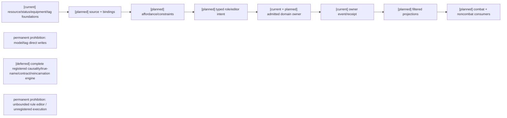

## 8. 时序图

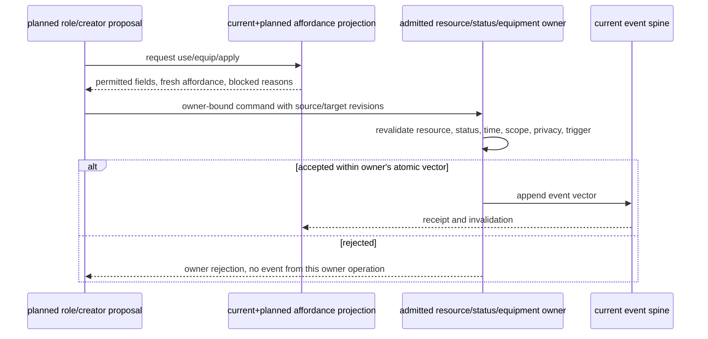

## 9. 数据流图

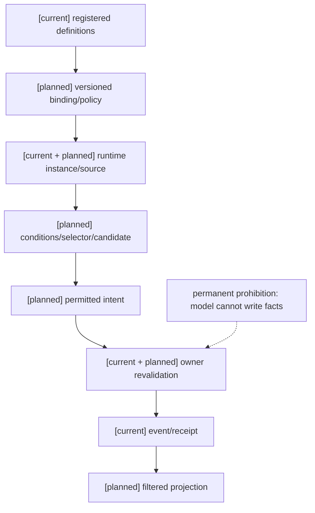

## 10. 验收

| ID | 案例 | 期望 |
|---|---|---|
| R01 | unknown resource/world 未注册 mana | 不出现隐式资源 |
| R02 | reserved/locked/available/debt 边界 | 未授权额度不可用；锁/债只按已注册 policy |
| R03 | recovery delay/suppression/overdraft/full | transition 与 source event 可重放、归 resource owner |
| R04 | fused/coupled/independent 与 focus→life | 只按注册转换，不由模型推断 |
| R05 | 不同 owner 的多资源转换 | 各自 receipt；跨 owner 失败按 spec09 恢复，不全局 rollback |
| E01 | 四 effect axes 混淆 | schema/validator 分轴拒绝 |
| E02 | 场覆盖/离场/核心破坏/过期 | 每步 owner evidence 和 lifecycle 正确 |
| E03 | field 改环境但不直接伤害 | 暴露再次经 target/effect owner 结算 |
| E04 | soul gate 缺 link/authority/vulnerability | 无 Soul fact write |
| I01 | 同 binding 多入口/重复 causal event | 去重，不重复施加 |
| I02 | 装备 source 快照/live 撤销 | 撤销范围符合绑定模式，无残留 modifier |
| I03 | 装卸装备影响 grant 与 skill mastery | 仅临时 grant 变更，学习事实保留 |
| I04 | start-use 后失败、success、取消 | refund policy 与次数/耐久/charges 正确 |
| I05 | 药品 stock、持续毒性、药效 snapshot/live | 不把 stock 与 persistent effect 合并 |
| I06 | ammo/media/formation 约束 | 分别检查弹药、媒介和空间组件 |
| I07 | unknown tag、非法 meta-tag | 无效果写入；owner/cache 按 revision 失效 |

关联：战斗02/05/06/07/08/11；编辑器05；计划04 Task3；审查06与回写登记 RW-18。


## 4.1 Status lifecycle temporal consumer（2026-10-16）

`StatusTagAuthorityService` 是状态生命周期唯一事实 owner。永久状态不隐式增加 duration；显式 `remove`、owner `expire` 与自动到期请求分开。带期限接纳冻结规格09定义的 `SimulationTime`/`ClockMapping`/profile/source revision 与 freshness；freshness 只验证来源证据，不能替代 lifecycle expiry。自动到期由现有 caller 以 `ScheduledWork` 选择后提交 owner-bound request，owner 重验 due time、实例、权限、stream revision 与幂等并产生实际 expired receipt。旧事件没有 expiry 时按永久解码；checkpoint+tail 不补造时间。入口为 `backend/app/gameplay/status_tags.py`；本节不授权新的 tag registry、scheduler 或 effect owner。

2026-10-16 应用接入增量：`main.py` 复用既有 `Phase3MirrorActorConfiguration.status_tag_definitions` 加载原 `StatusTagRegistry`，将原 owner 与薄 consumer 装配在应用同一 gameplay store；显式 `status_time_binding` 才允许该 actor 的期限状态消费匹配的 population world/timeline/source。期限由合法 apply 显式提供，不从演示或默认配置推断；默认 `gameplay_mirror_phase3_actor_configs=[]`，因此真实生产状态内容仍未配置。测试配置的实际 startup/caller/owner receipt/Durable 重启证据与生产内容启用分列，见 [阶段三回写](../回写/stage3-task1-task2-20261015.md#status-consumer-应用生命周期与-durable-重启闭环2026-10-16)；架构、时序、数据流复用 [规格09 §7.1](09-通用时间权限投影与领域服务接入规格.md#71-status-consumer-时间接入2026-10-16局部-current)。

同 actor 多期限状态由每次真实 owner 提交后的新投影重新验证；预算、暂停或失败只保留待处理状态，不把选择成功标成 expired。removed/expired 不重新激活；exact duplicate 返回原 receipt，changed duplicate 比较实际冻结输入和期限，而不只相信外部 digest。旧事件维持永久语义；缺迁移时拒绝 profile/unit/mapping 切换。本增量只收口 Task1 Status consumer，不启动 Task3 的完整状态/效果/资源迁移，也不宣称 Task1 或阶段三完成。


## Task3 前置审查回写（2026-10-16，RW-39）

[current] 真实 owner、事件版本、兼容 decoder、非战斗 consumer、隐私与时间 pins 见[本轮矩阵与三图](../回写/stage3-task3-20261016.md)。现行 ResourceEntry 仍为 current/minimum/maximum/reserved，available=current-reserved；maximum≠capacity、reserved≠locked。生产/经济/交互没有核心 Resource 的实际接线，身体恢复与生态水量恢复不是通用资源 recovery。

[planned/blocked] capacity/base_capacity、locked 重叠生命周期、debt ceiling/偿还、recovery/source accounting、目标 schema/codec 和持久 pause/drain 尚缺具名 owner 审定。现有降低 maximum/clamp 不能代替集中迁移；D17 保持暂停新承诺、旧 reservation 原合同结算、未清项 pending。仅完成审查与夹具设计，不新增字段、owner、adapter 或 pins，不标记 Task3 实施完成。[deferred] 本轮其他关闭范围见伴随报告。


## RW-41 Task3 资源前置接口设计（仅文档）

状态：`planned B design / C dependencies deferred / implementation admission = 0`。逐项来源、具名 owner/consumer、现有字段/版本/receipt/恢复、A/B/C 与解除条件见[Task3 §8.1–8.3](../回写/stage3-task3-20261016.md#8-task3-资源切片-abc-准入矩阵2026-10-16rw-41)；本节架构/时序/数据流使用[伴随三图 §8.4](../回写/stage3-task3-20261016.md#84-rw-41-共同伴随三图)。A 不新增实现，B 仅下述正式责任约束，C1–C8 正式 deferred。沿用 D06/D17，不冻结虚构目标 schema 或 API 签名。

### B1 容量求值与迁移提案边界

来源：资源02 §1.2/§2、本规格 §3。接口输入必须显式包含既有 actor/resource 身份、精确源/目标定义版本、owner revision/read-set、基础容量及修正的版本化内容/来源引用、政策版本与迁移身份/内容摘要。目标基础值和修正顺序没有注册依据时拒绝设计冻结，不能从 maximum、inventory capacity 或 Body capacity_ratio 推导。

接口输出是可解释的容量候选、逐来源修正和逐字段前后映射/差额说明；候选不写事实。现有 ResourceDefinitionRegistry 只管旧定义；ResourceBoundsMigrationAuthorityService 只作旧 bounds 纯计划；旧 bounds 实际提交由 GameplayPatchLifecycleAuthorityService 负责。目标容量结算责任及政策须通过 C1 明确，不将纯 projector 升格为 authority，也不扩大旧 bounds API 的权限。

拒绝条件包括未注册版本/来源、来源撤销或过期、revision 冲突、单位/舍入/溢出政策未定、无权主体及不完整来源解释。现有 minimum/maximum、负下界、reservation 和所有旧事实须可恢复；源值不能无条件重命名为 capacity/base_capacity。C1–C4 未解除前不创建目标字段、默认零值或源账。

### B2 D17 暂停、排空、提交和恢复

来源：D17、§3–3.1。接口语义依次为暂停新资源承诺、观察旧 reservation 按原合同完成/consume/release、满足一致 revision/read-set 后准备迁移、由有权原 owner 提交和统一开放注册范围。未结或无法确认的 reservation 一律 pending；不能主动取消、清账或伪造退款。旧资源服务在迁移提交前保持原语义。

控制请求必须明确迁移身份/精确范围、授权主体、旧新版本、预期 owner revisions、幂等及内容摘要；观察输出必须区分可确认排空、未结 pending、未知 pending、revision 冲突和已提交 receipt。准备检查与 append 之间必须重验，不能用一次空快照允许新承诺竞态。以上是逻辑接口，不代表已有持久状态 schema 或为其命名新 owner。

C5 待用户决定既有 owner 对持久 fence、状态记录、撤权和重启查询的责任。停机后不能靠进程变量推断已经暂停或排空；只能从经审定的原 store 记录和原 owner 查询恢复。提交前失败保留旧服务；提交后保留事实及 receipt，关不兼容 consumer，由 owner 批准后继修复，禁止旧投影覆盖、删除事件或跨 owner 全局回滚。不另建 clock/scheduler/store。

### B3 版本 decoder 与无损映射

来源：D06、§3.1、资源02 §2、投影04 §4.3–4.4。解码输入为原事件 schema 身份/版本、精确定义版本、checkpoint codec/cut/参与依赖、原 pins、迁移和 migrator 摘要；输出为旧语义重建结果或显式不兼容拒绝。既有 legacy-v0 兼容行为只服务其旧 decoder，不能复制为新字段默认值；未知 schema/缺政策/缺依赖不 fallback latest。

迁移设计须逐字段列源值、目标值、单位/舍入、reservation/lock/debt/recovery 关系及来源 ledger、可逆重建信息、版本和拒绝条件；所有损益必须由 owner 明确批准并保留可核对的来源。现有 bounds clamp 的 lost_amount 是显式损失，不是本目标无损映射证据。保留旧事件和旧 decoder，不重扣旧费用。隔离副本 full replay 与兼容 checkpoint+tail 的相等条件必须覆盖 reservation、源账、revision 和 receipt，不能仅比较 current。

C6 依赖 C1–C4 决策；冻结所有实际 consumer 的源/目标 pins、注册范围和 codec 后才可设计实现。D06 全范围通过后统一 admission，不逐资源偷开新 pin。本轮不分配目标 schema/revision 值。

### B4 receipt、超时查询与 Durable 恢复

来源：规格09 §4/§6、D17。现有提交责任仍在原 authority 与 GameplayEventStore/Durable；Resource projector/Phase3ProjectionCheckpoint 是读模型/内存 checkpoint，不能承担持久提交。目标 receipt 设计必须能引用原提交/幂等身份、内容摘要、迁移与定义/schema pins、owner 前后 revisions、源事件与重建依据；字段签名和版本待 C5/C6 后由既有提交 owner 审定。

丢响应/重试时按原 principal+idempotency 查询既有 `get_by_idempotency` / transaction 结果；已提交返回原事实和 receipt，未确认保持 unknown/pending，不能再次扣费。独立校验重复内容是目标接口的必要条件；旧 reservation apply 信任 caller 提供的 payload_digest，不能宣称已覆盖全部 changed-payload 重试。无查询权限不能因恢复读取绕过授权。

恢复设计必须声明参与 owner/依赖、一致 cut、checkpoint codec、tail 范围和历史 pins；在 Durable 新实例重建，而非复用旧内存。缺 tail、缺依赖、损坏或版本不匹配应显式拒绝/请求经授权的完整重建。Task2 scoped replay 只覆盖原声明参与者，不自动包括目标资源迁移。后续证据必须覆盖 append 前失败零写、提交后丢响应、变载荷重试、checkpoint-tail/full 相等和后继修复；本轮只设计，不执行。

### B5 资源级授权与 Stable/Hot/Delta

来源：规格09 §7、投影04 §2–5/§13、编辑器03 §5–6/04 §2/4/7。请求显式携带主体、actor/resource/字段用途、授权政策与撤权版本、owner revision/freshness 和所需投影类别；C7 尚未确定具体 issuer/policy/consumer，不设置 self/public/default 权限。owner 授权过滤先于 cache、角色 L1 及三类投影输出；actor 相等或顶层 entries allowlist 不构成资源级许可。

Stable 只保存被允许的基础定义、版本及低频政策；base_capacity 的定义来源按政策分类，临时/有效 capacity 和恢复修正属于 Hot，current/reserved/locked/debt 等实例值不能进入 Stable。Hot 需 definition/policy pins、owner revision、freshness/visibility；Delta 需 from/to、event refs、invalidation 及原 pins，缺段/乱序只能请求授权完整 snapshot，不补猜数值。原 composer 遗漏 definition_version 是缺口，不能把现有 envelope checksum 当成完整版本契约。

撤权先使私有 cache、affordance、pending intent 和 active binding 失效，再发布当前允许的投影；撤权 tombstone/失效通知不得携带已撤销私有值。历史 replay、重连和完整 snapshot 同样受当前授权约束，不能从旧 cache 回填秘密。资源 ACL 和撤权责任由 C7 明确后再定签名及验收；equipment/ability grant 撤销不自动覆盖此项。

### C 类正式 deferred 与实施边界

C1 容量来源/政策，C2 锁定生命周期，C3 透支/偿债，C4 恢复/来源账及时间准入，C5 持久 pause/drain 责任，C6 目标映射/codec，C7 资源授权与撤权，C8 真实非战斗 caller/owner route，按本次产品选择保持 core ResourceEntry 新增切片关闭。现有 direct owner API、测试、reference 和 verifier live probe 不作为生产 caller 验收；Production/Economy/Interaction 自有状态也不自动变为通用资源。缺少的事实 owner/content/caller 仍构成实现和验收阻断，不是等待产品审批。

本次仅完成 B 接口设计与 C 缺口登记，新资源可实现切片为零；2026-10-18 已选择保持无来源映射关闭。若未来出现已有非战斗 caller 与版本化资源内容源，再提交来源准入记录。facility repair 沿用 C/deferred；Task2 T07/prediction 仍按各自政策；Task4/5/6 状态见 closure 当前矩阵。Laya 仅 choice 输出类型。

## RW-43 生产输出入库 C1 决策单引用（2026-10-16）

本候选的来源判定见[生产输出入库 C1 决策单](../回写/stage3-task3-production-output-c1-decision-20261016.md)，保留 RW-42 历史。原设计02 §1.2 已定义 `base_capacity` 的角色/世界包来源与内容包政策，但该候选尚无核心准入、具体容量 owner、版本、policy 或映射。Inventory quantity、容器 capacity 和旧 maximum 不自动映射核心容量；领域 pins/receipt/重读验证也不等于核心 pins/receipt/持久恢复合同。

### 2026-10-18 Task3 当前政策选择

用户已委托本代理决定产品政策。本次选择是保持核心 ResourceEntry 的现有已准入语义，暂不将任何 Inventory、Economy、Construction 或 Ecology 数量/capacity 映射到 `ResourceEntry`。Task3 来源审计未找到同时具备真实非战斗 caller、核心内容版本/单位/容量 owner 与 D06 迁移责任的候选；因此 `R01–R05` 的新增资源切片维持 `C/deferred/not_verified`。替代方案是指定一个具体包内容与真实业务 caller 后实施集中 codec migration；现有来源审计包没有该可核对 caller/version，故当前不实施。此处“未决定”历史文字由本政策选择覆盖；缺来源不是等待产品批准的理由，也不是可以推造资源事实的许可。

C1 维持 C/deferred；若纳入核心仍须通过 D06 集中迁移门禁。Task3 可实施切片仍为零。本节 current/planned/deferred 架构、时序及数据流共同引用决策单三图，不新增字段、owner 或默认政策。

## RW-44 生产输出核心资源准入决定（2026-10-16）

此前用户决定生产输出保留 Inventory custody 语义，不将其映射到核心 `ResourceEntry`。2026-10-18 本次代理在用户委托的政策授权下维持该选择：Inventory quantity、容器 capacity、Inventory receipt 与重读仍只表达 Inventory 事实，不自动构成核心资源 current/capacity/base_capacity 或恢复合同。该决定保持 RW-44。

[current] 既有生产输出 caller、Inventory owner 和 custody 投影按现有内容版本工作；[planned] 无本候选的核心映射计划；[deferred] 只有明确业务需求及命名资源/容量来源后，才重开 C1 和 D06 全范围迁移准入。Task3 可实施切片仍为零。不得据此扩展到其他候选，也不改变 C2–C8、facility repair 或阶段三其他门禁。

### 2026-10-17 当前状态校正

RW-44 继续有效。早期 Task5/6 范围文字只描述当时轮次，已由用户当前授权取代，不改变本规格的 ResourceEntry 政策。Task3 C1–C8 的决策与逐项证据见[阶段三当前矩阵及决策包](../回写/stage3-closure-20261016.md#2026-10-17-逐项验收编号矩阵与产品决策包)；没有核心资源内容/容量政策时不新增映射或猜测字段。Task3、Task6 均未完成。


RW-44 继续有效。早期 Task5/6 范围文字只描述当时轮次，已由用户当前授权取代，不改变本规格的 ResourceEntry 政策。Task3 C1–C8 的决策与逐项证据见[阶段三当前矩阵及决策包](../回写/stage3-closure-20261016.md#2026-10-17-逐项验收编号矩阵与产品决策包)；没有核心资源内容/容量政策时不新增映射或猜测字段。Task3、Task6 均未完成。

## RW-42 C8+C1 来源决策包（2026-10-16）

本轮来源审计见[Task3 C8+C1 决策包](../回写/stage3-task3-c8-c1-source-decision-20261016.md)，核对了生产输出入库、粮食收获入库、公共项目预算、生产设施槽位/产出和生态节点水量/恢复五类真实领域入口。没有候选同时满足 C8（真实非战斗 caller、绑定内容、既有 owner route 与恢复边界）和 C1（具体容量来源、政策及核心 `ResourceEntry` 映射）。生产输出入库仅可列为需要补接口设计；其余保持 C/deferred，不能把领域容量、余额或数量字段升级为核心资源字段。

[current] 领域字段、内容 revision、owner receipt 与既有投影恢复保持原语义；[planned] 用户必须指定 caller、资源内容/容量来源、policy、映射与责任 owner；[deferred] D06 集中迁移、C2–C7、目标 schema/codec 和核心资源 admission 继续关闭。可实施切片仍为零，不新增字段、默认值、权限或 registry。

## 阶段三最终门禁同步（2026-10-16）

RW-44 继续约束：生产输出由 Inventory custody 管理，不进入核心 `ResourceEntry`。Task3 旧 owner 合同可复用但不构成新核心资源切片；C1–C8 在缺真实 caller、容量/policy、codec、迁移、privacy/revocation 前正式 deferred。解除条件与三图见[阶段三总收口矩阵](../回写/stage3-closure-20261016.md#2026-10-16-当前收口覆盖与历史段落说明)。

## 2026-10-18 角色资源来源审计与准入合同回写

### [current] 已核对的来源与边界

角色模板读取入口是 `backend/app/character_agent/profile/registry.py::CharacterProfileRegistry.from_directory()`，候选文件位于 `assets/characters/profiles/*.yaml`。运行时旧资源结构是 `backend/app/gameplay/resource_body_runtime.py::ResourceDefinitionRegistry`、`ResourceDefinition` 和 `ResourceEntry`。这些实际来源目前只提供身份/能力 dossier 以及 `current/minimum/maximum/reserved` 旧合同；没有正式的 stamina、mana、action-points 最大值、初始值、世界时间恢复周期/数量、锁定生命周期或债务政策。现有 fixture/bootstrap 数值、Inventory capacity、Body capacity 和 ability cost 不得推导为核心资源内容，RW-44 继续生效。

本次设计并实现的只读技术合同为 `backend/app/gameplay/resource_template_admission.py::ResourceTemplateAdmission`，测试为 `backend/tests/test_resource_template_admission.py`。它要求版本化 `template_ref/template_revision`、issuer/fact owner、actor/world/timeline scope、有效期、三项整数资源、恢复参数、`debt_policy=forbidden`、lock issuer/lifecycle revision、binding revision、读取主体、digest、receipt lookup 与 revocation owner；caller 先冻结来源，owner 在提交前以同一 source/binding revision 重验。该合同不注册内容、不提供默认值、不写 `ResourceEntry`、不新增 store/clock/owner，故 Task3 implementation admission 仍为 `0`。

### [planned] 来源出现后的最小实施顺序

受信角色模板发布者先提供可核对 revision/digest 与世界时钟绑定的三项资源政策；具名非战斗 caller 冻结模板与 binding revision；既有资源 owner 在 append 前重验并产生 owner receipt；随后才设计 D06 集中迁移、兼容 decoder、pause/drain、Durable 新实例、full/checkpoint+tail parity 与撤权恢复。任何缺少来源、权限或版本的请求必须零写拒绝。

### [deferred] 当前门禁

C1 容量/初始来源、C2 锁定、C3 债务、C4 恢复/时间准入、C5 持久 pause/drain、C6 codec/迁移、C7 资源隐私撤权、C8 真实 caller/owner route 均保持 deferred；不以 admission 合同测试冒充业务验收。

### 伴随三图

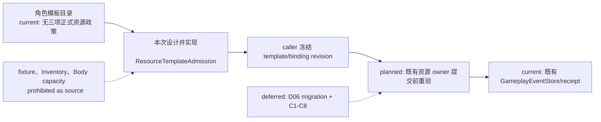

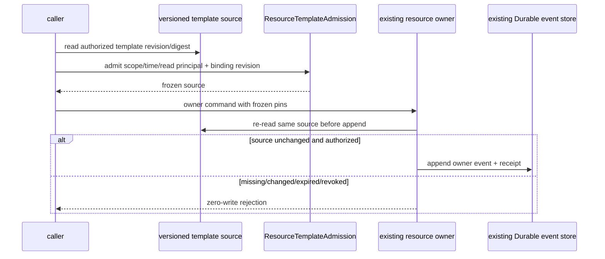

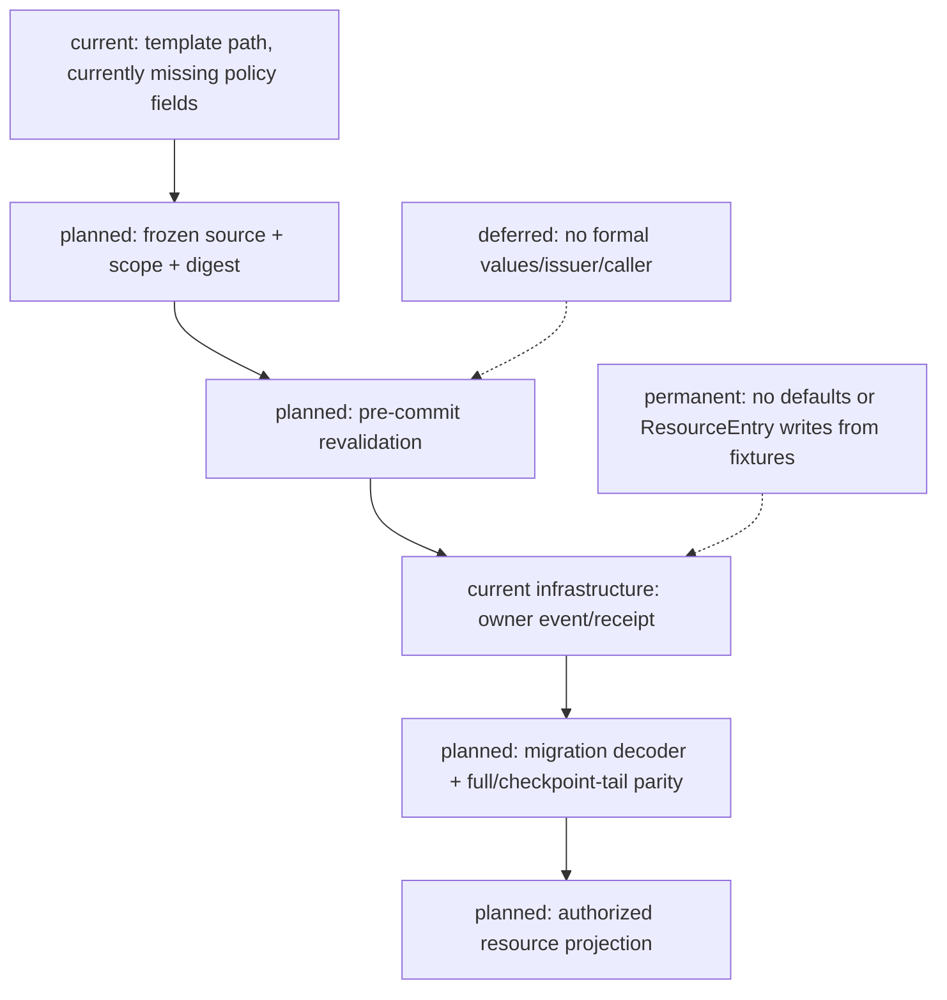

## 2026-10-19 角色模板资源物化 owner（本次设计并实现）

### 来源与职责

`CharacterProfileRegistry.from_directory()` 读取 `assets/characters/profiles/*.yaml` 中本次设计并实现的 `resource_template`。它提供 template revision、source digest、actor/world/timeline scope、有效期、read principal、receipt key、撤权责任，以及 stamina/mana/action-points 的整数容量、初始值、世界时间恢复参数、禁止欠值和技能锁定 revision。该 authored package 不是历史外部 issuer；world-admin 登录身份/授权服务仍不存在，不能被本实现冒充。

`CharacterResourceMaterializationCaller` 冻结 registry source；`ResourceMaterializationAuthorityService` 是本次设计并实现的正式资源 owner，复用现有 `GameplayEventStore`/`DurableGameplayEventStore`、`ResourceTemplateAdmission`、`build_multi_stream_atomic_event_batch` 和既有 ResourceBody projector。caller→owner 在同一提交边界重新读取 source，scope、validity、read principal、binding、read-set 和 resource stream revision 任一不符均 zero-write。三条 `gameplay.resource.materialized` 事件原子提交到 `gameplay:resources:{character_id}`，可见性为 `authority_only`；事件含 template/source receipt、world/timeline/tick、恢复、债务和锁定元数据。已有资源流拒绝再次初始化；exact duplicate 返回同一 receipt，changed duplicate 返回 `idempotency_key_reused`。

### Population activation/Presence 接线

应用装配在同一 store 构造 resource owner/caller，并在 Population activation→Presence 成功后执行资源物化第二阶段。Activation、Presence、Life stream heads 在资源写入前重验；Presence 已提交而资源失败时保留 activation/presence receipt 并返回 `recovery_required`。world tick/timeline 由 Population runtime driver 提供，transport 不得自行指定。该第二阶段不是跨流伪原子事务，恢复必须复用同一 Durable store 和 receipt。

### 架构图（current / planned / deferred）

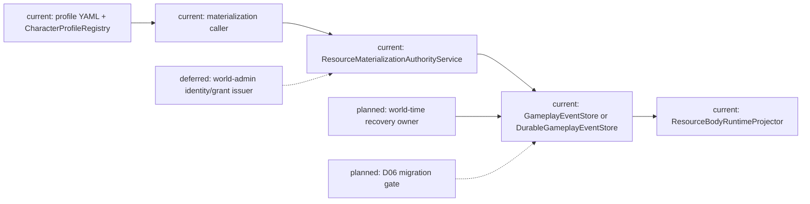

### 时序图（current / planned / deferred）

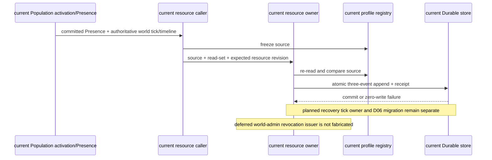

### 2026-10-19 D06 migration receipt integrity correction

本次设计并实现强化 `ResourceMigrationOwner` 的 Durable duplicate/replay 校验：重试必须找到原 transaction，并逐项核验 principal、command、完整四事件、事件 ID、事件类型、stream、revision、global sequence 与结果摘要；缺 transaction 或事件损坏 fail-closed，变更请求返回 `idempotency_reused`，均不追加新事件。迁移完成后 v2 reservation 继续要求有效 `lock_ref`，并验证关闭重开后的恢复。资源迁移/锁/物化/恢复 allowlist 49 passed，资源聚焦套件 87 passed。该切片加强 D06 证据，但尚未覆盖所有资源类别的集中跨域切换，因此规格10整体仍未通过。

### 数据流图（current / planned / deferred）

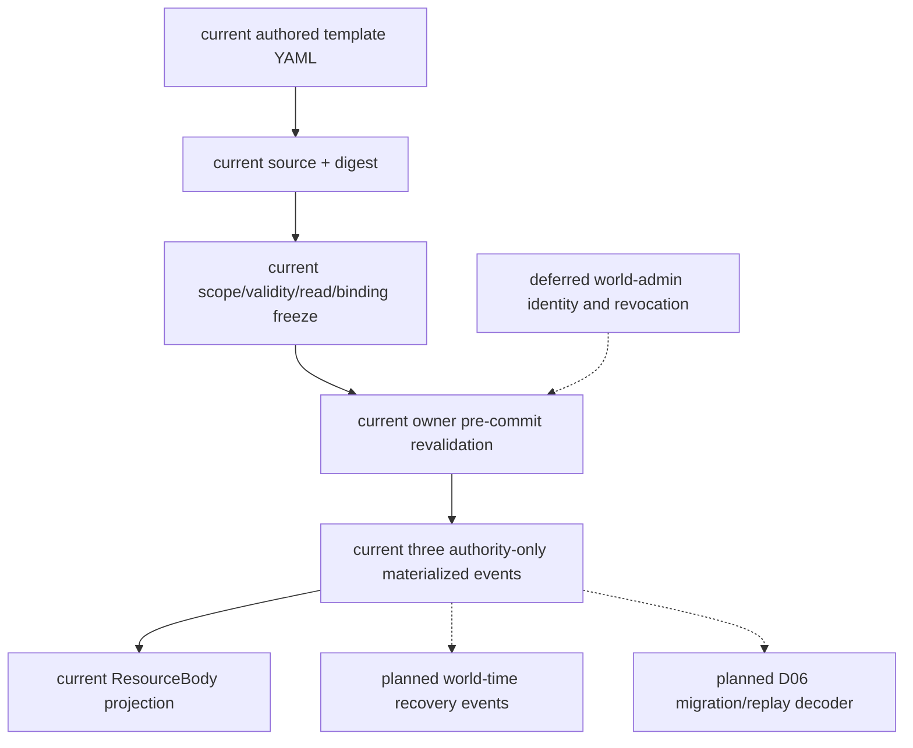

当前已验证 `backend/tests/test_resource_body_runtime.py` 20 项（含 3 项物化/重复/重启路径）及 Population activation/Presence focused tests；Task3 仍未总体验收，恢复 owner、D06 migration、正式 world-admin issuer 及 Task6 全域故障矩阵继续 planned/deferred。

## 2026-10-19 资源数值与物化实现更正（本次设计并实现）

用户已授权由本阶段补齐缺失数值。`assets/characters/profiles/*.yaml` 中的 `resource_template` 是版本化 authored source：char_a=stamina 100/100(+5/10 world ticks)、mana 80/80(+4/10)、action-points 6/6(+1/tick)；char_b=120/120(+6/10)、60/60(+3/10)、8/8(+1/tick)；char_c=80/80(+4/10)、120/120(+6/10)、5/5(+1/tick)。三项均为整数、debt forbidden，reservation owner 产生 locked 数量，恢复使用 Population 确认的世界时间。issuer/fact owner=`character-template-phase3`，版本=`character-template:<actor>@1`，属于本次设计并实现，不冒充历史外部 issuer。

## 2026-10-19 Resource modifier recovery interval correction（本次设计并实现）

`ResourceRecoveryAuthorityService` 不再把最终 modifier ledger 的 delta 乘到所有尚未结算周期。它从同一资源 stream 中按 `global_sequence` 重建 recovery modifier 的 attach/detach 历史；attach 使用 modifier 的 `effective_world_tick`，detach 使用事件顶层 `effective_world_tick`。任一时间缺失/非精确非负整数时拒绝并零写。恢复只在 `last_settled_tick + k * recovery_period` 的完整结算点采样：attach 在边界 tick 生效，detach 在边界 tick 起不再生效，未来 attach 不影响当前已确认区间。按 attach/detach 所在周期分段计数，避免按每个 tick 循环；每段 base+active additive rate 下限为零，最终按容量余量封顶。已提交的 `gameplay.resource.recovered` 仍是恢复事实与幂等 receipt，历史 modifier 不会因 detach 从投影 ledger 消失而丢失恢复计算依据。

同一修复还保证 `recovery_delta` modifier 的 attach/detach 只改变 modifier ledger/digest，不触发 capacity 重算或 current clamp；只有实际 `capacity_delta` 事件才按既有公式重算 capacity/current。该边界避免 recovery policy 改写独立 capacity 状态，不推导 capacity 到 maximum 的新映射。Modifier lifecycle 按 source event order 校验：重复 attach、无 open attach 的 detach、detach tick 早于 attach tick、重 attach tick 早于前次 detach 均 fail closed；有效同 ref 后续 attach 必须在前次 detach tick 或之后。

此增量属于本次设计并实现，复用 Population cadence temporal authorization、现有 resource event stream 与 shared store，不增加 clock/scheduler/store。每个历史 recovery event 的 `applied_through_world_tick` 必须是 exact nonnegative int，不晚于该 event 的 exact confirmation tick，且 actor/world/timeline 必须匹配当前读取范围；损坏边界不被过滤后重算，而是 fail closed。证据：`backend/tests/test_resource_recovery.py` 覆盖 attach、detach、future、missing detach、prior recovery boundary 损坏和逆序 modifier history；`test_resource_body_runtime.py` 验证 recovery modifier attach/detach 保留 capacity/current，容量 modifier 仍正确更新；资源 recovery/body/migration/migration-control allowlist 当前 73 passed。Modifier→Resource 的独立授权 admission API 和正式 Equipment 生产 caller 仍未实现，不能据此扩大 modifier 权限或宣称规格10完成。

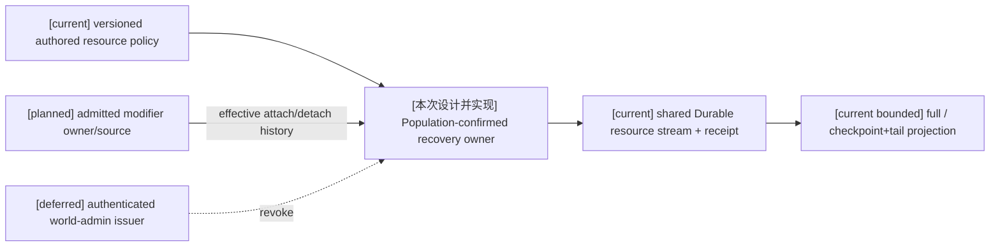

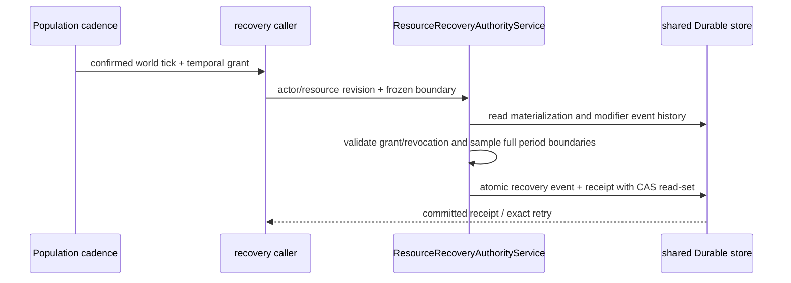

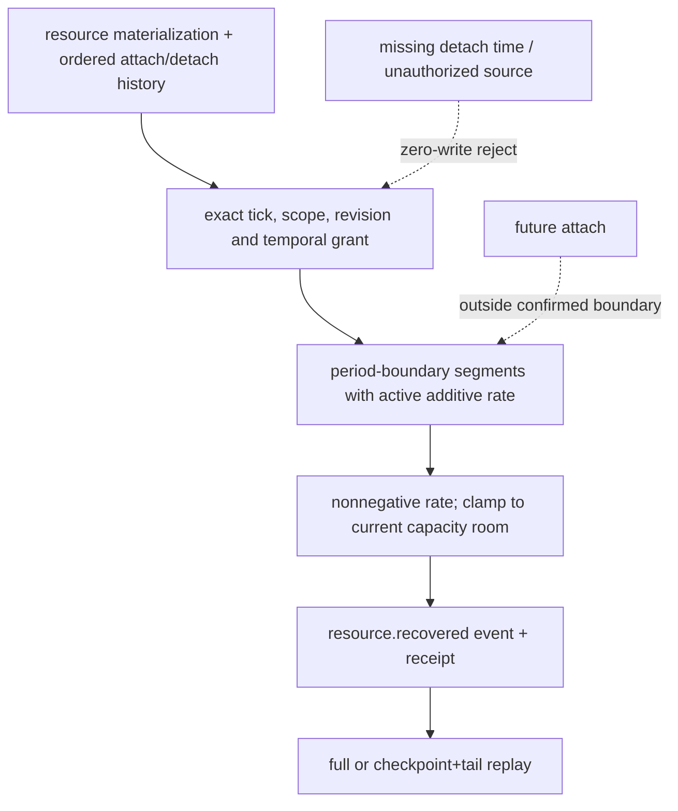

当前已实施的有限切片为 `CharacterResourceMaterializationCaller`→`ResourceMaterializationAuthorityService`：三项 `ResourceEntry` 事件使用同一既有 GameplayEventStore/DurableGameplayEventStore 原子提交；caller 冻结 source，owner 在提交前重验 scope、validity、read principal、binding、stream revision 和 read-set。完整 receipt 校验事务身份、三事件顺序与 payload、visibility、read-set、digest、event index、revision vector 和连续 global range；截短或篡改 receipt 零写拒绝。close/reopen 后由新 caller/new owner 查询并回放原 receipt。RW-44 仍禁止 Inventory custody 映射入核心 ResourceEntry。

恢复 callback 已接入 Population cadence，但完整容量/locked/debt 生命周期、D06 codec/migration、world-admin 撤权 issuer 与跨域恢复矩阵仍 planned/deferred；本切片不宣称规格10总验收完成。

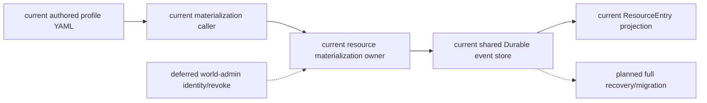

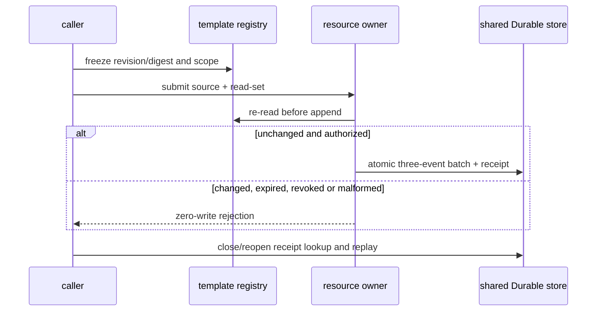

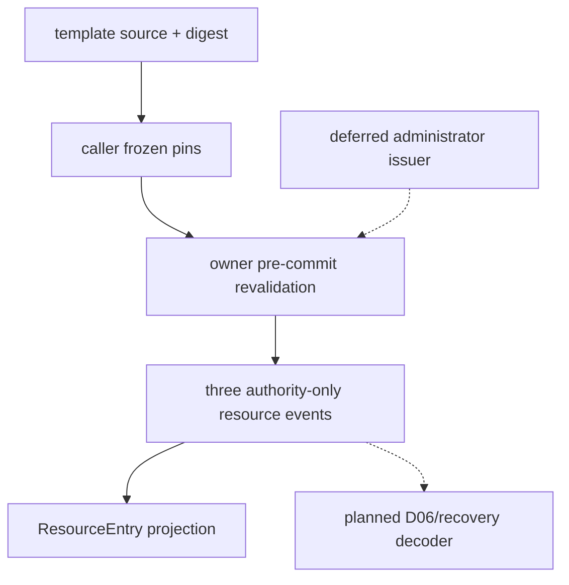

### 2026-10-19 Resource v2 and T09 evidence correction

资源 v2 物化仅接纳明确 `resource.v2`、`capacity/base_capacity`、空 modifier ledger、`locked=0`、`debt=0` 的本次 authored policy；旧事件保持 legacy decoder，不能静默升级。`ResourceEntry.reserved` 继续是 reservation 总量，不等同 locked。资源/物化/恢复/战斗适配器/Task6 allowlist 共 75 passed，且 fresh Harness 已证明资源 world-time callback、Durable close/reopen 与 RW-50 对照；独立 lock 生命周期、非空 modifier ledger、D06 migration 仍未完成。

T09 `PredictionAuthority` 已加强 Durable 生命周期、owner receipt 完整性、CAS、幂等 changed duplicate 和 checkpoint+tail projection，定向测试 7 passed；但未接入真实 Equipment 生产 ingress，保持 `not_verified/deferred`。不得将任意 callable、fixture 或 verifier-only probe 登记为 caller。

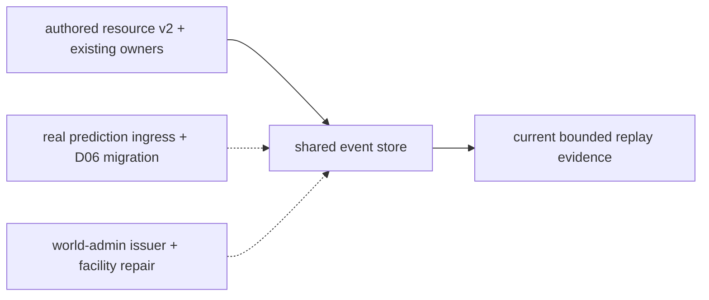

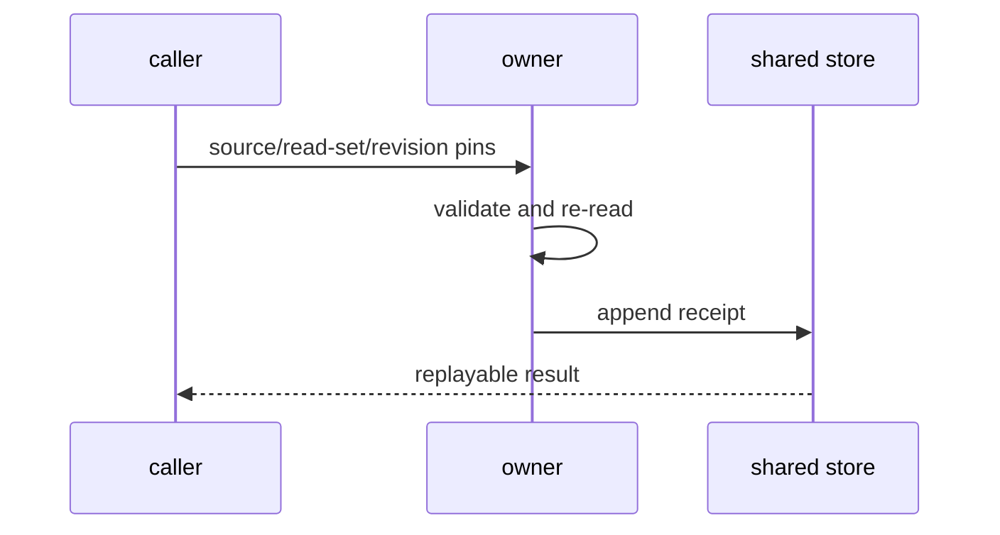

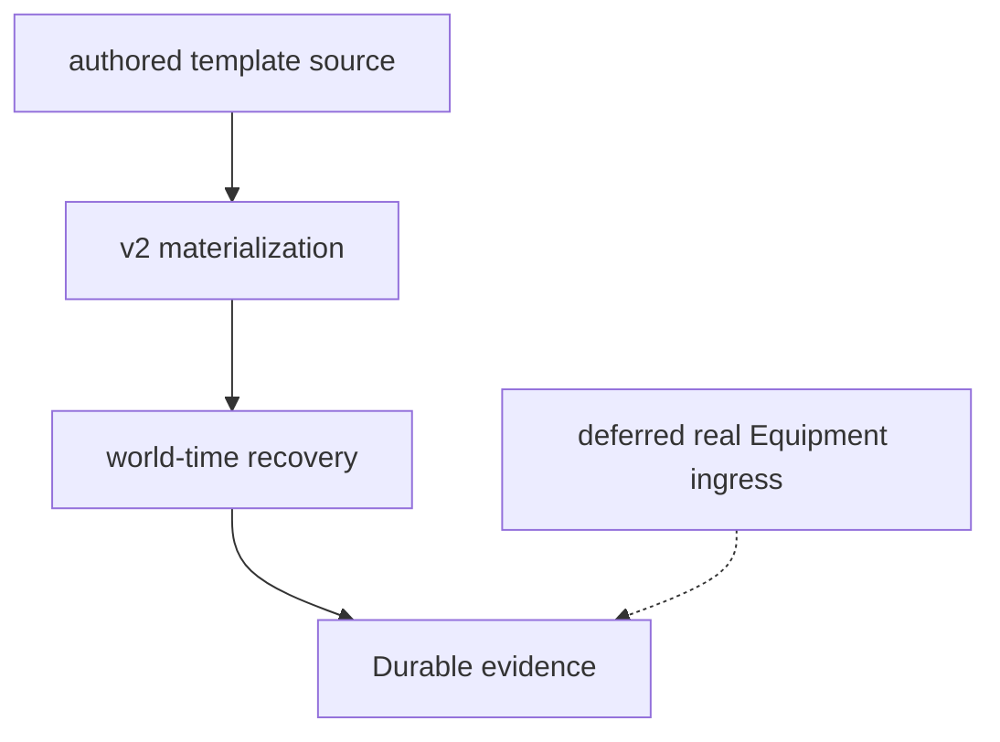

### 2026-10-19 current reservation/lock receipt contract correction

当前 v2 reservation 已由 `ResourceReservationAuthorityService` 与 `ResourceBodyRuntimeProjector` 共同实现 atomic reservation/lock pair。Duplicate receipt 校验 persisted transaction digest、两事件 schema/stream/transaction/command、causation/correlation、authority-only visibility、actor/resource/reservation/lock identity 与相同 amount；Durable event 与 batch 不一致时拒绝重放。fresh `infra-resource-world-time-recovery` evidence=`c239c75c612b4ea49a32f43505cacb20`，focused suite **52 passed**。该修正不意味着完整 ResourceEntry modifier/debt/conversion lifecycle 或全资源 D06 migration 已通过。

### 2026-10-19 D06 frozen projection revalidation

`ResourceMigrationOwner.apply()` 现在在投影读取前固定 resource/control stream revision，并将同一 revision vector 传入原子 append。计划阶段发生并发资源写入时返回 `revision_conflict`，不追加 migration completed event；`test_d06_rejects_resource_write_after_frozen_projection` 证明旧投影不会在并发写后继续提交。资源 allowlist 当前 50 passed。该修复只强化既有 D06 fail-closed/recovery 合同，不改变历史事件、RW-44 或全资源类别未完成状态。

### 2026-10-19 D06 v2 policy rebind bounded implementation

本次设计并实现 `resource.v2.policy.rebind.v1`：允许已 materialized 的 `resource.v2` 资源在显式 source/target definition、版本化 policy digest 和空 modifier ledger、`locked=0`、`debt=0` 的前提下迁移到另一 `resource.v2` policy。目标 capacity/base_capacity 以目标 definition 为准；current 仅在目标 maximum 下降时 clamp。legacy clamp migrator 与 v2 rebind migrator 的 code digest、migration kind、source/target schema 在 planner 和 projector 双重绑定；v2 状态不满足条件时 fail closed。full replay 与 checkpoint+tail replay 已验证相等，19 项资源迁移聚焦测试通过，fresh `infra-resource-world-time-recovery` run=`a79064bad3fc410797204735fceefb69` 通过并完成清理。

该切片仍不等于完整 D06：非空 modifier ledger、debt/locked 生命周期、跨 owner conversion、全资源统一迁移和管理员撤权仍未完成，Task3 与阶段三状态继续 `incomplete`。

### 2026-10-19 D06 pause receipt / nonempty ledger revalidation

以上“仅空 modifier ledger”的记录是早期实现快照。当前 planner/projector 保留并核验非空 ledger/digest；`test_d06_equipment_recovery_modifier_survives_durable_migration_and_recovery` 通过既有 Equipment owner 的真实 activation 来源验证 recovery modifier 迁移、Durable 重开、后续 world-time recovery 与 full/checkpoint+tail 一致；不据此宣称所有 modifier 类型或全资源统一迁移完成。

本轮修复既有 `ResourceMigrationControlAuthority.pause()` 的 duplicate receipt 校验：在原 shared Durable store 回读 transaction/event，核对 command、principal/key、stream/type、actor/migration、authority-only、event refs、resulting revisions、global sequence 与持久事件一致性。四类损坏 receipt 及缺事件回归先 RED 后 GREEN；损坏时 `resource_migration_receipt_incomplete`、zero-write，正常 duplicate/reopen 和 changed duplicate 合同不变。fresh `infra-resource-world-time-recovery` run=`371a7c61ccd64e56b5f4501093c16232`，**168 passed**、cleanup passed；证据及统一验收矩阵见 `../回写/stage3-closure-20261016.md` 顶部本轮条目。本修复不增加 authority、store、clock 或新的业务来源；架构、时序与数据流沿用本规格已有图示。正式管理员 issuer、完整 Task3 与 Task6 global cut 继续未验收。

### 2026-10-19 Task6 Resource participant design

在既有阶段三授权下，本切片扩展原 `capture_participants` / `validate_saved_participants`，不改变 Resource owner。`[current]` 原 cut 只有通用事件投影；`[planned]` 把真实 `gameplay:resources:{actor}` 流中的 Resource 事件作为一个版本化 participant，按相同 global sequence cut 重建全部 actor 的 entries/reservations/locks、来源 revision 和 projection digest，并保存有序事件身份与完整事件摘要。不得静默遗漏未知 Resource 事件、错误 actor/stream 或不支持 schema。无 Resource 事实时保留旧空范围兼容；有事实却缺 participant/version 时拒绝。checkpoint/tail 的 participant 集合变化仍要求重新 capture，不能偷加新范围。

迁移 decoder 依赖精确历史 ResourceDefinitionRegistry；本切片不从 payload 猜注册表，也不增加默认 latest resolver。当前应用没有统一历史定义来源，遇到 bounds_migrated 时沿用 projector 的 registry-required 明确拒绝。`[deferred]` facility repair 沿用既有延期；Equipment 领域 projection、全域 atomic cut、权限发行与完整 D06 仍为后续验收，不能由本切片替代。内部 replay 输出保持既有 trusted internal 边界，不产生公开 transport/read permission。

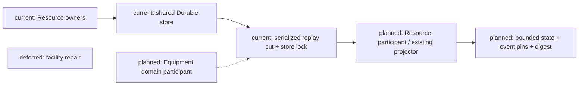

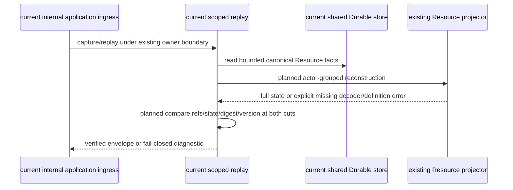

```mermaid
flowchart TD
  Facts["current: committed resource events"] --> Bound["planned: sequence + actor/stream/schema validation"]
  Bound --> Project["current: ResourceBodyRuntimeProjector.rebuild_resources"]
  Project --> State["planned: entries/reservations/locks/revisions/digest"]
  State --> Compare["planned: saved manifest vs bounded reconstruction"]
  Missing["current: absent migration definitions"] --> Reject["planned: incomplete, no replay writes"]
  Compare --> Result["planned: internal parity result / explicit mismatch"]
```

验收：真实 Resource materialization/reservation owner 写入同一 Durable store，capture 后 consume/recovery，再 close/reopen 并重放，full digest 与 cut+tail digest 一致、回放零写；篡改 state/ref/digest/decoder、遗漏 participant 及迁移缺定义均拒绝。实施顺序与文件责任见计划04末节；证据写入统一 stage3 closure。

#### 本切片实现状态（2026-10-19）

上述 Resource participant 已从 planned 转为本次实现：保存 actor 分组的完整 ResourceStateProjection 可序列化字段，恢复时先按 bounded 原事实核验保存状态，再用其 entries/reservations/locks/revisions/projection_revision 还原领域 checkpoint 接续 tail，与 bounded full rebuild 对照。不会用再次 full rebuild 冒充 checkpoint decoder。已知 Resource 事件出现在错误流、未知 Resource 流事件、schema/actor 不符、participant/version 缺失均拒绝。原 event cut 的 store lock、两次 observation、RuntimeExecution 与 trusted internal 边界不变。原 LifeState presence admission 已登记 schema 2，本次将该精确类型/版本补入 replay 白名单，未知 v3 与 Resource v2 event schema 仍拒绝。聚焦 replay/resource/application/cut 回归 49 passed；fresh Harness ID 以统一 closure 本轮记录为准。

### 2026-10-19 Task6 Equipment participant design

`[current]` EquipmentProjector 只支持 full rebuild；原 scoped cut 没有 EquipmentProjection。`[planned]` 在同一 cut 增加可选 equipment@1 participant，读取全部 canonical `gameplay:equipment:{actor}` activation_started/ended schema1 事件，按 actor 重建 activations、active_by_slot、ended_activation_ids、source_revision_vector 和 projection_revision，保存完整事件 digest。有事实时必须同时存在 participant/version；未知类型、错误 stream/actor/schema 均拒绝。原没有 Equipment 事实的 cut 继续可读；新增 actor 或参与范围必须重新 capture。

EquipmentProjector 增加 keyword-only checkpoint，接续已验证 EquipmentProjection 的副本和 tail；不重新提交 equip/unequip。保存的领域 checkpoint 先与历史 bounded full state 对照，再解码接 tail，与目标 bounded full state 对照。激活中的 ability/modifier/container-access 引用原样保留，不声称重建其独立 owner 状态。领域恢复只读取提交事实，不依赖当前 profile registry 或授予写权限。`[deferred]` facility repair 继续沿用既有延期；全 owner atomic cut、Inventory 完整领域投影、管理员 issuer 与 Equipment production demand 仍为待验收能力。

```mermaid
flowchart LR
  Owner["current: Equipment owner"] --> Store["current: shared Durable store"]
  Store --> Cut["current: serialized scoped cut"]
  Cut --> Part["planned: equipment@1 participant"]
  Part --> Projector["current full / planned checkpoint: EquipmentProjector"]
  All["planned: all-owner recovery"] -.-> Cut
  Repair["deferred: facility repair"]
```

```mermaid
sequenceDiagram
  participant App as current internal ingress
  participant Cut as current scoped replay
  participant Store as current Durable store
  participant Projector as EquipmentProjector
  App->>Cut: capture with active equipment
  Cut->>Store: read bounded committed lifecycle
  Cut->>Projector: planned full state capture
  App->>Cut: replay after close/reopen
  Cut->>Projector: planned verified checkpoint + tail
  Cut->>Projector: bounded full rebuild
  Cut-->>App: planned parity or explicit rejection; no owner writes
```

```mermaid
flowchart TD
  Facts["current: activation lifecycle facts"] --> Bound["planned: sequence / stream / schema / actor validation"]
  Bound --> State["planned: slots + activations + ended IDs + revisions"]
  State --> Saved["planned: internal versioned checkpoint"]
  Saved --> Decode["planned: restore EquipmentProjection"]
  Tail["current: committed tail facts"] --> Decode
  Decode --> Compare["planned: compare with full rebuild"]
  Compare --> Result["planned: parity / fail closed; trusted internal boundary"]
```

验收与映射：原 Equipment owner 在同一应用 Durable store equip→capture→unequip，关闭重开后使用非空 activation checkpoint 接 tail，完整领域状态/full digest 相等且零写；state/ref/digest/decoder/participant/version 损坏及错误事件范围均拒绝。实现文件为 `equipment_runtime.py`、`replay_participants.py`、`replay_checkpoint.py`，实施与证据见计划04对应增量及统一 closure。

实现状态：上述 Equipment participant 与 checkpoint API 已实施；实际混合 cut 同时包含 Resource 与 Equipment 领域状态。定向 replay/Equipment/Resource 回归 74 passed，新增范围变化检查后 Equipment participant 文件 13 passed；该历史轮次要求参与者加入后重新 capture，现由下述首次写入续接设计取代。非空激活恢复、多槽卸下、ended history、保存状态不变、checkpoint actor/digest 损坏仍保留。三图中的 planned Equipment participant/decoder 已转为本切片 current；全 owner cut 和其他 owner 的完整投影仍 planned。fresh Harness evidence 统一见 closure，不能以 bounded 通过代替阶段三门禁。

### 2026-10-19 Task6 Inventory domain participant design

`[current]` Inventory owner 已用共享 Durable store 与 `InventoryProjector` 重建 items、containers、locations、reservations、capacity reservations；旧 replay 只登记 production-output custody 专项 rows。`[planned]` 在同一 cut 登记独立的 `inventory_domain@1`，保存上述完整 InventoryProjection、来源 revisions、projection revision 与所有 Inventory 事件摘要。已知 commerce custody/delivery 事件在现有 projector 中无状态效果，但纳入事件身份和范围校验；不得把此投影声称为独立 Commerce owner 的状态。错误 stream/actor/schema/type、缺 participant/version 或历史 item definition 不能解析时 fail closed。外部 harvest/certification 来源从同一 bounded store 读取，checkpoint tail 不丢引用。

`[deferred]` 全 owner atomic cut、独立管理员 issuer 和其他领域投影仍待验收；facility repair 保持原延期。现有 trusted internal replay 不增加 transport 或写权限。

```mermaid
flowchart LR
  Owner["current: Inventory owner"] --> Store["current: shared Durable store"]
  Store --> Cut["current: serialized scoped cut"]
  Cut --> Part["planned: inventory_domain@1"]
  Part --> Projector["current: InventoryProjector checkpoint/full"]
  Source["current: harvest/certification source events"] --> Part
  All["deferred: full owner cut"] -.-> Cut
```

```mermaid
sequenceDiagram
  participant App as current internal ingress
  participant Cut as current scoped replay
  participant Store as current Durable store
  participant Projector as InventoryProjector
  App->>Cut: capture Inventory owner facts
  Cut->>Store: read same sequence boundary and source refs
  Cut->>Projector: planned full projection per actor
  App->>Cut: replay after Durable reopen
  Cut->>Projector: planned verified checkpoint plus tail/source refs
  Cut->>Projector: bounded full reconstruction
  Cut-->>App: planned parity or fail closed; zero writes
```

```mermaid
flowchart TD
  Facts["current: Inventory committed facts"] --> Bound["planned: type/schema/stream/actor/sequence checks"]
  Sources["current: cross-stream source events"] --> Bound
  Bound --> State["planned: items/containers/locations/reservations/capacity/revisions"]
  State --> Saved["planned: versioned internal manifest"]
  Saved --> Decode["planned: typed InventoryProjection checkpoint"]
  Tail["current: committed tail"] --> Decode
  Decode --> Compare["planned: compare with bounded full projection"]
  Compare --> Result["planned: parity or explicit rejection"]
```

实现状态：本切片已实现 `inventory_domain@1`；三图中该 participant、解码及校验步骤现为 current。真实 owner 的非空预留状态经 capture→consume tail→Durable close/reopen 验证 full parity 与零写；真实 production custody 来源也经原应用回归验证。`InventoryProjector` 的 production provenance digest 补齐了原 owner 已写入的 `source_certification_provenance` 字段。旧 custody 专项 participant 保留，且独立校验。测试、文件责任与 fresh 证据见计划04及统一 closure；该 bounded 结果不关闭 Task6 总门禁。

### 2026-10-19 D06 historical definition pins for scoped replay

`[current]` `ResourceMigrationOwner` 在同一 Durable transaction 提交 `bounds_migrated` 与 migration completed，planner 使用版本化 `ResourceDefinitionRegistry`，并在新迁移事件中固定 source/target definition 的完整 typed snapshot 与 canonical digest；projector 比对快照、摘要和注入的定义。scoped replay 只从 canonical resource stream 且由 `resource_migration_owner` 原事务及 completed 事件证明的快照构造精确版本注册表，再用于 bounded full 与 typed checkpoint+tail。相同 resource/version 的不同定义被拒绝；旧事件缺 snapshot 保持 fail closed。该快照是 owner 提交时的历史 pin，不是新的定义发布服务或 latest resolver。真实 owner 的连续 v1→v2→v3 迁移与跨 actor 的同版本定义冲突已有 scoped 回归。`[planned]` 继续扩大跨 owner cut 验收。

`[deferred]` 外部历史定义发布、非 migration 类别的统一内容迁移和全 owner atomic cut 仍需独立验收；facility repair 保持既有延期。本增量不改变 Resource 写权限或 Godot 表现边界。

```mermaid
flowchart LR
  Registry["current: registered source/target definitions"] --> Planner["current: D06 planner"]
  Planner --> Owner["current: ResourceMigrationOwner"]
  Owner --> Store["current: shared Durable resource + control transaction"]
  Store --> Pins["current: owner-authenticated definition snapshots"]
  Pins --> Replay["current: scoped Resource full and checkpoint-tail"]
  Old["current: old event without pins"] --> Reject["current: explicit incomplete"]
  External["deferred: external definition publisher"] -.-> Registry
```

```mermaid
sequenceDiagram
  participant Caller as current authorized migration caller
  participant Owner as current migration owner
  participant Store as current Durable store
  participant Replay as current scoped replay
  Caller->>Owner: paused/drained migration request
  Owner->>Owner: resolve and validate exact definitions
  Owner->>Store: atomic resource facts with pins + control completed
  Replay->>Store: read bounded canonical transaction
  Replay->>Replay: verify principal, completed pair, snapshots and digest
  Replay->>Replay: rebuild full and checkpoint plus tail with exact registry
  Replay-->>Caller: parity or explicit incomplete; zero writes
```

```mermaid
flowchart TD
  Definitions["current: source/target ResourceDefinition"] --> Plan["current: typed snapshots + digest in migration payload"]
  Plan --> Commit["current: owner atomic commit"]
  Commit --> Provenance["current: transaction/principal/completed validation"]
  Provenance --> Registry["current: exact historical registry"]
  Registry --> Full["current: bounded full projection"]
  Registry --> Tail["current: typed checkpoint + bounded tail"]
  Full --> Compare["current: state/ref/digest parity"]
  Tail --> Compare
  Missing["current: old or untrusted snapshot"] --> Reject["current: fail closed"]
```

验收与文件映射：`resource_body_runtime.py` 固定并校验快照；`replay_participants.py` 只解析同一 owner 事务中的定义；`test_resource_replay_participant.py` 用真实 D06 owner、Durable close/reopen、非空 checkpoint tail 和损坏/旧事件拒绝。实施及 Harness 证据见计划04和统一 closure。此设计沿用既有 D06 owner/registry/store，不产生新权限来源。

### 2026-10-19 Task6 Economy random private replay projection

`[current]` Economy owner 将 entropy anchor 与 random result 写入共享 Durable `gameplay:economy` stream，`EconomyProjector.rebuild()` 校验随机计算、anchor 关联与 authority-only 可见性。scoped replay 的 Economy random participant 在同一 bounded cut 中选择两类随机事件，核验 owner 事务并调用现有 `EconomyProjector` 重建；checkpoint 只保存每个 operation 的 payload digest、事件身份与 aggregate digest，不复制 seed、候选项或结果 payload。早期 cut 和 tail 各自重建并比较，缺 participant、错版本或事件损坏均拒绝。`[planned]` 将更广的 Economy owner 状态纳入统一 cut 与隐私投递验收。`[deferred]` authenticated lottery/loot/event-choice 生产需求和公开结果投递仍独立验收；此 participant 不制造业务需求或公开随机种子。

```mermaid
flowchart LR
  O["current: Economy random owner"] --> S["current: shared Durable economy stream"]
  S --> P["current: bounded random projector"] --> M["current: private digest-only manifest"]
  D["deferred: authenticated business producer"] -.-> O
```

```mermaid
sequenceDiagram
  participant O as current Economy owner
  participant S as current Durable store
  participant R as current scoped replay
  O->>S: commit private anchor and result facts
  R->>S: read bounded random events
  R->>R: rebuild with EconomyProjector
  R->>R: compare event refs and private digests across cut and tail
  R-->>O: parity or explicit rejection; zero writes
```

```mermaid
flowchart TD
  E["current: authority-only random events"] --> V["current: domain projection validation"]
  V --> H["current: operation and event digests"] --> C["current: scoped manifest comparison"]
  E --> X["deferred: public result delivery"]
```

映射与验收：`replay_participants.py` 负责 bounded 只读构造/校验，`replay_checkpoint.py` 固定可选 decoder 版本，`test_economy_random_replay_participant.py` 使用真实 owner、Durable 重开、早期 cut、损坏拒绝与零写。实施顺序及回滚点见计划04；此分析增量不修改 Economy authority 或 T07 生产来源。

审计补记：随机 participant 先扫描 `gameplay.economy.random_` 命名空间，再用两类精确事件类型及 schema 白名单准入，未知随机类型或版本不能从 cut 中静默消失。存在随机事实时 `random_context` 标明 bounded owner result 或 anchor pending，仍显式保留 `t07=not_verified`；无随机事实时保持原 `not_applicable`。

空 cut 连续性补记：`[current]` 新 capture 固定空 `economy_temporal@1`、`ecology_temporal@1`、`economy_random@1` 投影，使三个已准入 owner 的首次事实能够保持同一 participant 集合并通过 Durable checkpoint+tail 回放。无随机事件的空投影仍为 `random_context=not_applicable`，随机事实只在私有 participant 中留下摘要；历史无事件且缺 participant 的 manifest 保持可读，不向旧 cut 自动准入新领域。`[planned]` 全 owner global atomic cut 仍需独立验收；`[deferred]` T07 真实 lottery/loot/event-choice 需求来源未由此获得授权。

### 2026-10-19 Task6 LifeState bounded replay participant

`[current]` `CanonicalLifeStateAuthority` 仅从已提交 activation+Presence 初始化 alive，或从 confirmed case-death 写入 dead；Presence despawn 不改变 LifeState。`life_state@1` 是 scoped replay 的只读 participant，扫描 life stream 与事件命名空间，核验 LifeState 及来源事件的 owner 事务、actor、版本、顺序和状态转移。manifest 保存每个 actor 的状态、incarnation、revision、完整事件身份与摘要；非空 checkpoint 只应用 LifeState tail 并与目标 full rebuild 对照。旧 schema 1 unknown→dead 可读；缺版本、未知事件、错误来源或摘要损坏拒绝且不写事实。`[planned]` 将其与全部已准入 owner 纳入同一 global cut，并补齐跨域迁移、权限与隐私 parity。`[deferred]` 正式 activation grant issuer、canonical Soul 与无真实来源的复活均不由本 participant 创建。

```mermaid
flowchart LR
  A["current: ProfileActivationAuthority"] --> P["current: Presence owner"] --> L["current: LifeState owner"]
  C["current: case-death confirmation owner"] --> L
  L --> S["current: shared Durable life stream"] --> R["current: bounded LifeState replay participant"]
  I["deferred: external grant issuer"] -.-> A
  G["planned: all-owner global cut"] -.-> R
```

```mermaid
sequenceDiagram
  participant A as current Activation and Presence owners
  participant C as current case-death confirmation owner
  participant L as current LifeState owner
  participant S as current shared Durable store
  participant R as current scoped replay
  A->>L: committed activation and presence refs
  L->>S: append alive fact
  R->>S: capture nonempty alive checkpoint
  C->>L: confirmed case-death ref
  L->>S: append dead fact
  R->>S: read bounded tail after restart
  R->>R: validate owner sources and compare checkpoint plus tail with full
```

```mermaid
flowchart TD
  F["current: committed activation, presence, confirmation and life facts"] --> V["current: owner and source validation"]
  V --> X["current: per-actor LifeState projection"] --> M["current: scoped manifest and event digest"]
  M --> T["current: checkpoint plus tail comparison and zero-write rejection"]
  F -.-> G["planned: all-owner migration, privacy and permission parity"]
  F -.-> I["deferred: external grant issuer and Soul owner"]
```

实现映射：`replay_participants.py` 构造、验证并续接 LifeState bounded 状态；`replay_checkpoint.py` 冻结可选 decoder 版本；`test_life_state_replay_participant.py` 验证历史 death 与伪造来源拒绝，`test_economy_random_replay_participant.py` 验证真实 owner 的八领域共同 cut、Durable 重开及篡改零写。实施与 fresh 证据见计划04及统一 closure；测试 activation grant 与 terminal source 为 fixture，不能外推为生产 issuer 或 combat producer。

生命周期边界补充：新 capture 固定空的 Resource、Presence、LifeState participant，允许 checkpoint 后首次 activation 通过已有 handoff 同时写入资源物化、Presence spawned 和 LifeState alive，并在 Durable 重开后以同一声明的 participant 集合续接 tail。Resource 新 actor 从 tail 原事实构建，不能借旧 actor checkpoint；Presence 空 manifest 只有在目标边界仍无事实时才允许不装配 authority 验证。历史无这些 participant 的 checkpoint 在其原集合内可读，但不自动接纳事后新增领域事实；全 owner 动态准入仍属于 planned global cut。

### 2026-10-19 Task6 first Inventory and Equipment facts after cut

`[current]` 新 scoped capture 固定空的 `inventory_domain@1` 与 `equipment@1`；同一 cut 后原 Inventory/Equipment owner 首次提交事实或新增 actor 时，replay 使用该 actor 的 tail 原事实调用既有 projector，已有 actor 继续使用保存的 typed checkpoint。历史缺 participant 的无事件 checkpoint 仅在原声明集合内可读，不能事后隐式加入 participant。Inventory 的历史 item definition 仍需精确登记，测试在 Durable 重开后显式补入自有 sword definition；这不是生产定义发布来源。`[planned]` 把更多具名 owner 的动态 actor 加入、跨域来源与权限纳入 global cut。`[deferred]` 正式 Equipment 生产需求和 world-admin issuer 未由 replay 创建。

```mermaid
flowchart LR
  I["current: Inventory owner"] --> S["current: shared Durable store"]
  E["current: Equipment owner"] --> S
  S --> C["current: empty Inventory and Equipment cut"]
  S --> T["current: first actor tail"] --> P["current: domain projectors"]
  C --> P
  G["planned: global owner cut"] -.-> P
  D["deferred: production demand and issuer"] -.-> E
```

```mermaid
sequenceDiagram
  participant R as current scoped replay
  participant S as current Durable store
  participant I as current Inventory owner
  participant E as current Equipment owner
  R->>S: capture empty versioned participants
  I->>S: commit first actor Inventory facts
  E->>S: commit first actor Equipment activation
  R->>S: reopen and read bounded tail
  R->>R: rebuild new actors from tail and compare full projection
  R-->>I: parity or fail closed; zero writes
```

```mermaid
flowchart TD
  F["current: committed Inventory and Equipment events"] --> V["current: stream, actor, schema and source validation"]
  V --> N["current: new actor tail projection"]
  C["current: saved actor checkpoint"] --> X["current: existing actor tail projection"]
  N --> M["current: manifest digest and full parity"]
  X --> M
  M -.-> G["planned: all-owner atomic recovery and privacy parity"]
```

实现映射与验收：`replay_participants.py` 固定空 manifest、验证完整事件身份并区分新/旧 actor；`test_inventory_replay_participant.py` 与 `test_equipment_replay_participant.py` 使用现有 owner，在 Durable close/reopen 后验证早期 cut 的首写 tail、full parity 和零写。原已准入 owner、store、版本和篡改拒绝规则保持生效；证据见计划04与统一 closure。
