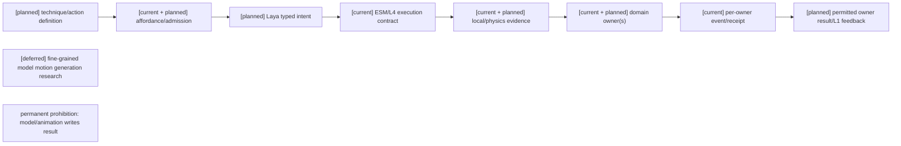
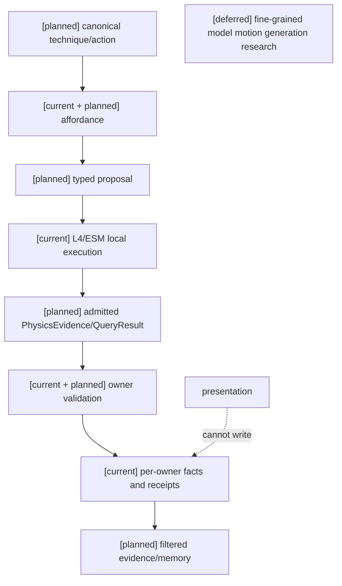
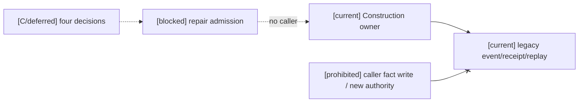
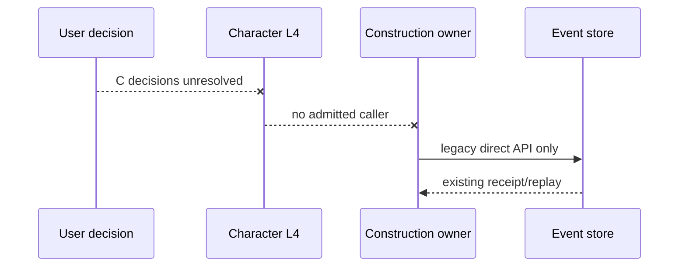
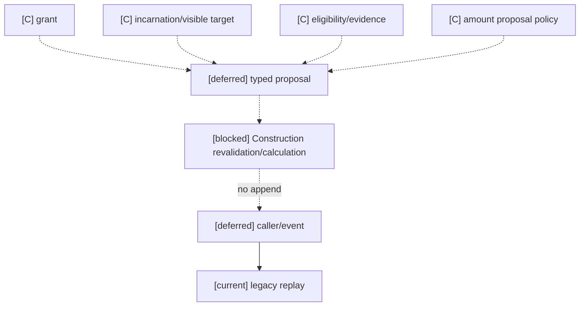

# 技法、动作、空间证据与非战斗结算适配规格

状态：`analysis/planned/non-authorizing`。动作合同服务任何已注册玩法；攻击、治疗、防御只是实例。

2026-10-15实施边界：计划04 Task1–2已按局部依赖启动，见 [阶段三实施回写](../回写/stage3-task1-task2-20261015.md)。本轮通用时间、batch/receipt与adapter admission切片没有准入新的技法、空间、物理或近战owner；本文Task4及领域执行仍待对应consumer证据。真实backend choice接线和L4合同诊断不构成动作命中、领域提交或Godot表现验收。

## 1. 来源追踪

| 分析源与章节 | 本文 | 验收 | 计划 |
|---|---|---|---|
| [战斗01](../战斗系统与角色技能，状态和资源/01-技法构筑、司命裁定与世界观规则计划.md) §1–9 | §2 | A01–A03 | 04/Task4 |
| [战斗03](../战斗系统与角色技能，状态和资源/03-攻防治疗招数数据与动作参数计划.md) §1–4、§4.1–4.3 | §3–4 | P01–P06 | 04/Task4 |
| [战斗05](../战斗系统与角色技能，状态和资源/05-效果通道、环境场与生命精神灵魂规则设计.md) §1–7 | §2–3 | A03 | 04/Task4 |
| [战斗07](../战斗系统与角色技能，状态和资源/07-战斗影响源、标签与跨维度效果设计.md) §6–8 | §2–3 | A02–A03 | 04/Task4 |
| [角色11](../角色/11-跨玩法动作承诺协议设计.md) 全文、[角色06](../角色/06-自身状态感知与具身反馈设计.md) | §2、§5 | A04–A06 | 角色计划02/07、04/Task4 |
| [角色16](../角色/16-通用玩法时序模型与编辑器设计.md) §2.3–2.4、§6 | §4 | A05–A06 | 04/Task1、4 |

## 2. 领域对象与 current/planned

| 对象/能力 | 状态与 owner |
|---|---|
| `action_window_runtime.py`, `action_graph_content.py`, `action_consequence_runtime.py` | `[current]` 局部 action window/graph/consequence 基础，不是完整 technique/action universal settlement |
| `ActionAttempt`、`CharacterExecutionContract`、ESM/L4 与 authority result | `[current]` 既有 transport/Character 执行与结果边界，见 `backend/app/models/embodied_interaction.py`、`backend/app/character_agent/models/character_execution.py` 和对应测试；不存在名为 `GameplayActionAttempt` 的代码类型，且现有合同不代表所有非战斗 owner 已接入 |
| 角色11定义的 typed action commitment 与跨玩法承诺扩展 | `[planned]` 复用既有 L4、CharacterActor、authority ingress/settlement；原文没有规定通用 `OutcomeEvidence` DTO 名称，实施前映射到 owner result 与角色反馈合同 |
| 战斗01/03定义的 `Technique`、`ActionPattern`、`EffectBinding` 与动作数据 | `[planned]` 由注册内容和对应领域 owner 提供，不新建第二 action authority |
| 空间物理 evidence/result attribution 完整接线 | `[planned]` 复用引擎/现有 evidence 与 domain owner；不是物理接触即命中 |
| arbitrary script action / model direct result writes | 永久禁止，不列为 deferred |

语义边界：Technique 是可学习/构筑能力语义；ActionPattern 是单次动作阶段结构；EffectBinding 是候选领域影响；跨玩法 typed commitment 是角色11规划的 intent/request/execution/result 承诺。结算由每个目标 owner 重验并提交，角色反馈复用其授权可见的 owner result/L1 projection。本文不规定新的通用 result DTO 名称。未知 canonical `semantic_action_id` fail-closed。

## 3. 动作、技法和多 owner 结算

准备、active/commit window、execute、interrupt、recover、complete 记录为执行阶段 evidence；时间坐标属于角色/16，不在动作域复制时钟。Laya/模型提出 typed intent；L4 与 CharacterActor 承接连续动作和表现；表现完成不代表 settlement 成功。

Technique 的攻击/防御/治疗只是模板；来源、传递、通道、结算四轴独立。结果要区分 `miss/dodge/parry/block/immunity/invulnerability/mitigation/shield_absorb`；公式顺序由内容 policy 注册。效果/资源/状态/生命/关系等 owner 各自重验，复用角色16 batch contract；跨 owner 部分成功保留 receipt/event，进入 successor/recovery/补偿，不声称全局原子。

## 4. 战斗空间/物理 evidence adapter

精确保留原文对象：`Hitbox`、`Hurtbox`、`GuardVolume`、`PhysicsEvidence`、`QueryResult`、`ProjectileDefinition`、`ProjectileExecutionState`、`TrajectoryEvidence`、`ImpactAttribution`。空间 query semantic 包含 Area、Distance、LineOfSight、Cover、Reachability。不得缩写掉 `ProjectileExecutionState`。

`QueryResult` 包含 requester view 与缓存 key；迟到、重复、stale、不完整、不支持要可区分。authority 隐藏候选不泄露给 actor。PhysicsEvidence 生命周期：sampled→admitted→consumed→superseded/rejected/expired。effect dedup key 包含 action/effect/target incarnation/impact slot。

单位、坐标系、shape、骨架 attachment revision 和 sweep capability 明确 pin；batch 使用 frozen spatial read-set。空间查询预算与 effect max targets 不混同。Actor movement/physics evidence 不是 hit/damage truth；World/physics owner 负责连续运动/物理 evidence，combat content package 声明技法、target/effect/counterplay policy，对应 Resource/Status/Effect/Lifecycle/Target owner 提交事实。

投射物实体创建/销毁复用战斗10的 EntityPresence/admission/quota/lifecycle，不另造 projectile ledger。Siming 只出高层 catalyst；模型/Laya 只提出 typed intent。

## 5. 架构图



## 6. 时序图

```mermaid
sequenceDiagram
  participant C as Character mind/Laya proposal
  participant T as temporal/window owner
  participant L as ESM/L4 execution
  participant P as physics/evidence adapter
  participant A as action/domain owner
  participant D as dependent domain owner
  participant V as L1 filtered view
  Note over C,V: [current] ActionAttempt/CharacterExecutionContract/owner result; [planned] shared cross-gameplay commitment; [deferred] fine-grained model motion generation
  C->>T: request/pin action window
  T-->>L: admitted window and revisions
  C->>L: typed intent
  L->>P: local action and evidence sampling
  P-->>A: provenance-bearing evidence, not hit truth
  A->>A: revalidate target/action/source
  A-->>L: result and owner receipt
  L->>D: dependent effect/resource request with receipt
  D-->>L: accepted/rejected/unknown receipt
  L-->>V: actual committed outcome and completeness
```

## 7. 数据流图



## 8. 验收

| ID | 案例 | 期望 |
|---|---|---|
| A01 | 未知/noncanonical action id | fail-closed，无执行或 owner event |
| A02 | combat 与开门/制作/救援共用 action contract | 非战斗不引入 combat type；owner route 各自结算 |
| A03 | model 声称伤害/治疗成功或 Siming catalyst | 只生成 typed intent，事实须 owner receipt |
| A04 | 中断/恢复/执行失败和动画完成 | phase evidence 准确；表现成功不能覆盖 owner reject |
| A05 | 两 owner 后者冲突/超时 | 前者 event/receipt 保留；查 receipt、successor/recovery |
| A06 | 窗口过期、source revision stale、权限撤销 | 重新验证后拒绝或重建 intent |
| P01 | miss/dodge/parry/block/immunity/invulnerability 等结果 | 分别保留，不折叠命中字段 |
| P02 | stale/late/duplicate/incomplete/unsupported QueryResult | 诊断不同，隐藏 authority 候选不泄露 |
| P03 | evidence sampled/admitted/consumed/rejected/expired | 生命周期可重放且重复 evidence 不重复效果 |
| P04 | incarnation 变化/多个 impact slot | dedup key 正确隔离 |
| P05 | unit/space/skeleton revision 不匹配，超 query budget | 拒绝/受限；不混淆 target budget |
| P06 | ProjectileExecutionState 重放与 EntityPresence | 复用 lifecycle owner，无第二 ledger |

2026-10-16 Task4 非战斗设施维修审查：Construction 是设施 condition owner，已有 repair/compensation event、receipt 和 replay；但 backend/app 无维修实际 caller，角色动作登记/L4 路由与 owner 对 actor、grant、时间/read pins 的重验也未成立。依 A01–A06 闸门停止实施，P01–P06 均未启动；矩阵和三图见[Task4 审查](../回写/stage3-task4-construction-audit-20261016.md)。

## 9. 关联

战斗01/03/05/07/10；[角色06](../角色/06-自身状态感知与具身反馈设计.md)、[角色07](../角色/07-传统游戏AI感知与Boss战思考模式设计.md)、[角色11](../角色/11-跨玩法动作承诺协议设计.md)、[角色16](../角色/16-通用玩法时序模型与编辑器设计.md)；计划04 Task4。动作空间 evidence 不能被解释为战斗唯一语义。


## 本批规格与计划回写：Action 时间接口（2026-10-16）

本轮仅将角色16时间合同接入既有调查冲突 Action consumer；接口来源、冻结窗口、owner 权限/时间重验、receipt/Durable 恢复、旧事件兼容及激活规则统一见[规格09 Action 接口决定](../规格/09-通用时间权限投影与领域服务接入规格.md#action-consumer-接口决定2026-10-16计划04-task1)，当前实现/计划/禁止项三图及证据见[阶段三回写](../回写/stage3-task1-task2-20261015.md#action-consumer-时间接入2026-10-16)。owner 仍只拥有原调查冲突事实；case_death/终局事件不是其他角色动作的通用结果。该接线不代表完整 Laya→L4→物理→领域动作链，不启动 Task4、近战或物理执行。旧事件可回放不等于统一时间证据；测试配置与生产内容启用分开验收。

2026-10-16 Action 验证回写：现有 Stormnight caller 已经 RuntimeExecution/真实 envelope 接线至原 conflict owner/store；147 项允许列表 focused 通过，最后 caller 幂等修正后三文件21项通过，backend-contract 仅静态通过。完整事件/receipt/Durable新实例证据、兼容/激活边界、生产未配置与剩余 Task1 缺口见[阶段三 Action 最终结果](../回写/stage3-task1-task2-20261015.md)。准入 fingerprint 从历史事件恢复；配置变化无迁移即拒绝，旧 retry 保留 pins；不扩展原调查冲突终局语义。历史 Status pytest cleanup 与本轮 Action pytest cleanup 均 incomplete，Harness cleanup 单列 passed；历史 HTTP503 审查仍 incomplete。

## Task4 设施维修动作准入设计收口（2026-10-16）

状态：`analysis/planned/non-authorizing; facility repair blocked/not_verified`。A02–A06 的非战斗共用承诺须有已注册 `ActionDefinition`、角色可见目标、有效 grant/affordance、L4 冻结承诺及 Construction owner 重验。既有 `CharacterSkillRegistry` 是动作定义来源，但当前 L3 以 `_candidate_semantic_action` 内置映射生成 `semantic_action_id`，缺已登记、版本化的绑定接口；Gameplay `SemanticRegistry` 不登记此动作，Construction command type 与 `inf:construction-facility-repair@1` 也不是 canonical `semantic_action_id`。具体维修 id、route 和 caller 均未获准。

`[current]` Construction 拥有 condition、direct repair/compensation、event/receipt/idempotency/project replay；角色 L4 合同保留 actor、target、source、revision vectors 与幂等身份。`[planned]` 在既有 registry/owner 范围内定义设施 typed proposal、可见 target、当下 affordance、timeline/profile/mapping/window 与 source/read/evidence pins、Construction 提交前重验及旧 direct API 兼容。维修增量只能由 Construction 依据获准的版本化规则计算，模型数值只是提案。`[blocked]` 维修 grant 来源及撤销、设施 incarnation、可见目标隐私接线、维修资格与数值 policy 尚无足够依据，不得以默认值补齐。`[deferred]` 本切片无另行延期能力；P01–P06 和其他 Task4 动作属于独立未启动范围。`[prohibited]` 新 semantic action registry、隐含 target/grant/affordance、模型或表现写 condition、借物理 `ActionAttempt` 伪造接触证据。

十项 A/B/C 判定、接口草案、责任矩阵、迁移边界、九项实施前置及区分 current/planned/blocked/prohibited 的[架构、时序、数据流三图](../回写/stage3-task4-construction-audit-20261016.md#2026-10-16-动作准入设计收口仅设计未实施)是本节的正式伴随设计。A 类局部 owner API 不解除整链 blocked。A01–A06 在 facility repair 上均未验证，Task1 调查冲突 Action 时间接线不能作为维修时间证据。

### 四项 B/C 决策登记（2026-10-16）

四项仍为 **C：正式 deferred**：repair grant 的签发/撤销/owner；facility incarnation、角色可见性与 target admission；repair affordance 与资格政策；`repair_amount` 的 proposal/Construction owner calculation 边界。现有 API 只能证明局部 owner 事实和原则，不能进入 A/B。2026-10-18 产品政策授权更正：用户已将全部产品政策决定权委托本代理，本次决定是在缺少真实维修 target/grant/evidence/calculation 来源期间继续 deferred，不创建 caller 或 repair event。替代方案是待真实版本化维修能力来源、facility identity/target view 与 Construction 计算输入存在后，按原 A01–A06、Task6 矩阵接线。解除条件、责任矩阵和阶段状态见[阶段三正式收口](../回写/stage3-task4-construction-audit-20261016.md#bc-阻断正式收口四项待用户决策-2026-10-16)及[当前阶段三政策选择](../回写/stage3-closure-20261016.md#2026-10-18-product-policy-decision-and-source-boundary-r86)。不得创建默认 grant/资格、隐含 target 或让 caller 写 `repair_amount`/`next_condition`。

#### Architecture diagram



#### Sequence diagram



#### Data-flow diagram



三个图只描述当前 owner 兼容面、拟议接口边界及 deferred 阻断，不授权 runtime 实施。

### 阶段三 Task4 动作 owner 审查同步（2026-10-16）

设施维修继续沿 RW-40 保持 C/deferred，不创建 synthetic caller、grant、target 或 repair event。现有 Conflict action owner、空间/source revision 校验和 `ActionConsequenceBoundary` 仅构成可复用 A 类边界，不等于非战斗动作完整 caller→owner→store 验收；详见[Task4/Task5 回写](../回写/stage3-task4-construction-audit-20261016.md)及[Task5 owner 审查](../回写/stage3-task5-lifecycle-audit-20261016.md)。

## 阶段三最终门禁同步（2026-10-16）

Conflict action 的窄范围 owner receipt/replay 边界保持 current；facility repair 沿 RW-40 为 C/deferred，P01–P06 及其他物理 owner 无具名 caller/admission，正式 deferred。任何新动作须具名 L4 route、grant/target/evidence/time pins、owner revalidation、receipt、Durable/full-tail 与 privacy/revocation 后才可重开。

### 2026-10-17 当前状态校正

Task4 可继续核查和实现有事实来源支持的现有 action consumer；facility repair 仍受四项产品决策约束，未经决定不创建维修 caller 或事件。P01–P06 无真实 physics/evidence owner admission，保持 not_verified/deferred。当前授权与逐项状态见[阶段三总收口审查](../回写/stage3-closure-20261016.md#2026-10-17-逐项验收编号矩阵与产品决策包)；早期“Task5/6 未启动”文字不再是当前执行限制。


Task4 可继续核查和实现有事实来源支持的现有 action consumer；facility repair 仍受四项产品决策约束，未经决定不创建维修 caller 或事件。P01–P06 无真实 physics/evidence owner admission，保持 not_verified/deferred。当前授权与逐项状态见[阶段三总收口审查](../回写/stage3-closure-20261016.md#2026-10-17-逐项验收编号矩阵与产品决策包)；早期“Task5/6 未启动”文字不再是当前执行限制。
