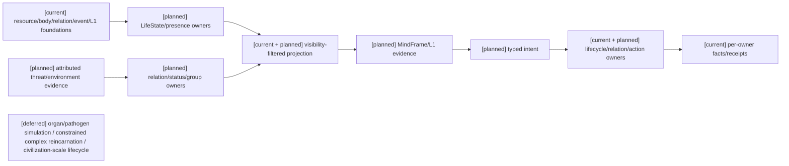
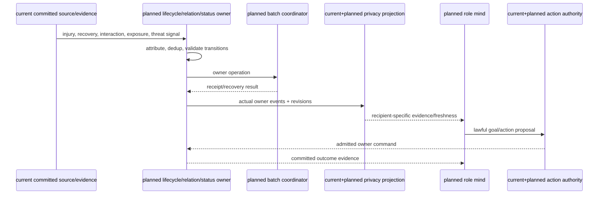
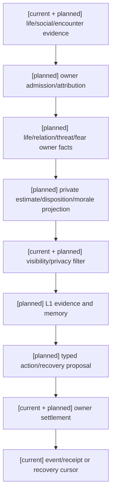
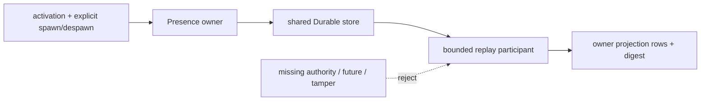
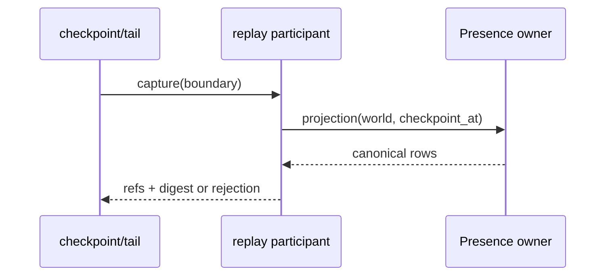
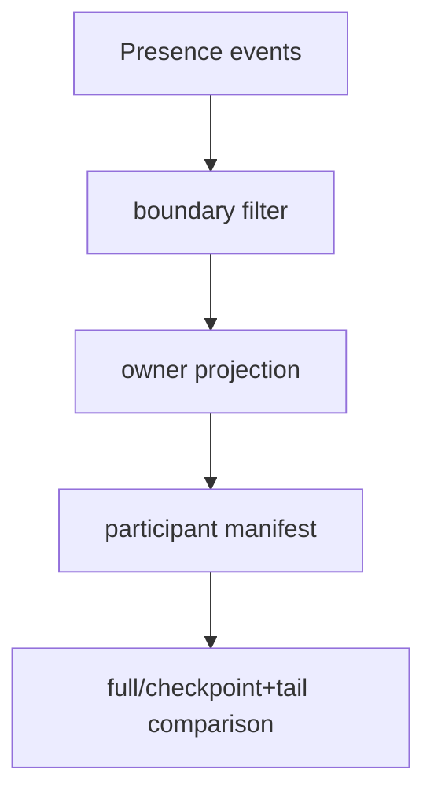
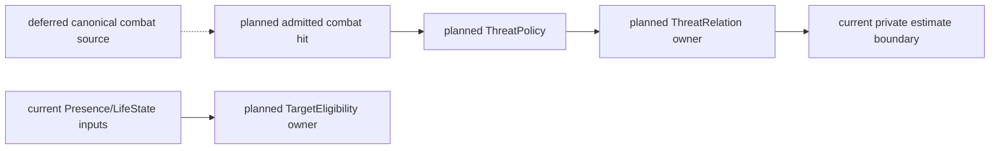
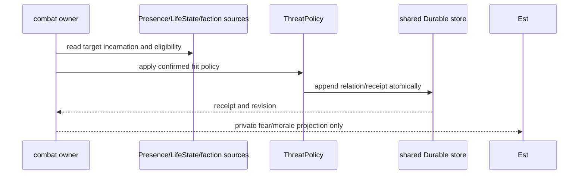
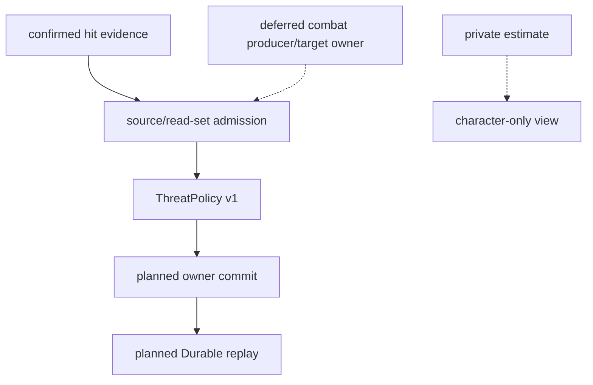

# 生命连续性、关系状态与动态行为规格

状态：`analysis/planned/non-authorizing`。生命、身体、关系可被战斗、日常工作、旅行、社交、灾害与恢复消费；Threat 等命名保留其原始 encounter 语义。

2026-10-15实施边界：计划04 Task1–2已按局部依赖启动，见 [阶段三实施回写](../回写/stage3-task1-task2-20261015.md)。本轮两个owner batch adapter不包含生命、presence、灵魂或关系写口；真实soul结果仍等待相应owner/API准入，角色侧继续保留缺owner拒绝。该缺口只阻断依赖soul结果的consumer，不反向成为时间、receipt恢复或其他独立通用后端合同的开工前置。

## 1. 来源追踪

| 分析源章节 | 本文 | 验收 | 计划 |
|---|---|---|---|
| [战斗09](../战斗系统与角色技能，状态和资源/09-战斗动态原语、关系状态与战斗倾向设计.md) §1–5、§7–8 | §4 | D01–D08 | 04/Task5 |
| [战斗09](../战斗系统与角色技能，状态和资源/09-战斗动态原语、关系状态与战斗倾向设计.md) §5.1、§7.3 | §4–5 | D05–D08 | 04/Task2、5 |
| [战斗10](../战斗系统与角色技能，状态和资源/10-生命状态、伤势与死亡连续性设计.md) §1–8、§6.1–6.3 | §3、5 | L01–L09 | 04/Task5 |
| [战斗05](../战斗系统与角色技能，状态和资源/05-效果通道、环境场与生命精神灵魂规则设计.md) §5–8 | §3 | L03–L06 | 04/Task3、5 |
| [角色06](../角色/06-自身状态感知与具身反馈设计.md)、[角色08](../角色/08-游戏AI启发下L1-L4架构增强设计.md)、[编辑器04](../编辑器与能力权限治理/04-十月分析领域接入与编辑器同步矩阵.md) §2、§4 | §3–5 | L04、D06 | 04/Task5、05/Task5 |

## 2. 当前实现边界

| 状态 | 现有证据 | 限制 |
|---|---|---|
| `[current]` | `resource_body_runtime.py` 的资源/BodyInjury；`continuity.py` RuntimeContinuityState；`shared_contracts.py` RelationshipRecord/CausalEventRecord；角色 `memory/social_memory.py`、L1 与 affect/personality projections | 基础伤势、私有 social trust/suspicion、关系记录、event/revision/projection 可复用；不是本规格完整 LifeState、ThreatRelation 或群体 morale 链 |
| `[current]` | `test_world_runtime_continuity.py`、`test_character_agent_relational_memory.py`、`test_gameplay_event_replay.py` | 对应基础行为，不证明完整生命/动态系统存在 |
| `[planned]` | 本文 §3–5 的完整 life/presence/dynamic contracts 与投影 | 每种事实按 owner admission 增量实现 |
| `[deferred]` | 战斗10 §1、§6.3；战斗05 §8 | 器官级生理、病原体生态、受规则约束的复杂转生/灵魂连续性、文明级死亡、大规模自治群体及已授权跨世界迁移 |

不得把战斗09 §8 明确未实现的完整 `ThreatRelation/FearCondition/BattleDisposition/MoraleState` chain 标为 current。

角色前置策略已收敛为 [D11](../审查/03-实施待决收敛与验证闸门.md)：角色基础闭环先行；当前没有真实 owner 的 LifeState/EntityPresence/SoulAccessGate 只能沿现有 readiness/diagnostic 接点表示不可用并经过角色私有过滤，不能创建伪 gate 结果、隐形资源或从字段缺失推导 alive/safe。具体投影字段由实际模型映射审定，不在本规格臆造 wire 协议。计划04准入真实 owner 后，回到角色的感知、表达和决策进行集成验收。此顺序不取消本文 planned 交付，也不要求 B/C 的每个普通场景都启用完整灵魂规则。

第五项的实际代码、测试、owner 和证据映射见 [审查07](../审查/07-第五项Life-Presence-Soul真实owner与角色投影边界.md)。补充核对确认：survival、profile activation、entity causal projection 和角色 continuity/L1 都是可复用基础或局部 owner，不构成完整 LifeState、EntityPresence 或 Soul/identity owner；未找到可提交灵魂事实的代码路径。缺 owner 时只能输出权限过滤后的 unavailable/diagnostic，不能把未知当作 alive、safe 或 Soul allow。

## 3. 生命与 entity continuity

原文生命状态集合为 `Alive, Impaired, Downed, Dying, Unconscious, DeadPending, Dead, Reviving, Revived, Despawned`。world package 可声明子集和合法转换；删掉状态须有 scoped profile 依据，不能称完整 canonical set。

LifeState、injury、disease、metabolic damage、exposure、recovery、death/revival 和 soul continuity 是不同轴。`health==0` 不自动等于死亡；死亡不等于 soul continuity 归零。状态转换记录 from/to/cause/lethal basis、health/injury/mind revisions、recovery/revive policy、encounter/phase、authority event、projection revision。

Spawn admission 与 EntityPresence/incarnation/quota 分开。准备目标的 required components、adapter receipts 后才 activation；prepared inactive object 不能行动。默认新增 actor append 独立身份，不能用 asset/package registration 或 active-control selection 隐式替换现有 actor。Despawn 为 retiring→close admission→owner cleanup→receipt→engine deletion；tombstone 支持 retry。已存在 actor summon/control 与 clone 新身份不同。Replay 重建不重复扣费/spawn/通知。

## 4. 关系和 encounter dynamic primitives

| 原语 | 语义与提交/投影边界 |
|---|---|
| `ThreatSignal` | 有来源/归因/单位/因果链/revision 的输入证据，不直接改状态 |
| `ThreatPolicy` / `ThreatValueDefinition` | 权重、聚合、衰减、转移、reset、cap、稳定排序政策；planned definition |
| `ThreatRelation` | subject→target 的已提交 pressure relation，由其 owner 结算 |
| `ThreatEstimate` | 带 freshness 的角色私有估计，由可见 evidence 推导 |
| `TargetEligibility` | 当前是否允许成为 action target，归 target/lifecycle owner |
| `TargetLock` / `ForcedTargetConstraint` | 选择约束/强制关系，不能与 threat 数值合并 |
| `FearCondition` | 由 status/effect owner 结算的个体条件，不是纯视图 |
| `BattleDisposition` | 个体选战/退倾向的私有 derived view；尊重能力/人格/行动可行性 |
| `MoraleState` | 群体聚合；持久后果须 admitted group/status owner |
| `ProtectionRelation` | protection/免攻击关系由相应 target/relation owner 控制 |

更新顺序：已提交结果/环境 evidence→归因/去重→ThreatSignal→ThreatPolicy 聚合/衰减/转移→新 ThreatRelation/eligibility revision→私有 L1 estimate。Threat/Fear/Morale 不能笼统地全当 view；它们的 owner 语义不同。ThreatPolicy 不扣资源/施 effect/LifeState。

稳定排序不得依赖模型输出、字典/物理返回/网络到达顺序。target eligibility、target lock、forced constraint 独立；transfer/encounter reset 与事件因果明确。队伍通信/群体 morale 依权限与可达性，不复制秘密估计。

## 5. 批次、权限与投影

重用角色16 §2.4 `BatchSettlementPlan`/`OwnerCommitReceipt`/recovery cursor。跨 owner 失败保留既有已提交事实；采用 receipt query、有界 retry、successor plan 或 owner-admitted compensation，不承诺全局 rollback。死亡/伤害已提交后不因后续阶段失败而抹除。

角色只能从 recipient-specific L1 收到身体、关系、ThreatEstimate 等带来源/freshness/confidence/visibility 的 evidence；不能由后台改 belief。editor 改定义/profile，角色和 Siming 走 typed intent/catalyst。Stable 定义与规则；Hot 当前 injury/life/eligibility/threat facts；Delta event refs/invalidation/replay。隐私过滤先于 cache。

## 6. 架构图

## 7. 时序图

## 8. 数据流图

## 9. 验收

| ID | 案例 | 期望 |
|---|---|---|
| L01 | complete life-state transitions incl Impaired/Unconscious/Revived | 只走注册边；状态事件 revision 完整 |
| L02 | health zero 与 lethal basis 不同 | 不自动死亡 |
| L03 | wound/disease/metabolic/exposure/recovery 与 damage | 区分状态和 damage event |
| L04 | death/revive/soul access | continuity 和 gate 独立；未经 gate 不改灵魂事实 |
| L05 | spawn prepare missing adapter/component | admission 拒绝；inactive prepared 不能行动 |
| L06 | append actor/active-control/asset registration | 默认新 identity；不能替换原 actor |
| L07 | despawn owner timeout、cleanup retry、tombstone | admission 已关；receipt query 后幂等收敛 |
| L08 | summon existing vs clone; replay | identity/费用/通知不重复 |
| L09 | 生命周期跨 Resource/Soul/Status owner 部分失败 | 已提交保留、receipt-driven recovery/compensation |
| D01 | repeated/out-of-order threat signals | attribution/dedup/stable sort 可重放 |
| D02 | ThreatRelation vs private ThreatEstimate | committed owner fact 与 recipient estimate 分开 |
| D03 | FearCondition/Fear projection | status/effect fact 与私有推断不同 |
| D04 | Morale aggregate with persistent consequence | group aggregate 与 status owner 分开 |
| D05 | target eligibility/lock/forced target invalidation | action recheck 后重选/拒绝 |
| D06 | private relation/threat view to another recipient | 不泄露、revoke 清 cache |
| D07 | transfer/encounter reset/phase | 按政策迁移/清零且带 cause/revision |
| D08 | group communication unreachable | 未收信息不进入估计/决策 |

关联[战斗09](../战斗系统与角色技能，状态和资源/09-战斗动态原语、关系状态与战斗倾向设计.md)、[战斗10](../战斗系统与角色技能，状态和资源/10-生命状态、伤势与死亡连续性设计.md)、[战斗05](../战斗系统与角色技能，状态和资源/05-效果通道、环境场与生命精神灵魂规则设计.md)、[角色06](../角色/06-自身状态感知与具身反馈设计.md)、[角色08](../角色/08-游戏AI启发下L1-L4架构增强设计.md)、编辑器04；计划04 Task5。

### 10.1 第五项 owner 核对回写（2026-10-11，D18/RW-19）

审查07逐项记录 `resource_body_runtime.py`、`survival_runtime.py`、`ProfileActivationAuthority`、`EntityCausalProjection`、`RuntimeContinuityState`、角色 L1/MindFrame 和现有 receipt/replay 测试的范围。它们分别证明资源/BodyInjury、survival 状态、population activation、只读因果投影和角色连续性基础，不证明完整 LifeState、EntityPresence、死亡/复活、spawn/despawn、incarnation、SoulContinuity 或 `SoulAccessGate`。

本批保持角色基础先行：owner 未准入时，角色只接收权限过滤后的 unavailable/diagnostic 和 blocker；真实 owner 取得 admission 后再把 owner receipt/replay 转为 recipient-specific 感知、表达和决策输入。该顺序不改变原设计的 Life/Presence/Soul planned 目标，且不把完整 Soul 验收作为角色基础开工前置。

### 阶段三 Task5 owner 审查同步（2026-10-16）

当前代码提供 `RuntimeContinuityState`、角色私有 relational memory、动作结果 source validation，以及本次设计并实现的 `PopulationPresenceAuthority` owner API。`PopulationActivationPresenceService` 和 `submit_population_activation_presence` 已形成受既有 Population grant 约束的应用 caller→activation→presence→shared store 路径；该 caller 只接受 project-visible Population proposal，不签发身份或 grant。Soul/identity、ThreatRelation/TargetEligibility/Fear/Morale/Protection 仍没有具名事实 owner/API，正式 deferred。不得由 survival、activation、标签或模型输出充当生命事实。实现、恢复与三图边界见[Task5 owner 审查回写](../回写/stage3-task5-lifecycle-audit-20261016.md)。

#### 2026-10-17 关系事实来源更正

P5 `SocialFactAuthority.resolve/view_for` 已有 directed relationship/knowledge facts 与 recipient visibility/revocation；`record_admitted_platform_social_relationship` 已有 package-bound shared identity relationship 的 owner/API、receipt 和 projector，但仅找到测试 caller，无生产接线，且不支持关系状态更新/结束。它们不是 ThreatRelation 动态 owner，也不是进程内 CharacterRelationalMemory 的客观化。D06 可复用该隐私基础，仍须实现目标 threat/private-estimate contract 后验收。L01–L09、D01–D08 整体仍未通过。此处原文“产品政策由用户决定”为当时状态记录，现由 2026-10-18 产品授权更正和 Task5 当前政策选择覆盖。

2026-10-17 当前状态校正：P5 Social owner 的 Durable close/reopen、receipt、exact/changed duplicate 与 revoke/checkpoint re-execution parity 已验证；不等于应用级 checkpoint+tail 或生产 identity caller。早期“本轮不启动 Task5/6”文字不覆盖用户当前授权。按本次授权，可先基于来源形成职责、权限、事件、恢复和验收设计，再实施有足够语义依据的正式 owner。

### 2026-10-18 Task5 当前政策选择

用户已将全部产品政策决定权委托本代理。本次选择为：Presence 与 LifeState 在语义上正交；profile activation 只证明 profile 在指定 world scope 的激活事实，不证明实体存在、死亡、soul continuity 或目标资格；health=0 不代表死亡；shared Social facts 与 actor-private estimates 保持隔离。依据该政策，本次设计并实现 `PopulationPresenceAuthority`：它要求 project-visible Population activation，显式提交 spawn/despawn，重新出现分配新 incarnation，并复用现有 `GameplayEventStore`、receipt、Durable 与 replay 责任。当前已有 `PopulationActivationPresenceService` 应用 caller 和正式 `main.py` 提交入口，证明 bounded caller→owner→store；仍缺生产调度器对该入口的业务 proposal 来源、adapter cleanup owner 及全 Task5 证据，因此不能把 focused tests 当作完整 Task5 验收。SoulAccessGate、Threat/target/Fear/Morale source 仍缺失，L01–L09/D01–D08 继续 `not_verified/deferred`。该政策由本次代理决定，不是待用户审批；运行时验收缺失仍阻止 Task5/Task6 总门禁。

### 2026-10-18 Presence replay participant correction

`PopulationPresenceAuthority.projection(world_ref, checkpoint_at=...)` 现为 replay participant 的实际重建 API。checkpoint/tail 只读取 boundary 内的 Presence event refs，并按每个 world 调用该 owner projection，随后核对 rows、event refs 与 `view_digest`；authority/store 不一致、缺失 authority、未来事件或篡改均 fail-closed。该改动复用既有 Durable `GameplayEventStore`，不新增 replay truth、clock 或 scheduler。

本次 focused 35 项通过只证明 owner/replay participant 合同与 Durable 新实例行为，不解除真实 Population grant issuer/caller、Soul/Threat/Target/Fear/Morale 来源缺口。

## 2026-10-19 Task5 产品政策与当前 owner 边界更正

用户已批准 ThreatPolicy：仅受信 confirmed combat hit 产生 Threat，实际伤害按 1:1 整数累计；不衰减、不跨 encounter；encounter 结束清零；并列按 canonical `actor_ref` 排序。TargetEligibility 由 combat owner 根据 Presence、LifeState 和敌对阵营判定，并在提交前重验 target incarnation、scope 与 source revisions。Fear/Morale 继续只做角色私有估计。该政策解除数值/语义决策缺口，但没有制造真实 combat event producer 或 world/admin source。

当前 `settle_street_combat` 仍是 bounded embodied demo，使用进程内状态，不能作为 canonical Threat/Target 来源。任何持久 adapter 必须先完成 source admission，再以同一既有 store 原子记录 owner receipt；不得出现内存事实已提交而 Durable 记录失败的不可恢复窗口。Soul/identity、客观关系事实和完整 Target/Threat owner 继续 not_verified/deferred。

